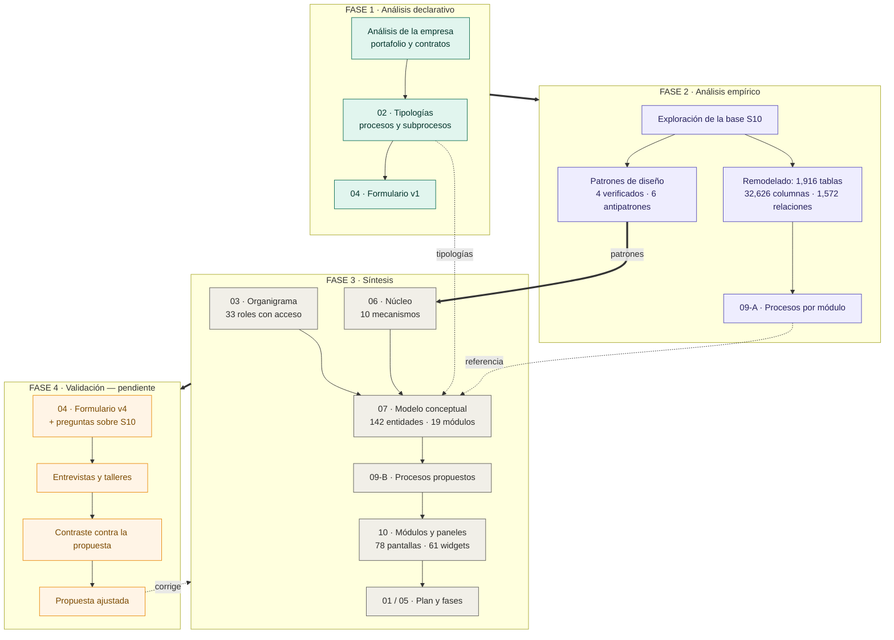

# Techquk S.A.C. — Programa de Ordenamiento Organizacional y Sistemas de Gestión (ERP + CRM)

**Versión:** 2.0 · Agosto 2026
## Resumen ejecutivo y guía de lectura

| Campo | Detalle |
|---|---|
| **Documento** | 00 — Resumen ejecutivo y guía de lectura |
| **Programa** | Ordenamiento Organizacional y Sistemas de Gestión (ERP + CRM) |
| **Dirigido a** | Gerencia General / Dirección |
| **Elaborado por** | Analista Funcional y Desarrollo — Proyecto ERP/CRM |
| **Fecha** | Agosto 2026 |
| **Versión** | 1.0 — Para revisión y aprobación |
| **Estado** | Propuesta ejecutiva |

---

## Registro de cambios

| Versión | Fecha | Cambios |
|---|---|---|
| 1.0 | Ago 2026 | Versión inicial: seis fases, 16 módulos |
| **2.0** | **Ago 2026** | **Nueve fases con núcleo y contratos · estimaciones con el equipo real · D5 resuelta · tres pendientes nuevos** |

`[S]` Los cambios salen de dos contrastes posteriores a la v1.0: el análisis de la base de datos
del ERP S10 que Techquk opera desde julio, y la revisión del modelo contra el organigrama del
documento 03.

---

## 1. Propósito de este documento

Este paquete documental responde a tres preguntas que la Gerencia necesita resolver **antes** de invertir en software:

1. **¿Qué vamos a construir?** El alcance, la arquitectura y las fases del ERP y el CRM propios de Techquk.
2. **¿Sobre qué realidad lo vamos a construir?** El mapa de los proyectos que ejecuta la empresa, descompuesto en procesos, y la estructura organizacional que debería soportarlos.
3. **¿Cómo obtenemos esa realidad de forma confiable?** El **Formulario de Levantamiento Organizacional y Funcional**, instrumento con el que capturamos de cada colaborador qué hace realmente, con qué información trabaja y qué decide.

La tesis central del programa es simple y conviene dejarla explícita:

> **No se automatiza lo que no está definido.** Un ERP construido sobre procesos no documentados replica el desorden actual a mayor velocidad y costo. Por eso el primer entregable del proyecto no es código: es el mapa de la empresa.

---

## 2. Situación de partida

Techquk S.A.C. (RUC 20487913791, Chiclayo, Lambayeque) opera desde 2012 como integrador tecnológico, con actividad registrada en comercio de equipos de cómputo y telecomunicaciones (CIIU 4741 principal, 4652 secundaria), servicios de tecnología de la información (CIIU 6209) y construcción (CIIU 4100). Está inscrita en el **Registro Nacional de Proveedores (RNP)** para contratar con el Estado y registrada en **REMYPE**. Su portafolio público comprende nueve líneas de solución (seguridad ciudadana, seguridad electrónica, infraestructura TI, IoT industrial, telesalud, plataformas en nube, colaboración, audio y video profesional, ciberseguridad) sobre tres verticales declaradas: **Gobierno, Educación y Salud**, con alianzas de marca de primer nivel (Axis, Cisco, Siemon, Furukawa, Rittal, Garmin).

Esa complejidad de portafolio contrasta con una estructura reducida (orden de 8 a 12 personas). El resultado observable es el patrón típico de la MYPE técnica en crecimiento:

| Síntoma | Consecuencia operativa | Consecuencia económica |
|---|---|---|
| Una misma persona cubre 3–5 funciones sin frontera definida | Cuellos de botella y dependencia de personas clave | Riesgo de continuidad; imposible delegar |
| La información vive en Excel, WhatsApp y correo personal | No hay una sola fuente de verdad | Se pierden oportunidades y trazabilidad de costos |
| No se conoce el margen real por proyecto hasta el cierre (o nunca) | Se cotiza por intuición | Erosión silenciosa de rentabilidad |
| El seguimiento comercial depende de la memoria del vendedor | Oportunidades sin seguimiento | Ingresos no capturados |
| El proceso de importación y nacionalización no tiene dueño formal | Retrasos en entrega, sobrecostos logísticos | Penalidades contractuales, capital inmovilizado |

> **Nota de validación:** los registros públicos de SUNAT muestran la condición *"Actividad de Comercio Exterior: SIN ACTIVIDAD"*, lo que sugiere que el abastecimiento importado se canaliza mediante terceros (mayoristas/importadores locales o agentes). Este punto debe confirmarse con Gerencia porque **determina el diseño del módulo de abastecimiento y del costeo de importación** (ver documento 02, tipología T5).

---

## 3. La propuesta en una línea

> Construir un **ERP y un CRM propios**, ajustados al modelo de negocio de Techquk (proyectos de integración + suministro + servicios recurrentes, con canal público y privado), tomando como insumo de diseño un **levantamiento formal de funciones, procesos y decisiones** realizado a todo el personal, y aprovechando ese mismo levantamiento para **rediseñar la estructura organizacional**.

Un solo esfuerzo, tres resultados: **empresa ordenada, sistema pertinente, personas con rol claro.**

---

## 4. Beneficios esperados

| Dimensión | Situación actual | Situación objetivo |
|---|---|---|
| **Comercial** | Oportunidades en la cabeza del vendedor | Embudo único, con etapas, responsable y probabilidad |
| **Licitaciones** | Seguimiento manual de convocatorias | Registro de participaciones, resultados y aprendizaje de precios |
| **Proyectos** | Avance informal | Cronograma, hitos, actas y valorizaciones en un solo lugar |
| **Costos** | Margen estimado | Margen real por proyecto, con costo de importación incluido |
| **Postventa** | Atención reactiva por WhatsApp | Tickets con SLA, garantías y contratos de mantenimiento vigentes |
| **Organización** | Funciones superpuestas | Catálogo de roles, matriz RACI y niveles de autorización |
| **Gerencia** | Reportes armados a mano | Tablero con indicadores de venta, ejecución y cobranza |

---

## 5. Estructura del entregable

Este documento es la portada de un paquete de **diecisiete documentos y once archivos de
datos**, organizados en tres carpetas.

### 5.1 Metodología y resultados — el diseño

| # | Documento | Responde a | Audiencia | Ver. |
|---|---|---|---|---|
| **00** | Resumen ejecutivo *(este)* | ¿Qué se propone y por qué? | Gerencia | 2.0 |
| **01** | `01-Plan-ERP-CRM.md` | ¿Qué sistema, con qué alcance, fases y esfuerzo? | Gerencia + TI | 2.1 |
| **02** | `02-Proyectos-y-Procesos.md` | ¿Qué hace Techquk? Seis tipologías y sus procesos | Gerencia + Jefaturas | 2.0 |
| **02-A** | `02A-Procesos-Recursos-Humanos.md` | Los ocho procesos de personal | Gerencia + RRHH | 2.0 |
| **02-A** | `02A-Anexo-Flujogramas-RRHH.md` | Los mismos, en diagrama | RRHH | 2.0 |
| **03** | `03-Organigrama-Propuesto.md` | ¿Cómo organizarse? Seis gerencias, 33 roles | Gerencia | 1.0 |
| **04** | `04-Formulario-Levantamiento.md` | El formulario íntegro, 95 preguntas | Todo el personal | 4.0 |
| **04-A** | `04A-Metodo-de-Levantamiento.md` | Cómo se aplica y qué produce cada sección | Analista + Gerencia | 1.0 |
| **05** | `05-Plan-Construccion-Tecnica.md` | Fases, antipatrones, criterios de salida | TI | 2.1 |
| **06** | `06-Arquitectura-Nucleo-Datos.md` | Los diez mecanismos, tabla por tabla | TI | 2.0 |
| **06-A** | `06A-Arquitectura-Explicada.md` | Lo mismo, sin tecnicismos | Gerencia + Jefaturas | 2.0 |
| **07** | `07-Modelo-Conceptual-Completo.md` | Las 142 entidades de los 19 módulos | TI | 2.2 |
| **08** | `08-Detalle-Columnas-y-Funcionamiento.md` | Columnas de cada entidad y cómo funciona el conjunto | TI | 2.0 |
| **09-A** | `09A-Procesos-S10-Actuales.md` | Los procesos que S10 ejecuta hoy | Gerencia + Jefaturas | 1.0 |
| **09-B** | `09B-Procesos-Propuestos-Techquk.md` | Los procesos propuestos, con flujogramas | Gerencia + Jefaturas | 2.1 |
| **10** | `10-Sistema-Modulos-Procesos-Paneles.md` | Módulos, 78 pantallas, paneles por rol, integraciones | Gerencia + TI | 2.1 |

### 5.2 S10 — el análisis del sistema actual

| Archivo | Contenido |
|---|---|
| `S10_firstSteps.md` | La exploración completa, hallazgo por hallazgo, con su consulta |
| `S10_arquitectura_completa.md` | Cómo está construida esa base: 1,916 tablas explicadas |
| `S10_mapa_relaciones.md` | Las 1,916 tablas con sus relaciones y la tabla referenciada |
| `S10_catalogo_tablas.csv` | Inventario: filas, columnas, dominio, referencias |
| `S10_diccionario_columnas.csv` | Las 32,626 columnas con su tipo |
| `S10_todas_relaciones.csv` · `S10_dbmodel_*.csv` | Las 1,572 relaciones, en dos formatos |
| `S10_todas_columnas.csv` · `S10_todos_indices.csv` · `S10_inventario_objetos_programables.csv` | Extracciones crudas del catálogo del sistema |

### 5.3 Contexto

`Techquk_Como_Funciona_la_Empresa.md` — el negocio explicado.

---

### 5.4 Lógica del flujo

El programa no siguió un orden de manual. Siguió el orden en que la información estuvo
disponible, y eso resultó ser una ventaja: **cada fase corrigió supuestos de la anterior.**

**Fase 1 — lo que la empresa declara.** El portafolio, los contratos, las seis tipologías y sus
procesos. `[S]` Material declarativo: describe cómo la organización se entiende a sí misma. No
se puede verificar contra nada.

**Fase 2 — lo que el sistema revela.** Se restauró la base del ERP que Techquk opera desde julio
y se analizó tabla por tabla. `[V]` Material empírico: no describe lo que alguien dice que hace,
sino lo que el sistema registró que ocurrió.

**Fase 3 — la síntesis.** Con los patrones de la fase 2 se construyó el núcleo; con el
organigrama y los procesos de la fase 1, el modelo, los flujos y el diseño de pantallas.

**Fase 4 — la validación, pendiente.** El formulario ampliado, las entrevistas, y el contraste
contra la propuesta. Lo que sobreviva al contraste es la propuesta ajustada a la realidad.

### 5.5 Por qué este orden resultó mejor que el previsto

`[S]` El plan original iba del formulario al mapa de procesos y de ahí al diseño. La base de
datos apareció en el camino y cambió el resultado en dos sentidos.

**Los patrones de diseño dejaron de ser opinión.** La tabla única de personas, la matriz de
aprobación parametrizable y el catálogo de tipos de transacción no se proponen porque suenen
bien: se observaron funcionando durante veintiséis años, con su retorno medido.

**Y aparecieron los errores que no se van a repetir.** `[V]` Seis antipatrones con evidencia
cuantificada — una llave primaria de once columnas, una tabla de 280 MB con 508 filas, seis
controles declarados y nunca alimentados.

`[V]` **El caso más ilustrativo:** de las nueve órdenes de compra emitidas en S10, **ninguna
pasó por un control capaz de detenerla**. Eso no se descubre preguntando.

### 5.6 Cuatro rutas de lectura

`[S]` Nadie necesita leer los diecisiete.

**Gerencia, treinta minutos.** Este documento, luego el 01, y de ahí su sección 8-bis sobre los
dos escenarios de alcance. Con eso alcanza para las decisiones que se le piden.

**Jefatura que valida su área.** El 02 para ver su proceso declarado, el 09-A para ver cómo lo
ejecuta S10 hoy, y el 09-B para ver la propuesta. La comparación entre los tres es lo que hace
productiva la sesión de validación.

**Desarrollo, antes de la primera línea de código.** El 05 para las reglas y los antipatrones, el
06 para el núcleo, el 07 para el modelo. El 08 como referencia de consulta.

**Quien quiera entender de dónde salen las decisiones.** `S10_arquitectura_completa.md` y luego
`S10_firstSteps.md`. Ahí está la evidencia de cada patrón que se propone.

### 5.7 Sobre las versiones

`[V]` Once documentos van en versión 2.0 o superior, corregidos tras analizar la base de S10 y
contrastar el modelo contra el organigrama.

`[S]` **Que dos tercios del paquete haya cambiado de versión no es señal de improvisación: es la
señal de que el contraste con la evidencia funcionó.** Los documentos que no cambiaron son los
que todavía no se han contrastado contra nada.

---

## 6. Lo que se solicita a la Gerencia

Este documento no pide presupuesto de licencias ni contratación externa. Pide **dos decisiones**:

| # | Decisión solicitada | Impacto si no se toma |
|---|---|---|
| **D1** | **Aprobar el levantamiento** y comunicarlo formalmente al personal como iniciativa institucional (no como evaluación de desempeño) | Respuestas ajenas a la realidad; el diseño se hace a ciegas |
| **D3** | **Validar el organigrama objetivo** del documento 03, incluidos los tres roles priorizados | La estructura de permisos y aprobaciones del sistema queda indefinida |

### Compromiso de tiempo del personal

| Actor | Dedicación |
|---|---|
| Cada colaborador | 25–40 minutos, una sola vez (formulario) |
| Jefaturas / responsables de área | 1 sesión de validación de 60–90 min |
| Gerencia | 1 sesión de cierre de 60 min para aprobar el mapa de procesos y el organigrama |

Es el costo más bajo que tendrá este proyecto y el de mayor retorno: cada hora invertida aquí evita semanas de reprogramación posterior.

---

## 7. Riesgos del programa y su mitigación

| Riesgo | Prob. | Impacto | Mitigación |
|---|---|---|---|
| Los procesos reales difieren entre lo declarado y lo ejecutado | Media | Alto | Contraste cruzado: formulario + revisión de documentos reales (cotizaciones, órdenes, actas) |
| Alcance del sistema crece sin control ("que también haga esto…") | Alta | Alto | Alcance congelado por fase; solicitudes nuevas van a lista de backlog priorizada |
| **Concentración funcional en una sola persona** | Alta | Alto | Que un desarrollador acompañe el levantamiento de su módulo; especificar una fase por delante; pruebas automatizadas como documentación |
| Dependencia técnica de una sola persona | **Baja** | Alto | Mitigada: tres desarrolladores con experiencia en el mismo stack |
| Resistencia al abandono de Excel | Media | Medio | Migración asistida y período de operación en paralelo por fase |
| Datos de clientes duplicados o inconsistentes al migrar | Alta | Medio | Etapa formal de depuración antes de cargar (ver documento 04, sección J) |

---

## 8. Hoja de ruta y equipo

`[V]` **El equipo real:** tres desarrolladores con experiencia previa en un ERP construido sobre
el mismo stack —Laravel, Filament, PostgreSQL— más un analista funcional. La Jefatura de
Desarrollo está vacante.

Las duraciones son estimaciones. Se manejan estas para cerrar números redondos, considerando esa
experiencia previa.

### 8.1 Las nueve fases

| Fase | Contenido | Duración | Entregable verificable | Ámbito |
|---|---|---|---|---|
| **F0** | Levantamiento y diseño organizacional | 2–3 sem | Mapa de procesos y organigrama aprobados | No se programa nada |
| **F1** | **Núcleo del sistema** ★ | 5–6 sem | Los diez mecanismos transversales operando | Base de todo |
| **F2** | Cuentas · Catálogo comercial · Personal | 3–4 sem | Cartera y catálogo cargados | CRM + ERP |
| **F3** | **Contratos** ★ · Proyectos · margen simplificado | 4–5 sem | **Alerta de penalidad diaria funcionando** | ERP |
| **F4** | CRM comercial: oportunidades, cotizaciones, licitaciones | 4–5 sem | Embudo comercial operando | CRM |
| **F5** | Abastecimiento, importaciones e inventario | 5–6 sem | Costeo de importación y stock confiable | ERP |
| **F6** | Administración y finanzas | 3–4 sem | Ciclo cerrado de contrato a cobro | ERP |
| **F7** | Servicios, SLA y suscripciones | 3–4 sem | SLA medido, renovaciones alertadas | ERP |
| **F8** | Horas de desarrollo y analítica | 2–3 sem | Margen completo e indicadores en línea | Transversal |

`[S]` **Las duraciones asumen los tres desarrolladores a dedicación completa.** Las fases 2 a 5
se acortan respecto de una estimación individual porque se reparten en frentes paralelos; la
fase 1 casi no, porque el núcleo no se divide bien entre tres personas.

### 8.2 Qué cambió respecto de la versión anterior

| Cambio | Motivo |
|---|---|
| **Se inserta F1, el núcleo** | Cuatro mecanismos atraviesan los diecinueve módulos. Construirlos dentro del CRM obliga a rehacerlos después |
| **Contratos entra antes que el CRM** | `[V]` Hay una penalidad registrada de **S/ 250,498.54**, superior al valor íntegro de cinco de los nueve contratos |
| **Importaciones sube y va con compras** | `[V]` **80 operaciones en 2024**; la entrega tardía se origina más en la llegada del equipo que en la instalación |
| De seis fases a nueve | El alcance pasó de 16 a 18 módulos tras revisar el organigrama |

### 8.3 El horizonte, según la dedicación autorizada

**Escenario recomendado — contabilidad y planilla en software especializado:**

| Dedicación del equipo | Horizonte |
|---|---|
| **Los tres a dedicación completa** | **6–8 meses** |
| Dos completos, uno al 50% | 7–9 meses |
| **Los tres al 50%** | **11–15 meses** |
| Un desarrollador a dedicación completa | 9–12 meses |

**Si se decidiera desarrollar contabilidad y planilla dentro del sistema:**

| Dedicación del equipo | Horizonte |
|---|---|
| Los tres a dedicación completa | **10–13 meses** |
| Los tres al 50% | **18–24 meses** |

`[S]` Esa segunda opción agrega 42 entidades al sistema y **traslada el riesgo tributario y
laboral del proveedor de software a Techquk**. Es la decisión de mayor impacto que queda
abierta. Detalle en el documento 01, sección 8-bis.

### 8.4 Dos advertencias sobre estos plazos

`[V]` **Los tres desarrolladores son también quienes entregan software a clientes.** El 55.3%
del portafolio son contratos híbridos, con frente de hardware y de software.

`[S]` Un equipo autorizado "al 100%" que en la práctica dedica el 40% produce el horizonte de la
fila del 50%, no el de la primera. Y el desvío se descubre en el mes cinco, cuando ya es tarde
para replanificar. **Lo que se pide a Gerencia no es elegir un plazo sino autorizar un
porcentaje explícito de dedicación, y medirlo.**

`[V]` **Y el cuello de botella no es el desarrollo sino la especificación.** Dieciocho módulos,
78 pantallas y 61 tableros tienen que ser especificados y validados por una sola persona. Tres
desarrolladores esperando definiciones van más rápido que uno, pero no más rápido de lo que
llegan las definiciones.

### 8.5 Sobre entregar por fases o todo junto

`[S]` La hoja de ruta contempla entrega por fases, y conviene mantenerlo aunque el equipo
permita ir más rápido, por tres razones:

**Cada fase apaga un módulo de S10.** El reemplazo por partes permite volver atrás si algo falla.
Un cambio de golpe, con dos años más de datos encima, no lo permite.

**El margen se ve desde el mes cuatro.** La fase 3 entrega margen estimado contra real con carga
manual de costos. Esperar al final significa que Gerencia no ve el indicador que originó el
proyecto hasta que termine.

**Y el alcance se controla mejor.** Con alcance congelado por fase, las solicitudes nuevas van a
una lista priorizada en lugar de expandir lo que ya está en construcción — que es el riesgo de
mayor probabilidad e impacto de la sección 7.

Detalle completo, criterios de salida y arquitectura técnica en el documento **01**.

---

## 9. Puntos pendientes de validación con Gerencia

Estos puntos están señalados a lo largo del paquete y condicionan el diseño:

1. ~~Modalidad real de abastecimiento importado.~~ **`[V]` RESUELTO: Techquk importa directamente.** El documento 03 registra 80 operaciones de importación en 2024, por USD 452.3 mil CIF, vía marítima por la Aduana del Callao y con dos agentes de aduana.
2. Peso relativo del canal público (SEACE / Catálogos Electrónicos de Perú Compras) frente al canal privado en la facturación anual. En términos simples: de cada 100 soles que factura Techquk, ¿cuántos vienen del Estado y cuántos de empresas privadas?
3. Existencia y estado de contratos recurrentes de mantenimiento o arrendamiento operativo vigentes. En términos simples: ¿hay clientes que le pagan a Techquk todos los meses, pase lo que pase?
4. Proveedor actual de facturación electrónica y viabilidad de integración. En términos simples: ¿con qué programa emiten las facturas hoy, y ese programa deja que otro sistema le hable?
5. Alcance real del Sistema de Gestión Integrado mencionado públicamente por la empresa (¿certificado, en implementación o declarativo?). En términos simples: la web de Techquk dice que la empresa tiene un sistema de gestión integrado. ¿Eso existe en papeles o es una frase de marketing?
6. Definición de quién ejercerá el rol de patrocinador del programa. ¿quién es el jefe de este proyecto? No quién lo programa, sino quién manda.
7. **¿Contabilidad y planilla se integran con software especializado o se desarrollan dentro del sistema?** En términos simples: ¿el ERP le manda los datos a un programa contable, o el ERP también hace la contabilidad? La diferencia es de 4 a 5 meses de trabajo y de quién asume el riesgo si un cálculo tributario sale mal.
8. **¿Qué porcentaje de dedicación se autoriza para los tres desarrolladores?** En términos simples: ¿cuánto de su tiempo se dedica a este proyecto y cuánto sigue en entregas a clientes?
9. **¿Quién decide la arquitectura mientras la Jefatura de Desarrollo esté vacante?** Conviene designar un responsable técnico entre los tres desarrolladores, con el mandato de resolver empates.

---

*Fin del documento 00. Continuar con `01-Plan-ERP-CRM.md`.*