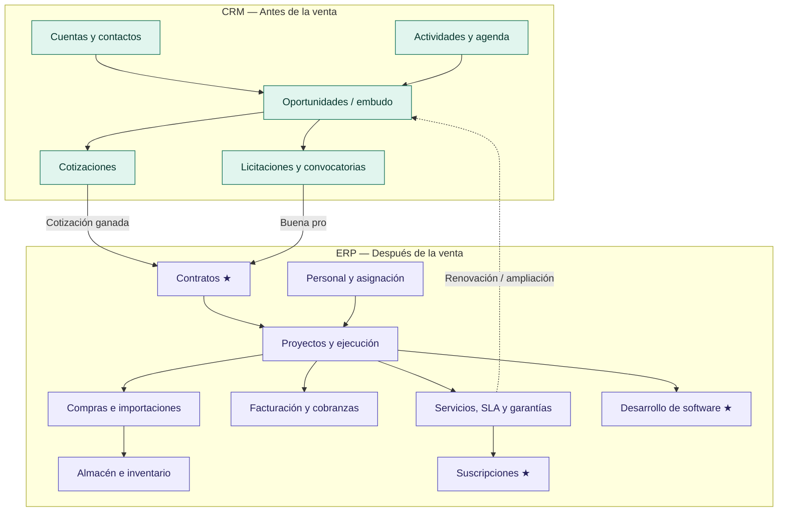
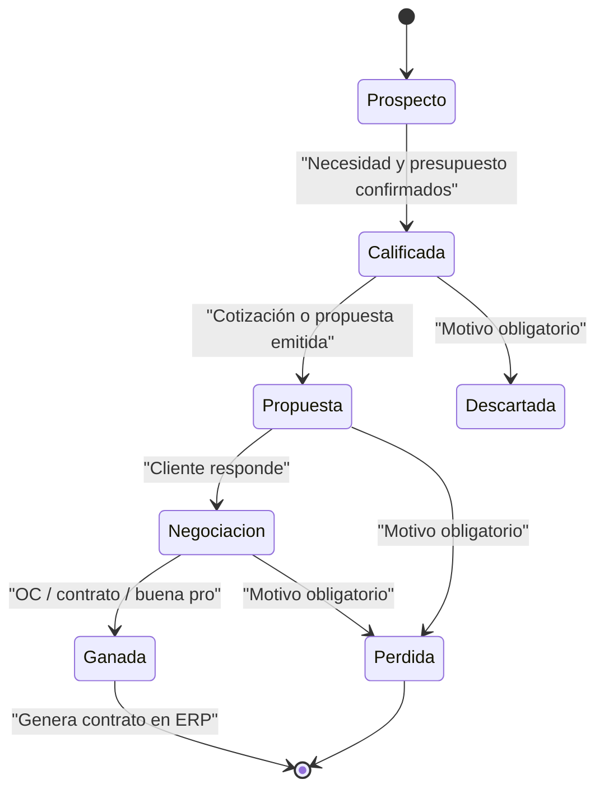
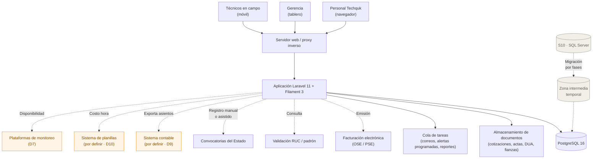
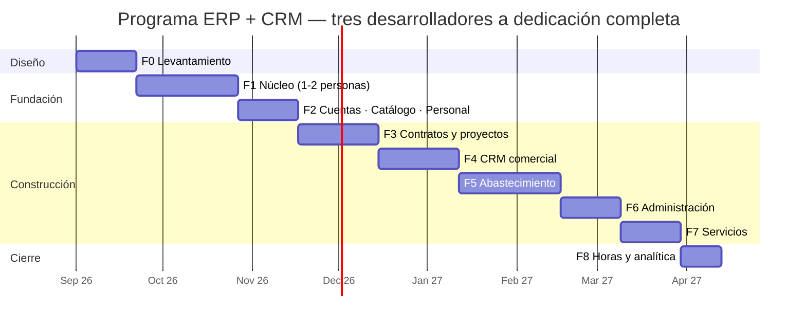

# Documento 01 — Plan de construcción del ERP y el CRM

**Programa:** Ordenamiento Organizacional y Sistemas de Gestión — Techquk S.A.C.
**Versión:** 2.1 · Agosto 2026 · Para revisión de Gerencia

---

## Registro de cambios

| Versión | Fecha | Cambios |
|---|---|---|
| 1.0 | Ago 2026 | Plan inicial: 16 módulos, 5 fases, horizonte 10–12 meses |
| 2.0 | Ago 2026 | Reemplazo de S10 · fase de núcleo · 3 módulos nuevos · fases reordenadas |
| **2.1** | **Ago 2026** | **Dos escenarios de alcance · estimaciones con el equipo real · el riesgo cambia de forma** |

### Qué cambió y por qué

`[V]` Entre la versión 1.0 y esta se hicieron dos cosas: se analizó tabla por tabla la base de
datos del ERP S10 que Techquk opera desde julio, y se revisó el organigrama del documento 03
contra el modelo de datos. De ahí salieron seis correcciones.

| Cambio | Motivo |
|---|---|
| **Se declara el reemplazo de S10** | La v1.0 no mencionaba que existe un ERP en producción |
| **Se inserta una fase de núcleo** | Cuatro mecanismos atraviesan los diecinueve módulos |
| **Tres módulos nuevos** | Contratos, Suscripciones y Desarrollo, exigidos por el organigrama |
| **Importaciones sube de prioridad** | `[V]` 80 operaciones en 2024; ahí está el riesgo económico |
| **Contratos entra antes que el CRM** | `[V]` Penalidad registrada de S/ 250,498.54 |
| **Horizonte revisado** | Con el equipo real: **6–8 meses** con los tres a dedicación completa |
| **Dos escenarios de alcance** | Contabilidad y planilla externas o propias — sección 8-bis |

### Convención de evidencia

| Marca | Significado |
|---|---|
| `[V]` | **Verificado** con una consulta o un documento del programa |
| `[S]` | **Supuesto** — interpretación razonable, no comprobada |
| `[P]` | **Pendiente** — requiere decisión de Gerencia o levantamiento |

---

## 1. La decisión de fondo: reemplazar S10

`[V]` **Techquk opera el ERP S10 desde el 1 de julio de 2026.** El análisis de su base de datos
lo confirma con precisión:

| Dato | Valor |
|---|---|
| Primera configuración | 4 de junio de 2026 |
| Primera operación registrada | 1 de julio, 09:02 |
| Facturas de compra registradas | **1,340** |
| Asientos contables | **6,491** |
| Órdenes de compra emitidas | 9 |
| Guías de almacén | 151 |

`[V]` **La decisión adoptada es que el sistema nuevo reemplace a S10, no que convivan.** Eso
tiene tres consecuencias que la versión 1.0 no contemplaba.

### 1.1 El alcance crece

Todo lo que S10 hace hoy y funciona tiene que existir en el sistema nuevo antes de apagarlo:
almacén con series, facturación electrónica, compras con aprobación, y contabilidad.

### 1.2 Contabilidad y planilla necesitan destino

`[V]` La versión 1.0 decidió no desarrollarlas e integrarlas con software especializado. **Esa
decisión sigue siendo correcta:** S10 tiene 680 procedimientos solo en contabilidad y 1,050 en
planillas. Reconstruir eso es un proyecto en sí mismo, con riesgo tributario y laboral.

`[P]` **Pero esa decisión asumía convivencia.** Si S10 se apaga, hay que definir dónde viven.
Ver decisiones D9 y D10 en la sección 10.

### 1.3 El reemplazo va por fases, no de golpe

`[S]` **Recomendación:** cada vez que un módulo del sistema nuevo entre en producción, el
correspondiente de S10 se apaga. Almacén nuevo funciona, almacén de S10 se cierra.

Eso reparte la migración en pedazos manejables y permite volver atrás si algo falla. El
escenario a evitar es llegar al mes veinte, descubrir que falta contabilidad, y quedarse con dos
sistemas de todas formas pero sin haberlo planificado.

---

## 2. Principios de diseño

| # | Principio | Qué significa en la práctica |
|---|---|---|
| **P1** | **Una sola fuente de verdad** | Un cliente, un proyecto y un producto existen una sola vez. Si un dato está en dos lugares, uno está equivocado |
| **P2** | **El proceso manda sobre el software** | Primero se define el proceso, luego se construye la pantalla. Nunca al revés |
| **P3** | **Todo registro tiene dueño** | Sin responsable nominal no se guarda |
| **P4** | **Construcción incremental y utilizable** | Cada fase entrega algo usable en producción |
| **P5** | **Trazabilidad completa** | Quién, cuándo y qué cambió. Indispensable para contratación pública |
| **P6** ★ | **Si puede quedar vacío, quedará vacío** | Si un dato importa, el sistema lo exige. Un control a medias es peor que ninguno |

> `[V]` **P6 es nuevo y sale de evidencia.** En S10 se encontraron **seis casos** de controles
> declarados y nunca alimentados: tres tablas con la fecha de creación completamente en nulo, el
> campo de firma obligatoria apagado en las dieciséis aprobaciones, tres estados de entrega que
> existen y jamás se usaron, y un padrón tributario sin actualizar desde 2015.
>
> Resultado medible: **de las nueve órdenes de compra emitidas, ninguna pasó por un control
> capaz de detenerla.**

---

## 3. Alcance: qué es CRM y qué es ERP en Techquk

**La idea que resume todo.** Mientras el negocio es una expectativa, vive en el verde. Cuando
hay un compromiso firmado, pasa al morado.

`[S]` **Cambio respecto de la v1.0.** Antes, una cotización ganada creaba directamente un
proyecto. Ahora crea primero un **contrato**, y de ahí nacen uno o más proyectos.

Tres razones: un contrato puede cubrir más de un proyecto —P6 y P9 del Hospital Regional
Docente Las Mercedes incluyen software, servidor y otros activos en un solo contrato—; el
contrato tiene vida jurídica propia con plazos que se amplían y fianzas que vencen; y la
penalidad se calcula sobre el contrato, no sobre el proyecto.

### 3.1 Alcance funcional del CRM

| Módulo | Contenido | Prioridad |
|---|---|---|
| **CRM-01 · Cuentas y contactos** | Entidades públicas y privadas, sedes, contactos, cargos, historial | Crítica |
| **CRM-02 · Oportunidades** | Embudo, monto estimado, probabilidad, competidores, motivo de pérdida | Crítica |
| **CRM-03 · Cotizaciones** | Versionado, líneas, márgenes, condiciones, aprobación de descuentos | Crítica |
| **CRM-04 · Licitaciones** | Convocatorias, cronograma, documentos, resultado, precio ganador | Alta |
| **CRM-05 · Actividades** | Visitas, llamadas, próximas acciones, recordatorios | Alta |
| **CRM-06 · Catálogo comercial** | Productos con marca, línea, precio referencial, margen objetivo, **equivalencia CUBSO** | **Crítica** ↑ |
| **CRM-07 · Campañas y prospección** | Origen del prospecto, leads del sitio web y la tienda | Media |

`[S]` **CRM-06 sube de Alta a Crítica.** El grafo de dependencias lo requiere para Cotizaciones,
Compras y Almacén: sin catálogo no hay nada que cotizar ni que comprar.

### 3.2 Alcance funcional del ERP

| Módulo | Contenido | Prioridad |
|---|---|---|
| **ERP-01 · Proyectos** | Ficha, tipología, hitos, presupuesto vs. real, entregables, actas | Crítica |
| **ERP-02 · Compras** | Requerimientos, cotizaciones de proveedor, **cuadro comparativo**, órdenes, evaluación | Crítica |
| **ERP-03 · Importaciones y costeo** | Embarques, agente de aduanas, DUA, costo puesto en almacén | **Crítica** ↑ |
| **ERP-04 · Almacén e inventario** | Ingresos, salidas, **series**, stock por ubicación, guías de remisión | Alta |
| **ERP-05 · Servicios y postventa** | Tickets, SLA, garantías, **reclamos al fabricante**, visitas | Alta |
| **ERP-06 · Facturación y cobranzas** | Comprobantes, estado de cuenta, detracciones, facturación electrónica | Crítica |
| **ERP-07 · Personal y asignación** | Competencias, certificaciones con vencimiento, disponibilidad, asignación | Alta ↑ |
| **ERP-08 · Seguridad y administración** | Usuarios, roles, **permisos por ámbito**, autorización, auditoría | Crítica |
| **ERP-09 · Analítica** | Indicadores comerciales, de ejecución y financieros | Media |
| **ERP-10 · Contratos** ★ | Plazos, hitos, **penalidad diaria**, adendas, cartas fianza, conformidades | **Crítica** |
| **ERP-11 · Suscripciones** ★ | Servicios en nube con vigencia, renovaciones, disponibilidad comprometida | Alta |
| **ERP-12 · Desarrollo de software** ★ | **Imputación de horas**, especificaciones, casos de prueba, defectos | Alta |

### 3.3 Por qué los tres módulos nuevos

`[V]` **ERP-10 Contratos.** El organigrama define el rol *Administración de Contratos*, cuyo
indicador es **"penalidades incurridas: meta cero"**, y su justificación documentada es una
penalidad por mora de **S/ 250,498.54** — monto superior al valor íntegro de cinco de los nueve
contratos del portafolio.

`[S]` Con el monto contratado, el plazo y la fecha comprometida, el sistema puede mostrar cuánto
cuesta cada día de atraso **antes** de que ocurra. Eso convierte un registro en una alerta.

`[V]` **ERP-11 Suscripciones.** El rol *Ciberseguridad y Monitoreo* administra servicios en la
nube contratados por clientes, con vigencias de hasta **372 días**. El documento 03 es explícito
en que esto no se gobierna con un jefe de proyecto ni con una mesa de ayuda.

`[V]` **ERP-12 Desarrollo de software.** Cinco roles de la Jefatura de Desarrollo declaran
accesos que ningún módulo cubría. Y la **imputación de horas aparece en cinco roles distintos**
de todo el organigrama.

`[S]` Sin imputación de horas, el margen de un proyecto con frente de software está mal
calculado — y los contratos híbridos son el **55.3% del portafolio**.

---

## 4. Modelo de datos: decisiones estructurales

Cuatro decisiones condicionan toda la construcción. Las tres primeras están **verificadas en un
ERP real de veintiséis años**.

### 4.1 Patrón *Party* para personas y organizaciones `[V]`

Una entidad única con **roles asignables**: cliente, proveedor, aliado, entidad contratante,
colaborador.

**La evidencia.** En S10 no existen tablas de clientes ni de proveedores. Existe una sola, con
**129 relaciones apuntando a ella** —la más referenciada de una base de 1,916 tablas— y
**veinticinco nombres de columna distintos** que representan otros tantos papeles. Incluso la
tabla de usuarios del sistema cuelga de ahí.

**El retorno, medido.** Su catálogo de roles pasó de 9 en 1999 a 13 en 2021 **sin que se creara
una sola tabla nueva**. Cuando en 2015 apareció la figura del practicante, insertaron una fila.

### 4.2 Autorización parametrizable `[V]`

Las reglas de aprobación viven en una tabla que cruza **ámbito, moneda y rango de monto**, más
los parámetros de cuántas firmas se requieren, si el orden importa, y **si cada firma es
obligatoria**.

**La lección viene de su falla.** En S10 esa estructura existe y está bien diseñada, pero el
campo de firma obligatoria está apagado. De las nueve órdenes emitidas, **ninguna pasó por un
control capaz de detenerla**, y dos proyectos compraron sin ninguna regla configurada sin que
nada lo señalara.

`[S]` **Por eso el sistema nuevo incluye dos cosas que S10 no tiene:** una pantalla que muestre
las reglas vigentes en lenguaje claro, y una alerta cuando un ámbito opera sin regla.

### 4.3 El embudo comercial como máquina de estados

**Regla de negocio:** ninguna oportunidad se cierra como perdida sin motivo tipificado de lista
cerrada. Ese campo, obligatorio, es lo que convierte el CRM en herramienta de aprendizaje
comercial y no en archivador.

### 4.4 Un proyecto, varias tipologías, un mismo esqueleto

Una sola entidad `proyectos` con **plantilla de fases por tipología**, en lugar de seis módulos
distintos. Añadir una línea de negocio nueva será configuración, no desarrollo.

---

## 5. Los seis errores que no se repetirán

`[V]` Cada uno se observó causando daño en S10, con su consecuencia medida.

| # | Antipatrón | Evidencia en S10 | La regla |
|---|---|---|---|
| **A1** | Códigos de negocio como llave primaria | Una llave de **once columnas**; 15 tablas con llaves de ocho | Llave interna automática siempre |
| **A2** | Texto de largo fijo | 207 columnas `char` en 131 tablas: espacios de relleno que rompen comparaciones | `varchar` o `text` |
| **A3** | Archivos dentro de la base | Una tabla de **280 MB con 508 filas** — 565 KB por fila | Adjuntos en disco; en la tabla solo la ruta |
| **A4** | Auditoría opcional | Tres tablas con fecha de creación **completamente en nulo** | `NOT NULL` con valor automático |
| **A5** | Lógica de negocio en la base | **9,152 procedimientos almacenados** | Lógica en la aplicación |
| **A6** | Dos convenciones conviviendo | `CodEmpresa` y `CodIdentificadorEmpresa` para lo mismo | Una convención, escrita, desde la primera tabla |

`[S]` **El antipatrón A3 tiene la consecuencia más visible:** dos tercios del espacio de esa base
de datos no son información de negocio. De casi dos gigabytes, la operación real ocupa unos
350 MB.

---

## 6. Arquitectura técnica

### 6.1 Pila tecnológica propuesta

`[P]` Propuesta basada en lo que se ha venido trabajando. Queda pendiente la propuesta del
equipo de desarrollo.

| Capa | Tecnología | Justificación |
|---|---|---|
| **Lenguaje / framework** | PHP 8.3 + Laravel 11 | Madurez, ecosistema amplio |
| **Interfaz administrativa** | Filament 3 | Reduce drásticamente el tiempo de construcción de pantallas |
| **Base de datos** | PostgreSQL 16 | Integridad referencial estricta, capacidad analítica |
| **Empaquetado** | Docker + Docker Compose | Entornos idénticos, despliegue reproducible |
| **Documentación** | MkDocs Material | Versionada junto al código |
| **Control de versiones** | Git, repositorio institucional | Continuidad ante rotación de personal |

**Nota de gobierno técnico:** el repositorio debe pertenecer a una cuenta institucional de
Techquk, no a una cuenta personal. Es un requisito de continuidad del negocio.

### 6.2 Diagrama de componentes

Gris: componentes temporales que desaparecen al terminar la migración. Naranja: destinos que
dependen de decisiones abiertas.

`[S]` **Tres agregados respecto de la v1.0.** Los técnicos en campo como usuario distinto —el
rol de Ingeniería declara "carga de evidencias", que se hace desde el celular en obra—. Los
destinos de contabilidad y planilla. Y la ruta de migración con su zona intermedia.

`[S]` **Y la cola de tareas tiene más trabajo del previsto:** las alertas de penalidad,
vencimiento de fianza, renovación de suscripción y embarque en riesgo son todas tareas
programadas.

### 6.3 Construir vs. comprar

| Criterio | Solución de mercado | Desarrollo propio |
|---|---|---|
| Costo inicial | Bajo a medio | Medio (horas internas) |
| Costo recurrente | Licencia por usuario, creciente | Infraestructura únicamente |
| Ajuste a licitaciones públicas peruanas | Bajo | Total |
| Costeo de importación | Solo en gama alta | Diseñado a medida |
| **Gestión de contratos con penalidad** | Rara vez | A medida |
| Dependencia del proveedor | Alta | Nula |
| Riesgo | Bajo | Concentrado en el equipo |
| Propiedad del activo | Del proveedor | De Techquk |

**Recomendación:** desarrollo propio, con las dos condiciones que mitigan el riesgo de
concentración del conocimiento: documentación obligatoria por fase y repositorio institucional.

`[S]` **Y una condición adicional que la v1.0 no tenía:** las pruebas automatizadas son la única
documentación que no se desactualiza, porque cuando miente, falla. Criterio de salida por fase:
cobertura sobre las reglas de negocio, no sobre el CRUD.

---

## 7. Plan por fases

`[S]` Son estimaciones. La parte de desarrollo debe tomarse con pinzas: es la más variable.

### Fase 0 — Levantamiento y diseño organizacional · 2–3 semanas

| Actividad | Entregable |
|---|---|
| Aplicación del Formulario de Levantamiento | Base de respuestas consolidada |
| Talleres de validación por área | Mapa de procesos validado |
| Consolidación del catálogo de roles | Catálogo con misión, decisiones y KPI |
| Matriz RACI por proceso | Matriz aprobada |
| Aprobación del organigrama objetivo | Organigrama firmado |
| Inventario de fuentes de datos | Plan de migración y depuración |

`[S]` **Agregado:** llevar a cada sesión los flujogramas del documento 09-B y preguntar *"¿es
así como lo hacen?"*. La gente corrige mejor de lo que describe.

**Criterio de salida:** Gerencia aprueba mapa de procesos, organigrama y matriz de
autorizaciones.

---

### Fase 1 — Núcleo del sistema ★ NUEVA · 5–6 semanas

| Actividad | Entregable |
|---|---|
| Identidad: personas y organizaciones con roles | Patrón *Party* operativo |
| Autorización parametrizable con firma obligatoria | Matriz de aprobación configurable |
| Estados y transiciones por tipo de documento | Máquina de estados |
| Auditoría obligatoria en toda tabla | Trazabilidad garantizada |
| Catálogos compartidos, incluido **CUBSO** | Base de catálogos cargada |
| Numeración, adjuntos, notificaciones, configuración | Mecanismos transversales |

**Por qué va primero.** `[V]` Cuatro mecanismos atraviesan los diecinueve módulos. En S10, la
tabla de personas es referenciada por 129 relaciones. Si se construye dentro del CRM, queda con
forma de CRM, y cuando llegue Compras habrá que rehacerla con meses de datos encima.

`[S]` **No depende de la Fase 0**, porque modela estructura y no procesos de Techquk. Puede
correr en paralelo con el levantamiento.

**Criterio de salida:** `migrate:fresh --seed` levanta el esquema completo; existe un módulo de
demostración que usa los diez mecanismos; cero tablas sin llave primaria.

---

### Fase 2 — Cuentas, catálogo y personal · 4–5 semanas

| Actividad | Entregable |
|---|---|
| Cartera única de clientes y proveedores | Migración depurada desde S10 |
| Catálogo comercial con equivalencia CUBSO | Módulo CRM-06 operativo |
| Legajo, competencias y certificaciones | Módulo ERP-07 operativo |

`[S]` **Los tres se pueden construir en paralelo:** no dependen entre sí y todo lo demás los
necesita.

---

### Fase 3 — Contratos y proyectos · 6–8 semanas

| Actividad | Entregable |
|---|---|
| Registro de contratos con penalidad diaria | Módulo ERP-10 operativo |
| Cartas fianza con alertas de vencimiento | Control de garantías |
| Plantillas de fases por tipología | Módulo ERP-01 configurable |
| Avance, hitos, actas y valorizaciones | Seguimiento de ejecución |
| Margen simplificado con carga manual de costos | Reporte de margen desde el mes cuatro |

`[V]` **Por qué contratos entra antes que el CRM.** El riesgo económico documentado es una
penalidad de S/ 250,498.54. Un sistema que alerta sobre vencimientos contractuales rinde desde
el primer mes; ordenar el embudo comercial rinde después.

`[S]` **El margen adelantado.** Una carga manual de costos permite que Gerencia vea margen
estimado contra real desde el mes cuatro. Cuando llegue el módulo de compras, se reemplaza el
origen del dato sin cambiar la pantalla.

**Criterio de salida:** alerta de penalidad diaria funcionando; todo proyecto activo con ficha,
responsable y margen.

---

### Fase 4 — CRM comercial · 6–8 semanas

| Actividad | Entregable |
|---|---|
| Embudo con etapas y motivos de pérdida | Módulo CRM-02 operativo |
| Cotizador con líneas, márgenes y versionado | Módulo CRM-03 operativo |
| Registro de licitaciones y convocatorias | Módulo CRM-04 operativo |
| Agenda de actividades | Módulo CRM-05 operativo |
| Capacitación al equipo comercial | Manual + sesión práctica |

**Criterio de salida:** el 100% de las cotizaciones nuevas se emite desde el sistema.

---

### Fase 5 — Abastecimiento, importaciones e inventario · 8–10 semanas

| Actividad | Entregable |
|---|---|
| Requerimientos y órdenes con flujo de aprobación | Módulo ERP-02 operativo |
| **Cuadro comparativo de proveedores** | Comparación de ofertas antes de comprar |
| Embarques, DUA y costeo puesto en almacén | Módulo ERP-03 operativo |
| **Alerta de embarque en riesgo de hito** | Integración ERP-03 ↔ ERP-10 |
| Inventario con control de series | Módulo ERP-04 operativo |
| Evaluación de proveedores | Ranking por cumplimiento |

`[V]` **Por qué importaciones sube.** Techquk realizó **80 operaciones de importación en 2024**,
por USD 452.3 mil CIF, vía marítima por la Aduana del Callao y con dos agentes de aduana. Es una
operación cada cuatro días hábiles.

`[V]` **Y el documento 03 señala que en contratos de suministro la entrega tardía se origina con
más frecuencia en la llegada del equipo que en la instalación.** De ahí la alerta que conecta la
fecha estimada de llegada con los hitos contractuales en riesgo.

`[V]` **El cuadro comparativo corrige lo observado en S10:** allá la tabla de cotizaciones de
proveedor tiene **cero registros**. Las nueve órdenes se emitieron sin comparar ofertas.

**Criterio de salida:** el costo de un equipo importado incluye flete, seguro, derechos y
nacionalización, y se refleja automáticamente en el margen del proyecto.

---

### Fase 6 — Administración y finanzas · 5–6 semanas

| Actividad | Entregable |
|---|---|
| Emisión e integración con facturación electrónica | Módulo ERP-06 operativo |
| **Bandeja de comprobantes observados** | Reenvío con motivo de SUNAT |
| Estado de cuenta y antigüedad de deuda | Reporte de cobranzas |
| Detracciones y retenciones | Cumplimiento tributario |
| Cuentas por pagar y pagos a proveedores | Ciclo de pago completo |
| Exportación estructurada al sistema contable | Integración contable |

`[V]` **La bandeja de observados no es opcional.** En S10, la tabla de errores de facturación
electrónica tiene **1,763 registros contra 1,340 documentos emitidos** — más errores que
documentos.

**Criterio de salida:** ciclo cerrado desde el contrato hasta el cobro, sin recaptura.

---

### Fase 7 — Servicios y suscripciones · 5–6 semanas

| Actividad | Entregable |
|---|---|
| Tickets con SLA de respuesta y solución | Módulo ERP-05 operativo |
| Reclamos de garantía al fabricante | Trazabilidad por número de serie |
| Contratos de servicio y suscripciones en nube | Módulo ERP-11 operativo |
| Tablero de disponibilidad | Comprometido vs. efectivo |

---

### Fase 8 — Horas de desarrollo y analítica · 4–5 semanas

| Actividad | Entregable |
|---|---|
| Imputación de horas por proyecto | Margen de proyectos híbridos completo |
| Definición final de indicadores con Gerencia | Ficha técnica de indicadores |
| Tablero comercial, operativo y financiero | Tablero en línea |
| Reportes programados por correo | Envío automático semanal |

---

### 7.1 Cronograma indicativo

`[S]` **El cronograma asume los tres desarrolladores a dedicación completa.** Las fases 2 a 5 se
acortan respecto de la estimación de una persona porque se reparten en frentes paralelos; la
fase 1 casi no, porque el núcleo no se divide bien.

### 7.2 El equipo y el horizonte

`[V]` **La composición real del equipo:** tres desarrolladores con experiencia previa en un ERP
construido sobre el mismo stack —Laravel, Filament, PostgreSQL— más un analista funcional. La
Jefatura de Desarrollo está vacante.

Eso mejora sustancialmente las estimaciones de la versión anterior, que asumían un solo
desarrollador sin ese antecedente.

#### Lo que acelera

`[S]` **No hay curva de aprendizaje del stack**, y hay algo más valioso: experiencia de dominio.
Haber construido un ERP antes significa conocer los problemas que aparecen en el mes seis — la
desnormalización que se justifica, los estados que hay que versionar, el reporte que nadie
previó.

Estimo entre **15% y 20% menos tiempo** que un equipo sin ese antecedente.

#### Lo que no acelera

`[S]` **Tres desarrolladores no rinden el triple que uno.** Hay coordinación, revisión mutua y
decisiones conjuntas. La proporción realista es **2.2 a 2.5 veces**.

`[S]` **Y el núcleo casi no se puede repartir.** Los diez mecanismos son decisiones de diseño
entrelazadas: partirlos entre tres personas produce tres criterios distintos.

#### Las estimaciones

**Escenario 1 — contabilidad y planilla externas (recomendado):**

| Dedicación del equipo | v2.0 | **v2.1** |
|---|---|---|
| **Tres desarrolladores a dedicación completa** | — | **6–8 meses** |
| Dos a dedicación completa, uno al 50% | — | 7–9 meses |
| **Tres desarrolladores al 50%** | — | **11–15 meses** |
| Un desarrollador a dedicación completa | 11–14 meses | 9–12 meses |
| Un desarrollador a dedicación parcial | 18–24 meses | 16–21 meses |

**Escenario 2 — contabilidad y planilla propias:**

| Dedicación del equipo | Horizonte |
|---|---|
| Tres desarrolladores a dedicación completa | **10–13 meses** |
| Tres desarrolladores al 50% | **18–24 meses** |

#### Cómo se reparte el trabajo

`[S]` El grafo de dependencias del documento 10 permite paralelizar de forma natural:

| Fase | Cómo se reparte |
|---|---|
| **F0** Levantamiento | El analista al frente; los desarrolladores participan en las sesiones técnicas |
| **F1** Núcleo | **Una o dos personas**; el resto revisa y prepara F2 |
| **F2** Cuentas · Catálogo · Personal | **Tres frentes en paralelo**, uno por persona |
| **F3** Contratos · Proyectos | Dos personas; la tercera adelanta el catálogo comercial |
| **F4** CRM comercial | Tres frentes: oportunidades, cotizaciones, licitaciones |
| **F5** Compras · Importaciones · Almacén | Tres frentes, con el costeo como punto de encuentro |
| **F6–F8** | Se reparte por módulo |

`[S]` **La fase 2 es la que mejor aprovecha el equipo:** tres módulos que no dependen entre sí y
que todo lo demás necesita.

### 7.3 La condición que sostiene estas estimaciones

`[V]` **Los tres desarrolladores son también quienes entregan software a clientes.** Los
proyectos P6 y P9 del Hospital Regional Docente Las Mercedes incluyen frente de software, y el
**55.3% del portafolio son contratos híbridos**.

`[S]` Un equipo autorizado "al 100%" que en la práctica dedica el 40% porque hay entregas de por
medio produce el horizonte de la fila del 50%, no el de la primera. Y el desvío se descubre en
el mes cinco, cuando ya es tarde para replanificar.

`[P]` **Lo que se pide a Gerencia** no es elegir un plazo sino autorizar un **porcentaje
explícito de dedicación**, y que se mida con las horas imputadas. Es exactamente lo que el
sistema va a permitir hacer con los proyectos de cliente — conviene aplicarlo también al
proyecto interno.

### 7.4 El cuello de botella no es el desarrollo

`[V]` **Dieciocho módulos, 78 pantallas y 61 widgets tienen que ser especificados y validados
por una sola persona.**

`[S]` Tres desarrolladores esperando definiciones van más rápido que uno, pero **no más rápido
de lo que llegan las definiciones**. Si el analista especifica mientras el equipo construye lo
mismo, el cuello se vuelve permanente.

`[S]` **La forma de evitarlo** es que las definiciones de cada fase estén cerradas antes de que
empiece su construcción, con el analista trabajando siempre una fase por delante.

---

## 8. La migración desde S10

`[S]` **El momento es favorable.** Siete semanas de transacciones es lo mínimo que habrá nunca.
Cada mes que pasa, migrar cuesta más.

### 8.1 Qué se migra y qué no

| Origen en S10 | Filas | ¿Se migra? |
|---|---:|---|
| Personas y organizaciones | 1,638 | **Sí — es el activo principal** |
| Catálogo CUBSO | 57,610 | **Sí — tal cual** |
| Órdenes y pedidos abiertos | 9 c/u | Sí |
| Facturas de compra | 1,340 | `[P]` Solo las abiertas |
| Guías de almacén | 151 | `[P]` Solo el saldo de stock |
| Asientos contables | 6,491 | No — quedan en el destino contable |
| Insumos de construcción | 10,254 | **No — no es el rubro de Techquk** |

`[V]` **El único activo real es la tabla de personas:** 1,638 registros con RUC, dirección y las
marcas de retención y percepción. Eso encaja directo en el modelo nuevo.

### 8.2 Los cuatro problemas técnicos conocidos

`[V]` Los campos de texto de largo fijo traen espacios de relleno. Hay que limpiarlos en la
extracción, no después.

`[V]` El ordenamiento cambia: SQL Server no distingue mayúsculas ni acentos por defecto;
PostgreSQL sí. "Ferretería" y "FERRETERIA" dejan de ser el mismo y aparecen duplicados donde no
los había.

`[V]` Hay fechas con valor 1899-12-30, que es el cero de SQL Server disfrazado de fecha.

`[V]` Hay **489 columnas de tipo aproximado** usadas para importes. Al convertirlas a tipo exacto
pueden aparecer diferencias de centavos.

`[S]` **La estrategia: zona intermedia.** Extraer a una base de staging, limpiar ahí, y recién
cargar. La migración se corre diez veces antes de salir bien, y sin esa zona cada intento ensucia
el sistema nuevo.

---

## 8-bis. Los dos escenarios de alcance

`[S]` Al decidir el reemplazo de S10 queda abierta una elección que no es técnica sino de
negocio, y es la de mayor impacto sobre plazo y riesgo.

### 8-bis.1 Una aclaración previa sobre las integraciones

`[S]` Es tentador plantear "sistema con integraciones" contra "sistema sin integraciones". **Esa
dicotomía no existe.** Hay tres tipos de conexión externa y solo una admite desarrollarse en
lugar de integrarse.

| Tipo | Qué se decide | Cuáles |
|---|---|---|
| **A — Construir o integrar** | Si la función vive dentro o fuera del ERP | Contabilidad · Planillas |
| **B — Automático o manual** | Si conecta el sistema o lo escribe una persona | Padrón RUC · Convocatorias · Monitoreo |
| **C — No negociable** | Existe siempre; solo varía el proveedor | Facturación electrónica |

**Por qué el tipo B no se puede desarrollar.** Los datos no son de Techquk: el padrón es de
SUNAT, las convocatorias son del Estado, la disponibilidad la mide la plataforma del proveedor.
La única alternativa a la conexión automática es escribirlos a mano.

`[V]` **Por qué el tipo C no admite nada.** Para emitir un comprobante en Perú hay que enviarlo
a SUNAT, directamente o vía OSE. Techquk ya está autorizada desde 2018 y emite desde sus propios
sistemas desde 2019.

`[S]` **El riesgo de confundirlos** es elegir "sin integraciones" para simplificar, y descubrir
en la fase 6 que la facturación electrónica no era opcional.

### 8-bis.2 Escenario 1 — Contabilidad y planilla externas *(recomendado)*

El ERP registra la operación, calcula el margen y **exporta** lo que el sistema contable
necesita. Las planillas viven en software especializado y devuelven el costo hora.

| Aspecto | Valor |
|---|---|
| Módulos adicionales | ERP-13 Integración contable — 5 entidades |
| Horizonte | El del plan: **11–14 meses** a dedicación completa |
| Entidades | ~142 |
| Riesgo tributario y laboral | **Del proveedor del software** |
| Costo recurrente | Licencias de contable y planillas |
| Mantenimiento normativo | Incluido en la licencia |

### 8-bis.3 Escenario 2 — Contabilidad y planilla propias

El ERP es autónomo. Nada sale ni entra para estas dos funciones.

| Aspecto | Valor |
|---|---|
| Módulos adicionales | ERP-14 Contabilidad (~18 entidades) · ERP-15 Planillas (~24 entidades) |
| Horizonte | **17–21 meses** a dedicación completa |
| Entidades | ~182 |
| Riesgo tributario y laboral | **De Techquk** |
| Costo recurrente | Solo infraestructura |
| Mantenimiento normativo | **Trabajo de desarrollo permanente** |

### 8-bis.4 Recomendación

`[S]` **Escenario 1.**

`[V]` **El argumento de tamaño.** En S10, contabilidad y planillas suman **1,730
procedimientos** — casi el 20% de todo el sistema. No es un módulo más: es un quinto del
producto.

`[S]` **El argumento del mantenimiento.** El costo real no es construirlas sino mantenerlas. Las
tasas de AFP cambian, los topes se actualizan, la PLAME cambia de formato. Cada cambio normativo
es trabajo de desarrollo que compite con las mejoras al negocio.

`[S]` **Y el argumento de oportunidad.** Techquk vende integración tecnológica, no software
contable. Construir contabilidad es dedicar seis meses a un problema que el mercado ya resolvió,
en lugar de dedicarlos a licitaciones, contratos y servicios recurrentes — que es donde ningún
producto comercial la atiende bien.

`[S]` **El escenario 2 solo se justificaría** si el software contable del mercado resultara
incompatible con la operación de Techquk. No hay razón para suponerlo, pero conviene verificarlo
antes de descartarlo.

### 8-bis.5 El modo mínimo de las demás conexiones

`[S]` Ninguna integración del tipo B es todo o nada:

| Conexión | Modo mínimo aceptable | Qué se pierde |
|---|---|---|
| Padrón RUC | Captura manual | Datos que envejecen sin aviso |
| Convocatorias | Registro manual *(ya aceptado en la v1.0)* | Riesgo de no enterarse a tiempo |
| Monitoreo | Registro manual mensual | Medición menos confiable |
| Costo hora | Campo actualizado a mano | **Distorsiona el margen** — la excepción |

`[S]` **Tres de las cuatro empiezan bien en modo manual.** Automatizar cuando el volumen lo
justifique, no antes.

---

## 9. Indicadores de éxito del programa

| Indicador | Línea base | Meta a 12 meses |
|---|---|---|
| **Penalidades incurridas por causa administrativa** ★ | S/ 250,498.54 registrada | **Cero** |
| Cotizaciones emitidas desde el sistema | 0% | 100% |
| Oportunidades con etapa y responsable | Sin medición | 100% |
| Proyectos con margen real calculado al cierre | Sin medición | 100% |
| Contratos con vencimiento monitoreado | 0% | 100% |
| Tiempo de elaboración de una cotización | Por medir en F0 | Reducción del 50% |
| Tickets atendidos dentro de SLA | Sin medición | ≥ 90% |
| Días promedio de cobranza | Por medir en F0 | Reducción del 20% |
| Tiempo de preparación del reporte gerencial | Horas | Minutos |

`[S]` **El primer indicador es nuevo y es el más defendible ante Gerencia**, porque tiene línea
base documentada y una meta inequívoca.

### 9.1 Indicadores de salud de la construcción

`[S]` Se verifican con una consulta al cierre de cada fase:

| Indicador | Meta |
|---|---|
| Tablas con datos y sin llave primaria | **0** — en S10 hay 67 |
| Columnas de auditoría en nulo | **0** — en S10 hay tres tablas completas |
| Ámbitos operando sin regla de aprobación | **0** — en S10 hay dos proyectos |
| Tiempo de levantar el entorno desde cero | **< 15 min** |
| Cobertura de pruebas sobre reglas de negocio | **> 70%** |

---

## 10. Puntos a validar con Gerencia

| # | Decisión | Impacto si no se toma |
|---|---|---|
| **D1** | ¿Multiempresa o empresa única? | El esquema completo se diseña sobre un supuesto |
| **D2** | ¿El eje organizador es el contrato o el proyecto? | Permisos y reportes quedan indefinidos |
| **D3** | ¿Se incorpora el CUBSO al núcleo? | Las cotizaciones no nacen clasificadas para licitación |
| **D4** | ¿El ERP emite comprobantes o alimenta al emisor actual? | ERP-06 se diseña sin destino |
| ~~D5~~ | ~~¿Importación directa o por terceros?~~ | **`[V]` RESUELTA: directa** |
| **D6** | ¿El desarrollo se gestiona en el ERP o aparte? | ERP-12 se diseña sin alcance |
| **D7** | ¿La disponibilidad de servicios se mide sola o a mano? | ERP-11 no puede medir su indicador |
| **D8** | ¿Qué **porcentaje de dedicación** se autoriza para los tres desarrolladores? | Se compromete un plazo que la capacidad no sostiene |
| **D9** ★ | **¿Escenario 1 o 2?** (sección 8-bis) | Cambia el horizonte en 6–7 meses y traslada el riesgo tributario |
| **D10** ★ | Si es escenario 1: ¿qué software contable y de planillas? | Define el formato de exportación |

`[P]` **Y cuatro preguntas operativas que la v1.0 ya tenía:** qué proveedor de facturación
electrónica se usa hoy, qué sistema contable se emplea, si se autoriza el repositorio
institucional, y si se confirma el desarrollo propio frente a una solución de mercado.

`[S]` **D9 es la más urgente y la de mayor impacto.** No es una preferencia técnica: cambia el
horizonte en 6 a 7 meses, el tamaño del sistema en 42 entidades, y traslada el riesgo tributario
y laboral de un proveedor a Techquk. Conviene decidirla antes de la fase 2.

---

## 11. Gobierno del proyecto

| Rol | Responsabilidad | Ocupante |
|---|---|---|
| **Patrocinador** | Aprueba alcance, resuelve conflictos, garantiza disponibilidad | Gerencia General |
| **Líder funcional** | Levanta procesos, escribe especificaciones, valida entregables | Analista Funcional |
| **Responsable técnico** | Decide arquitectura y resuelve empates | `[P]` **Por designar** |
| **Desarrollo** | Construyen, documentan y despliegan | Tres desarrolladores |
| **Usuarios clave** | Un representante por área; valida cada fase | Designados en F0 |

**Ritmo:** reunión quincenal de 30 minutos con el patrocinador; demostración funcional al cierre
de cada fase; acta de aceptación como condición para iniciar la siguiente.

### 11.1 El riesgo cambió de forma

`[V]` **El riesgo ya no es la falta de gente.** Tres desarrolladores con experiencia en el mismo
stack es un punto de partida sólido: el conocimiento técnico está repartido y si uno se va, los
otros dos entienden el modelo.

`[V]` **El riesgo real es la concentración funcional.** El conocimiento del negocio está en una
sola persona: quien levanta los procesos, escribe las especificaciones y decide qué significa
cada campo.

`[S]` Si esa persona no está disponible, los tres desarrolladores no se detienen por falta de
capacidad técnica — se detienen por falta de definiciones.

**Mitigación, en orden de efectividad:**

**Que un desarrollador acompañe el levantamiento de su módulo.** No para especificar, sino para
entender el porqué. Es la forma más barata de que el conocimiento funcional deje de estar en una
sola cabeza.

**Especificar una fase por delante**, no por demanda.

**Pruebas automatizadas como documentación.** Son la única que no se desactualiza, porque cuando
miente, falla.

**Un registro de decisiones de arquitectura** con su fecha y motivo. Diez minutos por decisión, y
es lo que permite que alguien nuevo entienda por qué las cosas son como son.

### 11.2 La vacante de jefatura

`[V]` La Jefatura de Desarrollo está vacante y el organigrama la marca como prioridad 1.

`[S]` Sin ella, las decisiones de arquitectura recaen en el analista funcional o se toman por
consenso entre los tres desarrolladores. Ninguna de las dos es mala, pero conviene que sea
explícito quién decide cuando hay desacuerdo — o esas decisiones se postergan.

`[P]` **Mientras la vacante siga abierta:** designar un responsable técnico del proyecto entre
los tres desarrolladores, con el mandato explícito de resolver empates.

---

## 12. Lo que este plan deliberadamente no incluye

- **Contabilidad y planilla:** en el escenario 1 —el recomendado— se integran con software
  especializado y no se desarrollan. `[P]` **Pero al apagar S10, ese software tiene que
  existir.** Ver sección 8-bis y decisión D9.
- **Tienda en línea:** permanece en su plataforma; solo se integra la captura de prospectos.
- **Aplicación móvil nativa:** la interfaz web será adaptable. `[S]` La carga de evidencias en
  obra es el caso que más la justificaría en una fase posterior.
- **Gestor de tareas de desarrollo:** `[S]` construirlo compite con productos maduros y
  gratuitos. Solo la imputación de horas va en el ERP.
- **Migración de histórico completo:** se migran cartera, catálogos y documentos abiertos. El
  histórico permanece consultable en su formato original.

---

## 13. Documentos del programa

| Doc | Contenido | Versión |
|---|---|---|
| 00 | Resumen ejecutivo y guía | 1.0 |
| **01** | **Este plan** | **2.0** |
| 02 | Proyectos, tipologías y procesos | 1.0 |
| 03 | Organigrama, roles y accesos | 1.0 |
| 04 | Formulario de levantamiento | 1.0 |
| 05 | Plan de construcción técnica | 2.0 |
| 06 / 06-A | Arquitectura del núcleo · versión explicada | 1.0 |
| 07 | Modelo conceptual — 142 entidades | 2.0 |
| 08 | Detalle de columnas y funcionamiento | 1.0 |
| 09-A | Procesos actuales de S10 | 1.0 |
| 09-B | Procesos propuestos | 2.0 |
| 10 | Módulos, procesos y paneles | 2.0 |
| — | Análisis de la base S10 y sus tres CSV | 1.0 |

---

*Fin del documento 01 v2.1. La versión 1.0 está archivada en `v1_historico/`. Continuar con
`02-Proyectos-y-Procesos.md`.*