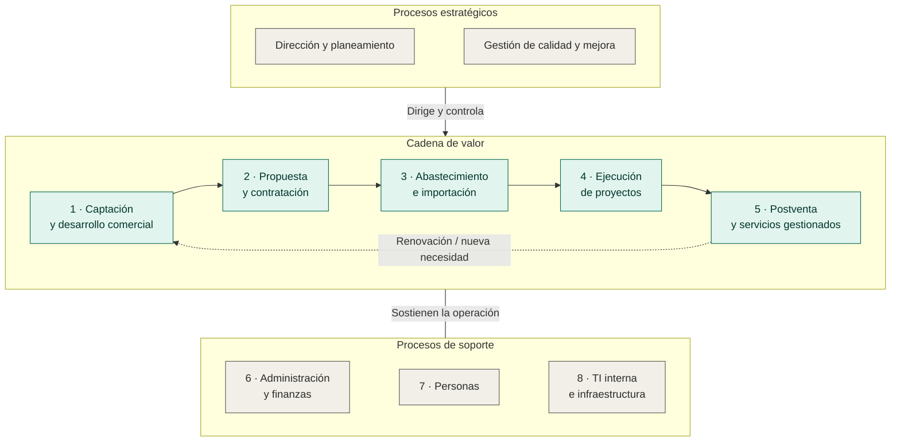
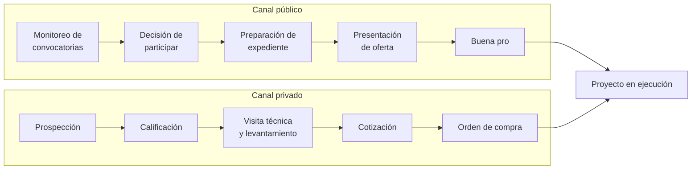

# Documento 02 — Catálogo de proyectos de Techquk y descomposición en procesos

**Programa:** Ordenamiento Organizacional y Sistemas de Gestión — Techquk S.A.C.
**Versión:** 2.0 · Agosto 2026 · Para validación por Gerencia y jefaturas

---

## Registro de cambios

| Versión | Fecha | Cambios |
|---|---|---|
| 1.0 | Ago 2026 | Seis tipologías, diecinueve procesos, siete brechas |
| **2.0** | **Ago 2026** | **Dos procesos nuevos · brecha B1 resuelta · B8 y B9 · nota sobre proyectos híbridos** |

### Qué cambió y de dónde sale

`[V]` Los cambios provienen de dos contrastes posteriores a la v1.0: el análisis de la base de
datos del ERP S10 que Techquk opera, y la revisión del organigrama del documento 03.

| Cambio | Origen |
|---|---|
| **B1 queda resuelta** | `[V]` 80 operaciones de importación en 2024, USD 452.3 mil CIF |
| **Nuevo proceso: administración de contratos** | `[V]` Rol con indicador "penalidades meta cero" y una penalidad de S/ 250,498.54 |
| **Nuevo proceso: gestión de garantía con el fabricante** | `[V]` Help Desk *"gestiona garantías con el fabricante y tramita devoluciones"* |
| **Nueva brecha B8: proyectos híbridos** | `[V]` El 55.3% del portafolio combina hardware y software en un solo contrato |
| **Nueva brecha B9: control de aprobaciones** | `[V]` De nueve órdenes de compra en S10, ninguna pasó por un control capaz de detenerla |

> `[S]` **Advertencia sobre el estatus de este documento.** La v1.0 era enteramente
> **declarativa**: describía lo que Techquk hace según su portafolio público. Esta versión mezcla
> eso con hallazgos **empíricos** del sistema en operación. Ambos están marcados para que en el
> taller de validación se distinga qué es propuesta y qué es evidencia.

---

## 1. Cómo leer este documento

Techquk presenta públicamente **nueve líneas de solución** sobre **tres verticales de mercado**. Sin embargo, para efectos de diseño organizacional y de sistemas, lo relevante no es el catálogo comercial sino el **comportamiento operativo**: dos soluciones distintas que se ejecutan con el mismo flujo de trabajo son, en la práctica, el mismo proceso.

Por eso este documento reorganiza el portafolio en **seis tipologías de proyecto**, cada una con su propia secuencia de procesos. Esta es la unidad de análisis correcta para definir roles, responsabilidades y módulos de sistema.

### Convención de evidencia

| Marca | Significado |
|---|---|
| `[V]` | **Verificado** con datos del sistema en operación o con un documento del programa |
| `[S]` | **Supuesto** — propuesta basada en el portafolio público, sin verificar |
| `[P]` | **Pendiente** — se confirma en el taller de la Fase 0 |

### Estructura jerárquica utilizada

| Nivel | Denominación | Ejemplo |
|---|---|---|
| **Nivel 0** | Macroproceso | Ejecución de proyectos |
| **Nivel 1** | Proceso | Instalación y puesta en marcha |
| **Nivel 2** | Subproceso / actividad | Configuración de equipos y pruebas de aceptación |

### Del portafolio comercial a las tipologías operativas

| Línea de solución publicada | Tipología operativa |
|---|---|
| Seguridad Ciudadana | **T1** — Integración de seguridad electrónica |
| Seguridad Electrónica | **T1** |
| Infraestructura de TI | **T2** — Infraestructura y conectividad |
| Audio y video profesional | **T3** — Colaboración y espacios tecnológicos |
| Colaboración | **T3** |
| Plataformas en la nube | **T3** (despliegue) y **T6** (suscripción recurrente) |
| IoT industrial | **T4** — Ingeniería a medida y desarrollo |
| Sistemas de Telesalud | **T4** |
| Ciberseguridad | **T6** — Servicios gestionados |
| *(Tienda / venta de equipos)* | **T5** — Suministro y arrendamiento operativo |
| *(Arrendamiento operativo)* | **T5** |

> **Nota de validación:** esta agrupación es una propuesta basada en información pública del portafolio de la empresa. Debe confirmarse en el taller de validación de la Fase 0, ya que de ella dependen las plantillas de fases del módulo de proyectos.

---

## 2. Mapa de macroprocesos (Nivel 0)

**La franja del medio, en color: por ahí entra el dinero**

Está coloreada a propósito. Son los cinco pasos por los que pasa todo negocio de Techquk, de izquierda a derecha:

Por ejemplo: Una municipalidad necesita cámaras de videovigilancia.

1 · Captación → te enteras. Puede ser porque saliste a visitar, porque te recomendaron, o porque el Estado publicó la convocatoria.

2 · Propuesta y contratación → armas la oferta: qué cámaras, cuántas, a qué precio, en cuántos días. Presentas y ganas.

3 · Abastecimiento e importación → hay que conseguir los equipos. Cotizas proveedores, compras, recibes.

4 · Ejecución de proyectos → los técnicos van, instalan, configuran, prueban y entregan con acta.

5 · Postventa y servicios gestionados → arranca el mantenimiento, el soporte y la garantía.

Se llama cadena de valor porque cada paso agrega algo. El mismo cliente vale más contratado que prospectado, y más entregado que contratado.

La flecha punteada de regreso

Va del paso 5 al paso 1: "Renovación / nueva necesidad".

Dos años después, en una visita de mantenimiento, el jefe de seguridad comenta que quieren cubrir tres zonas más. Eso vuelve a entrar como oportunidad nueva.

No es una fila que termina, es un círculo. Y venderle a quien ya te conoce cuesta una fracción de conseguir un cliente nuevo.

**La franja de arriba: dirige y controla**

Dirección y planeamiento y Gestión de calidad y mejora. La flecha dice literalmente "Dirige y controla".

Aquí se decide a qué mercados apuntar, qué márgenes aceptar, qué se prioriza cuando hay dos proyectos y un solo equipo técnico. Nadie factura por planear, pero sin esto los cinco pasos de abajo se ejecutan sin rumbo.

**La franja de abajo: sostiene la operación**

Administración y finanzas, Personas y TI interna.

Están en gris y abajo porque no venden — sostienen. Si nadie cobra, no hay caja para comprar los equipos del siguiente proyecto. Si nadie contrata ni capacita técnicos, no hay quién instale. Si se cae el correo, se para todo.

Por qué el gris y el color no son decoración

Los tres grupos son necesarios, pero solo uno genera ingreso. Poner en color únicamente la cadena de valor hace que al abrir la lámina el ojo vaya directo a donde está el negocio.

Es también el orden de prioridad del proyecto: el ERP y el CRM atacan primero la franja de color, y las de gris vienen después.

Para qué sirve tener esto dibujado

Tres cosas muy concretas:

Muestra qué no tiene dueño. Con los ocho procesos en una sola lámina salta a la vista que el paso 3 —abastecimiento, que maneja la mayor parte del costo del negocio— no tiene responsable formal hoy. Esa es la brecha que justifica el primer rol nuevo del organigrama.

De aquí sale el organigrama. Las cuatro áreas propuestas no se copiaron de ningún lado: se armaron agrupando estos ocho procesos. Comercial toma 1 y 2, Suministro toma 3, Operaciones toma 4 y 5, Administración toma 6, 7 y 8.

De aquí sale el sistema. Cada proceso corresponde a módulos del ERP o del CRM. Este mapa es, literalmente, el índice de lo que hay que construir.

En una frase para tu superior

En el centro y en color está por dónde entra el dinero; arriba quién decide; abajo quién sostiene. Y el último paso vuelve al primero.

| Código | Macroproceso | Objetivo | Módulo principal del sistema |
|---|---|---|---|
| **M1** | Captación y desarrollo comercial | Generar y calificar oportunidades | CRM-01, CRM-02, CRM-05, CRM-07 |
| **M2** | Propuesta y contratación | Convertir oportunidades en contratos rentables | CRM-03, CRM-04 |
| **M3** | Abastecimiento e importación | Disponer del bien correcto, al costo y en el plazo | ERP-02, ERP-03, ERP-04 |
| **M4** | Ejecución de proyectos | Entregar la solución conforme y a tiempo | ERP-01, ERP-07 |
| **M5** | Postventa y servicios gestionados | Sostener la operación del cliente y generar recurrencia | ERP-05 |
| **M6** | Administración y finanzas | Facturar, cobrar y controlar el resultado | ERP-06 |
| **M7** | Personas | Disponer de capacidades técnicas certificadas | ERP-07 |
| **M8** | TI interna | Sostener la operación digital de la empresa | ERP-08 |

---

## 3. Canales de venta: una distinción que atraviesa todas las tipologías

Techquk vende por dos canales con reglas radicalmente distintas. Confundirlos en el diseño del sistema es uno de los errores más costosos que se pueden cometer.

| Aspecto | **Canal público** (Estado) | **Canal privado** |
|---|---|---|
| Habilitación | Inscripción vigente en el RNP | Ninguna |
| Origen de la oportunidad | Convocatoria publicada | Prospección propia o referido |
| Documento de compromiso | Buena pro / orden de compra de catálogo electrónico | Orden de compra o contrato privado |
| Precio | Competitivo, con techo referencial | Negociado |
| Requisitos formales | Altos: garantías, plazos, penalidades, actas | Variables |
| Riesgo principal | Penalidad por atraso; observaciones a la documentación | Incobrabilidad |
| Ciclo de cobro | Extenso, sujeto a conformidad | Negociado |
| Consecuencia para el sistema | Requiere **CRM-04**, control de plazos y expediente documental | Flujo comercial estándar |

**Implicancia organizacional:** el canal público exige una competencia especializada (normativa de contrataciones, plazos perentorios, armado de expedientes) que no es la misma que la venta consultiva privada. Esta es la base de uno de los tres roles priorizados en el documento 03.

---

## 4. Tipologías de proyecto y su descomposición

Cada tipología se describe con la misma plantilla: identificación, disparador, procesos jerarquizados, riesgos y soporte del sistema.

---

### 4.1 
- ### T1 — Integración de seguridad electrónica y seguridad ciudadana

| Campo | Detalle |
|---|---|
| **Alcance típico** | Videovigilancia urbana, CCTV institucional, control de acceso, videoanalítica, centros de monitoreo |
| **Verticales** | Gobierno (municipalidades, comisarías), Educación, Salud, industria privada |
| **Marcas asociadas** | Axis y aliados de infraestructura |
| **Disparador** | Convocatoria pública o requerimiento privado de seguridad |
| **Duración típica** | Media a larga; con obra civil asociada |
| **Rasgo distintivo** | Combina suministro de equipos, obra física, configuración y capacitación. Alta exposición a penalidades por plazo. |

#### Descomposición de procesos

**1. Preventa e ingeniería de propuesta**
- 1.1 Levantamiento de información en sitio
  - 1.1.1 Visita técnica y registro fotográfico de puntos
  - 1.1.2 Verificación de disponibilidad de energía y conectividad
  - 1.1.3 Evaluación de rutas de canalización y obra civil requerida
- 1.2 Diseño de la solución
  - 1.2.1 Selección de cámaras y cobertura por punto
  - 1.2.2 Dimensionamiento de almacenamiento y ancho de banda
  - 1.2.3 Diseño del centro de monitoreo y del enlace de comunicaciones
- 1.3 Elaboración de la propuesta técnico-económica
  - 1.3.1 Lista de materiales *(BOM)* con marcas y modelos
  - 1.3.2 Costeo de equipos, mano de obra, obra civil y contingencia
  - 1.3.3 Definición del plazo de ejecución y del cronograma ofertado

**2. Contratación**
- 2.1 Presentación de la oferta (según canal)
- 2.2 Negociación de condiciones y plazos
- 2.3 Firma de contrato u orden de compra; emisión de garantías si corresponde

**3. Planificación de la ejecución**
- 3.1 Apertura del proyecto y designación del responsable
- 3.2 Cronograma detallado con hitos y ruta crítica
- 3.3 Requerimiento de materiales al área de abastecimiento
- 3.4 Asignación de cuadrilla técnica y programación de personal
- 3.5 Coordinación de permisos, accesos y seguridad en obra

**4. Ejecución en campo**
- 4.1 Obra civil y canalización
- 4.2 Tendido de cableado y montaje de soportes
- 4.3 Instalación de equipos y energización
- 4.4 Configuración lógica: direccionamiento, grabación, videoanalítica, usuarios
- 4.5 Pruebas punto por punto y levantamiento de observaciones

**5. Entrega y cierre**
- 5.1 Pruebas de aceptación con el cliente
- 5.2 Capacitación a operadores y entrega de manuales
- 5.3 Expediente técnico final: planos as-built, series de equipos, credenciales
- 5.4 Acta de conformidad y activación de garantías
- 5.5 Cierre económico: costo real vs. presupuesto

| Riesgos críticos | Control propuesto |
|---|---|
| Retraso de obra civil por causas del cliente | Registro documentado de ampliaciones de plazo desde el sistema |
| Diferencia entre lo relevado y lo encontrado en sitio | Acta de levantamiento firmada como anexo de la cotización |
| Equipos con plazo de importación largo | Alerta temprana de abastecimiento al aprobar la cotización |
| Penalidad por incumplimiento en contrato público | Semáforo de hitos con alerta anticipada |

**Módulos que lo soportan:** CRM-02, CRM-03, CRM-04, ERP-01, ERP-02, ERP-04, ERP-07, ERP-05.

---

### 4.2 
- ### T2 — Infraestructura de TI y conectividad

| Campo | Detalle |
|---|---|
| **Alcance típico** | Cableado estructurado, centros de datos y gabinetes, redes cableadas e inalámbricas, energía respaldada |
| **Marcas asociadas** | Cisco, Siemon, Furukawa, Rittal |
| **Disparador** | Nueva sede, ampliación, renovación tecnológica o requerimiento normativo |
| **Rasgo distintivo** | Alta exigencia de certificación y estándares; el entregable incluye pruebas medibles |

#### Descomposición de procesos

**1. Preventa**
- 1.1 Relevamiento de la infraestructura existente
- 1.2 Definición de la arquitectura de red y topología objetivo
- 1.3 Dimensionamiento de gabinetes, energía y climatización
- 1.4 Propuesta con lista de materiales certificada por marca

**2. Contratación** *(idéntica a T1, sección 2)*

**3. Planificación**
- 3.1 Apertura de proyecto y cronograma
- 3.2 Requerimiento de materiales y verificación de disponibilidad de marca
- 3.3 Coordinación de ventanas de trabajo con el cliente (parada de servicio)

**4. Ejecución**
- 4.1 Instalación de canalización y bandejas
- 4.2 Tendido y peinado de cableado horizontal y vertical
- 4.3 Montaje y organización de gabinetes
- 4.4 Configuración de equipos activos: conmutadores, enrutadores, puntos de acceso
- 4.5 **Certificación de enlaces** con instrumento calibrado y emisión de reporte
- 4.6 Etiquetado e identificación normalizada

**5. Entrega y cierre**
- 5.1 Reporte de certificación entregado al cliente
- 5.2 Documentación: diagrama lógico, diagrama físico, matriz de puertos
- 5.3 Transferencia de conocimiento al área de TI del cliente
- 5.4 Acta de conformidad y garantía de marca registrada

| Riesgos críticos | Control propuesto |
|---|---|
| Falla en la certificación de enlaces | Reproceso presupuestado como contingencia; registro de causa |
| Ventanas de trabajo limitadas | Planificación de hitos por ventana en el cronograma del sistema |
| Vencimiento de garantía extendida de marca por registro tardío | Tarea automática de registro de garantía al cierre |

**Módulos que lo soportan:** CRM-03, ERP-01, ERP-02, ERP-04, ERP-05.

---

### 4.3 
- ### T3 — Colaboración, audio-video profesional y despliegue en nube

| Campo | Detalle |
|---|---|
| **Alcance típico** | Salas de reunión equipadas, videoconferencia, señalización digital, audio profesional, despliegue de plataformas en nube |
| **Disparador** | Modernización de espacios; necesidad de comunicación remota |
| **Rasgo distintivo** | Proyecto corto con un componente recurrente: la suscripción o licenciamiento posterior |

#### Descomposición de procesos

**1. Preventa**
- 1.1 Evaluación del espacio: acústica, dimensiones, iluminación, conectividad
- 1.2 Diseño de la experiencia de uso y selección de equipamiento
- 1.3 Demostración o prueba de concepto cuando el cliente lo requiere
- 1.4 Propuesta con separación explícita entre inversión inicial y costo recurrente

**2. Contratación**
- 2.1 Cierre comercial del componente de proyecto
- 2.2 **Registro del componente recurrente**: licencias, suscripciones, fecha de renovación

**3. Ejecución**
- 3.1 Adecuación del espacio y montaje
- 3.2 Instalación de pantallas, cámaras, audio y control
- 3.3 Integración con la plataforma de colaboración del cliente
- 3.4 Configuración de cuentas, salas y políticas
- 3.5 Pruebas de sesión extremo a extremo

**4. Entrega y adopción**
- 4.1 Capacitación a usuarios finales
- 4.2 Guía rápida de uso en sala
- 4.3 Acta de conformidad

**5. Gestión de la recurrencia** *(enlaza con T6)*
- 5.1 Registro de la fecha de renovación en el sistema
- 5.2 Alerta anticipada de renovación (90/60/30 días)
- 5.3 Gestión de la renovación como oportunidad en el CRM

| Riesgos críticos | Control propuesto |
|---|---|
| Renovaciones que vencen sin gestión comercial | Alertas automáticas y renovación creada como oportunidad |
| Baja adopción del usuario final | Capacitación como hito contractual, no como cortesía |

**Módulos que lo soportan:** CRM-02, CRM-03, ERP-01, ERP-05, ERP-06.

> **Oportunidad de negocio identificada:** el ingreso recurrente por licencias y suscripciones es hoy, con alta probabilidad, invisible en la gestión. Registrarlo y gestionar activamente las renovaciones es una de las ganancias más rápidas de todo el programa.

---

### 4.4 
- ### T4 — Ingeniería a medida: IoT industrial, telesalud y desarrollo tecnológico

| Campo | Detalle |
|---|---|
| **Alcance típico** | Monitoreo industrial, sensorización, telemetría, plataformas de telesalud, desarrollo de software asociado |
| **Verticales** | Industria, Salud, Educación |
| **Disparador** | Problema específico del cliente sin solución de catálogo |
| **Rasgo distintivo** | Alcance ambiguo por naturaleza; requiere gestión formal de cambios. Es la tipología de mayor riesgo de margen. |

#### Descomposición de procesos

**1. Exploración y definición**
- 1.1 Entendimiento del problema del cliente y de sus indicadores
- 1.2 Estudio de viabilidad técnica y económica
- 1.3 Definición del alcance mínimo viable y de lo explícitamente excluido
- 1.4 Estimación de esfuerzo y propuesta por etapas

**2. Contratación**
- 2.1 Contrato con alcance, supuestos y **procedimiento de control de cambios**
- 2.2 Definición de criterios de aceptación medibles

**3. Diseño**
- 3.1 Arquitectura de la solución: sensores, comunicación, plataforma, visualización
- 3.2 Definición del modelo de datos y de los tableros requeridos
- 3.3 Plan de pruebas y de aceptación

**4. Construcción e integración**
- 4.1 Aprovisionamiento de hardware y componentes
- 4.2 Desarrollo o parametrización de la plataforma
- 4.3 Integración con sistemas existentes del cliente
- 4.4 Pruebas unitarias y de integración

**5. Piloto y ajuste**
- 5.1 Despliegue en ambiente controlado
- 5.2 Recolección de observaciones y ajustes
- 5.3 Validación de indicadores con el usuario

**6. Puesta en producción y transferencia**
- 6.1 Despliegue definitivo
- 6.2 Documentación técnica y funcional
- 6.3 Capacitación y transferencia
- 6.4 Definición del esquema de soporte posterior

| Riesgos críticos | Control propuesto |
|---|---|
| Crecimiento no controlado del alcance | Control de cambios contractual, con impacto en costo y plazo registrado |
| Estimación de esfuerzo insuficiente | Registro de horas reales para calibrar estimaciones futuras |
| Dependencia de una sola persona técnica | Documentación obligatoria como hito de pago |
| Requisitos regulatorios en salud | Validación normativa temprana en la etapa de viabilidad |

**Módulos que lo soportan:** ERP-01 (con registro de horas), ERP-07, CRM-03.

---

### 4.5 
- ### T5 — Suministro de bienes y arrendamiento operativo

| Campo | Detalle |
|---|---|
| **Alcance típico** | Venta de equipos de cómputo, periféricos y equipamiento de telecomunicaciones; arrendamiento operativo de equipamiento |
| **Canal** | Público (catálogos electrónicos, procedimientos de selección) y privado; tienda en línea |
| **Disparador** | Orden de compra, procedimiento de selección o pedido directo |
| **Rasgo distintivo** | Margen ajustado y alta sensibilidad al costo de reposición y al tipo de cambio |

#### Descomposición de procesos

**1. Gestión del pedido**
- 1.1 Recepción del requerimiento o de la orden de compra
- 1.2 Verificación de especificaciones técnicas y equivalencias admitidas
- 1.3 Confirmación de disponibilidad: stock propio, distribuidor local o importación
- 1.4 Confirmación de precio y plazo de entrega

**2. Abastecimiento**
- 2.1 Cotización a proveedores y comparación
- 2.2 Emisión de la orden de compra al proveedor
- 2.3 **Ruta de importación** *(si aplica)*
  - 2.3.1 Orden de importación y condiciones de entrega *(Incoterm)*
  - 2.3.2 Coordinación con el agente de carga y seguimiento del embarque
  - 2.3.3 Gestión documentaria: factura comercial, lista de empaque, documento de transporte
  - 2.3.4 Nacionalización con el agente de aduanas y numeración de la declaración
  - 2.3.5 Pago de derechos y liberación de la mercadería
  - 2.3.6 **Costeo puesto en almacén**: prorrateo de flete, seguro, derechos y gastos
- 2.4 Recepción, verificación de conformidad y registro de números de serie

**3. Entrega**
- 3.1 Preparación del despacho y guía de remisión
- 3.2 Transporte y entrega en el lugar convenido
- 3.3 Instalación básica o puesta en marcha, si el contrato lo incluye
- 3.4 Acta de entrega y conformidad

**4. Cierre**
- 4.1 Facturación y registro de detracción o retención cuando corresponde
- 4.2 Seguimiento de cobranza
- 4.3 Registro de garantías por número de serie

**5. Arrendamiento operativo** *(variante)*
- 5.1 Registro del contrato: plazo, cuota, equipos asignados y su serie
- 5.2 Facturación recurrente programada
- 5.3 Mantenimiento y reemplazo durante la vigencia
- 5.4 Gestión del vencimiento: renovación, devolución o venta del residual

| Riesgos críticos | Control propuesto |
|---|---|
| Costo de importación no prorrateado; margen aparente superior al real | Módulo ERP-03 con costeo puesto en almacén obligatorio |
| Variación del tipo de cambio entre la cotización y la compra | Registro de tipo de cambio en cada etapa y política de validez de oferta |
| Stock inmovilizado o equipos sin trazabilidad de serie | Inventario con control de serie (ERP-04) |
| Equipos de arrendamiento sin control de ubicación | Registro de activo por serie y cliente asignado |

**Módulos que lo soportan:** ERP-02, ERP-03, ERP-04, ERP-06, CRM-06.

> **Punto crítico de validación:** los registros públicos de SUNAT consignan a la empresa como *"Actividad de Comercio Exterior: SIN ACTIVIDAD"*. Si el abastecimiento importado se realiza a través de terceros, el subproceso 2.3 se simplifica considerablemente y el módulo ERP-03 puede posponerse. Si existe importación directa (actual o proyectada), este subproceso carece hoy de dueño formal en la estructura, lo que constituye la brecha organizacional más significativa detectada.

---

### 4.6 
- ### T6 — Servicios gestionados, soporte y ciberseguridad

| Campo | Detalle |
|---|---|
| **Alcance típico** | Contratos de mantenimiento preventivo y correctivo, mesa de ayuda, monitoreo, auditoría informática, servicios de ciberseguridad |
| **Disparador** | Contrato recurrente, garantía vigente o incidente reportado |
| **Rasgo distintivo** | Es el único ingreso predecible del negocio. No es un proyecto: es una operación continua con acuerdos de nivel de servicio. |

#### Descomposición de procesos

**1. Contratación del servicio**
- 1.1 Definición del alcance: equipos cubiertos, sedes, horarios
- 1.2 Definición de niveles de servicio: tiempo de respuesta y de solución por criticidad
- 1.3 Precio, periodicidad de facturación y vigencia
- 1.4 Registro del contrato con sus fechas de renovación

**2. Operación del servicio**
- 2.1 **Atención de incidentes**
  - 2.1.1 Recepción del requerimiento por canal formal único
  - 2.1.2 Registro del ticket con criticidad y activo afectado
  - 2.1.3 Asignación a técnico y diagnóstico
  - 2.1.4 Atención remota o visita en sitio
  - 2.1.5 Solución, informe técnico y conformidad del usuario
  - 2.1.6 Medición del cumplimiento del nivel de servicio
- 2.2 **Mantenimiento preventivo**
  - 2.2.1 Programación anual de visitas por contrato
  - 2.2.2 Ejecución según lista de verificación estandarizada
  - 2.2.3 Informe de estado y recomendaciones
  - 2.2.4 Identificación de necesidades de renovación → **oportunidad en el CRM**
- 2.3 **Gestión de garantías**
  - 2.3.1 Verificación de cobertura por número de serie
  - 2.3.2 Tramitación con la marca y seguimiento del reemplazo

**3. Gestión del contrato**
- 3.1 Reporte periódico de cumplimiento al cliente
- 3.2 Facturación recurrente
- 3.3 Alerta y gestión de renovación
- 3.4 Análisis de rentabilidad del contrato: ingresos vs. horas y repuestos consumidos

| Riesgos críticos | Control propuesto |
|---|---|
| Atención por canales informales sin registro | Canal único de entrada; todo incidente genera ticket |
| Contratos que se atienden a pérdida | Registro de horas y repuestos imputados al contrato |
| Renovaciones perdidas por falta de seguimiento | Alertas anticipadas y renovación como oportunidad |
| Incumplimiento de nivel de servicio sin detección | Semáforo de cumplimiento en tiempo real |

**Módulos que lo soportan:** ERP-05, ERP-04, ERP-06, CRM-02.

> **Observación estratégica:** en integradores de este perfil, los servicios gestionados suelen representar una fracción menor de la facturación pese a ser el ingreso más estable y de mayor margen. Formalizarlos y medirlos es una de las palancas de valor más claras del programa.

---

## 5. Matriz consolidada de procesos por tipología

| Proceso (Nivel 1) | T1 | T2 | T3 | T4 | T5 | T6 |
|---|:--:|:--:|:--:|:--:|:--:|:--:|
| Prospección y calificación | ● | ● | ● | ● | ● | ○ |
| Visita técnica / levantamiento | ● | ● | ● | ● | ○ | ● |
| Diseño de solución e ingeniería | ● | ● | ● | ● | – | ○ |
| Cotización y propuesta | ● | ● | ● | ● | ● | ● |
| Participación en procedimiento público | ● | ● | ○ | ○ | ● | ○ |
| Contratación y garantías | ● | ● | ● | ● | ● | ● |
| **Administración de contrato** ★ | ● | ● | ● | ● | ● | ● |
| Planificación de proyecto | ● | ● | ● | ● | ○ | – |
| Abastecimiento nacional | ● | ● | ● | ● | ● | ● |
| Importación y nacionalización | ○ | ○ | ○ | ○ | ● | ○ |
| Gestión de almacén y series | ● | ● | ● | ● | ● | ● |
| Obra civil y canalización | ● | ● | ○ | – | – | – |
| Instalación y configuración | ● | ● | ● | ● | ○ | ● |
| Desarrollo de software | – | – | ○ | ● | – | ○ |
| Certificación y pruebas | ● | ● | ● | ● | ○ | ● |
| Capacitación al cliente | ● | ● | ● | ● | ○ | ○ |
| Acta de conformidad y cierre | ● | ● | ● | ● | ● | ● |
| Facturación y cobranza | ● | ● | ● | ● | ● | ● |
| Soporte bajo nivel de servicio | ○ | ○ | ○ | ○ | ○ | ● |
| **Garantía y reclamo al fabricante** ★ | ● | ● | ● | ○ | ● | ○ |
| Gestión de renovaciones | ○ | ○ | ● | ○ | ● | ● |

**Leyenda:** ● proceso central · ○ eventual · – no aplica

**Lectura gerencial de la matriz:** dieciocho de los veintiún procesos son comunes a cuatro o más tipologías. Esto confirma la decisión de arquitectura del documento 01: **un solo módulo de proyectos con plantillas de fases configurables**, y no un desarrollo separado por línea de negocio.

### Los dos procesos agregados en la v2.0

`[V]` **Administración de contrato.** Es central en las seis tipologías, y su ausencia en la
v1.0 era una omisión de peso. No es lo mismo que "contratación y garantías", que cubre la firma:
este proceso cubre la **vida del contrato** — plazos que corren, penalidad diaria que se acumula,
adendas que amplían, cartas fianza que vencen y conformidades que hay que obtener.

`[V]` Su justificación está documentada: existe una penalidad por mora de **S/ 250,498.54**,
superior al valor íntegro de cinco de los nueve contratos del portafolio.

`[V]` **Garantía y reclamo al fabricante.** La v1.0 contemplaba la garantía hacia el cliente pero
no el proceso hacia atrás: cuando una cámara falla, alguien tiene que gestionar el reclamo con
Axis o con el distribuidor, enviar el equipo y hacer seguimiento del caso.

`[S]` Aplica a las tipologías que entregan equipamiento, no a las de desarrollo puro.

---

## 6. Brechas de proceso detectadas

Estas brechas se derivan del análisis del portafolio frente a la estructura actual. Deben confirmarse con los resultados del formulario.

| # | Brecha | Consecuencia | Documento donde se resuelve |
|---|---|---|---|
| ~~**B1**~~ | ~~El proceso de importación no tiene responsable formal~~ | **`[V]` RESUELTA.** El documento 03 crea el rol *Compras e Importaciones*. Y el volumen quedó cuantificado: **80 operaciones en 2024, USD 452.3 mil CIF**, vía marítima por Callao con dos agentes de aduana | 03 (rol creado) + 01 (módulo ERP-03) |
| **B2** | La participación en procedimientos públicos depende de esfuerzo disperso | Convocatorias perdidas por plazo; expedientes observados | 03 (rol nuevo) + 01 (módulo CRM-04) |
| **B3** | No existe una función de gestión de proyectos por encima de la ejecución técnica | Cada proyecto se administra según el criterio de quien lo ejecuta | 03 (rol nuevo) + 01 (módulo ERP-01) |
| **B4** | El ingreso recurrente (licencias, suscripciones, mantenimientos) no se gestiona como cartera | Pérdida silenciosa de renovaciones | 01 (módulos ERP-05, CRM-02) |
| **B5** | No existe canal único de ingreso de incidentes | Atenciones no registradas ni facturadas | 01 (módulo ERP-05) |
| **B6** | El costo real por proyecto no se conoce ni se compara con el presupuesto | Se repiten decisiones comerciales sin evidencia de rentabilidad | 01 (módulos ERP-01, ERP-03) |
| **B7** | La conformidad y el expediente técnico se arman al final, de memoria | Retrasos en la conformidad y en el cobro | 01 (módulo ERP-01) |
| **B8** ★ | **Los proyectos híbridos no tienen un modelo de gestión propio** | El 55.3% del portafolio combina hardware y software en un solo contrato. Sin imputación de horas, su margen está mal calculado | 01 (módulos ERP-01 y ERP-12) |
| **B9** ★ | **El control de aprobación de compras no bloquea nada** | `[V]` De las nueve órdenes emitidas en S10, **ninguna pasó por un control capaz de detenerla**; dos proyectos compraron sin regla configurada | 01 (núcleo, mecanismo de autorización) |

### Las dos brechas agregadas en la v2.0

`[V]` **B8 — Proyectos híbridos.** Los contratos P6 y P9 del Hospital Regional Docente Las
Mercedes incluyen software, servidor y otros activos en un solo contrato. El documento 03
argumenta que por eso Desarrollo de Software va dentro de Operaciones y Proyectos: separarlas
dejaría esos contratos con dos gerentes y ningún responsable único.

`[S]` **La consecuencia para el sistema** es que un proyecto puede tener frente de hardware y de
software simultáneos, con consumo de materiales y **imputación de horas** en la misma ficha. La
matriz de la sección 5 lo refleja parcialmente —"Desarrollo de software" aparece como central
solo en T4— pero en la práctica atraviesa las tipologías cuando el contrato es híbrido.

`[P]` **A validar en el taller:** ¿las seis tipologías admiten proyectos con dos frentes, o hace
falta una séptima que los modele explícitamente?

`[V]` **B9 — Control de aprobaciones.** Este hallazgo no proviene del análisis del portafolio
sino de los datos del sistema en operación. El mecanismo de aprobación de S10 registra firmas
pero no las exige: el campo que hace obligatoria una firma está apagado en las dieciséis
aprobaciones registradas.

`[S]` **Es una brecha corregible hoy**, con independencia del sistema nuevo: se resuelve editando
la configuración de grupos de aprobación en S10, no programando.

---

## 7. Puntos a validar en el taller de la Fase 0

1. ¿La agrupación en seis tipologías refleja la operación real?
2. ¿Qué tipologías concentran la facturación y cuáles son marginales?
3. ~~¿Existe hoy importación directa?~~ **`[V]` RESUELTO: sí, 80 operaciones en 2024.** La pregunta que queda es otra: ¿cuánto tarda en promedio el ciclo desde la orden hasta la recepción, y con qué variabilidad?
4. ¿Cuántos contratos recurrentes están vigentes y cómo se controlan actualmente?
5. ¿Qué procesos de esta lista se ejecutan hoy sin ningún registro documental?
6. ★ **¿Cómo se gestionan hoy los proyectos híbridos** —hardware y software en un mismo contrato— y quién responde por el conjunto?
7. ★ **¿Cómo se calcula y se controla la penalidad** en cada tipo de contrato? ¿Alguien lleva la cuenta de los días que quedan?
8. ★ **¿Cómo se tramita hoy un reclamo de garantía al fabricante**, y cuánto suele tardar?

> `[S]` **Cómo usar este documento en el taller.** Llevar la matriz de la sección 5 y preguntar
> proceso por proceso: *"¿esto lo hacen? ¿quién? ¿queda registrado en algún lado?"*. La gente
> corrige mejor de lo que describe, y las tres preguntas nuevas apuntan justo a los procesos que
> el análisis del sistema actual señaló como más frágiles.

---

*Fin del documento 02. Continuar con `03-Organigrama-Propuesto.md`.*