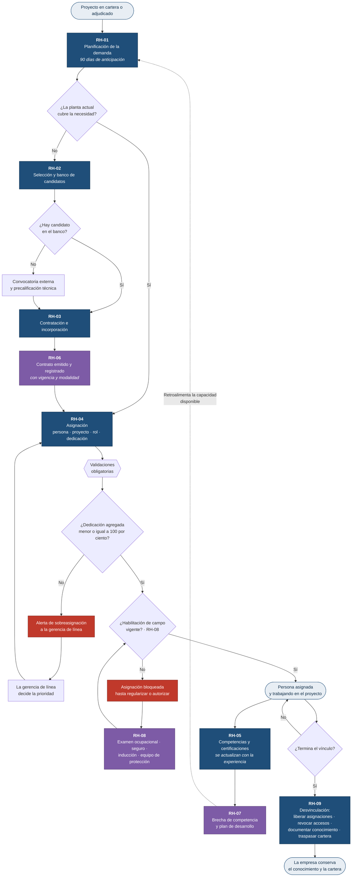
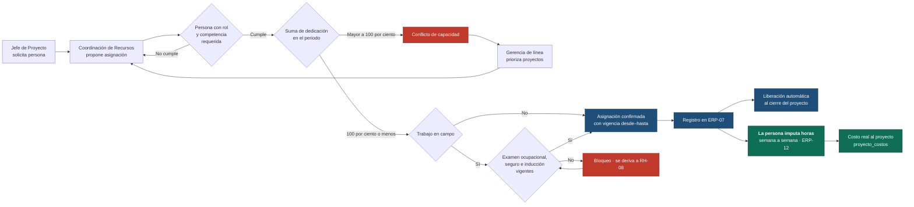
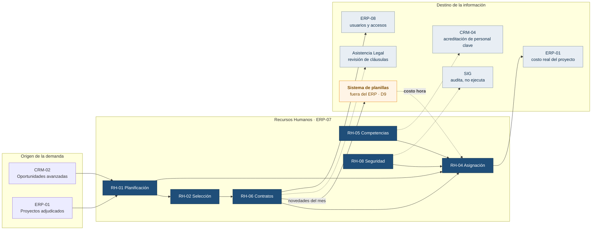

# Documento 02-A · Anexo — Flujogramas de los procesos de Recursos Humanos

**Programa:** Ordenamiento Organizacional y Sistemas de Gestión — Techquk S.A.C.
**Versión:** 2.0 · Agosto 2026 · Anexo del documento 02-A v1.1

> Los tres diagramas responden preguntas distintas y conviene no mezclarlos.
> El **F1** muestra el recorrido completo; el **F2** muestra la única regla que puede detener una asignación; el **F3** muestra de dónde viene y a dónde va la información.

---

## Registro de cambios

| Versión | Fecha | Cambios |
|---|---|---|
| 1.0 | Ago 2026 | Tres flujogramas: ciclo de vida, asignación e interfaces |
| **2.0** | **Ago 2026** | **F2 incorpora la imputación de horas · F3 explicita la frontera con planilla** |

`[S]` Ambos cambios acompañan los del documento 02-A v2.0 y no alteran el diseño propuesto.

---

## F1 · Ciclo de vida: de la previsión a la salida

**Cómo leerlo.** Azul: los procesos que habilitan la ejecución. Morado: cumplimiento y desarrollo. Rojo: los dos puntos donde el sistema **detiene** algo en vez de solo registrarlo.

> **Los dos rombos rojos son el aporte real del ERP.** Todo lo demás lo puede hacer una hoja de cálculo con disciplina. Bloquear una asignación por sobreasignación o por habilitación vencida, no.

---

## F2 · Detalle de RH-04: la asignación y sus controles

> **Lo que este diagrama define para el desarrollo:** la asignación no es un `INSERT` simple. Es una transacción con tres validaciones previas —competencia, capacidad y habilitación— y una fecha de fin que dispara la liberación. Modelarla como un campo `proyecto_actual` en la tabla de personas hace imposible todo lo anterior.

> `[V]` **Las dos cajas verdes son el agregado de la v2.0.** La asignación **planifica** —esta
> persona al 50% entre marzo y junio— pero las horas imputadas **registran lo real**. Si alguien
> asignado al 50% dedicó el 80% porque el proyecto se complicó, el margen calculado sobre la
> asignación está mal.
>
> `[V]` Importa especialmente porque el **55.3% del portafolio son contratos híbridos**, con
> frente de hardware y de software. Sin horas imputadas, ese segundo frente no tiene costo.
>
> `[S]` **Quien imputa es la persona que trabajó**, desde su propia pantalla. Recursos Humanos
> administra la asignación, no captura horas ajenas.

---

## F3 · Interfaces: qué entra, qué sale y con quién

**Línea continua:** el dato pasa y es necesario para continuar. **Línea punteada:** el dato se informa o se consulta, sin detener el proceso.

> **La flecha que más importa es `P5 → CRM-04`.** Es la que convierte a Recursos Humanos en condición de ingreso a una licitación: sin certificación vigente acreditable, la propuesta no se presenta. Es también el argumento más fácil de defender ante Gerencia, porque tiene efecto directo sobre el ingreso.

> `[V]` **La caja naranja es la frontera con planilla, agregada en la v2.0.** El cálculo de
> remuneraciones **no vive en el ERP**: en S10 son 1,050 procedimientos, el segundo módulo más
> grande del sistema, y su costo real es el mantenimiento normativo permanente.
>
> **Dos flechas la cruzan, y van en sentidos opuestos.** RH-06 **entrega** las novedades del mes
> —altas, bajas, cambios de modalidad, ausencias—. Y el sistema de planillas **devuelve** el
> costo hora, sin el cual las horas imputadas son un número sin valor económico.
>
> `[P]` Esa devolución depende de la decisión D9. En su forma más simple es un campo actualizado
> a mano por periodo; en su forma completa, la integración I5 del documento 10.

---

## Nota de uso

Los tres diagramas están en Mermaid, igual que los del documento 01, por lo que se renderizan directamente en MkDocs Material sin plugin adicional.

**Los flujogramas son parte de la hipótesis de diseño**, no de la operación verificada. Sirven bien como material de taller: se proyectan, se pide a los participantes que señalen dónde el recorrido real difiere, y las diferencias señaladas son el hallazgo del taller.

---

*Fin del anexo de flujogramas del documento 02-A v2.0. La versión 1.0 está archivada en
`v1_historico/`.*