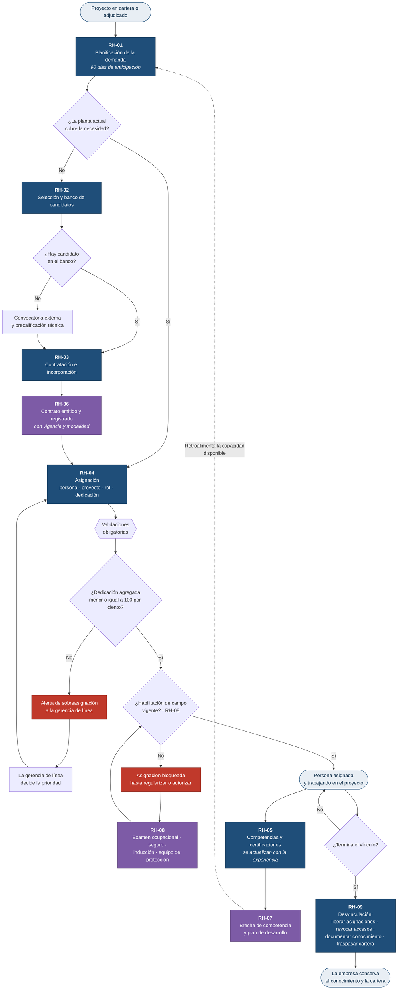

# Documento 02-A — Procesos de Recursos Humanos

**Programa:** Ordenamiento Organizacional y Sistemas de Gestión — Techquk S.A.C.
**Versión:** 2.0 · Agosto 2026

---

## Registro de cambios

| Versión | Fecha | Cambios |
|---|---|---|
| 1.0 | Ago 2026 | Ocho procesos de RRHH con su encuadre y flujogramas |
| **2.0** | **Ago 2026** | **Frontera con planilla · imputación de horas en RH-04 · `contratos` renombrada** |

### Qué cambió y por qué

| Cambio | Motivo |
|---|---|
| **RH-06: la entidad pasa a llamarse `contratos_laborales`** | `contratos` ya está tomada por el módulo ERP-10, que son los contratos **con clientes** |
| **RH-04 incorpora la imputación de horas** | `[V]` Aparece en cinco roles del organigrama; sin ella el margen de un proyecto híbrido no se calcula |
| **Nueva sección 5: la frontera con planilla** | Al decidir el reemplazo de S10, hay que definir qué queda dentro del ERP y qué sale |

> `[S]` **Ninguno de los tres cambios altera el diseño propuesto en la v1.0.** El primero es de
> nombre, el segundo agrega un dato que faltaba, y el tercero explicita un límite que estaba
> implícito.
**Complementa a:** documento 02 (procesos de la cadena de valor) · documento 03 §4.6 (catálogo de roles)

---

## 1. Encuadre

El documento 02 descompone los **procesos de la cadena de valor**: los diecinueve que recorre un proyecto desde la prospección hasta la cobranza. Recursos Humanos no aparece ahí porque no es un tramo de esa cadena: es un **macroproceso de soporte** que la habilita.

La pregunta que responde el área, según el documento 03, es una sola:

> *¿Está la persona correcta disponible cuando el proyecto la necesita?*

Esa pregunta ordena todo lo que sigue. Los procesos que contribuyen a responderla son centrales; los demás son administrativos y podrían tercerizarse sin afectar la operación.

---

## 2. Mapa de procesos (Nivel 1)

| Código | Proceso | Criticidad | Disparador |
|---|---|:--:|---|
| **RH-01** | Planificación de la demanda de personal | ● | Cartera comercial y cronograma de proyectos |
| **RH-02** | Selección y banco de candidatos | ● | Requerimiento de personal o previsión de RH-01 |
| **RH-03** | Contratación e incorporación | ● | Candidato seleccionado |
| **RH-04** | Asignación persona–proyecto–rol–dedicación | ● | Inicio o cambio de alcance de un proyecto |
| **RH-05** | Competencias y certificaciones | ● | Certificación obtenida, vencida o requerida por una convocatoria |
| **RH-06** | Administración de contratos de trabajo y de prestación | ◐ | Vinculación, renovación o vencimiento |
| **RH-07** | Desarrollo del talento, desempeño y clima | ◐ | Ciclo anual · brecha de competencia detectada |
| **RH-08** | Seguridad y salud en el trabajo | ◐ | Trabajo en campo · requisito contractual |
| **RH-09** | Desvinculación y transferencia de conocimiento | ● | Renuncia, fin de contrato o fin de prestación |

**Leyenda:** ● habilita la ejecución de proyectos - "sin esto los proyectos no salen" · ◐ cumplimiento normativo y desarrollo del talento - "sin esto la empresa se expone legalmente o deja de crecer".

---

## 3. Los cinco procesos que sostienen la operación

### RH-01 · Planificación de la demanda de personal

| Campo | Contenido |
|---|---|
| **Entrada** | Oportunidades en etapa avanzada (CRM-02) · proyectos adjudicados con fecha de inicio |
| **Actividades** | Traducir cada proyecto a roles obligatorios según su tipología (T1–T6) · proyectar el pico con **90 días de anticipación** · contrastar contra la planta disponible · decidir entre planta, prestador de servicio o subcontrata |
| **Salida** | Plan de cobertura por proyecto · requerimientos de personal anticipados |
| **Sistema** | ERP-07 · consume plantillas de fases de ERP-01 |

> **Es el proceso que hoy no existe y explica la mayoría de las urgencias.** La fuerza variable oscila entre 4 y 42 prestadores según el mes. Sin previsión, cada pico se resuelve llamando a quien esté disponible, no a quien corresponde.

---

### RH-02 · Selección y banco de candidatos

| Campo | Contenido |
|---|---|
| **Entrada** | Requerimiento de personal con perfil y fecha de necesidad |
| **Actividades** | Consultar primero el banco de candidatos por especialidad y sede · convocar solo si el banco no cubre · precalificar técnicamente con apoyo del área usuaria · verificar antecedentes y referencias |
| **Salida** | Terna o candidato único · banco actualizado |
| **Sistema** | ERP-07 |

> El banco es lo que separa cubrir una vacante en cinco días de cubrirla en veinticinco. Recoge la anotación *"tener el banco de los CV"* del MAP-SIGM-005.

---

### RH-04 · Asignación persona–proyecto–rol–dedicación

| Campo | Contenido |
|---|---|
| **Entrada** | Proyecto con roles obligatorios definidos |
| **Actividades** | Proponer asignación con rol y porcentaje de dedicación · **validar que ninguna persona supere el 100 % agregado** · registrar vigencia (desde–hasta) · emitir alerta de sobreasignación · liberar al cierre del proyecto |
| **Salida** | Registro de asignaciones vigentes · alertas de capacidad · **base para la imputación de horas** |
| **Sistema** | ERP-07 · tabla de asignaciones con vigencia · ERP-12 · `partes_horas` |

> **Es el proceso más importante del área para el sistema.** La asignación es una relación de cuatro elementos —persona, proyecto, rol, dedicación— con vigencia. Modelarla como un campo "proyecto actual" en la ficha de la persona destruye toda la capacidad de análisis: no permite detectar la sobreasignación, que es exactamente el problema que el rol nuevo viene a resolver.
>
> **Frontera:** Recursos Humanos propone la asignación y señala el conflicto. **La prioridad entre proyectos la deciden las gerencias de línea**, no el área.

#### La asignación planifica; las horas registran ★

`[V]` **Este agregado no estaba en la v1.0 y es necesario.** La imputación de horas aparece en
**cinco roles distintos** del organigrama: Gerencia de Operaciones, Jefatura de Desarrollo,
Desarrolladores, y dos más.

Son dos datos distintos y ambos hacen falta:

| Dato | Qué dice | Para qué sirve |
|---|---|---|
| **Asignación** | "Esta persona está al 50% en este proyecto entre marzo y junio" | Planificar capacidad y detectar sobreasignación |
| **Horas imputadas** | "Trabajó 18 horas en este proyecto la semana pasada" | Calcular el **costo real** del proyecto |

`[S]` **Por qué no basta con la asignación.** Un porcentaje de dedicación es una intención. Si
alguien asignado al 50% dedicó en realidad el 80% porque el proyecto se complicó, el margen
calculado sobre la asignación está mal.

`[V]` **Y esto importa especialmente en Techquk** porque el **55.3% del portafolio son contratos
híbridos** —hardware y software en un mismo contrato—. Sin horas imputadas, el frente de
software de esos proyectos no tiene costo, y el margen sale inflado.

`[S]` **La frontera de responsabilidad.** Recursos Humanos administra la asignación; **quien
imputa las horas es la persona que las trabajó**, desde su propia pantalla. El área no captura
horas ajenas.

`[P]` **A validar en el taller:** ¿con qué frecuencia se imputan las horas — diaria, semanal? Y
¿aplica a todos los roles o solo a quienes trabajan en proyectos facturables?

---

### RH-05 · Competencias y certificaciones

| Campo | Contenido |
|---|---|
| **Entrada** | Certificaciones de marca y partner · evidencia declarada en la Sección K del formulario |
| **Actividades** | Registrar nivel por capacidad y persona · registrar certificaciones **con fecha de vencimiento** · alertar vencimientos con anticipación · emitir constancia de personal clave para expedientes de contratación pública |
| **Salida** | Matriz de competencias vigente · acreditación de personal clave |
| **Sistema** | ERP-07 · alimenta CRM-04 |

> Este proceso tiene un uso comercial directo que suele pasarse por alto: **una certificación vencida puede descalificar una propuesta**. Ahí el área deja de ser soporte y pasa a ser condición de ingreso a una licitación.

---

### RH-09 · Desvinculación y transferencia de conocimiento

| Campo | Contenido |
|---|---|
| **Entrada** | Aviso de salida o fin de contrato |
| **Actividades** | Liberar asignaciones vigentes · revocar accesos del sistema · recuperar activos · **documentar lo que la persona sabía hacer y nadie más sabe** · traspasar cartera de contactos al CRM |
| **Salida** | Registro de salida · conocimiento y contactos retenidos por la empresa |
| **Sistema** | ERP-07 · ERP-08 (revocación) · CRM-01 (traspaso de cartera) |

> Es la contrapartida de las preguntas **C7** y **J5** del formulario: quién sabe hacer algo que nadie más sabe, y con qué clientes solo una persona tiene relación. Sin este proceso, cada salida se lleva un pedazo de la empresa.

---

## 4. Los tres procesos de cumplimiento y desarrollo

### RH-06 · Administración de contratos de trabajo y de prestación

| Campo | Contenido |
|---|---|
| **Entrada** | Candidato seleccionado · renovación próxima a vencer · cambio de condiciones |
| **Actividades** | Emitir el contrato según modalidad · **registrar vigencia, modalidad y condiciones en un solo lugar** · controlar vencimientos y renovaciones con anticipación · gestionar altas y bajas ante los registros correspondientes · custodiar el expediente de cada persona · aportar novedades a Contabilidad para la planilla |
| **Salida** | Contrato vigente y archivado · alerta de vencimiento · expediente completo por persona |
| **Sistema** | ERP-07 · tabla de contratos con vigencia · ERP-08 (bitácora) |

> **Sobre "documentar todo lo contractual".** Hoy el vínculo laboral y el de prestación de servicios se administran con criterios distintos y en soportes distintos. El sistema debe tratarlos como **una sola entidad `contratos_laborales` con un campo de modalidad**, no como dos módulos: la persona es la misma, la asignación a proyecto es la misma y el historial debe ser continuo aunque cambie la modalidad.
>
> `[V]` **Sobre el nombre.** En la v1.0 esta entidad se llamaba `contratos` a secas. Se renombró
> porque el módulo ERP-10 del documento 07 ya usa `contratos` para los **contratos con
> clientes** —con penalidad diaria, adendas y cartas fianza—. Son cosas distintas y conviene que
> el nombre lo diga.
>
> `[S]` **Y esto no rompe el patrón Party, lo refuerza.** Party resuelve que la persona exista una
> sola vez sin importar cuántos papeles cumpla; esta propuesta resuelve que el vínculo exista
> una sola vez sin importar su modalidad. Sin Party, alguien que pasa de planilla a locación
> tendría dos fichas de persona; con Party, es la misma persona con dos contratos consecutivos y
> el historial es continuo — que es exactamente lo que este proceso busca.
>
> **Por qué importa más de lo que parece.** Con una fuerza variable de hasta 42 prestadores, el vencimiento no controlado produce dos riesgos concretos: personal trabajando sin cobertura vigente en obra, y contingencia laboral por continuidad no formalizada. Ambos son observables en una auditoría de contratación pública.
>
> **Frontera:** RRHH administra el contrato; **Asistencia Legal revisa las cláusulas** antes de la firma cuando la modalidad se sale del modelo estándar.

---

### RH-07 · Desarrollo del talento, desempeño y clima

| Campo | Contenido |
|---|---|
| **Entrada** | Matriz de competencias (RH-05) · roles obligatorios por tipología (RH-01) · resultados de proyecto |
| **Actividades** | **Comparar la competencia disponible contra la requerida y obtener la brecha** · construir el plan de capacitación y certificación desde esa brecha, no desde el interés declarado · gestionar las certificaciones de partner y su renovación · evaluar el desempeño con criterios ligados al rol · medir clima y actuar sobre lo que produce rotación |
| **Salida** | Plan de desarrollo por persona y por rol · brecha de competencia cuantificada · plan de sucesión de roles críticos |
| **Sistema** | ERP-07 · alimenta la planificación de RH-01 |

> **Sobre "fortalecer el talento humano".** El plan de capacitación solo tiene sentido si nace de una resta: *competencia que los proyectos exigen* menos *competencia que la planta tiene*. Sin esa resta, la capacitación se decide por disponibilidad de cursos o por interés personal, y no mueve la capacidad de la empresa.
>
> **Este proceso es la respuesta estructural a C7 del formulario.** Si una sola persona sabe hacer algo crítico, el plan de desarrollo debe producir un segundo. Esa es la diferencia entre capacitar y **construir respaldo**.
>
> **Encuadre necesario:** la evaluación de desempeño se diseña por separado y con comunicación propia. Mezclarla con el levantamiento —que se prometió explícitamente que no evalúa a nadie— contamina ambas cosas.

---

### RH-08 · Seguridad y salud en el trabajo

| Campo | Contenido |
|---|---|
| **Entrada** | Asignación a proyecto con trabajo en campo · exigencia del contrato o del cliente |
| **Actividades** | Verificar **antes del inicio** que cada persona asignada tenga examen médico ocupacional vigente, seguro complementario cuando corresponda, inducción y equipo de protección · registrar capacitaciones de seguridad · investigar incidentes y accidentes · sostener el registro documental exigible |
| **Salida** | Habilitación de la persona para campo · registros exigibles ante auditoría o cliente |
| **Sistema** | ERP-07 · **bloqueo o alerta en la asignación de RH-04** |

> **Es el proceso con la regla de sistema más dura de toda el área.** La asignación a un proyecto de campo debe **validar la habilitación vigente antes de confirmarse**. Si el examen médico venció o el seguro no está activo, el sistema no debería dejar cerrar la asignación sin una autorización explícita y registrada.
>
> Esa validación convierte un requisito normativo en un control automático, que es exactamente lo que un ERP aporta y una hoja de cálculo no.
>
> **Frontera:** RRHH ejecuta; **el SIG audita y no ejecuta**. Si el SIG operara el proceso, perdería la independencia para revisarlo.

---

## 5. La frontera con planilla ★

`[V]` **Esta sección no estaba en la v1.0 y se vuelve necesaria** al haberse decidido que el
sistema nuevo reemplace a S10 en lugar de convivir con él.

### 5.1 Lo que este documento cubre y lo que no

`[S]` Los ocho procesos descritos son **gestión de personas**: quién es cada quien, qué sabe
hacer, dónde está asignado y bajo qué vínculo.

**La nómina es otra cosa**: calcular cuánto cobra cada persona cada mes, con sus descuentos de
pensión, quinta categoría, gratificaciones, compensación por tiempo de servicios y la
declaración mensual ante SUNAT.

| Función | ¿Está en el ERP? |
|---|---|
| Ficha de la persona, competencias, certificaciones | **Sí** — ERP-07 |
| Contrato laboral con su modalidad y vigencia | **Sí** — ERP-07 |
| Asignación a proyecto con dedicación | **Sí** — ERP-07 |
| Imputación de horas trabajadas | **Sí** — ERP-12 |
| Cálculo de remuneraciones, boletas, PLAME | `[P]` **Depende de la decisión D9** |

### 5.2 Por qué la nómina no se desarrolla

`[V]` **El argumento de tamaño.** En el ERP S10 que Techquk opera, el módulo de planillas son
**1,050 procedimientos** y 103 tablas — el segundo más grande de todo el sistema.

`[S]` **Y el argumento del mantenimiento, que pesa más.** El costo real no es construirlo sino
seguirlo: las tasas de administradoras de pensión cambian varias veces al año, la remuneración
mínima se actualiza, la UIT cambia en enero, y el formato de la declaración mensual se
modifica.

Cada uno de esos cambios es trabajo de desarrollo **que no se puede postergar**: si la
declaración no sale en el formato correcto, la empresa no puede declarar.

`[P]` **La decisión D9 del documento 01** define si la nómina vive en software especializado
—escenario recomendado— o dentro del sistema. Ver documento 01, sección 8-bis.

### 5.3 Lo que el ERP necesita de vuelta

`[V]` Aunque la nómina viva afuera, hay **un dato que tiene que regresar**: el **costo hora** de
cada persona.

`[S]` Sin él, las horas imputadas en RH-04 son un número de horas sin valor económico, y el
margen del proyecto queda incompleto.

| Forma de resolverlo | Costo | Riesgo |
|---|---|---|
| **Campo actualizado a mano por periodo** | Minutos por periodo | Se desactualiza si nadie lo revisa |
| **Integración con el sistema de nómina** | Desarrollo de la conexión | Menor, pero depende del proveedor |

`[S]` **Recomendación: empezar con el campo manual.** Es la única de las conexiones externas del
programa donde el modo mínimo tiene una consecuencia real —distorsiona el margen— así que
conviene fijar una revisión periódica explícita, no confiar en que alguien se acuerde.

### 5.4 Lo que RRHH sí aporta a la nómina

`[V]` RH-06 ya lo menciona: *"aportar novedades a Contabilidad para la planilla"*.

`[S]` Concretamente, el ERP es la fuente de las novedades del mes: altas y bajas de personal,
cambios de modalidad de contrato, vencimientos de vigencia, y ausencias registradas en la
disponibilidad.

**Esa exportación de novedades es la integración I5** del documento 10, sección 10.3.

---

## 6. Puntos a validar en el taller ★

1. ¿Con qué frecuencia se imputarían las horas — diaria o semanal?
2. ¿La imputación aplica a todos los roles o solo a quienes trabajan en proyectos facturables?
3. ¿Dónde se calcula hoy la planilla, y ese sistema permite entregar y recibir datos?
4. ¿Quién actualizaría el costo hora y con qué periodicidad?
5. ¿Cuántas personas están hoy bajo cada modalidad de vínculo?
6. ¿Existe hoy algún registro de competencias y certificaciones, o está en la memoria de las jefaturas?

---

*Fin del documento 02-A v2.0. La versión 1.0 está archivada en `v1_historico/`. Los flujogramas
están en `02A-Anexo-Flujogramas-RRHH.md`.*