# Documento 03 — Organigrama propuesto, catálogo de roles y casos de uso

**Versión:** 1.0 · Agosto 2026

## 1. Argumentación del diseño

### 1.1 Por qué cinco gerencias y no otras

El primer nivel se define por un criterio único: **una gerencia por cada pregunta que la empresa necesita responder de forma permanente.**

| Gerencia | Pregunta que responde | 
|---|---|
| **Gerencia General** | ¿Hacia dónde vamos y con qué recursos? | 
| **Gerencia Comercial** | ¿De dónde vienen los ingresos futuros? | 
| **Gerencia de Operaciones y Proyectos** | ¿Entregamos lo prometido, a tiempo y al costo previsto? | 
| **Gerencia de Suministro y Comercio Exterior** | ¿Tenemos el bien correcto, al costo correcto, a tiempo? **Elevada** desde Jefatura de Logística |
| **Gerencia de Administración** | ¿Cobramos, pagamos y controlamos el resultado? | 
| **Gerencia de Recursos Humanos** | ¿Está disponible la persona correcta cuando el proyecto la necesita? | 

### 1.2 Por qué Desarrollo de Software va dentro de Operaciones y Proyectos

**Argumento 1 — Los contratos son híbridos, no separables.**

P6 y P9, del Hospital Regional Docente Las Mercedes, tienen por objeto *"sistema de información, software y servidor, además de otros activos"*. Un solo contrato. Un solo cliente. Un solo plazo. Una sola acta de conformidad. El servidor y el software no son dos proyectos: son dos frentes del mismo proyecto, y quien recibe la penalidad si uno de los dos falla es la empresa, no un área.

Si el software estuviera en otra gerencia, ese contrato tendría **dos gerentes y ningún responsable único**. La matriz RACI exige una sola A por proceso. Poner el desarrollo fuera de Operaciones la rompe en el 55.3 % del portafolio.

**Argumento 2 — El plazo es común y muy corto.**

P9 dispone de **40 días** para importar el servidor, instalarlo, desplegar el sistema de información y ponerlo en marcha en un hospital en funcionamiento. P6 tuvo **23 días** para lo mismo. Coordinar frentes con ese plazo requiere que alguien pueda reasignar prioridades entre hardware y software **en el mismo día y sin escalar a Gerencia General**. Una frontera entre gerencias en ese punto no organiza: retrasa.

**Argumento 3 — La escala no justifica una gerencia.**

El equipo de desarrollo son cuatro personas: un analista y tres desarrolladores. Una gerencia para cuatro personas es la misma ficción administrativa que este documento critica en el MAP-SIGM-005.

**Argumento 4 — La Gerencia de Operaciones y Proyectos queda correctamente descrita.**

Con el desarrollo adentro, esa gerencia gobierna **todo lo que se entrega al cliente**: obra, suministro instalado, software, servicio gestionado y postventa. Su pregunta —*¿entregamos lo prometido?*— cubre por fin el total de los entregables, y no solo la parte física.

**Contrapartida a considerar.** La Gerencia de Operaciones y Proyectos concentra ahora seis jefaturas y aproximadamente doce personas. Es la gerencia más grande y por amplio margen. Eso es coherente con que ahí ocurre la entrega, pero **hace crítico liberar al gerente de la ejecución directa**: por eso el *Jefe de Proyectos y/o Residente* es una de las vacantes priorizadas. Mientras Julio Palacios sea a la vez gerente, jefe de proyectos y administrador de contratos, la gerencia depende de una sola persona.

### 1.3 Por qué Suministro sale de Administración y se eleva a gerencia

Es la única gerencia nueva. Cuatro razones:
{Informacion a Validar}
1. **Concentra el mayor riesgo económico documentado.** Existe una penalidad por mora registrada de **S/ 250,498.54**, monto superior al valor íntegro de cinco de los nueve contratos del portafolio.
2. **Es la principal causa de incumplimiento de plazo.** En contratos de suministro, la entrega tardía se origina con más frecuencia en la llegada del equipo que en la instalación.
3. **Exige competencias que no son administrativas.** Techquk realizó **80 operaciones de importación en 2024**, por USD 452.3 mil CIF, vía marítima por la Aduana del Callao y con dos agentes de aduana. Clasificación arancelaria, condiciones de entrega internacionales y coordinación aduanera no son habilidades de oficina administrativa.
4. **Hoy no tiene dueño formal.** El MAP-SIGM-005 no contiene ninguna casilla de comercio exterior ni de almacén, pese a que ambas funciones se ejecutan.

> Cuando una función crítica no tiene dueño, la ejerce quien tiene tiempo, que rara vez es quien tiene el criterio.

Dejarla como jefatura dentro de Administración la subordina al ciclo administrativo, cuando su ritmo lo marca el plazo del proyecto. La elevación no agrega personas: **Alexander Nayra y Enrique Vargas son los mismos**, con responsabilidad precisada y una vacante nueva.

## 2. Criterios de diseño

| # | Criterio | Aplicación |
|---|---|---|
| **C1** | Toda actividad crítica tiene un responsable único | Ningún proceso queda sin dueño nominado |
| **C2** | Agrupar por afinidad de proceso, no de persona | Las gerencias se definen por macroproceso |
| **C3** | Separar quien vende, quien ejecuta y quien paga | Control interno básico |
| **C4** | Estructura viable para el tamaño real | Multifunción **declarada**, con titular e interinato explícitos |
| **C5** | Crecer por función, no por persona | Cada puesto nuevo responde a una brecha demostrada |
| **C6** | Proporcionalidad entre estructura, ingreso y riesgo | §1.4 |
| **C7** | Continuidad del equipo | §1.5 |
| **C8** | Trazabilidad de vacantes | §5 |
| **C9** | **Una jefatura solo si tiene personas a cargo** | Evita la inflación de jefaturas unipersonales (CH16) |
| **C10** | **Un contrato, un responsable de entrega** | Fundamento de §1.2 |

---

## 3. Organigrama propuesto v1

```mermaid
flowchart TB
    JGA["JUNTA GENERAL DE ACCIONISTAS"] --> GG["GERENCIA GENERAL<br/><b>Miguel Sánchez</b>"]

    GG --- SGI["Jefatura de Sistema Integrado<br/>de Gestión<br/><i>staff · VACANTE</i>"]
    GG --- LEG["Asistente Legal Interno<br/><i>staff · VACANTE</i>"]

    GG --> COM["GERENCIA COMERCIAL<br/><i>Miguel Sánchez (interino)</i>"]
    GG ==> OPE["GERENCIA DE OPERACIONES<br/>Y PROYECTOS<br/><b>Julio Palacios</b>"]
    GG ==> SUM["GERENCIA DE SUMINISTRO<br/>Y COMERCIO EXTERIOR ★<br/><b>Alexander Nayra</b>"]
    GG --> ADM["GERENCIA DE<br/>ADMINISTRACIÓN<br/><b>Cristhian Díaz</b>"]
    GG --> RRH["GERENCIA DE<br/>RECURSOS HUMANOS<br/><b>Yuliana Cóndor</b>"]

    COM --> C1["Jefatura de Ventas<br/><i>3 VACANTES</i>"]
    COM --> C2["Jefatura de Preventa y Costeo<br/><b>Ronal Barboza</b><br/><i>+2 VACANTES</i>"]
    COM --> C3["Licitaciones y Contrataciones<br/>del Estado ★<br/><i>VACANTE · prioridad 3</i>"]
    COM --> C4["Marketing y Comunicación<br/><i>3 VACANTES</i>"]

    OPE --> P1["Jefatura de Proyectos<br/><i>Julio Palacios (interino)</i><br/><i>1 VACANTE · prioridad 5</i>"]
    P1 --> P2["Administración de Contratos ★<br/><i>rol · Julio Palacios</i>"]
    OPE --> P3["Jefatura de Ingeniería<br/><b>Fanny · Ronal · Sebastián S.</b><br/><i>+3 perfiles requeridos</i>"]
    OPE --> P4["Jefatura de Desarrollo<br/>de Software y Apps<br/><b>VACANTE</b>"]
    OPE --> P9["Jefatura de Ciberseguridad<br/>y Monitoreo de Soluciones<br/><i>VACANTE · prioridad 6</i>"]
    OPE --> P10["Jefatura de Help Desk<br/>y Garantías<br/><i>2 VACANTES</i>"]
    OPE --> P11["Small Business<br/><i>VACANTE</i>"]

    P4 --> P5["Analista Funcional<br/><b>Sebastián R.</b>"]
    P4 --> P6["Desarrolladores<br/><b>Anderson · Lenart · Yair</b><br/><i>+2 VACANTES</i>"]
    P4 --> P7["DBA e Ingeniería de Datos ★<br/><i>VACANTE · prioridad 2</i>"]
    P4 --> P12["Aseguramiento de Calidad ★<br/><i>VACANTE · prioridad 4</i>"]

    SUM --> S1["Jefatura de Compras<br/>e Importaciones ★<br/><i>Alexander Nayra (interino)</i><br/><i>1 VACANTE · prioridad 1</i>"]
    SUM --> S2["Jefatura de Almacén<br/>e Inventario<br/><b>Enrique Vargas</b>"]

    ADM --> A1["Jefatura de Contabilidad<br/><b>Johana Llontop</b>"]
    A1 --> A2["Auxiliares de Contabilidad<br/><b>Vanessa Martínez</b><br/><b>Joshep Gutiérrez</b>"]
    ADM --> A3["Jefatura de Finanzas<br/>y Tesorería<br/><b>Lisset Sánchez</b><br/><i>+1 VACANTE</i>"]
    ADM --> A4["Asistente de Administración<br/><i>VACANTE</i>"]
    ADM --> A5["Coordinador de TI Interna<br/><i>VACANTE</i>"]
    ADM --> A6["Servicios Generales<br/><b>Adriano Vargas</b><br/><b>Marlene Sánchez · Janeth Rivera</b>"]

    RRH --> R1["Coordinación de Recursos<br/>y Asignaciones ★<br/><b>Yuliana Cóndor</b>"]
    RRH --> R2["Selección y Banco de CV<br/><b>Yuliana Cóndor</b>"]

    classDef dir fill:#0D1B2A,stroke:#000000,color:#FFFFFF
    classDef linea fill:#7B3F00,stroke:#4A2600,color:#FFFFFF
    classDef apoyo fill:#2C5F8A,stroke:#1E3A5F,color:#FFFFFF
    classDef staff fill:#F4F1DE,stroke:#8D6E3A,color:#4A3C1D
    classDef ocupado fill:#EEF2F7,stroke:#5B7C99,color:#1E3A5F
    classDef mixto fill:#FFF4E6,stroke:#E8890C,color:#7B4A00
    classDef vacante fill:#FDE8E8,stroke:#C0392B,color:#7B241C

    class JGA,GG dir
    class OPE,SUM linea
    class COM,ADM,RRH apoyo
    class SGI,LEG staff
    class P4,P5,S2,A1,A2,A6,R1,R2 ocupado
    class P1,P3,P6,C2,A3,S1 mixto
    class C1,C3,C4,P2,P7,P8,P9,P10,P11,P12,A4,A5 vacante
```

**Cómo leer el diagrama.** Línea gruesa (`==>`): gerencias que **entregan y abastecen**. Línea simple: gerencias que **captan y administran**. Línea horizontal: **staff**, asesora y no manda. **★** rol o unidad nueva. Rojo: vacante completa. Naranja: con titular y plazas pendientes.

---

## 4. Catálogo de roles y responsabilidades

Cada puesto declara seis campos. El cuarto —**de qué no se encarga**— es el que evita el trabajo duplicado y las tareas huérfanas.

---

### 4.1 Dirección y staff

#### Gerencia General — *Miguel Sánchez*

| Campo | Contenido |
|---|---|
| **Misión** | Definir el rumbo del negocio, asignar recursos y responder por el resultado |
| **Se encarga de** | Aprobar la participación en contratos sobre umbral · autorizar compras e inversiones mayores · fijar precios fuera de política · resolver conflictos entre gerencias · representar a la empresa ante clientes clave y entidades · aprobar contrataciones |
| **Decide** | Estructura, inversión, precios excepcionales, contratación de personal |
| **No se encarga de** | La ejecución operativa de ningún proceso. Si la Gerencia General opera, ninguna gerencia puede rendir cuentas de su área |
| **Indicador** | Rentabilidad · crecimiento de facturación · liquidez |
| **En el sistema** | Lectura total · aprobación sobre umbral · tablero gerencial |

#### Jefatura de Sistema Integrado de Gestión — *VACANTE (staff)*

| Campo | Contenido |
|---|---|
| **Misión** | Que los procedimientos existan, estén vigentes y se cumplan |
| **Se encarga de** | Custodiar el mapa de procesos y el catálogo de roles · controlar versiones documentales · auditar cumplimiento · gestionar no conformidades · velar por la seguridad en trabajos de riesgo · completar los pendientes declarados en el propio MAP-SIGM-005 (diagramas de flujo, funciones y perfiles de puesto) |
| **Decide** | Aprobación de versiones documentales · observación de incumplimientos |
| **No se encarga de** | Ejecutar los procesos que audita. Su autoridad es de veto sobre el cumplimiento, no de mando sobre la operación |
| **Indicador** | Procesos documentados vigentes · acciones de mejora cerradas |
| **En el sistema** | Lectura transversal · administración documental |

> Se asigna a una persona existente con dedicación parcial. No requiere contratación.

#### Asistente Legal Interno — *VACANTE (staff)*

| Campo | Contenido |
|---|---|
| **Misión** | Proteger a la empresa en sus compromisos contractuales |
| **Se encarga de** | Revisar bases de licitación y contratos antes de la firma · asesorar en penalidades, adendas y ampliaciones · revisar propiedad intelectual en contratos de desarrollo · atender materia laboral y societaria |
| **Decide** | Recomendación de firmar o no · observaciones a bases |
| **No se encarga de** | Armar el expediente de licitación, que corresponde a Licitaciones |
| **Indicador** | Contratos revisados antes de firma · controversias evitadas |
| **En el sistema** | Lectura de contratos y expedientes |

---

### 4.2 Gerencia Comercial

#### Gerencia Comercial — *Miguel Sánchez (interino)*

| Campo | Contenido |
|---|---|
| **Misión** | Asegurar el flujo de oportunidades calificadas y su conversión rentable |
| **Se encarga de** | Dirigir captación, propuesta y contratación · decidir en qué convocatorias participar · aprobar cotizaciones y descuentos dentro de política · mantener la relación con clientes clave · responder por el margen ofertado |
| **Decide** | Descuentos dentro de política · prioridad de oportunidades · participación en convocatorias |
| **No se encarga de** | **Comprometer plazos de entrega sin validación de Suministro**, ni alcances técnicos sin validación de Preventa o Desarrollo |
| **Indicador** | Valor del embudo · tasa de conversión · margen promedio ofertado |
| **En el sistema** | CRM completo · aprobación de cotizaciones · lectura de proyectos |

#### Jefatura de Ventas — *3 VACANTES*

| Campo | Contenido |
|---|---|
| **Misión** | Desarrollar cartera y cerrar negocios, con énfasis en el canal privado |
| **Se encarga de** | Prospectar y calificar oportunidades · visitar y mantener relación con clientes · negociar dentro del límite autorizado · **registrar toda actividad comercial en el sistema** · traspasar formalmente el proyecto ganado a Operaciones |
| **Decide** | Agenda comercial propia · descuentos hasta el límite autorizado |
| **No se encarga de** | Definir la solución técnica ni comprometer fechas de entrega |
| **Indicador** | Oportunidades creadas · monto cerrado · actividades registradas |
| **En el sistema** | CRM sobre cartera propia · creación de cotizaciones |

#### Jefatura de Preventa y Costeo — *Ronal Barboza · 2 VACANTES*

| Campo | Contenido |
|---|---|
| **Misión** | Traducir la necesidad del cliente en una solución correcta y correctamente costeada |
| **Se encarga de** | Levantar el requerimiento técnico · diseñar la solución y seleccionar marcas entre los partners homologados · elaborar la lista de materiales · **costear con el costo puesto en almacén, no con precio de lista** · estructurar y sustentar la propuesta técnica · solicitar a Desarrollo la estimación de esfuerzo cuando hay software |
| **Decide** | Configuración técnica propuesta · marcas a emplear |
| **No se encarga de** | Negociar el precio final ni comprometer la fecha de entrega |
| **Indicador** | Desviación entre la lista de materiales cotizada y la ejecutada · tiempo de respuesta de propuesta |
| **En el sistema** | Catálogo · cotizador · histórico de proyectos similares |

> Fusiona *Pre-Venta* y *Cotizador* del MAP-SIGM-005. Costear no es un paso posterior al diseño: es parte del mismo acto. Separarlos produce propuestas técnicamente correctas y económicamente inviables.

#### Licitaciones y Contrataciones del Estado ★ — *VACANTE · prioridad 3*

| Campo | Contenido |
|---|---|
| **Misión** | Maximizar la participación exitosa en el canal público sin fallas formales |
| **Se encarga de** | Monitorear convocatorias en SEACE · analizar bases y evaluar conveniencia · formular consultas y observaciones · armar el expediente completo · **presentar dentro del plazo** · gestionar garantías y el RNP · registrar resultados y precios de la competencia |
| **Decide** | Recomendación de participar o no · interposición de consultas y observaciones |
| **No se encarga de** | Diseñar la solución técnica ni costearla |
| **Indicador** | Convocatorias evaluadas · tasa de adjudicación · **expedientes observados: meta cero** |
| **En el sistema** | Módulo de licitaciones · alertas de plazo · histórico de precios |

> **Riesgo binario.** Un plazo perdido o un documento faltante invalida una oferta completa, por buena que sea técnicamente. La totalidad del ingreso registrado proviene de este canal.

#### Marketing y Comunicación — *3 VACANTES*

| Campo | Contenido |
|---|---|
| **Misión** | Que el mercado sepa qué hace Techquk y con qué respaldo |
| **Se encarga de** | Gestionar presencia digital y redes · producir piezas gráficas y material técnico comercial · organizar y participar en eventos de tecnología · mantener la relación con los partners de marca · apoyar la presentación de propuestas |
| **Decide** | Calendario de contenidos y participación en eventos |
| **No se encarga de** | Prospección ni cierre comercial |
| **Indicador** | **Oportunidades atribuibles a acciones de marketing** |
| **En el sistema** | Registro de campañas y su atribución a oportunidades |

> Consolida *Diseñador*, *Eventos TI* y *Community Manager*, conservando las tres plazas. El indicador existe justamente para que, si el aporte se demuestra, la función pueda crecer con evidencia y no por supuesto.

---

### 4.3 Gerencia de Operaciones y Proyectos

#### Gerencia de Operaciones y Proyectos — *Julio Palacios*

| Campo | Contenido |
|---|---|
| **Misión** | Entregar lo comprometido —obra, equipamiento, software y servicio— en plazo y dentro del margen previsto |
| **Se encarga de** | Dirigir ejecución y postventa de **todos** los entregables · asignar recursos técnicos y de desarrollo · priorizar entre proyectos simultáneos · aceptar o rechazar ampliaciones de plazo · responder por el margen de ejecución · **arbitrar entre el frente de hardware y el de software cuando compiten por el mismo plazo** |
| **Decide** | Asignación de cuadrillas y de equipo de desarrollo · prioridad entre proyectos · métodos de ejecución |
| **No se encarga de** | Negociar el contrato ni comprometer precios |
| **Indicador** | Cumplimiento de plazo · margen de ejecución vs. presupuestado · actas de conformidad obtenidas |
| **En el sistema** | Proyectos, avance, consumo, imputación de horas · lectura de compras |

> **Es la gerencia de mayor alcance de la estructura**, y ese es su fundamento: aquí ocurre la entrega. Por lo mismo, liberar al gerente de la ejecución directa mediante la cobertura de la Jefatura de Proyectos es una prioridad, no un lujo.

#### Jefatura de Proyectos — *Julio Palacios (interino) · 1 VACANTE · prioridad 5*

| Campo | Contenido |
|---|---|
| **Misión** | Administrar el ciclo de vida completo de cada proyecto: alcance, cronograma, costo, riesgos y comunicación con el cliente |
| **Se encarga de** | Planificar y programar · controlar avance físico y financiero · **coordinar los frentes de hardware, software y puesta en marcha** · gestionar riesgos y control de cambios · obtener el acta de conformidad · cerrar y liquidar el proyecto |
| **Decide** | Reprogramación interna de hitos · escalamiento de riesgos · solicitud de control de cambios |
| **No se encarga de** | Ejecutar técnicamente. Si el jefe de proyecto instala o programa, deja de gestionar |
| **Indicador** | Desviación de plazo y de costo · actas obtenidas dentro del plazo |
| **En el sistema** | Proyectos asignados · cronograma · requerimientos de compra |

> **Dos modalidades del mismo rol.** *Jefe de Proyectos* gestiona desde oficina y puede llevar varios proyectos a la vez. *Residente* permanece en obra y lleva uno solo. No deben confundirse al asignar: el modo Residente aplica a proyectos como el de radioenlaces y torres, ejecutado fuera del departamento durante 198 días.

#### Administración de Contratos ★ — *rol · Julio Palacios*

| Campo | Contenido |
|---|---|
| **Misión** | Que ningún contrato genere penalidad por causa administrativa |
| **Se encarga de** | Registrar plazos, hitos y penalidades de cada contrato · **alertar con anticipación sobre vencimientos** · gestionar adendas y ampliaciones · tramitar valorizaciones y conformidades · custodiar cartas fianza y sus vencimientos · mantener el expediente contractual completo |
| **Decide** | Momento de solicitar formalmente una ampliación de plazo |
| **No se encarga de** | La ejecución técnica ni la negociación comercial del contrato |
| **Indicador** | **Penalidades incurridas: meta cero** · conformidades obtenidas dentro del plazo |
| **En el sistema** | Contratos con vigencia, penalidad diaria y alertas automáticas |

> **Rol, no puesto.** Se asigna a un titular existente y no requiere contratación. Su origen es directo: una penalidad por mora de S/ 250,498.54, superior al monto íntegro de cinco de los nueve contratos registrados.

#### Jefatura de Ingeniería — *Fanny · Ronal · Sebastián S. · 3 perfiles requeridos*

| Campo | Contenido |
|---|---|
| **Misión** | Ejecutar la instalación conforme al diseño, con calidad y seguridad |
| **Se encarga de** | Diseñar la solución técnica de campo · instalar y configurar equipamiento · tender cableado estructurado y fibra · montar torres y alinear radioenlaces · instalar videovigilancia y seguridad electrónica · configurar servidores y virtualización · ejecutar pruebas de puesta en marcha · levantar observaciones · registrar evidencia de avance |
| **Decide** | Método de instalación · **detención de trabajos por condición insegura**, decisión que no se revierte por presión de plazo |
| **No se encarga de** | Comprometer fechas con el cliente ni autorizar trabajos adicionales |
| **Indicador** | Observaciones en la aceptación · reprocesos · incidentes de seguridad |
| **En el sistema** | Registro de avance · consumo de materiales · carga de evidencias |

> *Arquitecto*, *Estructuralista* y *Especialista TI* son **perfiles requeridos** heredados del MAP-SIGM-005, no personas ni puestos permanentes. Se convocan por proyecto según su tipología.

#### Jefatura de Desarrollo de Software y Apps — *Vacante*

| Campo | Contenido |
|---|---|
| **Misión** | Construir y mantener los sistemas que la empresa vende, dentro del esfuerzo estimado y con calidad verificable |
| **Se encarga de** | Dirigir el ciclo de desarrollo · definir arquitectura y estándares técnicos · **estimar el esfuerzo de las propuestas con componente de software antes de que Comercial oferte** · asignar al equipo entre proyectos · responder por los entregables de software ante el Jefe de Proyectos · mantener la hoja de ruta del producto propio (ERP hospitalario) |
| **Decide** | Arquitectura, tecnologías, estándares de código, prioridad técnica interna |
| **No se encarga de** | La ejecución física en campo ni la instalación de hardware, que corresponden a Ingeniería · tampoco de negociar plazo con el cliente |
| **Indicador** | Desviación de esfuerzo estimado vs. real · defectos detectados en producción · entregas dentro de fecha comprometida |
| **En el sistema** | Proyectos de desarrollo · imputación de horas · lectura de costos |

> **Es la jefatura que sostiene el 76.8 % del ingreso registrado.** Su peso no está en el rango sino en su dotación: seis puestos especializados, tres de ellos por cubrir.

#### Analista Funcional — *Sebastián R.*

| Campo | Contenido |
|---|---|
| **Misión** | Traducir la necesidad del cliente en una especificación que el equipo pueda construir sin adivinar |
| **Se encarga de** | Relevar requerimientos con el cliente · redactar especificaciones funcionales y criterios de aceptación · modelar procesos y datos · gestionar el alcance y los cambios · capacitar a los usuarios finales · elaborar la documentación funcional del entregable |
| **Decide** | Interpretación funcional del requerimiento · prioridad de funcionalidades dentro de una fase |
| **No se encarga de** | Negociar precio ni plazo con el cliente |
| **Indicador** | Requerimientos aceptados sin retrabajo · cambios de alcance por especificación deficiente |
| **En el sistema** | Especificaciones · criterios de aceptación · gestión de cambios |

#### Desarrolladores — *Anderson · Lenart · Yair · 2 VACANTES*

| Campo | Contenido |
|---|---|
| **Misión** | Construir el software conforme a la especificación y al estándar técnico |
| **Se encarga de** | Programar funcionalidades · corregir defectos · documentar técnicamente · participar en revisiones de código · **imputar sus horas al proyecto correspondiente** · desplegar en los ambientes definidos |
| **Decide** | Detalles de implementación dentro de la arquitectura aprobada |
| **No se encarga de** | Definir el alcance ni comprometer fechas con el cliente |
| **Indicador** | Funcionalidades entregadas conformes · defectos por entrega |
| **En el sistema** | Tareas · imputación de horas · repositorio |

> **La imputación de horas no es burocracia.** En un proyecto de desarrollo, las horas de ingeniería son el costo dominante. Sin registrarlas, el margen del 76.8 % del negocio es invisible.

#### DBA e Ingeniería de Datos ★ — *VACANTE · prioridad 2*

| Campo | Contenido |
|---|---|
| **Misión** | Que los datos estén disponibles, íntegros y sean recuperables |
| **Se encarga de** | Diseñar y mantener modelos de datos · optimizar consultas y rendimiento · **administrar respaldos y verificar que la restauración funcione** · ejecutar migraciones de datos en implantaciones · controlar accesos a la información sensible |
| **Decide** | Modelo físico de datos · política de respaldo · índices y optimizaciones |
| **No se encarga de** | La lógica de negocio de la aplicación |
| **Indicador** | Disponibilidad de la base · tiempo de recuperación **verificado** · migraciones sin pérdida |
| **En el sistema** | Administración de base de datos · auditoría de accesos |

> Existe como *DBA* vacante en el MAP-SIGM-005. Se amplía su alcance a ingeniería de datos. En un sistema hospitalario, la integridad y la confidencialidad del dato no son un requisito técnico más.

#### Especialista de Integraciones ★ — *VACANTE · prioridad 2*

| Campo | Contenido |
|---|---|
| **Misión** | Que dos sistemas que no fueron diseñados para hablarse se entiendan de forma confiable |
| **Se encarga de** | Diseñar y construir procesos de extracción, transformación y carga · integrar con sistemas de terceros mediante interfaces · orquestar flujos automatizados · **monitorear las canalizaciones y gestionar sus fallas** · documentar el contrato de interfaz con cada contraparte · coordinar con el área técnica del cliente |
| **Decide** | Arquitectura de integración · frecuencia y modo de sincronización · tratamiento de errores y reprocesos |
| **No se encarga de** | Desarrollar las aplicaciones que consumen esos datos |
| **Indicador** | Canalizaciones operando sin intervención manual · registros perdidos o duplicados en la sincronización |
| **En el sistema** | Registro de integraciones por cliente · bitácora de ejecución |

> **Puesto nuevo.** Lo exige el proyecto de automatización de flujos de la Policía Nacional del Perú. Es un oficio distinto del desarrollo de aplicaciones: trabaja sobre sistemas ajenos, que no puede modificar y cuyo comportamiento no controla.

#### Aseguramiento de Calidad ★ — *VACANTE · prioridad 4*

| Campo | Contenido |
|---|---|
| **Misión** | Encontrar los defectos antes que el cliente |
| **Se encarga de** | Diseñar y ejecutar casos de prueba · verificar criterios de aceptación · probar regresiones antes de cada entrega · registrar y seguir defectos hasta su cierre · **certificar que una versión está lista para entregar** |
| **Decide** | **Aprobar o bloquear una entrega.** Es decisión autónoma y no se revierte por presión de plazo |
| **No se encarga de** | Corregir los defectos que encuentra. La independencia entre quien construye y quien prueba es la razón de ser del puesto |
| **Indicador** | Defectos detectados antes de la entrega vs. después · entregas rechazadas por el cliente |
| **En el sistema** | Casos de prueba · registro de defectos · certificación de versiones |

#### Jefatura de Ciberseguridad y Monitoreo de Soluciones — *VACANTE · prioridad 6*

| Campo | Contenido |
|---|---|
| **Misión** | Que los servicios contratados estén disponibles todos los días del contrato |
| **Se encarga de** | Operar plataformas de monitoreo · administrar servicios en la nube contratados por clientes · **responder por el nivel de servicio comprometido** · atender incidentes de seguridad · emitir reportes periódicos al cliente · gestionar renovaciones y vencimientos de suscripciones · asegurar la configuración de los servidores entregados |
| **Decide** | Clasificación de criticidad de incidentes · medidas de contención inmediata |
| **No se encarga de** | El soporte al usuario final de equipos, que corresponde a Help Desk |
| **Indicador** | Disponibilidad efectiva vs. comprometida · incidentes de seguridad · renovaciones gestionadas a tiempo |
| **En el sistema** | Contratos de servicio con vigencia y nivel comprometido · tablero de disponibilidad |

> Existe en el MAP-SIGM-005 con coordinador vacante. Se amplía a gestión de nivel de servicio: hay contratos de nube con vigencias de hasta **372 días**, que no se gobiernan con un jefe de proyecto ni con una mesa de ayuda.

#### Jefatura de Help Desk y Garantías — *2 VACANTES*

| Campo | Contenido |
|---|---|
| **Misión** | Que el cliente resuelto sea también el cliente que vuelve |
| **Se encarga de** | Recibir y clasificar solicitudes de soporte · atender incidentes dentro del nivel comprometido · **gestionar garantías con el fabricante y tramitar devoluciones** · ejecutar mantenimientos preventivos · atender el período de garantía contractual · medir satisfacción · escalar lo que no puede resolver |
| **Decide** | Clasificación de criticidad · asignación inicial del incidente |
| **No se encarga de** | Operar los servicios gestionados en la nube, que corresponde a Ciberseguridad y Monitoreo |
| **Indicador** | Cumplimiento de nivel de servicio · resolución en primer contacto · satisfacción |
| **En el sistema** | Tickets con nivel de servicio · garantías · consulta de inventario y series |

> Agrupa las casillas vacantes de *Help Desk y Garantías* y *Atención al Cliente*. Ambas plazas se conservan.

#### Small Business — *VACANTE*

| Campo | Contenido |
|---|---|
| **Misión** | Ejecutar contratos menores con costo de gestión proporcional a su tamaño |
| **Se encarga de** | Contratos menores del Estado hasta 8 UIT y privados con entrega directa · cotizar, coordinar la entrega y obtener la conformidad, **todo en un solo rol y sin cronograma completo** |
| **Decide** | Aceptación y programación de encargos menores dentro de política |
| **No se encarga de** | Proyectos con obra, ingeniería de campo o plazo extendido |
| **Indicador** | Encargos entregados a tiempo · margen unitario |
| **En el sistema** | Flujo comercial simplificado |

> Se conserva tal como el MAP-SIGM-005 la define, porque está bien definida. Su razón de ser es evitar que un contrato de cien mil soles consuma la misma estructura de gestión que uno de un millón y medio.

---

### 4.4 Gerencia de Suministro y Comercio Exterior

#### Gerencia de Suministro y Comercio Exterior — *Alexander Nayra*

| Campo | Contenido |
|---|---|
| **Misión** | El bien correcto, al costo correcto, en el plazo comprometido |
| **Se encarga de** | Dirigir abastecimiento, importación y almacén · homologar proveedores · responder por el costo puesto en almacén · **certificar el plazo de abastecimiento antes de que Comercial comprometa una fecha con el cliente** |
| **Decide** | Selección de proveedor dentro de política · condiciones de entrega · nivel de existencias de seguridad |
| **No se encarga de** | La instalación del bien adquirido |
| **Indicador** | Costo puesto en almacén vs. presupuestado · cumplimiento de plazo de abastecimiento |
| **En el sistema** | Compras, importaciones e inventario completos · lectura de proyectos y cotizaciones |

> **Facultad de veto.** Ninguna propuesta puede comprometer fecha de entrega sin que Suministro haya validado el plazo de abastecimiento. Es el control directo contra la repetición de la penalidad por mora.

#### Jefatura de Compras e Importaciones ★ — *Alexander Nayra (interino) · 1 VACANTE · prioridad 1*

| Campo | Contenido |
|---|---|
| **Misión** | Traer lo que el proyecto necesita, sabiendo cuánto cuesta de verdad y cuándo llega |
| **Se encarga de** | Cotizar y comparar proveedores nacionales e internacionales · emitir órdenes de compra · coordinar embarque y transporte internacional · **gestionar al agente de aduana y la nacionalización** · calcular el costo completo incluyendo arancel, flete, seguro y gastos · seguir la mercadería en tránsito e informar al Jefe de Proyectos · reclamar al proveedor por faltantes o daños |
| **Decide** | Proveedor dentro de política · modalidad de transporte · momento de emitir la orden según el plazo del proyecto |
| **No se encarga de** | Custodiar la mercadería una vez recibida, que corresponde a Almacén |
| **Indicador** | Días de tránsito reales vs. estimados · desviación del costo de nacionalización · órdenes llegadas después de la fecha requerida |
| **En el sistema** | Órdenes de compra · expediente de importación con declaración aduanera · costeo completo |

> **Prioridad número uno.** 80 operaciones de importación en 2024 por USD 452.3 mil CIF, con dos agentes de aduana, y ninguna casilla en el organigrama vigente.

#### Jefatura de Almacén e Inventario — *Enrique Vargas*

| Campo | Contenido |
|---|---|
| **Misión** | Saber siempre qué hay, dónde está y en qué estado |
| **Se encarga de** | Recepcionar e inspeccionar contra la orden de compra · **registrar números de serie** · almacenar y ubicar · controlar existencias · despachar a obra con guía de remisión · controlar activos en tránsito entre sedes · ejecutar inventarios cíclicos |
| **Decide** | **Aceptar, aceptar con observación o rechazar una recepción** · ubicación y método de almacenamiento |
| **No se encarga de** | Negociar con proveedores ni emitir órdenes de compra |
| **Indicador** | Exactitud de inventario · diferencias en recuento · despachos a tiempo |
| **En el sistema** | Movimientos de almacén · series · guías de remisión · inventarios |

> Amplía el puesto de *Auxiliar Logístico*. El registro de series es lo que permite después atender una garantía sin adivinar qué equipo se instaló dónde.

---

### 4.5 Gerencia de Administración

#### Gerencia de Administración — *Cristhian Díaz*

| Campo | Contenido |
|---|---|
| **Misión** | Asegurar la liquidez, el cumplimiento tributario y laboral, y el control del resultado |
| **Se encarga de** | Dirigir administración, contabilidad, finanzas y TI interna · programar pagos · fijar condiciones de crédito · supervisar la cobranza · **controlar el resultado por proyecto** · administrar los usuarios del sistema |
| **Decide** | Programación de pagos · condiciones de crédito · notas de crédito dentro de umbral |
| **No se encarga de** | La gestión de personas, que corresponde a Recursos Humanos |
| **Indicador** | Días de cobranza · liquidez · cumplimiento de obligaciones |
| **En el sistema** | Módulo administrativo completo · lectura total · administración de usuarios |

#### Jefatura de Contabilidad — *Johana Llontop*

| Campo | Contenido |
|---|---|
| **Misión** | Registro contable exacto, oportuno y conforme a la normativa |
| **Se encarga de** | Registrar operaciones · emitir comprobantes electrónicos · llevar libros y declaraciones · conciliar cuentas · **registrar el costo de importación completo por expediente** · coordinar con la asesoría externa especializada |
| **Decide** | Tratamiento contable de las operaciones dentro de la normativa |
| **No se encarga de** | Decidir a quién y cuándo se paga, que corresponde a Finanzas y Tesorería |
| **Indicador** | Comprobantes sin observación · declaraciones en plazo · cierre mensual oportuno |
| **En el sistema** | Módulo contable · comprobantes · costeo de importación |

#### Auxiliares de Contabilidad — *Vanessa Martínez · Joshep Gutiérrez*

| Campo | Contenido |
|---|---|
| **Misión** | Procesar la documentación contable con exactitud y oportunidad |
| **Se encarga de** | Registro de comprobantes de compra y venta · archivo y custodia documental · apoyo a conciliaciones · seguimiento de detracciones y retenciones · preparación de información para declaraciones |
| **Decide** | Clasificación contable rutinaria dentro del plan de cuentas |
| **No se encarga de** | Criterios contables no rutinarios ni tratamiento de operaciones especiales |
| **Indicador** | Documentos registrados en plazo · errores de registro detectados en revisión |
| **En el sistema** | Registro contable operativo · sin acceso a márgenes por proyecto |

#### Jefatura de Finanzas y Tesorería — *Lisset Sánchez · 1 VACANTE*

| Campo | Contenido |
|---|---|
| **Misión** | Convertir la facturación en efectivo dentro del plazo |
| **Se encarga de** | Seguir la cobranza cliente por cliente · conciliar bancos · ejecutar pagos programados · **gestionar cartas fianza y controlar sus vencimientos** · proyectar el flujo de caja · administrar líneas de crédito |
| **Decide** | Gestión y escalamiento de la cobranza · aplicación de pagos |
| **No se encarga de** | El registro contable de las operaciones |
| **Indicador** | Antigüedad de la deuda · efectividad de cobranza · días de caja disponibles |
| **En el sistema** | Estado de cuenta · registro de cobros y pagos · garantías vigentes |

> **Facturar y cobrar no son lo mismo.** Con los plazos de pago del Estado, una empresa puede facturar bien y quedarse sin efectivo. La carta fianza vencida y no devuelta es capital inmovilizado sin que nadie lo note.

#### Asistente de Administración — *VACANTE*

| Campo | Contenido |
|---|---|
| **Misión** | Que la documentación fluya y esté donde debe estar |
| **Se encarga de** | Gestión documental y archivo · trámites ante entidades · apoyo a la emisión de comprobantes · coordinación de agenda y logística administrativa · apoyo al armado de expedientes |
| **No se encarga de** | Decisiones contables ni financieras |
| **Indicador** | Trámites completados en plazo · documentación localizable |
| **En el sistema** | Módulo administrativo operativo · sin acceso a costos ni márgenes |

> **Unifica las dos casillas duplicadas** *Asistente de Adm* del MAP-SIGM-005, que aparecían con idéntico rótulo bajo Administración y bajo Recursos Humanos.

#### Coordinador de TI Interna — *VACANTE*

| Campo | Contenido |
|---|---|
| **Misión** | Que las herramientas de trabajo de la propia empresa funcionen |
| **Se encarga de** | Equipos, correo, accesos y respaldos internos · soporte a los colaboradores · administración de licencias corporativas · seguridad informática interna · administración de cuentas del ERP y el CRM |
| **Decide** | Estándar de equipamiento interno · política de accesos |
| **No se encarga de** | Los sistemas que se venden a clientes, que corresponden a Desarrollo de Software |
| **Indicador** | Disponibilidad de servicios internos · tiempo de atención |
| **En el sistema** | Administración de usuarios y accesos internos |

> **No confundir con Desarrollo de Software.** Una construye para el cliente; esta atiende puertas adentro.

#### Servicios Generales — *Adriano Vargas (conductor) · Marlene Sánchez · Janeth Rivera (limpieza)*

| Campo | Contenido |
|---|---|
| **Misión** | Que las sedes y el transporte estén operativos |
| **Se encarga de** | Transporte de personal, equipos y materiales a obra · **traslado entre sedes y a proyectos fuera del departamento** · mantenimiento y limpieza de locales · custodia de vehículos y su documentación |
| **Decide** | Ruta y programación del traslado dentro de lo requerido |
| **No se encarga de** | La custodia del inventario, que corresponde a Almacén |
| **Indicador** | Disponibilidad de movilidad · cumplimiento de traslados programados |
| **En el sistema** | Registro de traslados asociados a proyecto |

> El traslado a obra es parte de la cadena de entrega. En proyectos ejecutados fuera de Chiclayo, la movilidad es una restricción real de plazo, no un servicio auxiliar.

---

### 4.6 Gerencia de Recursos Humanos

#### Gerencia de Recursos Humanos — *Yuliana Cóndor*

| Campo | Contenido |
|---|---|
| **Misión** | Que esté disponible la persona correcta cuando el proyecto la necesita |
| **Se encarga de** | Reclutar y seleccionar · administrar contratos de trabajo y de prestadores de servicio · gestionar planilla en coordinación con Contabilidad · capacitación y certificaciones de partners · clima y desempeño · seguridad y salud en el trabajo junto con el SIG |
| **Decide** | Proceso de selección · condiciones de contratación dentro de política |
| **No se encarga de** | El cálculo y registro contable de la planilla |
| **Indicador** | Cobertura de roles por proyecto · rotación · tiempo de cobertura de una vacante |
| **En el sistema** | Personas, contratos, asignaciones y competencias |

#### Coordinación de Recursos y Asignaciones ★ — *Yuliana Cóndor*

| Campo | Contenido |
|---|---|
| **Misión** | Administrar la elasticidad de la fuerza de trabajo sin improvisar |
| **Se encarga de** | Mantener el registro de asignaciones persona–proyecto–rol–dedicación · **controlar que nadie supere el 100 % de dedicación agregada** · anticipar los picos de carga con al menos 90 días · activar el banco de prestadores · registrar competencias y certificaciones disponibles |
| **Decide** | Propuesta de asignación · alerta de sobreasignación |
| **No se encarga de** | La prioridad entre proyectos, que corresponde a las gerencias de línea |
| **Indicador** | Roles obligatorios cubiertos antes del inicio de cada proyecto · personas sobreasignadas |
| **En el sistema** | Tabla de asignaciones con vigencia · alertas de capacidad |

> **Rol nuevo.** La fuerza de trabajo variable oscila entre **4 y 42 prestadores de servicio** según el mes, con máximo en febrero de 2025, sobre un núcleo permanente de 8 a 9 personas. Sin este control, el pico se administra improvisando.

#### Selección y Banco de CV — *Yuliana Cóndor*

| Campo | Contenido |
|---|---|
| **Misión** | Tener a quién llamar antes de necesitarlo |
| **Se encarga de** | Mantener un banco de candidatos por especialidad y por sede · precalificar técnicos y especialistas · gestionar la incorporación y la inducción |
| **Indicador** | Días para cubrir un requerimiento de personal |

> Recoge la anotación *"Tener el banco de los CV"* del propio MAP-SIGM-005.

---

## 5. Reglas de frontera

Las fricciones previsibles, resueltas por anticipado:

| Situación | Regla |
|---|---|
| Comercial quiere comprometer una fecha de entrega | **Suministro certifica el plazo de abastecimiento antes de la oferta.** Sin esa validación, la propuesta no sale |
| La propuesta incluye software | **Desarrollo estima el esfuerzo antes de ofertar.** Comercial no compromete alcance de software sin esa estimación |
| Un proyecto lleva hardware y software a la vez | **Un solo Jefe de Proyecto rinde cuentas.** Ingeniería y Desarrollo aportan frentes; no hay dos responsables |
| Ingeniería y Desarrollo compiten por el mismo plazo | **Arbitra el Gerente de Operaciones y Proyectos**, en el día y sin escalar |
| Calidad bloquea una entrega y el plazo aprieta | **La decisión de Calidad no se revierte por presión de plazo.** Solo la Gerencia General puede levantarla, dejando constancia escrita |
| Una persona es requerida por dos proyectos | **Recursos y Asignaciones alerta; la gerencia de línea prioriza.** Nadie supera el 100 % de dedicación agregada |
| Ingeniería detiene un trabajo por condición insegura | **La decisión no se discute.** Se documenta y se replanifica |
| Llega mercadería con observaciones | **Almacén decide aceptar, observar o rechazar.** Compras no puede forzar la recepción |

---

## 6. Casos de uso

Ningún organigrama debe aprobarse sin verificar que funciona. A continuación, dos proyectos reales recorridos de principio a fin.

### 6.1 Caso 1 — Proyecto híbrido de alta exigencia

**Referencia:** contrato del Hospital Regional Docente Las Mercedes, 2025. *Sistema de información, software y servidor, además de otros activos.* **S/ 1,560,000 · 40 días de plazo.**

Es el contrato más grande del portafolio —el 44 % del total histórico— y el que mejor prueba la estructura, porque exige simultáneamente importación, instalación, desarrollo y puesta en marcha en un hospital en funcionamiento.

| Etapa | Quién actúa | Qué hace | Qué produce |
|---|---|---|---|
| **1. Detección** | Licitaciones ★ | Detecta la convocatoria en SEACE, analiza bases, evalúa conveniencia y plazos | Recomendación de participar |
| **2. Solución técnica** | Preventa y Costeo · Jefatura de Ingeniería · Jefatura de Desarrollo | Preventa define el equipamiento; Ingeniería valida la instalación; **Desarrollo estima el esfuerzo del sistema de información** | Lista de materiales + estimación de horas |
| **3. Validación de plazo** | **Gerencia de Suministro** | Certifica en cuántos días puede tener el servidor en almacén, considerando importación y nacionalización | **Fecha de abastecimiento certificada** |
| **4. Oferta** | Gerencia Comercial · Gerencia General | Construye el precio con costo puesto en almacén más horas de ingeniería; Gerencia General aprueba por monto | Oferta presentada en plazo |
| **5. Adjudicación** | Licitaciones ★ · Asistente Legal | Gestiona garantías; Legal revisa el contrato antes de la firma | Contrato firmado, carta fianza emitida |
| **6. Apertura** | Jefatura de Proyectos · **Administración de Contratos ★** | Registra plazo, hitos y penalidad diaria; **activa alertas de vencimiento**; arma el cronograma con tres frentes | Proyecto abierto con alertas |
| **7. Asignación** | Recursos y Asignaciones ★ | Verifica que todos los roles obligatorios estén cubiertos y que nadie supere el 100 % de dedicación | Equipo asignado y validado |
| **8. Frente hardware** | Compras e Importaciones ★ → Almacén | Emite la orden, coordina embarque y agente de aduana, nacionaliza; Almacén recibe, verifica contra orden y **registra series** | Servidor y activos en almacén, con costo real |
| **9. Frente software** | Analista Funcional · Desarrolladores · DBA ★ | Releva con el hospital, especifica, construye, prepara la migración de datos | Sistema construido |
| **10. Calidad** | Aseguramiento de Calidad ★ | Prueba contra criterios de aceptación y **certifica o bloquea la versión** | Versión certificada |
| **11. Instalación** | Jefatura de Ingeniería | Instala servidor y activos; configura y ejecuta pruebas | Infraestructura operativa |
| **12. Puesta en marcha** | Ciberseguridad y Monitoreo · Analista Funcional | Asegura la configuración del servidor; el Analista capacita a los usuarios | Sistema en producción, usuarios capacitados |
| **13. Conformidad** | **Administración de Contratos ★** | Tramita el acta dentro del plazo | Acta de conformidad |
| **14. Facturación** | Contabilidad → Finanzas y Tesorería | Emite comprobante; Tesorería sigue la cobranza y **controla el vencimiento de la carta fianza** | Facturación cobrada, fianza liberada |
| **15. Postventa** | Help Desk y Garantías | Atiende el período de garantía consultando las series registradas en la etapa 8 | Garantía atendida sin reconstruir información |

**Qué demuestra este caso**

1. **Los frentes de hardware y software conviven bajo un mismo Jefe de Proyectos.** En 40 días no hay margen para coordinar entre gerencias: si el servidor se retrasa, la fecha de despliegue del software se mueve el mismo día. Ese arbitraje ocurre dentro de la Gerencia de Operaciones y Proyectos. **Es el argumento del §1.2 verificado sobre un contrato real.**
2. **Aparecen cuatro roles que hoy no existen** —Licitaciones, Compras e Importaciones, Administración de Contratos y Calidad— y los cuatro intervienen en etapas donde hay pérdida documentada.
3. **La etapa 3 es el control contra la penalidad.** Sin la certificación de Suministro, la oferta compromete una fecha que nadie verificó. Es exactamente lo que produce una mora.
4. **La etapa 8 alimenta la etapa 15.** El registro de series al recibir es lo que permite atender la garantía dos años después sin adivinar.

### 6.2 Caso 2 — Proyecto de integración sin componente físico

**Referencia:** automatización de flujos para la Policía Nacional del Perú, en ejecución. Canalización de datos e integración entre sistemas. **Sin hardware.**

Este caso prueba la estructura por el lado opuesto: un proyecto donde Suministro no interviene y donde el riesgo no está en el plazo de entrega sino en sistemas de terceros que la empresa no controla.

| Etapa | Quién actúa | Qué hace | Qué produce |
|---|---|---|---|
| **1. Captación** | Gerencia Comercial · Licitaciones ★ | Identifica la oportunidad y evalúa el marco de contratación | Decisión de participar |
| **2. Factibilidad técnica** | **Especialista de Integraciones ★** · Analista Funcional | Determina a qué sistemas hay que conectarse, con qué interfaces y qué restricciones impone la contraparte | Informe de factibilidad y riesgos de integración |
| **3. Estimación** | Jefatura de Desarrollo | Estima el esfuerzo, **incluyendo el tiempo de coordinación con el área técnica del cliente**, que suele subestimarse | Estimación de horas por perfil |
| **4. Oferta** | Gerencia Comercial | Construye la propuesta sobre horas de ingeniería, sin componente de bienes | Oferta presentada |
| **5. Apertura** | Jefatura de Proyectos · Administración de Contratos ★ | Registra hitos y entregables; el riesgo principal es la **dependencia de terceros**, que se registra explícitamente | Proyecto abierto con riesgo declarado |
| **6. Asignación** | Recursos y Asignaciones ★ | Asigna Integraciones, Analista, Desarrolladores y DBA con dedicación por fase | Equipo asignado |
| **7. Diseño** | Especialista de Integraciones ★ · DBA ★ | Diseña procesos de extracción, transformación y carga; define el modelo de datos destino; **documenta el contrato de interfaz con cada contraparte** | Diseño de integración documentado |
| **8. Construcción** | Desarrolladores · Integraciones ★ | Construye las canalizaciones y la orquestación de flujos | Canalizaciones construidas |
| **9. Calidad** | Aseguramiento de Calidad ★ | Prueba con datos reales anonimizados; verifica que no haya registros perdidos ni duplicados | Certificación de integridad |
| **10. Puesta en marcha** | Integraciones ★ · Ciberseguridad y Monitoreo | Despliega y **deja las canalizaciones bajo monitoreo permanente** | Flujos automatizados en operación |
| **11. Operación** | Ciberseguridad y Monitoreo | Vigila la ejecución, gestiona fallas y reprocesos, reporta al cliente | Servicio operando con nivel comprometido |
| **12. Conformidad y cobro** | Administración de Contratos ★ → Contabilidad → Tesorería | Conformidad, facturación y cobranza | Proyecto cerrado y cobrado |

**Qué demuestra este caso**

1. **Suministro no interviene en absoluto.** La estructura no fuerza a todos los proyectos por el mismo camino: cada tipología activa solo los roles que necesita.
2. **La etapa 11 no tiene fin natural.** Una canalización de datos no se entrega y se olvida: queda operando. Por eso Ciberseguridad y Monitoreo debe cubrirse; sin ese puesto, el proyecto termina en el correo personal de quien lo construyó.
3. **La etapa 2 justifica el puesto de Integraciones.** Un desarrollador de aplicaciones no evalúa factibilidad de conexión con sistemas ajenos. Son oficios distintos, y el proyecto lo demuestra antes de empezar.
4. **El costo es enteramente horas de ingeniería.** Sin imputación de horas, este proyecto no tiene margen calculable. Es la razón de que la imputación sea obligatoria para los desarrolladores.

### 6.3 Contraste breve — Contrato menor

**Referencia:** servidor tipo rack para la Municipalidad Provincial de Chiclayo. **S/ 105,990 · 30 días.**

Recorrido completo: **Small Business** cotiza y coordina · **Compras e Importaciones ★** trae el equipo · **Almacén** recibe y registra la serie · **Ingeniería** instala y configura · **Small Business** obtiene la conformidad · **Contabilidad y Tesorería** facturan y cobran.

**Seis intervenciones, sin cronograma completo y sin Jefe de Proyectos.** Eso es exactamente lo que la unidad *Small Business* del MAP-SIGM-005 buscaba, y por eso se conserva: un contrato de cien mil soles no puede consumir la misma estructura de gestión que uno de un millón y medio.

---

## 7. Vacantes priorizadas

| Prioridad | Puesto | Brecha que cierra | Evidencia | Cobertura interina |
|---|---|---|---|---|
| **1** | Compras e Importaciones ★ | Abastecimiento sin dueño | Penalidad de S/ 250,498.54 · 80 importaciones en 2024 | Alexander Nayra |
| **2** | DBA e Ingeniería de Datos · Especialista de Integraciones ★ | Capacidad exigida por el proyecto PNP y por el ERP hospitalario | Canalización de datos e integración con sistemas de terceros | Sebastián R. |
| **3** | Licitaciones y Contrataciones del Estado ★ | Canal público disperso | Nueve contratos públicos · RNP vigente · 100 % del ingreso registrado | Miguel Sánchez |
| **4** | Aseguramiento de Calidad ★ | Desarrollo sin control de calidad | Contrato de desarrollo de S/ 390,000 sin función de aseguramiento | Sebastián R. |
| **5** | Jefe de Proyectos y/o Residente | Ejecución sin gestión dedicada | Vacante en el MAP-SIGM-005 · libera al Gerente de Operaciones | Julio Palacios |
| **6** | Jefatura de Ciberseguridad y Monitoreo | Servicio recurrente sin dueño | Contrato de nube de 372 días de vigencia | Ingeniería |
| **7** | Help Desk y Garantías · Atención al Cliente | Soporte reactivo | Dos casillas vacantes en el MAP-SIGM-005 | Ingeniería |
| **8** | Jefatura de Sistema Integrado de Gestión | Procedimientos sin custodio | Vacante · pendientes declarados en el propio documento | Por asignar |
| **9** | Ventas · Marketing · Asistente de Administración · TI Interna | Canal privado y soporte administrativo | Sin ingreso registrado atribuible al canal privado | Miguel Sánchez / Cristhian Díaz |

**Regla de contratación.** Cada incorporación se justifica con evidencia obtenida del propio sistema. Si tras la Fase 1 el ERP demuestra que el retraso de abastecimiento causa la mayoría de los incumplimientos de plazo, la contratación deja de ser una opinión y pasa a ser una decisión respaldada.

---

## 8. Puntos a validar con Gerencia

1. ¿Se aprueba la estructura de cinco gerencias más la Gerencia General?
2. ¿Se confirma que **Desarrollo de Software y Apps permanece dentro de la Gerencia de Operaciones y Proyectos**, bajo Julio Palacios?
3. ¿Se aprueba la elevación de Logística a **Gerencia de Suministro y Comercio Exterior**, con Alexander Nayra como gerente?
4. ¿Se aprueba el criterio de proporcionalidad C6 y el rebalanceo que produce?
5. ¿Se aprueba la consolidación de Marketing y de Preventa y Costeo, conservando todas las plazas?
6. ¿Se confirma el orden de las nueve prioridades del §8?
7. ¿Qué plazo se fija para los interinatos de Miguel Sánchez, Julio Palacios, Alexander Nayra y Yuliana Cóndor?
8. ¿Quién asume la Jefatura de Sistema Integrado de Gestión?
9. Observaciones abiertas: ¿*Ronal* de Ingeniería y *Ronal Barboza* de Preventa son la misma persona? ¿Se registrarán nombres completos de *Sebastián R.* y *Sebastián S.*?

---

## Anexo A — Reubicación nominal

| Persona | MAP-SIGM-005 | Propuesta v4.0 |
|---|---|---|
| **Miguel Sánchez** | Gerencia General · Gerencia Comercial | Gerencia General + Gerencia Comercial (interino declarado) |
| **Julio Palacios** | Gerencia de Operaciones y Proyectos | Gerencia de Operaciones y Proyectos + Jefatura de Proyectos (interino) + Administración de Contratos |
| **Cristhian Díaz** | Gerencia de Administración | Gerencia de Administración |
| **Yuliana Cóndor** | Gerencia de Recursos Humanos | Gerencia de Recursos Humanos + Coordinación de Recursos y Asignaciones |
| **Alexander Nayra** | Jefatura de Logística | **Gerencia de Suministro y Comercio Exterior** + Compras e Importaciones (interino) |
| **Enrique Vargas** | Auxiliar Logístico | Jefatura de Almacén e Inventario |
| **Johana Llontop** | Jefatura de Contabilidad | Jefatura de Contabilidad |
| **Vanessa Martínez** | Auxiliar de Contabilidad | Auxiliar de Contabilidad |
| **Joshep Gutiérrez** | Contabilidad | Auxiliar de Contabilidad |
| **Lisset Sánchez** | Jefatura de Finanzas | Jefatura de Finanzas y Tesorería |
| **Ronal Barboza** | Pre-Venta | Jefatura de Preventa y Costeo |
| **** | Analista (Desarrollo de Software) | **Jefatura de Desarrollo de Software y Apps** + Analista Funcional |
| **Anderson · Lenart · Yair** | Desarrollador Junior | Desarrolladores |
| **Fanny · Ronal · Sebastián S.** | Ingeniería | Jefatura de Ingeniería |
| **Adriano Vargas** | Conductor | Servicios Generales — Conductor |
| **Marlene Sánchez · Janeth Rivera** | Personal de Limpieza | Servicios Generales |

**21 posiciones nominadas. Ninguna persona queda fuera de la estructura.**

## Anexo B — Corrección sobre comercio exterior

El documento 00 consignaba que el registro SUNAT indica *"Actividad de Comercio Exterior: SIN ACTIVIDAD"* e infería abastecimiento vía terceros.

Los registros aduaneros disponibles indican lo contrario: **80 operaciones de importación en 2024, por un valor CIF aproximado de USD 452.3 mil**, con origen principal en Brasil, Colombia y Estados Unidos, por vía marítima a través de la Aduana del Callao, con intervención de dos agentes de aduana.

Consecuencias: se refuerza la elevación de Suministro a gerencia; el módulo de abastecimiento debe contemplar costeo de importación completo —declaración aduanera, arancel, flete, seguro y gastos de nacionalización—; y debe verificarse con Contabilidad la discrepancia entre el registro tributario y los registros aduaneros.

## Anexo C — Limitaciones

1. **El portafolio analizado cubre solo contratación pública registrada.** No incluye clientes privados, subcontratos ni ventas directas. Si el canal privado tiene peso significativo, la prioridad baja asignada a Ventas y Marketing debe revisarse.
2. **Existe al menos un contrato no visible en el registro público**, anterior a diciembre de 2020, evidenciado por una penalidad registrada sin contrato asociado.
3. **Los casos de uso del §7 son reconstrucciones** de cómo la estructura propuesta procesaría cada proyecto, no un registro de cómo se ejecutaron.
4. **Los datos provienen de agregadores de fuentes oficiales.** Antes de emitir la versión definitiva conviene verificarlos en SEACE y en el Registro de Sanciones.

---

*Fin del documento 03 v4.0. Continuar con `04-Formulario-Levantamiento.md`.*