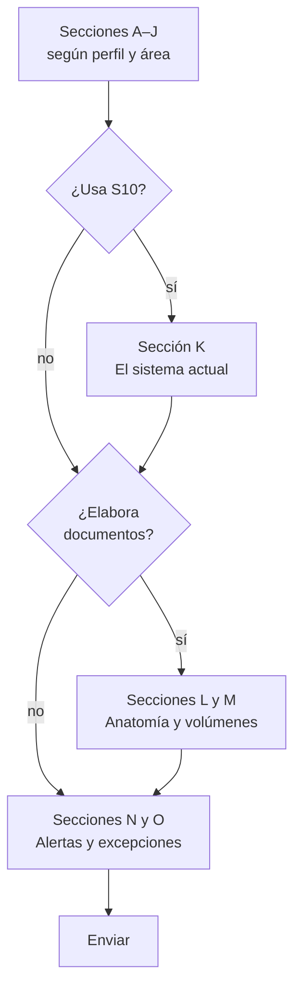

# Documento 04-A — Método del levantamiento

**Programa:** Ordenamiento Organizacional y Sistemas de Gestión — Techquk S.A.C.
**Versión:** 1.0 · Agosto 2026
**Formulario:** `04-Formulario-Levantamiento.md` · publicado en `form.jotform.com/262254666913059`

---

## Registro de cambios

| Versión | Fecha | Cambios |
|---|---|---|
| **1.0** | **Ago 2026** | **Documento nuevo. Recoge el método que antes estaba dentro del documento 04, que ahora contiene solo el formulario** |

---

## 1. Qué es este documento

`[S]` El documento 04 contiene **el formulario**: qué se pregunta y cómo. Este contiene **el
método**: por qué se pregunta cada cosa, a quién se aplica, qué se hace con las respuestas y qué
produce cada sección para el sistema.

Se separaron porque tienen usos distintos. El 04 se usa para armar y editar el formulario; este
se usa para justificarlo ante Gerencia y para procesar los resultados.

---

## 2. Un levantamiento, cuatro instrumentos

| Instrumento | Qué captura | A quién se aplica |
|---|---|---|
| **I-1 · Formulario** | Funciones, procesos, decisiones, herramientas | Todo el personal |
| **I-2 · Entrevista de reconstrucción** | La secuencia real de un proyecto vivido | 6 a 8 personas clave |
| **I-3 · Verificación documental** | La cronología objetiva de un caso | Sobre documentos, no personas |
| **I-4 · Sesión de detalle funcional** ★ | **Campos, estados y reglas de cálculo** | **5 a 7 dueños de proceso** |

`[S]` **I-4 es el que produce la especificación.** Se aplica después del formulario, cuando ya se
sabe quién es dueño de qué, y se hace con documentos reales sobre la mesa.

### Regla de asignación

| Perfil | I-1 | I-2 | I-3 | I-4 |
|---|:--:|:--:|:--:|:--:|
| Gerencia | ● | ● | | |
| Jefatura o coordinación | ● | ● | ● | ● |
| Analista, desarrollador o técnico | ● | ○ | | ○ |
| Auxiliar o asistente | ● | | | ○ |
| Conductor o servicios generales | ● | | | |
| Prestador externo recurrente | ● | | | |

● obligatorio · ○ según sea dueño de un documento

---

## 3. Por qué cada sección existe

### Las diez secciones originales

| Sección | Por qué se pregunta |
|---|---|
| **A** Identificación | `[S]` La diferencia entre A.5 (cargo contractual) y A.6 (cargo percibido) es el primer indicador de desalineación entre lo formal y lo real |
| **B** Ubicación | `[S]` B.3 —de quién recibe instrucciones en la práctica— revela las líneas de mando que el organigrama no muestra |
| **C** Funciones | `[S]` C.3 y C.4 son las que producen **reglas de negocio**: qué se rompe y qué criterio se aplica cuando no hay procedimiento |
| **D** Proyecto concreto | `[S]` D.4 —cómo se enteró del problema— produce los **requisitos de alerta** del sistema |
| **E** Procesos | `[S]` E.7 pregunta quién **debería** ser responsable, no quién lo es. Es la que revela los desacuerdos de fondo |
| **F** Herramientas | `[S]` F.2 identifica los archivos paralelos que el sistema debe absorber |
| **G** Decisiones | `[S]` Produce la matriz de autorizaciones del núcleo |
| **H** Documentos | `[S]` Mapea el flujo documental y quién firma qué |
| **I** Problemas | `[S]` I.5 —qué le gustaría ver al empezar el día— define los **paneles por rol** |
| **J** Cartera | `[S]` Identifica qué información de clientes está fuera del control de la empresa |

### Las cinco secciones nuevas

`[S]` El formulario original levanta muy bien **cómo trabaja la organización**. Lo que no
levantaba es la información que el desarrollo necesita para escribir una pantalla.

| Sección | Qué resuelve | Sin ella |
|---|---|---|
| **K · El sistema actual** | Cómo se trabaja hoy en S10 | Se diseña sin saber qué ya funciona y qué estorba |
| **L · Anatomía documental** | Qué campos y estados tiene cada documento | El documento 08 sigue siendo inferencia |
| **M · Volúmenes y búsqueda** | Cuántos y cómo se encuentran | Pantallas sin filtros, listas de mil filas |
| **N · Alertas** | Qué debería avisarle el sistema | Notificaciones inventadas por el analista |
| **O · Excepciones** | El caso más raro que le tocó | El diseño se rompe en el mes tres |

> `[S]` **Por qué importa esta ampliación.** El documento 08 admite que entre un tercio y la
> mitad de sus columnas cambiará después del levantamiento. Ese cambio solo ocurre si el
> levantamiento pregunta por columnas.

### Las tres preguntas de mayor rendimiento

`[S]` Si hubiera que quedarse con tres del instrumento entero:

**L.1 — Adjunte un documento real.** Un documento impreso responde en dos minutos lo que una
entrevista de media hora no consigue. Si la cotización tiene columna de descuento, la columna
existe.

**L.4 — Llévenos por la vida de ese documento.** Produce el catálogo de estados y las
transiciones permitidas de una sola vez, sin que la persona sepa qué es una máquina de estados.

**K.5 — Qué le obliga a hacer el sistema que no tiene sentido.** Revela dónde el sistema actual
estorba, que es lo que el nuevo no debe repetir. Y suele dar las respuestas más francas del
formulario, porque la persona siente que le preguntan por un problema y no por su desempeño.

---

## 4. Lógica condicional

`[S]` Sin filtrado, el instrumento se vuelve inabordable para quien tiene poco que aportar.

| Perfil | Secciones que ve |
|---|---|
| Gerencia | A–J · N · O |
| Jefatura que produce documentos | Todas |
| Analista o técnico que usa S10 | A–J · K · N · O |
| Auxiliar | A–J · K · N |
| Conductor o servicios generales | A–C · E.9 · F · I · N |
| Prestador externo | A · C · H · I |

`[S]` **El conductor no debería ver quince secciones.** Un formulario de cuarenta minutos para
quien tiene poco que aportar produce respuestas de compromiso y desanima al resto del personal.

---

## 5. Trazabilidad: de cada sección al sistema

| Sección | Artefacto que produce | Módulo que alimenta |
|---|---|---|
| **A** Identificación | Padrón de personal | ERP-07 · núcleo M10 |
| **B** Ubicación | Organigrama real · **requisitos de permiso** | Núcleo M10 |
| **C** Funciones y excepciones | Descripción de puestos · **reglas de negocio** | Validaciones de todos los módulos |
| **D** Proyecto concreto | Secuencia real · **requisitos de alerta** | ERP-01 · núcleo M8 |
| **E** Procesos | Matriz RACI | Núcleo M10 · permisos por ámbito |
| **F** Herramientas | Inventario de fuentes | Plan de migración |
| **G** Decisiones | **Matriz de autorizaciones** | Núcleo M2 |
| **H** Documentos | Mapa documental · **series de numeración** | ERP-01 · 02 · 06 · núcleo M6 |
| **I** Problemas | Cartera de requisitos · **diseño de paneles** | Documento 10, sección 7 |
| **J** Cartera | Plan de consolidación | CRM-01 · núcleo M1 |
| **K** ★ Sistema actual | **Qué conservar y qué corregir** | Todos · plan de migración |
| **L** ★ Anatomía documental | **Columnas y estados reales** | **Documento 08 · núcleo M3** |
| **M** ★ Volúmenes | Filtros, índices, paginación | Documento 10, pantallas |
| **N** ★ Alertas | **Catálogo de notificaciones** | Núcleo M8 |
| **O** ★ Excepciones | Casos límite del diseño | Todos |

`[S]` **La sección L es la de mayor impacto técnico.** Es la única que produce columnas y
estados, que es lo que hoy el documento 08 propone por inferencia.

---

## 6. Prueba piloto — requisito previo

`[S]` Antes de aplicar el instrumento completo, probarlo con **tres personas de perfiles
distintos**: una jefatura, un técnico y un auxiliar.

| Qué medir | Umbral aceptable |
|---|---|
| Tiempo de llenado | Menos de 35 minutos |
| Preguntas que quedan en blanco | Ninguna en más de una de las tres |
| Preguntas mal entendidas | Ninguna |
| **Documentos adjuntados en L.1** | **Al menos dos de tres** |

`[S]` **El último umbral es el crítico.** Si la gente no adjunta el documento real, la sección L
no rinde y hay que buscar otra vía — pedirlo en la sesión I-4, por ejemplo.

`[P]` Si el llenado supera los 35 minutos, recortar antes de aplicar. Los candidatos naturales
son F.5, I.3 e I.6, que producen opinión general más que información accionable.

---

## 7. Procesamiento

| Etapa | Actividad | Producto |
|---|---|---|
| 1 | Consolidación de respuestas | Base única del levantamiento |
| 2 | **Transposición de persona a rol** | Fichas de proceso por rol, no por individuo |
| 3 | Análisis de consistencia | Detección de contradicciones |
| 4 | **Extracción de campos desde los adjuntos de L.1** ★ | **Borrador de columnas por entidad** |
| 5 | Entrevistas de reconstrucción (I-2) | Secuencia real de procesos críticos |
| 6 | **Sesiones de detalle funcional (I-4)** ★ | **Especificación de campos y estados** |
| 7 | Talleres de validación por área | Acuerdos sobre el proceso real |
| 8 | Consolidación final | Mapa de procesos · catálogo de roles · organigrama |
| 9 | **Contraste contra la propuesta** ★ | **Documentos 07, 08 y 10 corregidos** |
| 10 | Presentación a Gerencia | Informe de hallazgos y decisiones requeridas |

> `[S]` **La etapa 2 es indispensable.** El formulario captura información por persona; el
> sistema necesita información por **rol**. Sin transponer, se termina modelando la organización
> alrededor de las personas actuales — que es lo que un diseño escalable debe evitar.

> `[S]` **La etapa 9 es la que cierra el ciclo.** Los documentos 07, 08 y 10 son hoy una
> propuesta construida sobre el análisis del sistema actual y el organigrama. El levantamiento
> los convierte en especificación, y lo que sobreviva al contraste es lo que se construye.

### Qué busca el análisis de consistencia

| Señal detectada | Interpretación | Acción |
|---|---|---|
| Dos personas se declaran responsables del mismo proceso | Responsabilidad duplicada | Definir una sola en el taller |
| Un proceso sin nadie que lo ejecute | Proceso huérfano o inexistente | Verificar si existe |
| Alguien reporta a más de una persona | Doble línea de mando | Resolver en el organigrama |
| Diferencia entre A.5 y A.6 en varias personas | Cargos desalineados | Revisar descripciones de puesto |
| **Un campo que varios declaran saltar (K.3)** ★ | Campo sin propósito real | No incluirlo en el sistema nuevo |
| **Un archivo propio que duplica algo del sistema (F.2 y K.4)** ★ | El sistema no resuelve ese caso | Requisito funcional prioritario |
| **La misma alerta pedida por tres personas (N.1)** ★ | Necesidad transversal | Notificación del núcleo, no de un módulo |
| **La misma excepción contada por varios (O.1)** ★ | No es excepción: es un caso no modelado | Incorporar al diseño |

---

## 8. Qué deliberadamente no se pregunta

`[S]` Un instrumento crece por acumulación si nadie decide qué dejar fuera.

**No se pregunta la opinión sobre otras personas.** El formulario levanta procesos, no
desempeño. Una pregunta sobre quién trabaja mal contamina todo el instrumento: la gente deja de
responder con franqueza.

**No se pregunta cómo debería ser el sistema en términos técnicos.** *"¿Qué botones necesita?"*
produce respuestas que reflejan el último software que la persona usó, no su necesidad real. Se
pregunta por el problema, no por la solución.

**No se piden datos personales más allá de lo funcional.** Ver sección 9.

**No se pregunta por procesos que la persona no ejecuta.** Las matrices de la sección E filtran
por área, y las secciones nuevas por perfil.

---

## 9. Datos personales

`[S]` El instrumento recoge nombre, correo institucional, cargo, fecha de ingreso y modalidad de
vinculación. Todo eso es información funcional necesaria para el padrón de personal.

**Lo que no se recoge:** documento de identidad, domicilio, datos familiares, remuneración,
información de salud.

`[P]` **Sobre los adjuntos de L.1.** Un documento real puede contener datos de clientes. Se pide
explícitamente que la persona pueda tacharlos, y los adjuntos deben guardarse con acceso
restringido al equipo del programa.

---

## 10. Comunicación previa

`[S]` El formulario debe ir precedido de un mensaje de Gerencia, no del área de sistemas. Tres
puntos:

**Qué se está haciendo y para qué.** Se está construyendo un sistema; se necesita saber cómo
funciona la empresa de verdad.

**Que no evalúa desempeño.** Es la preocupación que va a tener la mayoría, y conviene
desactivarla antes de que aparezca.

**Que lo que no se diga, no existirá en el sistema.** Es el argumento más efectivo para obtener
respuestas completas.

---

## 11. Cronograma de la Fase 0

| Semana | Actividad |
|---|---|
| 1 | Comunicación previa · prueba piloto con tres personas · ajustes |
| 1–2 | Aplicación del formulario I-1 |
| 2 | Consolidación · análisis de consistencia · **extracción de campos de los adjuntos** |
| 2–3 | Entrevistas I-2 · verificación documental I-3 |
| 3 | **Sesiones de detalle funcional I-4** |
| 3 | Talleres de validación por área |
| 3–4 | Consolidación final · **contraste contra los documentos 07, 08 y 10** |
| 4 | Presentación a Gerencia |

`[S]` **La semana 4 no es un trámite:** es donde se decide qué del diseño sobrevive. Sin ella, el
levantamiento produce un informe y el diseño queda como estaba.

---

## 12. Sobre el uso de asistentes de inteligencia artificial

`[V]` El formulario publicado invita explícitamente a usar IA para ordenar las ideas, con la
condición de que las respuestas sean fieles a lo que realmente ocurre.

`[S]` **Es una decisión acertada.** El problema habitual de un formulario de levantamiento no es
que la gente mienta: es que le cuesta explicar por escrito algo que hace de forma automática. Un
asistente que le ayude a ordenar lo que quiere decir mejora la calidad del insumo.

`[S]` **Con una salvedad para el análisis.** Las respuestas asistidas tienden a ser más
articuladas y más largas, lo que puede hacer que parezcan más completas de lo que son. En el
análisis de consistencia conviene mirar si la respuesta contiene **hechos concretos** —nombres
de archivos, plazos, casos ocurridos, montos— o solo una descripción bien redactada de lo que
debería pasar.

`[S]` **Una señal útil:** las respuestas con nombres propios y fechas suelen ser reales; las que
describen un proceso ideal en tercera persona, no siempre.

---

## 13. Puntos a validar con Gerencia

1. ¿Se aprueba la ampliación del instrumento con las cinco secciones nuevas?
2. ¿Se autoriza pedir documentos reales como adjunto en L.1?
3. ¿Quiénes son los cinco a siete dueños de proceso para las sesiones I-4?
4. ¿Quién firma la comunicación previa al personal?
5. `[P]` ¿Se aplica el formulario a los prestadores externos recurrentes?

---

*Fin del documento 04-A. El formulario íntegro está en `04-Formulario-Levantamiento.md`.*
