# Documento 07 — Modelo conceptual completo

**Programa:** Ordenamiento Organizacional y Sistemas de Gestión — Techquk S.A.C.
**Versión:** 2.2 · Agosto 2026
**Complementa:** documento 06 (núcleo) · documento 10 (módulos y paneles)

---

## Registro de cambios

| Versión | Fecha | Cambios |
|---|---|---|
| 1.0 | Ago 2026 | Versión inicial: 15 módulos, ~118 entidades |
| 2.0 | Ago 2026 | Cuatro módulos nuevos y siete entidades sueltas, tras revisar el organigrama |
| 2.1 | Ago 2026 | Los dos escenarios de alcance · esbozo de ERP-14 y ERP-15 · conteos corregidos |
| **2.2** | **Ago 2026** | **Cada módulo con su sección propia: CRM-05/06/07 y ERP-06/07/09 tenían las entidades sueltas · ERP-08 explicitado** |

### Qué cambió en la versión 2.0

`[V]` El documento 03 declara, para cada uno de sus 33 roles, qué debe ver en el sistema. Al
contrastar esa lista contra el modelo v1.0 aparecieron cuatro funciones sin entidades.

| Cambio | Origen |
|---|---|
| **Nuevo ERP-10 Contratos** | Rol *Administración de Contratos*, indicador "penalidades meta cero" |
| **Nuevo ERP-11 Suscripciones** | Rol *Ciberseguridad y Monitoreo*, contratos de nube de hasta 372 días |
| **Nuevo ERP-12 Desarrollo de software** | Cinco roles de la Jefatura de Desarrollo |
| **Nuevo ERP-13 Integración contable** | Consecuencia de reemplazar S10 en lugar de convivir |
| `guias_remision` en ERP-04 | Acceso declarado de *Almacén e Inventario* |
| `reclamos_garantia` en ERP-05 | *Help Desk gestiona garantías con el fabricante* |
| `traslados` en ERP-01 | *Servicios Generales: registro de traslados asociados a proyecto* |
| **D5 resuelta** | `[V]` 80 operaciones de importación en 2024, USD 452.3 mil CIF |

**Total tras la v2.0:** de 118 a **142 entidades**, de 15 a **19 módulos de negocio**.

### Qué cambió en la versión 2.1

| Cambio | Motivo |
|---|---|
| **Se documentan los dos escenarios de alcance** | La decisión de reemplazar S10 abrió una elección que cambia el modelo en 42 entidades |
| **Esbozo de ERP-14 Contabilidad y ERP-15 Planillas** | Se mencionaban con su conteo pero sin contenido: el escenario 2 no era evaluable |
| Conteos corregidos en el diagrama general | Decía 11 módulos y 72 entidades; son 12 y 77 |
| Distribución por evidencia corregida | Sumaba 135 en lugar de 140 |
| Renumeración de la sección 15-bis | Era un remiendo de la inserción de ERP-13 |
| Se agrega D8 a la lista de decisiones | Faltaba: es el escenario de dedicación autorizado |

---

## 1. Qué es este documento y qué no

**Qué es.** El inventario de entidades: qué existe, qué guarda cada una en una línea, y cómo se
conecta con las demás.

**Qué no es.** El detalle de columnas. Eso está en el documento 08.

### Fidelidad

Los módulos vienen del documento 01, ampliados con lo que el documento 03 exige. El módulo
ERP-08 no aparece porque está resuelto en el mecanismo M10 del núcleo.

| Marca | Significado |
|---|---|
| `[D]` | **Declarado** — se desprende del documento 01 o del 03 |
| `[S]` | **Supuesto** — el modelo la necesita; ningún documento la menciona |
| `[P]` | **Pendiente** — depende de una decisión o del levantamiento |

---

## 2. Vista general

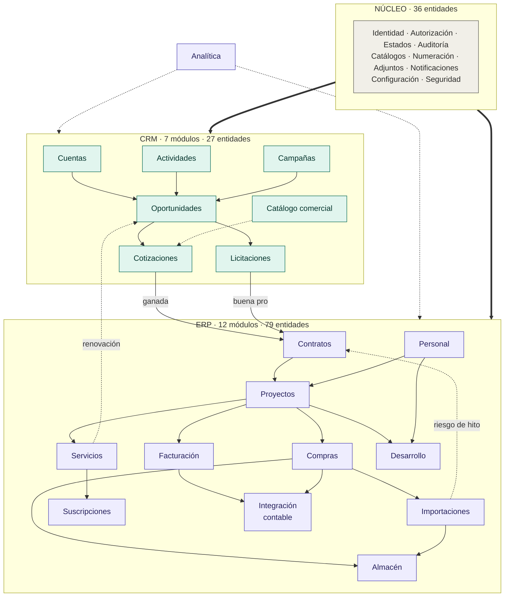

`[P]` **El diagrama corresponde al escenario 1.** En el escenario 2, ERP-13 se reemplaza por dos
módulos completos —ERP-14 Contabilidad y ERP-15 Planillas— y el sistema pasa a 21 módulos y ~182
entidades. Ver sección 23.

`[S]` **Cambio de frontera respecto de la v1.0.** Antes, una cotización ganada creaba
directamente un proyecto. Ahora crea primero un **contrato**, y de ahí nacen uno o más
proyectos. Es lo que permite gobernar plazos, penalidades y fianzas por separado de la
ejecución.

---

## 3. CRM-01 · Cuentas y contactos

> Documento 01: entidades públicas y privadas, sedes, contactos, cargos, historial.

`[D]` La mayor parte vive en el núcleo. Lo que agrega este módulo:

| Entidad | Qué guarda |
|---|---|
| `cuentas` `[S]` | Ficha comercial de un party con rol cliente |
| `cuenta_verticales` `[S]` | Verticales que atiende — Gobierno, Educación, Salud |
| `cuenta_historial` `[S]` | Bitácora de la relación comercial |

**Del núcleo:** `parties`, `party_roles`, `party_contactos`, `party_sedes`.

---

## 4. CRM-02 · Oportunidades

| Entidad | Qué guarda |
|---|---|
| `oportunidades` `[D]` | El negocio en curso con monto, probabilidad y fecha de cierre |
| `oportunidad_lineas` `[S]` | Estimación de qué se vendería |
| `oportunidad_competidores` `[D]` | Contra quién se compite y a qué precio |

**Regla del documento 01:** ninguna oportunidad se cierra como perdida sin motivo tipificado.

---

## 5. CRM-03 · Cotizaciones

| Entidad | Qué guarda |
|---|---|
| `cotizaciones` `[D]` | Cabecera: cliente, validez, condiciones |
| `cotizacion_versiones` `[D]` | Cada revisión, con su motivo de cambio |
| `cotizacion_lineas` `[D]` | Producto, cantidad, costo, precio, margen |
| `condiciones_comerciales` `[D]` | Formas de pago, plazos, garantías |

`[V]` **Requisito nuevo desde el documento 03.** El rol *Preventa y Costeo* declara acceso a
"histórico de proyectos similares". Eso exige que al cotizar se pueda consultar qué se cotizó y
qué costó realmente en proyectos de la misma tipología.

`[S]` No requiere entidad nueva: es una vista sobre `proyecto_costos` filtrada por tipología.

---

## 6. CRM-04 · Licitaciones y contrataciones del Estado

| Entidad | Qué guarda |
|---|---|
| `convocatorias` `[D]` | Entidad, objeto, valor referencial, tipo de procedimiento |
| `convocatoria_cronograma` `[D]` | Etapas con fechas críticas |
| `participaciones` `[D]` | La decisión de participar y su seguimiento |
| `participacion_documentos` `[D]` | Qué se presentó en cada etapa |
| `participacion_resultado` `[D]` | Resultado, ganador y precio adjudicado |
| `tipos_procedimiento` `[S]` | Licitación pública, adjudicación simplificada, subasta inversa |

`[D]` **Rol dedicado:** *Licitaciones y Contrataciones del Estado*, vacante con prioridad 3, con
acceso a "módulo de licitaciones · alertas de plazo · histórico de precios".

---

## 7. CRM-05 · Actividades

> Documento 01: visitas, llamadas, correos, próximas acciones, recordatorios.

| Entidad | Qué guarda |
|---|---|
| `actividades` `[D]` | Qué se hizo o se hará: tipo, fecha, resultado, próxima acción |
| `actividad_participantes` `[S]` | Quiénes participaron, de Techquk y del cliente |
| `tipos_actividad` `[S]` | Catálogo: visita, llamada, correo, reunión técnica, demostración |

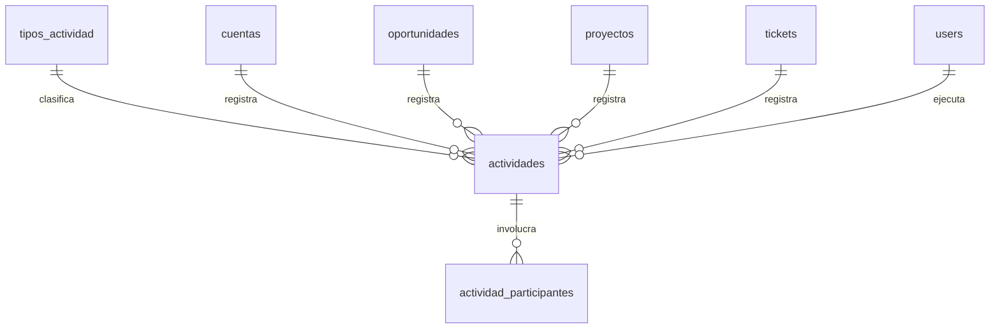

`[S]` **Es una entidad polimórfica:** una actividad puede colgar de una cuenta, una oportunidad,
un proyecto o un ticket. Modelarla una sola vez evita cuatro tablas casi idénticas — y evita que
el historial de un cliente quede repartido en cuatro lugares.

---

## 8. CRM-06 · Catálogo comercial

> Documento 01: productos y servicios con marca, línea de solución, precio referencial y margen
> objetivo.

| Entidad | Qué guarda |
|---|---|
| `productos` `[D]` | Cada bien o servicio: código, descripción, unidad, marca, línea |
| `marcas` `[D]` | Los fabricantes representados |
| `familias_producto` `[S]` | Agrupación jerárquica del catálogo |
| `producto_precios` `[D]` | Precio referencial y margen objetivo, con vigencia |
| `producto_cubso` `[S]` | Equivalencia con el código del catálogo del Estado |
| `producto_proveedores` `[S]` | Qué proveedores lo suministran y a qué costo |

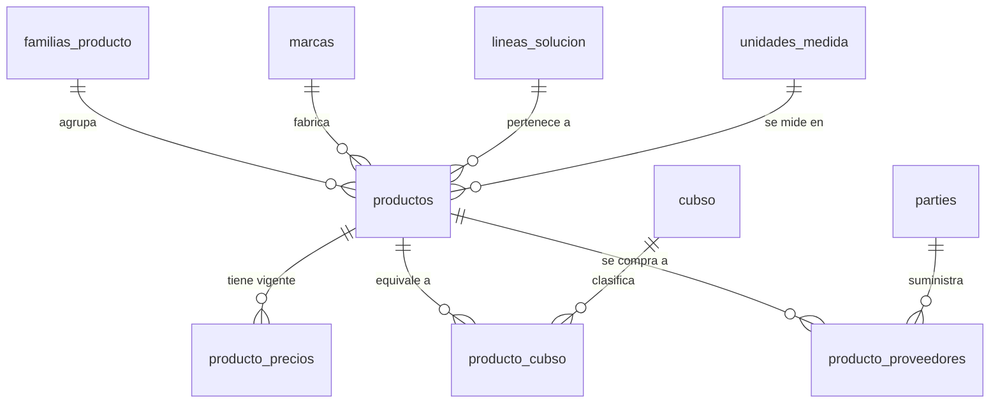

`[S]` **Sube de prioridad respecto del documento 01.** El grafo de dependencias lo requiere para
Cotizaciones, Compras y Almacén: sin catálogo no hay nada que cotizar ni que comprar.

`[S]` **`producto_cubso` es la pieza que conecta el catálogo con la contratación pública.** Sin
ella, cada participación en una convocatoria exige clasificar los ítems a mano.

`[S]` **Y `productos.requiere_serie` conecta con el almacén:** decide si al recibir una unidad el
sistema exige registrar su número de serie.

---

## 9. CRM-07 · Campañas y prospección

> Documento 01: origen del prospecto, seguimiento de leads del sitio web y de la tienda en línea.

| Entidad | Qué guarda |
|---|---|
| `campanias` `[D]` | Acciones de prospección con su periodo y presupuesto |
| `leads` `[D]` | Contactos entrantes sin calificar todavía |
| `origenes_lead` `[D]` | Catálogo: sitio web, tienda en línea, referido, feria, visita en frío |

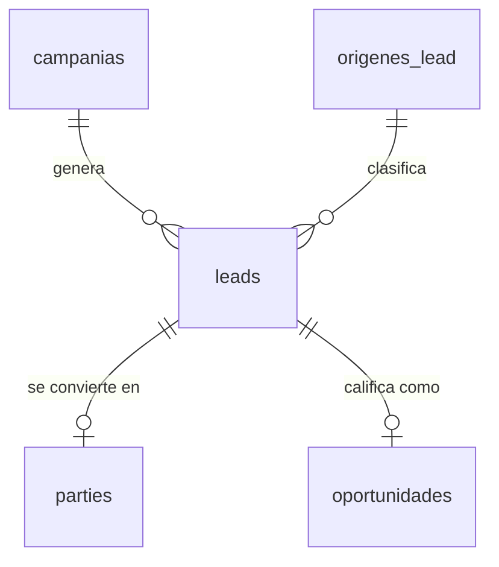

`[P]` **Prioridad media.** Su diseño depende de si la tienda en línea puede enviar los leads
automáticamente o si se cargan a mano.

`[S]` **La relación `leads → parties` es la que evita duplicados.** Un lead que se convierte no
crea una organización nueva: se enlaza a la que ya existe, o crea una y queda apuntando a ella.

---

## 10. ERP-10 · Contratos y garantías contractuales ★ NUEVO

> `[V]` **Origen:** rol *Administración de Contratos*, cuyo indicador es **"penalidades
> incurridas: meta cero"**. Su justificación documentada es una penalidad por mora de
> **S/ 250,498.54**, superior al monto íntegro de cinco de los nueve contratos del portafolio.

| Entidad | Qué guarda |
|---|---|
| `contratos` `[D]` | El contrato: cliente, objeto, monto, plazo, **penalidad diaria** |
| `contrato_hitos` `[D]` | Hitos contractuales con fecha comprometida |
| `contrato_adendas` `[D]` | Ampliaciones de plazo y modificaciones, con su resolución |
| `cartas_fianza` `[D]` | Garantía, entidad emisora, monto y **vencimiento** |
| `penalidades` `[D]` | Las incurridas, con su cálculo, motivo y estado |
| `conformidades` `[D]` | Actas de conformidad obtenidas y su fecha |

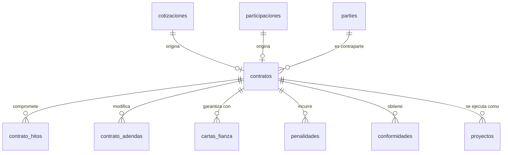

`[S]` **Por qué no basta con la tabla `proyectos`.** Un contrato puede cubrir más de un
proyecto, y tiene vida jurídica propia: plazos que se amplían, fianzas que vencen, penalidades
que se calculan por día.

`[S]` **Y la penalidad diaria es calculable.** Con el monto contratado, el plazo y la fecha
comprometida, el sistema puede mostrar cuánto cuesta cada día de atraso **antes** de que ocurra.
Eso convierte el módulo de un registro en una alerta.

---

## 11. ERP-01 · Proyectos

| Entidad | Qué guarda |
|---|---|
| `proyectos` `[D]` | La ficha: contrato, tipología, plazo, responsable |
| `plantillas_fase` `[D]` | Secuencia de fases por tipología |
| `plantilla_fase_pasos` `[D]` | Pasos de cada fase |
| `proyecto_fases` `[D]` | Instancia real en un proyecto |
| `proyecto_hitos` `[D]` | Puntos de control comprometidos y reales |
| `proyecto_entregables` `[D]` | Qué se entrega y en qué estado |
| `actas` `[D]` | Actas de inicio y de recepción |
| `valorizaciones` `[D]` | Avance valorizado por periodo |
| `proyecto_presupuesto` `[D]` | Lo estimado por partida |
| `proyecto_costos` `[D]` | Lo gastado, de todos los orígenes |
| `proyecto_ubicaciones` `[S]` | Puntos geográficos instalados |
| **`traslados`** `[D]` ★ | **Viajes imputados a proyecto** |

`[V]` **`traslados` es nueva.** El rol *Servicios Generales* declara "registro de traslados
asociados a proyecto". El conductor imputa su viaje al proyecto que lo consume — una fuente de
costo que la v1.0 no contemplaba.

### Los orígenes del costo, actualizados

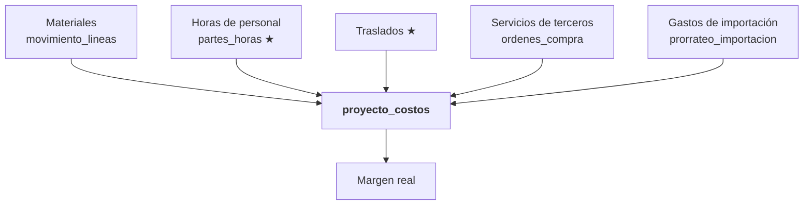

> `[V]` **Advertencia desde S10.** Allá, la partida de control debería recibir costos de
> materiales, mano de obra, equipos y subcontratos. **Trece de las dieciséis tablas que apuntan
> a ella están vacías.** Una estructura de costos solo vale si todos los orígenes la alimentan.

---

## 12. ERP-02 · Compras y abastecimiento

| Entidad | Qué guarda |
|---|---|
| `requerimientos` `[D]` | Qué necesita un proyecto y para cuándo |
| `requerimiento_lineas` `[D]` | Ítems con cantidad y destino |
| `cotizaciones_proveedor` `[D]` | Ofertas recibidas |
| `cotizacion_proveedor_lineas` `[D]` | Precio y plazo por ítem |
| `cuadros_comparativos` `[S]` | La comparación y la decisión |
| `ordenes_compra` `[D]` | La orden emitida |
| `orden_compra_lineas` `[D]` | Qué se compra, contra qué requerimiento |
| `evaluaciones_proveedor` `[D]` | Calificación por plazo, calidad y precio |

`[V]` **El cuadro comparativo corrige lo observado en S10:** allá la tabla de cotizaciones de
proveedor tiene **cero registros**. Las nueve órdenes se emitieron sin comparar ofertas.

---

## 13. ERP-03 · Importaciones y costeo

> `[V]` **D5 RESUELTA.** El documento 03 establece que Techquk realizó **80 operaciones de
> importación en 2024**, por **USD 452.3 mil CIF**, vía marítima por la Aduana del Callao y con
> **dos agentes de aduana**. El módulo se mantiene completo y **sube de prioridad**.

| Entidad | Qué guarda |
|---|---|
| `ordenes_importacion` `[D]` | La operación, con su incoterm |
| `embarques` `[D]` | El envío físico y sus fechas |
| `declaraciones_aduana` `[D]` | La DUA con su régimen |
| `conceptos_costo_importacion` `[D]` | Flete, seguro, derechos, agente, almacenaje |
| `gastos_importacion` `[D]` | Cada gasto con su comprobante |
| `prorrateo_importacion` `[D]` | Cómo se reparte entre los ítems |
| `agentes_aduana` `[S]` | Los dos agentes con los que se opera |

`[S]` **Ochenta operaciones al año es una cada cuatro días hábiles.** El ciclo de nacionalización
no es un detalle: es parte del costo de casi todo lo que Techquk vende.

`[V]` **Aquí está el riesgo económico documentado.** El documento 03 señala que en contratos de
suministro la entrega tardía se origina con más frecuencia en la llegada del equipo que en la
instalación — y que existe una penalidad de S/ 250,498.54.

`[S]` Eso conecta `embarques` con `contrato_hitos`: **el sistema debería alertar cuando la fecha
estimada de llegada pone en riesgo un hito contractual.** Es la integración de mayor valor entre
dos módulos de todo el modelo.

---

## 14. ERP-04 · Almacén e inventario

| Entidad | Qué guarda |
|---|---|
| `almacenes` `[D]` | Depósitos con responsable |
| `ubicaciones_almacen` `[S]` | Estante, zona, sección |
| `tipos_movimiento` `[D]` | Catálogo con banderas de comportamiento |
| `movimientos` `[D]` | Cabecera de cada guía |
| `movimiento_lineas` `[D]` | Ítem, cantidad, costo |
| `stock` `[D]` | Saldo por producto, almacén y ubicación |
| `series` `[D]` | Cada equipo con su número de serie |
| `serie_movimientos` `[S]` | Trazabilidad de cada serie |
| **`guias_remision`** `[D]` ★ | **Guía electrónica de traslado ante SUNAT** |

`[V]` **`guias_remision` es nueva.** El rol *Almacén e Inventario* declara acceso a "movimientos
de almacén · series · **guías de remisión** · inventarios".

`[S]` Es un documento electrónico distinto de la guía interna: lleva transportista, punto de
partida y de llegada, y se declara ante SUNAT.

---

## 15. ERP-05 · Servicios y postventa

| Entidad | Qué guarda |
|---|---|
| `contratos_servicio` `[D]` | Acuerdo recurrente con su vigencia |
| `sla_definiciones` `[D]` | Tiempos comprometidos por prioridad |
| `tickets` `[D]` | Cada solicitud con prioridad y estado |
| `ticket_seguimientos` `[D]` | Bitácora de la atención |
| `visitas_tecnicas` `[D]` | Salidas a campo |
| `informes_servicio` `[D]` | Entregable de cada atención |
| `garantias` `[D]` | Cobertura hacia el cliente |
| **`reclamos_garantia`** `[D]` ★ | **Reclamo al fabricante, con número de caso** |
| **`reclamo_series`** `[D]` ★ | **Qué equipos se reclaman** |

`[V]` **Las dos nuevas vienen del documento 03:** Help Desk *"gestiona garantías con el
fabricante y tramita devoluciones"*.

`[S]` La v1.0 modelaba la garantía hacia el cliente pero no el proceso hacia atrás. Aquí la
tabla `series` muestra su valor completo: el reclamo se hace por número de serie, y el
fabricante lo exige.

---

## 16. ERP-11 · Suscripciones y servicios gestionados ★ NUEVO

> `[V]` **Origen:** rol *Ciberseguridad y Monitoreo de Soluciones*, que administra servicios en
> la nube contratados por clientes, con vigencias de hasta **372 días**. El documento 03 es
> explícito: *"no se gobiernan con un jefe de proyecto ni con una mesa de ayuda"*.

| Entidad | Qué guarda |
|---|---|
| `suscripciones` `[D]` | Servicio en nube: cliente, proveedor, vigencia, costo y precio |
| `suscripcion_renovaciones` `[D]` | Historial de renovaciones con su margen |
| `disponibilidad_servicio` `[D]` | Disponibilidad comprometida contra efectiva, por periodo |
| `incidentes_seguridad` `[D]` | Incidentes con su criticidad y contención |

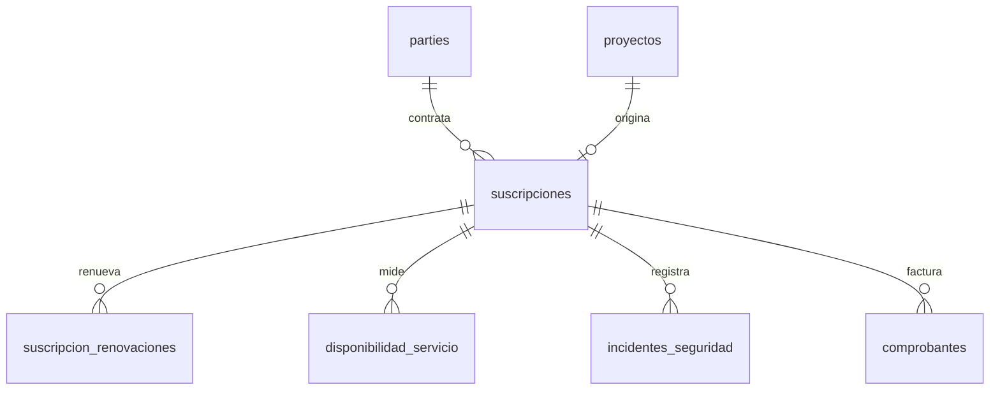

`[S]` **Dos diferencias con ERP-05 que justifican módulo aparte.**

**El costo también es recurrente.** Techquk le paga al proveedor de nube mientras le cobra al
cliente. El margen se mide por periodo, no por proyecto.

**La renovación es el evento crítico.** Una suscripción que vence sin renovarse deja al cliente
sin servicio y a Techquk sin ingreso.

`[P]` **Falta decidir** si la disponibilidad se mide automáticamente desde las plataformas de
monitoreo o se registra a mano.

---

## 17. ERP-12 · Desarrollo de software ★ NUEVO

> `[V]` **Origen:** cinco roles de la Jefatura de Desarrollo declaran accesos que el modelo no
> cubría. Y la **imputación de horas aparece en cinco roles distintos** del organigrama.

| Entidad | Qué guarda |
|---|---|
| **`partes_horas`** `[D]` | **Horas efectivas por persona, proyecto y fecha** |
| `especificaciones` `[D]` | Requisitos con criterios de aceptación |
| `especificacion_cambios` `[D]` | Gestión de cambios sobre lo especificado |
| `casos_prueba` `[D]` | Casos y su resultado por versión |
| `defectos` `[D]` | Defectos con severidad y estado |
| `versiones` `[D]` | Entregas certificadas |
| `integraciones_cliente` `[D]` | Integraciones desplegadas y su bitácora |

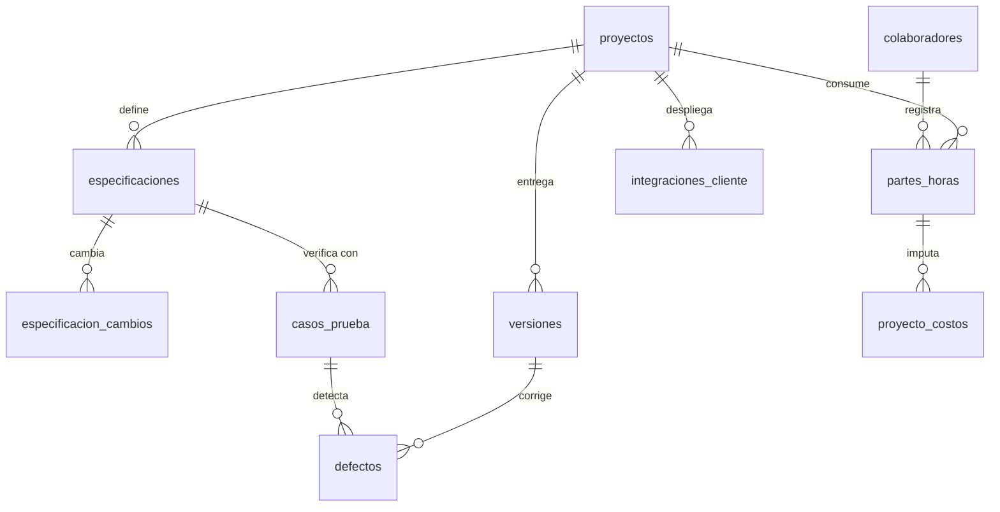

### Por qué `partes_horas` es innegociable

`[V]` El documento 03 argumenta que Desarrollo va dentro de Operaciones porque los contratos son
híbridos: P6 y P9 del Hospital Regional Docente Las Mercedes incluyen software, servidor y otros
activos en **un solo contrato**, y esos contratos híbridos son el **55.3% del portafolio**.

`[S]` **Consecuencia directa:** un proyecto puede tener frente de hardware y de software
simultáneos. Si las horas de desarrollo no se imputan, el margen de ese proyecto está mal
calculado.

`[P]` **Decisión D6.** Si el resto del módulo vive en el ERP o en herramienta especializada.

`[S]` **Recomendación:** `partes_horas` en el ERP; especificaciones, casos de prueba y defectos
en una herramienta de desarrollo, con enlace por proyecto. Construir un gestor de tareas compite
con productos maduros y gratuitos.

---

## 18. ERP-13 · Integración contable ★ NUEVO

> `[V]` **Origen: la decisión de reemplazar S10.** Mientras ambos sistemas convivieran, la
> contabilidad se quedaba en S10. Al apagarlo, el ERP tiene que alimentar a su reemplazo.
>
> `[P]` **Este módulo existe solo en el escenario 1** —contabilidad y planilla externas—, que es
> el recomendado. En el escenario 2 se reemplaza por dos módulos completos: ERP-14 Contabilidad
> (~18 entidades) y ERP-15 Planillas (~24 entidades). Ver sección 23 y documento 01, sección 8-bis.

| Entidad | Qué guarda |
|---|---|
| `cuentas_pagar` `[S]` | Lo que se debe a proveedores, con vencimiento |
| `pagos` `[S]` | Pagos emitidos y su aplicación a comprobantes |
| `asientos_generados` `[S]` | El puente hacia el sistema contable, con estado de exportación |
| `configuracion_contable` `[S]` | Qué cuenta corresponde a cada tipo de operación |
| `bitacora_integraciones` `[S]` | Cada ejecución de integración, con resultado y reintentos |

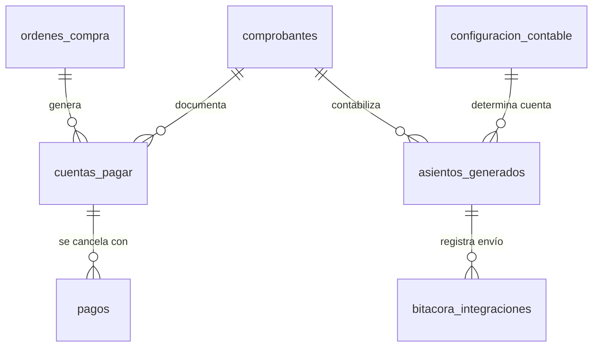

`[S]` **`cuentas_pagar` y `pagos` faltaban con independencia de esta decisión.** El modelo v1.0
tenía lo que te deben —`cuentas_cobrar`— pero no lo que debes.

`[S]` **`bitacora_integraciones` sirve a las siete integraciones**, no solo a la contable. Vive
aquí porque es donde se concentra el trabajo de exportación.

`[V]` **Y su contador de reintentos viene de evidencia:** en S10, la tabla de errores de
facturación electrónica tiene **1,763 registros contra 1,340 documentos**. Sin contador de
reintentos, eso son 1,763 líneas sueltas en lugar de "estos veinte documentos fallaron muchas
veces".

`[P]` **Decisión D9:** dónde vive la contabilidad. El alcance depende de si el destino acepta
cargas estructuradas o exige captura manual.

---

## 19. ERP-06 · Facturación y cobranzas

> Documento 01: comprobantes, estado de cuenta, antigüedad de deuda, detracciones, integración
> con facturación electrónica.

| Entidad | Qué guarda |
|---|---|
| `comprobantes` `[D]` | Facturas, boletas, notas de crédito y débito emitidas |
| `comprobante_lineas` `[D]` | El detalle de lo facturado |
| `comprobantes_electronicos` `[D]` | El estado ante SUNAT: enviado, aceptado, observado, con su CDR |
| `cuentas_cobrar` `[D]` | El saldo pendiente por comprobante, con vencimiento |
| `cobranzas` `[D]` | Los pagos recibidos y a qué comprobantes se aplican |
| `detracciones` `[D]` | El monto detraído, su constancia y su depósito |
| `retenciones` `[S]` | Las retenciones aplicadas por el cliente |

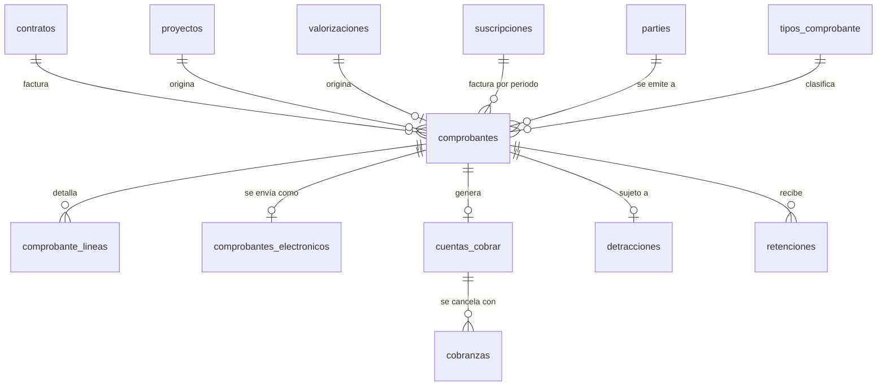

`[V]` **`comprobantes_electronicos` necesita un contador de reintentos.** En S10, la tabla de
errores de facturación electrónica tiene **1,763 registros contra 1,340 documentos emitidos** —
más errores que documentos. Sin contador, eso son 1,763 líneas sueltas en lugar de "estos veinte
documentos fallaron muchas veces".

`[V]` **Requisito de permisos del documento 03.** Dos roles —*Auxiliares de Contabilidad* y
*Asistente de Administración*— declaran acceso **"sin acceso a márgenes por proyecto"**.

`[S]` Eso no es permiso de módulo sino **de campo**: pueden abrir la ficha de proyecto pero no
ver las columnas de costo. Conviene preverlo desde el diseño, porque agregarlo después implica
revisar cada formulario.

`[V]` **Las marcas tributarias del núcleo se usan aquí.** En S10, la función que decide si
aplicar retención lee tres banderas de la ficha del proveedor —`Retencion`, `Percepcion`,
`BuenContribuyente`— antes de consultar cualquier padrón. Esas tres viven en `parties`.

`[P]` **Decisión D4:** si el ERP genera y firma el comprobante electrónico o alimenta al emisor
actual de Techquk, que opera desde 2019. La conexión con SUNAT existe en ambos casos.

---

## 20. ERP-07 · Personal y asignación

> Documento 01: legajo básico, competencias y certificaciones, disponibilidad, asignación de
> técnicos a proyectos.

| Entidad | Qué guarda |
|---|---|
| `colaboradores` `[D]` | La ficha laboral sobre el party: ingreso, cargo, unidad |
| `contratos_laborales` `[D]` | El vínculo con su modalidad y vigencia |
| `competencias` `[D]` | Catálogo de habilidades técnicas requeridas |
| `certificaciones` `[D]` | Catálogo de certificaciones de fabricante |
| `colaborador_competencias` `[D]` | Qué sabe hacer cada quien y a qué nivel |
| `colaborador_certificaciones` `[D]` | Qué acredita, **con su vencimiento** |
| `asignaciones` `[D]` | Quién está en qué proyecto, en qué periodo y con qué dedicación |
| `disponibilidad` `[S]` | Ausencias, vacaciones y bloqueos de agenda |

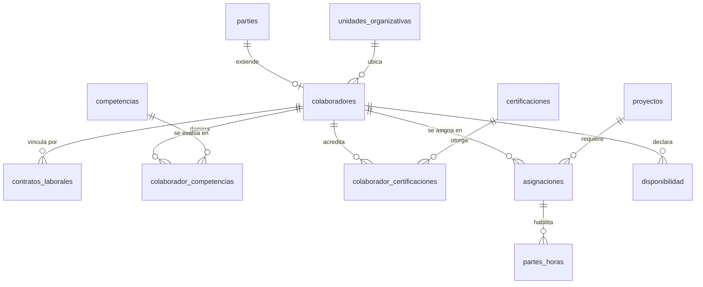

> **La decisión del documento 01 que se respeta:** planilla y contabilidad **no se desarrollan**,
> se integran con software especializado. Este módulo cubre competencias y asignación, no
> remuneraciones. Ver secciones 23 y documento 01, sección 8-bis.

`[V]` **`contratos_laborales` se llama así y no `contratos`** porque ese nombre lo usa el módulo
ERP-10 para los contratos con clientes. El documento 02-A explica por qué el vínculo laboral y
el de locación deben ser una sola entidad con campo de modalidad, y no dos tablas.

`[S]` **`asignaciones` planifica; `partes_horas` registra.** La asignación dice "esta persona al
50% entre marzo y junio"; las horas dicen "trabajó 18 horas esta semana". Si alguien asignado al
50% dedicó el 80%, el margen calculado sobre la asignación está mal.

`[V]` **`colaborador_certificaciones` con vencimiento es información comercial**, no
administrativa: varias convocatorias públicas exigen personal certificado vigente. Saber cuáles
vencen en noventa días condiciona a qué se puede postular.

`[V]` **Rol dedicado:** *Coordinación de Recursos y Asignaciones*, con acceso declarado a "tabla
de asignaciones con vigencia · **alertas de capacidad**".

---

## 21. ERP-09 · Analítica

> Documento 01: indicadores comerciales, de ejecución y financieros para Gerencia.

| Entidad | Qué guarda |
|---|---|
| `indicadores` `[S]` | La definición: fórmula, unidad, meta, periodicidad |
| `indicador_valores` `[S]` | El valor calculado en cada corte, para ver tendencia |
| `tableros` `[S]` | Qué indicadores ve cada rol |
| `tablero_indicadores` `[S]` | La composición de cada tablero |

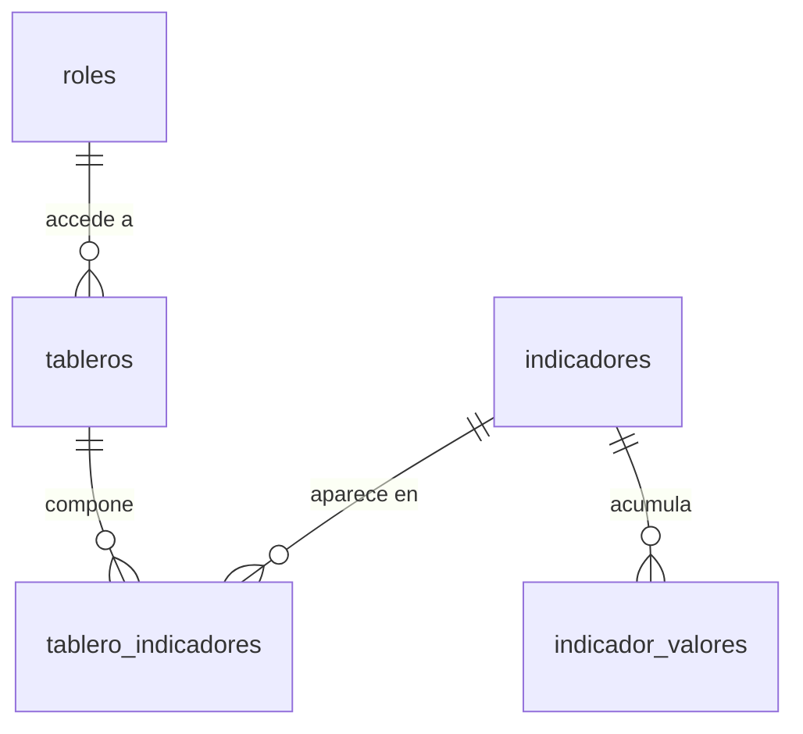

`[S]` **Este módulo no crea información: la lee.** Casi todo se resuelve con vistas sobre las
tablas existentes. Las cuatro entidades son solo para las definiciones y para guardar la serie
histórica.

`[S]` **Por qué guardar el valor y no solo calcularlo.** Un indicador calculado en vivo responde
"cuánto es hoy". `indicador_valores` responde "cómo viene evolucionando", que es la pregunta que
Gerencia hace de verdad. Y permite comparar contra un cierre pasado sin recalcular sobre datos
que ya cambiaron.

`[P]` La lista concreta de indicadores se define con Gerencia. El documento 01 propone nueve en
su sección 9, y el documento 10 propone los widgets por rol.

---

## 22. ERP-08 · Seguridad y administración

> **Este módulo no tiene entidades propias en el documento 07.**

`[V]` Está resuelto por completo en el **mecanismo M10 del documento 06**, que cubre usuarios,
unidades organizativas, roles, permisos y permisos por ámbito.

| Qué necesita ERP-08 | Dónde vive |
|---|---|
| Usuarios del sistema | `users`, extendida con `party_id` — núcleo M10 |
| Estructura organizativa | `unidades_organizativas` — núcleo M10 |
| Roles y permisos | `spatie/laravel-permission` — núcleo M10 |
| Permisos acotados a proyecto o almacén | `permisos_por_ambito` — núcleo M10 |
| Auditoría de cambios | `auditoria_cambios` — núcleo M4 |
| Configuración del sistema | `parametros` — núcleo M9 |

`[S]` **Se deja esta sección explícita** para que quien busque el módulo ERP-08 lo encuentre, en
lugar de concluir que se olvidó. Su ausencia en la numeración de módulos es deliberada.

---

## 23. El escenario 2 — Contabilidad y planillas propias

`[P]` **Esta sección describe lo que el escenario 2 agregaría.** No es una propuesta: es lo que
haría falta si Gerencia decidiera que el ERP sea autónomo en estas dos funciones.

`[S]` Se documenta porque hasta ahora el escenario 2 aparecía solo como un número —42 entidades
más— sin contenido. **Decidir entre dos opciones donde una está descrita y la otra no es decidir
a ciegas.**

### 23.1 ERP-14 · Contabilidad

`[S]` Esbozo de entidades, dimensionado a la operación de Techquk. No incluye módulos que S10 sí
tiene y que aquí no aplicarían, como contabilidad de obra o ajuste por inflación.

| Grupo | Entidades | Qué guarda |
|---|---|---|
| **Plan de cuentas** | `plan_contable`, `plan_contable_periodo` | El catálogo de cuentas y su vigencia por periodo |
| **Periodos** | `periodos_contables`, `cierres` | Meses abiertos y cerrados, con su bloqueo |
| **Asientos** | `asientos`, `asiento_detalle`, `tipos_asiento` | El registro de partida doble |
| **Automatización** | `esquemas_contables`, `esquema_detalle` | Qué asiento genera cada tipo de operación |
| **Libros** | `libro_diario`, `libro_mayor`, `libro_registro_compras`, `libro_registro_ventas` | Los libros electrónicos exigidos por SUNAT |
| **Cierre y reportes** | `balance_comprobacion`, `estados_financieros` | Balance y estados |
| **Tributario** | `configuracion_tributaria`, `declaraciones` | Tasas, topes y declaraciones mensuales |

**Total estimado: ~18 entidades.**

`[S]` **Lo que no aparece en esa lista y es el verdadero costo:** los libros electrónicos tienen
un formato definido por SUNAT que cambia, la partida doble exige validación de cuadre en cada
asiento, y el cierre de periodo tiene que impedir modificaciones retroactivas.

`[V]` **Referencia de tamaño.** En S10, el módulo de contabilidad son **680 procedimientos** y
76 tablas. Aunque Techquk necesitara la mitad, sigue siendo el módulo más grande del sistema.

### 23.2 ERP-15 · Planillas

| Grupo | Entidades | Qué guarda |
|---|---|---|
| **Estructura** | `esquemas_planilla`, `conceptos_remunerativos`, `formulas` | Qué conceptos existen y cómo se calculan |
| **Contrato laboral** | `contratos_laborales`, `regimenes` | Régimen, jornada, tipo de contrato |
| **Afiliación** | `afiliaciones_pension`, `administradoras_pension` | AFP u ONP, con sus tasas vigentes |
| **Cálculo** | `periodos_planilla`, `planillas`, `planilla_detalle` | El cálculo mensual por trabajador |
| **Variables del mes** | `horas_extras`, `descuentos`, `adelantos`, `prestamos` | Lo que varía cada periodo |
| **Periódicos** | `gratificaciones`, `cts`, `vacaciones`, `liquidaciones` | Los cálculos semestrales y de cese |
| **Entregables** | `boletas_pago`, `declaraciones_plame` | Lo que se entrega al trabajador y a SUNAT |

**Total estimado: ~24 entidades.**

`[V]` **Referencia de tamaño.** En S10 son **1,050 procedimientos** y 103 tablas — el segundo
módulo más grande de todo el sistema, solo detrás del núcleo.

### 23.3 Lo que el conteo de entidades no muestra

`[S]` **El costo de estos dos módulos no está en construirlos sino en mantenerlos.**

| Qué cambia | Cada cuánto | Qué implica |
|---|---|---|
| Tasas de AFP | Varias veces al año | Actualizar y recalcular |
| Remuneración mínima vital | Ocasional | Afecta topes y cálculos derivados |
| Formato de la PLAME | Anual o más frecuente | Rehacer el archivo de declaración |
| Libros electrónicos | Cambios de estructura | Rehacer la generación |
| UIT | Anual | Afecta quinta categoría y multas |

`[S]` **Cada uno de esos cambios es trabajo de desarrollo que compite con las mejoras al
negocio.** Y a diferencia de un módulo comercial, no se puede postergar: si la PLAME no sale en
el formato correcto, la empresa no puede declarar.

### 23.4 El impacto en el proyecto

| Aspecto | Escenario 1 | Escenario 2 |
|---|---|---|
| Entidades del sistema | 140 | **~182** |
| Módulos de negocio | 19 | **21** |
| Construcción adicional | — | **+22 a +30 semanas** |
| Horizonte a dedicación completa | 11–14 meses | **17–21 meses** |
| Riesgo tributario y laboral | Del proveedor | **De Techquk** |
| Mantenimiento normativo | Incluido en licencia | **Permanente** |

`[S]` **Recomendación: escenario 1.** El escenario 2 solo se justificaría si el software del
mercado resultara incompatible con la operación de Techquk. `[P]` Conviene verificarlo antes de
descartarlo, pero no hay razón para suponerlo.

`[S]` **Y un argumento de oportunidad.** Techquk vende integración tecnológica, no software
contable. Seis meses en contabilidad y planillas son seis meses que no van a licitaciones,
contratos y servicios recurrentes — que es donde ningún producto comercial la atiende bien.

---

## 24. Resumen del sistema completo

| Bloque | Módulos | Entidades |
|---|---:|---:|
| **Núcleo** | 10 mecanismos | 36 |
| **CRM** | 7 módulos | 27 |
| **ERP** | 12 módulos | 79 |
| **Total escenario 1** | **19 de negocio** | **142** |
| *(Escenario 2: + ERP-14 y ERP-15)* | *21 de negocio* | *~184* |

### Los cuatro módulos nuevos

| Módulo | Entidades | Origen |
|---|---:|---|
| ERP-10 Contratos | 6 | Rol *Administración de Contratos* |
| ERP-11 Suscripciones | 4 | Rol *Ciberseguridad y Monitoreo* |
| ERP-12 Desarrollo | 7 | Cinco roles de la Jefatura de Desarrollo |
| ERP-13 Integración contable | 5 | La decisión de reemplazar S10 |

### Distribución por evidencia

| Marca | Entidades | Cambio desde v1.0 |
|---|---:|---|
| `[D]` Declarado | ~79 | +17 |
| `[S]` Supuesto | ~55 | +7 |
| `[P]` Pendiente | ~8 | sin cambio |
| **Total** | **142** | **+24** |

`[S]` **Las entidades nuevas son en su mayoría `[D]`**, porque salen de accesos declarados en el
organigrama. Las cinco de ERP-13 son `[S]`, porque nacen de una consecuencia de diseño y no de
un acceso declarado.

---

## 25. Las decisiones abiertas

| # | Decisión | Estado |
|---|---|---|
| **D1** | ¿Multiempresa o empresa única? | `[P]` Abierta |
| **D2** | ¿Qué organiza la información? | `[P]` Abierta |
| **D3** | ¿Entra el CUBSO en el núcleo? | `[P]` Abierta |
| **D4** | ¿El ERP emite comprobantes o alimenta al emisor? | `[P]` Abierta |
| ~~**D5**~~ | ~~¿Importación directa o por terceros?~~ | **`[V]` RESUELTA: directa** |
| **D6** ★ | ¿El desarrollo se gestiona en el ERP o aparte? | `[P]` Nueva |
| **D7** ★ | ¿La disponibilidad de servicios se mide sola o a mano? | `[P]` Nueva |
| **D8** | ¿Cuál escenario de dedicación se autoriza? | `[P]` Abierta |
| **D9** ★ | ¿Escenario 1 o 2? Contabilidad y planillas externas o propias | `[P]` **La de mayor impacto** |
| **D10** ★ | Si es escenario 1: ¿qué software concreto? | `[P]` Nueva |

`[S]` **D9 es la más urgente.** Cambia el horizonte en 6 a 7 meses, el tamaño del sistema en 42
entidades, y traslada el riesgo tributario y laboral de un proveedor a Techquk. Conviene
decidirla antes de la fase 2, porque en el escenario 2 el colaborador se modela de otra forma.

---

## 26. Lo que este documento no resuelve

**No define columnas.** Documento 08.

**No reemplaza la Fase 0.** Qué campos lleva una cotización de Techquk y cuántas etapas tiene un
proyecto de videovigilancia sale del levantamiento.

`[S]` **Y una advertencia sobre el crecimiento del modelo.** Pasar de 118 a 142 entidades tras
revisar un solo documento sugiere que seguirá creciendo. Eso es normal y saludable — pero
refuerza que el orden de construcción por fases es lo que hace el proyecto abordable.

---

*Fin del documento 07 v2.2. Las versiones anteriores están archivadas en `v1_historico/`.*
