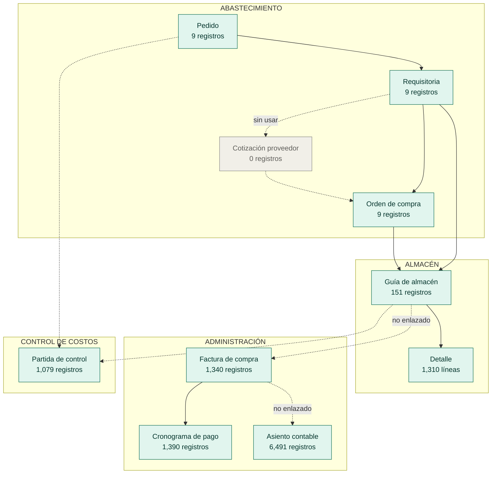
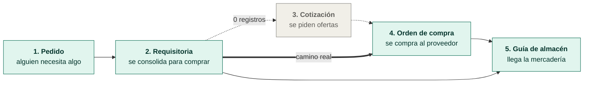
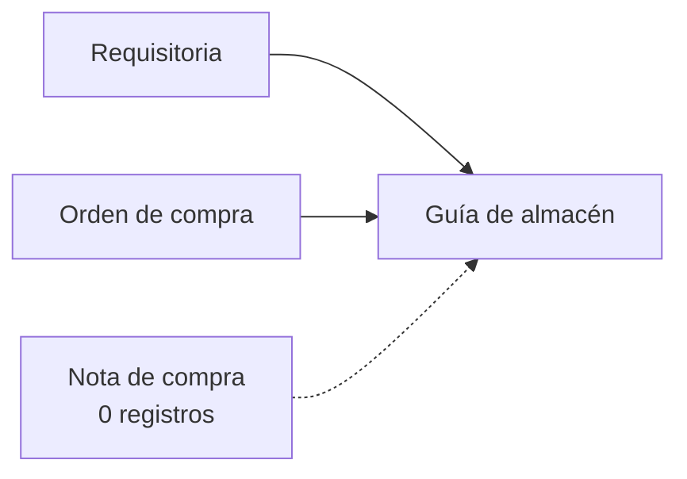
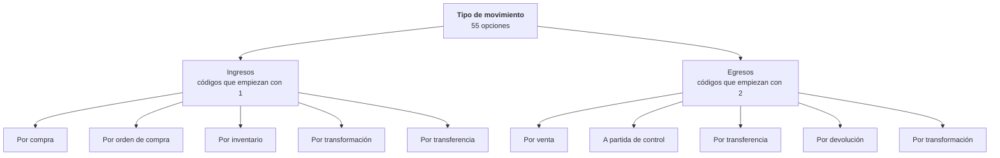
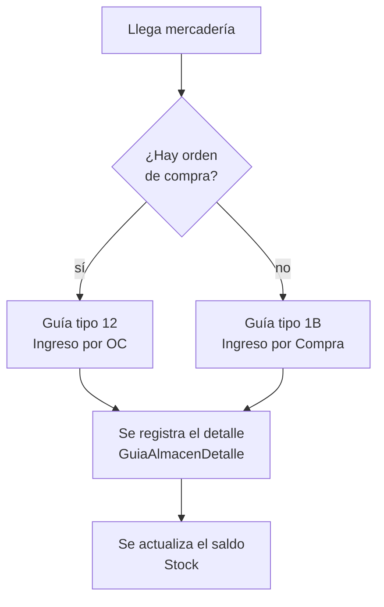
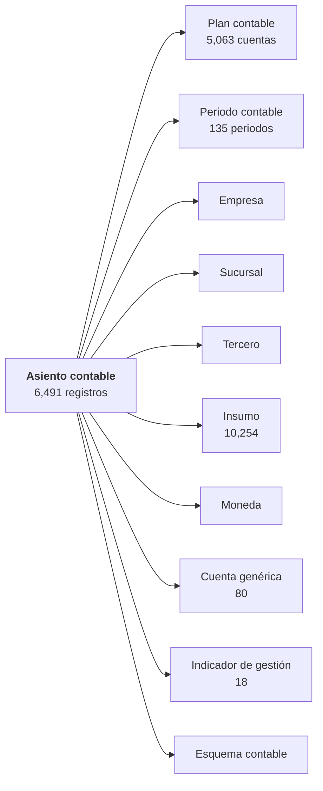
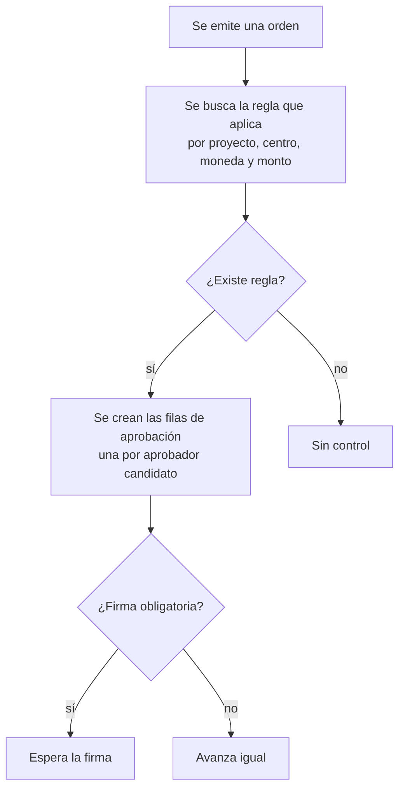
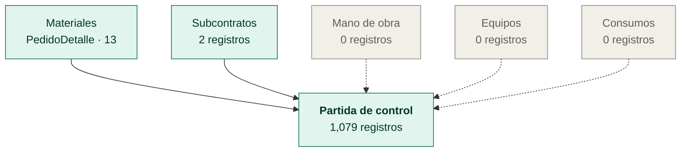

# Procesos operativos de S10, reconstruidos desde la base de datos


**Versión:** 1.0 · Agosto 2026
**Sistema:** ERP S10 en producción en Techquk S.A.C.
**Fuente:** las 1,572 relaciones entre tablas, los catálogos de estado y los datos operativos
**Foto:** 17 de agosto de 2026

> **Sobre la versión.** Este documento no ha requerido correcciones desde su emisión. Es
> descriptivo: reconstruye los procesos que S10 ejecuta hoy a partir de sus relaciones, y eso no
> cambia con las decisiones de diseño ni con los módulos que se agregaron a la propuesta.

---

## Cómo se reconstruyeron estos procesos

`[V]` No se abrió la aplicación. Los flujos salen de tres fuentes de la propia base:

**Las relaciones entre tablas** dicen qué documento nace de cuál. Si `NotaPedidoRequisitoria`
tiene una columna que apunta a `Pedido`, entonces la requisitoria viene después del pedido.

**Los catálogos de estado** dicen por qué etapas pasa cada documento.

**Los datos reales** dicen qué caminos se usan y cuáles quedaron sin transitar.

`[S]` **Lo que este método no puede dar:** quién ejecuta cada paso, cuánto demora, ni qué
valida la pantalla. Las relaciones muestran el esqueleto del proceso, no la coreografía.

Marcas: `[V]` verificado en los datos · `[S]` inferido · `[P]` pendiente de confirmar

---

## 1. Mapa general de los procesos



Verde: en uso. Gris: existe en la estructura y no tiene datos.

---

## 2. Proceso de abastecimiento

`[V]` **La cadena verificada en las relaciones:**

```
Pedido → NotaPedidoRequisitoria → [CotizacionProveedor] → OrdenDeCompra → GuiaAlmacen
```

### 2.1 El flujo completo



### 2.2 Paso 1 — El pedido

`[V]` La tabla `Pedido` apunta a cinco lugares:

| Columna | Apunta a | Qué significa |
|---|---|---|
| `CodProyecto` | `ProyectoAlmacen` | Para qué proyecto y almacén |
| `CodProyectoPC` | `Proyecto` | A qué proyecto se imputa el costo |
| `NroCC` | `CentroCompra` | Bajo qué centro de compra |
| `CodEstadoPedido` | `PedidoEstado` | En qué etapa está |
| `CodAlmacen` | `ProyectoAlmacen` | Qué almacén lo atiende |

`[V]` Y `PedidoDetalle` guarda las líneas, con dos columnas que apuntan a `PartidaDeControl`:
**cada ítem pedido se imputa desde el origen a una partida de costo.**

`[S]` Eso significa que el control de costos no se calcula al final: se declara al pedir.

### 2.3 Paso 2 — La requisitoria

`[V]` `NotaPedidoRequisitoria` apunta a `Pedido`, a `CentroCompra` y a su propio catálogo de
estados de cuatro valores.

`[S]` **Es el eslabón que la mayoría de la gente no ve.** Agrupa lo pedido para poder
comprarlo. Un mismo pedido puede generar varias requisitorias si sus ítems se compran a
proveedores distintos.

### 2.4 Paso 3 — La cotización que no ocurre

`[V]` `OrdenDeCompra` tiene una columna `NroCP` que apunta a `CotizacionProveedor`.
**Esa tabla tiene cero registros.**

`[S]` Las nueve órdenes emitidas se generaron **sin comparar ofertas en el sistema**. Puede que
la comparación exista fuera —por correo, en Excel— o que no se haga.

`[P]` Es una de las preguntas más concretas para llevar a las entrevistas: *¿se cotiza con
varios proveedores antes de comprar?*

### 2.5 Paso 4 — La orden de compra

`[V]` `OrdenDeCompra` apunta a siete lugares:

| Columna | Apunta a | Registros del destino |
|---|---|---:|
| `CodProveedor` | `Identificador` | 1,638 |
| `CodEstado` | `OrdenDeCompraEstado` | 7 |
| `CodFormaDePago` | `FormaDePago` | 32 |
| `CodMoneda` | `Moneda` | 2 |
| `NroCC` | `CentroCompra` | 1 |
| `NroCCP` | `CentroCompraProyecto` | 11 |
| `NroCP` | `CotizacionProveedor` | **0** |

`[V]` **Los siete estados posibles de una orden**, con los que están en uso:

| Estado | Órdenes |
|---|---:|
| Aprobado | 1 |
| **En Almacén** | **7** |
| En Subcontrato | 1 |

### 2.6 Paso 5 — La recepción

`[V]` Aquí aparece un detalle de diseño que vale la pena: `GuiaAlmacen` apunta **a los dos**
documentos anteriores.



`[S]` **Eso permite dos caminos de recepción.** Se puede recibir contra una orden formal, o
contra la requisitoria directamente cuando no hubo orden. Explica por qué en julio se
registraron 101 ingresos sin orden de compra: el camino existe y está previsto.

`[V]` Y hay un tercer camino: `NroNotaCompra` apunta a `NotaCompra`, con cero registros.

---

## 3. Proceso de almacén

### 3.1 El catálogo que gobierna todo

`[V]` `GuiaAlmacen` apunta a `GuiaAlmacenMovimiento`, un catálogo de **55 tipos de movimiento**.
Ese catálogo es el que decide cómo se comporta cada guía.



### 3.2 Los movimientos realmente usados

`[V]` De los 55 tipos disponibles, **once tienen registros**:

| Código | Movimiento | Guías | Julio | Agosto |
|---|---|---:|---:|---:|
| `1B` | Ingreso por Compra | 106 | 101 | 5 |
| `12` | Ingreso por Orden de Compra | 10 | 0 | 10 |
| `1D` | Ingreso por Transformación | 8 | 8 | — |
| `2R` | Egreso por Transformación | 8 | 8 | — |
| `25` | Egreso por Venta | 6 | — | 6 |
| `2G` | Egreso a Partida de Control con descarga directa | 4 | — | 4 |
| `11` | Ingreso por Inventario | 3 | 3 | — |
| `15` | Ingreso por Transferencia Externa | 2 | — | 2 |
| `24` | Egreso por Transferencia Externa | 2 | — | 2 |
| `2H` | Egreso a Partida de Control | 1 | — | 1 |
| `2O` | Egreso por Devolución al Proveedor | 1 | 1 | — |

`[V]` **44 de los 55 tipos nunca se usaron.**

### 3.3 El proceso de recepción, paso a paso



`[V]` `GuiaAlmacenDetalle` tiene 1,310 líneas para 151 guías — un promedio de **8.7 ítems por
guía**. Y apunta a `Insumo`, el catálogo de 10,254 materiales.

### 3.4 El proceso de despacho

`[V]` En agosto aparecen los egresos: 6 ventas, 5 consumos a partida de control, 2
transferencias.

`[S]` El egreso a partida de control es el que conecta el almacén con el costo del proyecto: el
material sale y se imputa a la partida que lo consume.

`[V]` Y existen dos variantes del mismo movimiento: `2G` con descarga directa —sin pasar por
stock— y `2H` normal. Se usan las dos.

---

## 4. Proceso de facturación de compras

### 4.1 La estructura de una factura

`[V]` `RDocumento` es la tabla más ancha del sistema con datos: **190 columnas** y 1,340 filas.
Apunta a nueve lugares:

| Columna | Apunta a | Qué define |
|---|---|---|
| `CodIdentificador` | `Identificador` | El proveedor |
| `CodIdentificadorDestino` | `Identificador` | La empresa receptora |
| `CodTipoDocumento` | `TipoDocumento` | Factura, boleta, nota de crédito |
| `CodProyecto` | `Proyecto` | A qué proyecto se imputa |
| `CodMoneda` | `Moneda` | Soles o dólares |
| `CodFormaDePago` | `FormaDePago` | Contado, crédito |
| `NroMetodoPago` | `MetodoPago` | Cómo se paga |
| `NroMotivoPago` | `MotivoPago` | Por qué se paga |
| `NroCentroDeCosto` | `CentroDeCosto` | 0 registros — sin usar |

### 4.2 Qué cuelga de cada factura

`[V]` Dieciséis tablas apuntan a `RDocumento`. Las que tienen datos:

| Tabla | Registros | Qué guarda |
|---|---:|---|
| `RDocumentoDetalle` | 1,721 | Las líneas de la factura |
| `RDocumentoCronogramaPago` | 1,390 | Las cuotas de pago |
| `RDocumentoImpuesto` | 1,327 | El desglose de impuestos |
| `RDocumentoRelacionado` | 125 | Notas de crédito y documentos vinculados |
| `RDocumentoDetalleCopia` | 1,721 | Espejo del detalle |

`[V]` **Once tablas más están vacías**, entre ellas `RDocumentoElectronico`, `RDocumentoAsiento`
y `RDocumentoRecepcion`.

### 4.3 El eslabón que falta

`[S]` **`RDocumento` no tiene ninguna relación con `GuiaAlmacen`.**

Eso significa que en la estructura no hay forma de saber qué factura corresponde a qué
recepción. Son dos registros paralelos del mismo hecho: llegó mercadería y llegó su factura.

`[V]` Existe `RDocumentoRecepcion`, que parece diseñada para eso, con **cero registros**.

`[P]` Es una pregunta para el proveedor: *¿cómo se concilia una factura contra su guía de
recepción?* Puede resolverse en la aplicación sin relación declarada, o puede no resolverse.

### 4.4 El cronograma de pago

`[V]` 1,390 cuotas para 1,340 facturas. `[S]` La mayoría se paga en una sola cuota; unas
cincuenta están fraccionadas.

---

## 5. Proceso contable

### 5.1 La estructura del asiento

`[V]` `AsientoContable` tiene 6,491 registros y apunta a diez lugares:



`[S]` **Tres cosas que revela esa estructura:**

Que apunte a `Identificador` tres veces —empresa, sucursal y tercero— confirma el patrón de
tabla única de personas incluso en contabilidad.

Que apunte a `Insumo` significa que el asiento puede detallarse hasta el material específico,
no solo a la cuenta contable.

Que apunte a `IndicadorGestion` sugiere contabilidad analítica: cada asiento puede clasificarse
para reportes de gestión, no solo para el balance.

### 5.2 El eslabón que también falta

`[V]` **`AsientoContable` no tiene relación con `RDocumento`.** Existe `RDocumentoAsiento`, que
serviría de puente, con **cero registros**.

`[S]` La contabilización parece ocurrir por proceso, no por enlace declarado. Los 6,491 asientos
arrancaron el 30 de julio a las 23:56 — casi medianoche.

---

## 6. Proceso de aprobación

### 6.1 Un hallazgo estructural

`[V]` **Ni `GrupoAprobacion` ni `OrdenDeCompraAprobacion` tienen una sola relación declarada.**
Ni entrante ni saliente.

Eso es notable en una base con 1,572 relaciones donde casi todo está conectado.

`[S]` **Significa que el subsistema de aprobaciones funciona por convención en el código, no por
integridad declarada en la base.** Nada impide que exista una aprobación apuntando a una orden
que no existe, o a un usuario dado de baja.

`[S]` Es coherente con lo que encontramos operando: el mecanismo registra firmas pero no las
exige. Un subsistema desacoplado a propósito, o agregado después sin integrarlo del todo.

### 6.2 Cómo funciona



`[V]` En la instalación analizada, de las nueve órdenes emitidas **ninguna tomó el camino de
"espera la firma"**: seis pasaron por reglas sin firma obligatoria y tres por proyectos sin
regla configurada.

---

## 7. Proceso de control de costos

### 7.1 La partida de control

`[V]` `PartidaDeControl` tiene 1,079 registros y es el eje del costo por proyecto. Dieciséis
tablas apuntan a ella, aunque **solo tres tienen datos**:

| Tabla que apunta | Registros | Qué imputa |
|---|---:|---|
| `PedidoDetalle` | 13 | Lo pedido |
| `SubcontratoLiquidacionDetalle` | 1 | Liquidación de subcontrato |
| `SubcontratoRecurso` | 1 | Recursos de subcontrato |

`[V]` **Trece tablas apuntan a ella y están vacías**, entre ellas `ProyectoObreroTareo`,
`RegistroConsumo` y `ProyectoEquipoParteInsumo`.

`[S]` Eso dibuja el diseño completo: la partida de control debería recibir costos de materiales,
mano de obra, equipos y subcontratos. Hoy solo recibe de pedidos y subcontratos.



---

## 8. Proceso de proyectos

`[V]` `Proyecto` tiene 234 registros y **101 tablas apuntan a ella**. De esas, solo **once
tienen datos**:

| Tabla | Registros | Qué guarda |
|---|---:|---|
| `Periodo` | 34,066 | Periodos del proyecto |
| `PresupuestoSubpartidaProyecto` | 856 | Presupuesto por subpartida |
| `PartidaDeControl` | 1,079 | Partidas de costo |
| `Clasificacion` | 348 | Agrupaciones |
| `ProyectoEstructuraTarea` | 226 | Estructura de tareas |
| `ProyectoAlmacen` | 93 | Almacenes del proyecto |
| `ProyectoCalendario` | 34 | Calendarios |
| `Calendario` | 33 | Días laborables |
| `CentroCompraProyecto` | 11 | Centros de compra habilitados |
| `Pedido` | 9 | Pedidos |
| `PieValorizacion` | 6 | Pies de valorización |

`[S]` **Noventa tablas de proyecto están vacías.** Actas, cronogramas, ofertas, evaluaciones de
personal, órdenes de trabajo, tareo de obreros. Es el módulo con mayor brecha entre lo
disponible y lo usado.

---

## 9. Resumen: qué está en uso y qué no

`[V]` Cuadro de los siete procesos:

| Proceso | Estado | Evidencia |
|---|---|---|
| **Abastecimiento** | En uso, con un paso omitido | 9 pedidos, 9 órdenes; cotización de proveedor en 0 |
| **Almacén** | En uso | 151 guías, 11 de 55 tipos de movimiento |
| **Facturación de compras** | En uso intensivo | 1,340 facturas en seis semanas |
| **Contabilidad** | En uso | 6,491 asientos desde el 30 de julio |
| **Aprobación** | Configurado, sin capacidad de bloqueo | 16 firmas, ninguna obligatoria en uso |
| **Control de costos** | Parcial | Recibe de pedidos y subcontratos; no de mano de obra ni equipos |
| **Proyectos** | Mínimo | 11 de 101 tablas relacionadas tienen datos |

---

## 10. Los tres eslabones que faltan

`[S]` El hallazgo más interesante de reconstruir los procesos desde las relaciones es lo que
**no** está conectado.

| Eslabón faltante | Tabla puente | Registros |
|---|---|---:|
| Guía de almacén ↔ Factura de compra | `RDocumentoRecepcion` | **0** |
| Factura de compra ↔ Asiento contable | `RDocumentoAsiento` | **0** |
| Aprobaciones ↔ resto del sistema | *ninguna relación declarada* | — |

`[S]` **Los tres son puntos donde la trazabilidad se corta.** El sistema sabe que llegó
mercadería y que llegó una factura, pero no que sean la misma compra. Sabe que hay facturas y
que hay asientos, pero no cuál generó cuál.

`[P]` Puede que la aplicación los resuelva sin relación declarada. Es exactamente el tipo de
pregunta que se responde entrando al sistema.

---

## 11. Qué falta para completar este documento

`[P]` **Quién ejecuta cada paso.** Las relaciones dicen qué sigue a qué, no quién lo hace. Eso
sale del sistema o de las entrevistas.

`[P]` **Qué valida cada pantalla.** Un campo puede admitir vacío en la base y ser obligatorio en
el formulario.

`[P]` **Los tiempos.** Cuánto demora en promedio pasar de pedido a orden, de orden a recepción.
Se calcula con consultas sobre las fechas, pero con nueve pedidos la muestra es muy pequeña.

`[P]` **Los tres eslabones faltantes.** Confirmar si se resuelven en la aplicación.

---

*Los procesos aquí descritos son los de S10 tal como está configurado en Techquk hoy. El
documento complementario describe los procesos propuestos para el sistema nuevo.*
