# Documento 09-B — Procesos propuestos para el ERP/CRM de Techquk

**Programa:** Ordenamiento Organizacional y Sistemas de Gestión — Techquk S.A.C.
**Versión:** 2.1 · Agosto 2026
**Complementa:** documentos 02 v2.0 (procesos y tipologías) y 07 v2.2 (modelo conceptual)

---

## Registro de cambios

| Versión | Fecha | Cambios |
|---|---|---|
| 1.0 | Ago 2026 | Nueve procesos propuestos |
| 2.0 | Ago 2026 | Tres procesos nuevos; importación confirmada; alerta de penalidad |
| **2.1** | **Ago 2026** | **Numeración corregida · la comparación con S10 se remite al 09-A** |

### Qué cambió en la versión 2.0

| Cambio | Origen |
|---|---|
| **Nuevo:** proceso de administración de contratos | Rol *Administración de Contratos*, documento 03 |
| **Nuevo:** proceso de suscripciones y renovación | Rol *Ciberseguridad y Monitoreo*, contratos de hasta 372 días |
| **Nuevo:** proceso de reclamo de garantía al fabricante | *Help Desk gestiona garantías con el fabricante* |
| **Corregido:** el proceso de importación | `[V]` D5 resuelta: Techquk importa directamente |
| **Corregido:** de cotización nace un contrato, no un proyecto | Consecuencia del módulo ERP-10 |

---

> ## ⚠ ESTE DOCUMENTO ES PROPUESTA, NO LEVANTAMIENTO
>
> Los procesos que siguen **no describen cómo trabaja Techquk hoy**. Son un diseño construido
> desde tres fuentes: el contenido que el documento 01 asigna a cada módulo, las seis tipologías
> del documento 02, y lo aprendido de un ERP real en operación.
>
> **Su función es servir de punto de partida para las entrevistas de la Fase 0**, no de
> especificación. La pregunta correcta frente a cada flujograma es *"¿es así como lo hacen?"* —
> y la respuesta útil es la que corrige el diagrama.
>
> `[S]` Se estima que la mitad de estos flujos cambiará después del levantamiento. Eso es señal
> de que la Fase 0 funcionó.

---

## 1. Mapa general

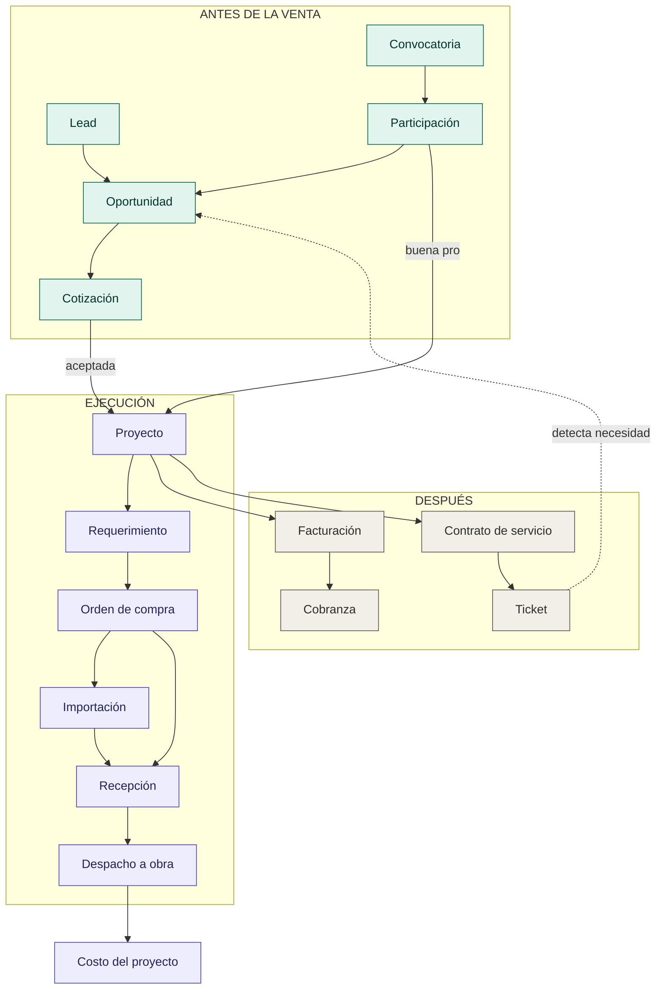

---

## 2. Proceso comercial privado

`[S]` Aplica a clientes privados. El canal público tiene su propio proceso (sección 3).

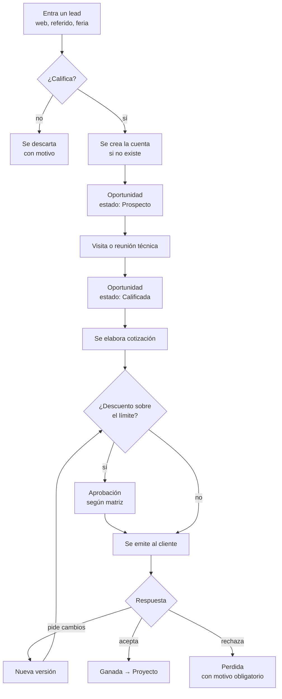

### Las reglas que gobiernan este flujo

`[S]` **Tres, y todas vienen del documento 01:**

Ninguna oportunidad se cierra como perdida sin **motivo tipificado de lista cerrada**. No texto
libre.

Cada revisión de cotización genera **una versión nueva**, no reemplaza la anterior. Así se puede
defender un precio ofrecido meses atrás.

El descuento sobre cierto límite dispara la **matriz de aprobación** del núcleo.

`[P]` **Lo que hay que preguntar en la Fase 0:** cuántas etapas tiene realmente el embudo de
Techquk, quién aprueba descuentos y desde qué monto, y cuáles son los motivos de pérdida reales.

---

## 3. Proceso de contratación pública

`[S]` Este flujo no existe en S10 y es central para Techquk.

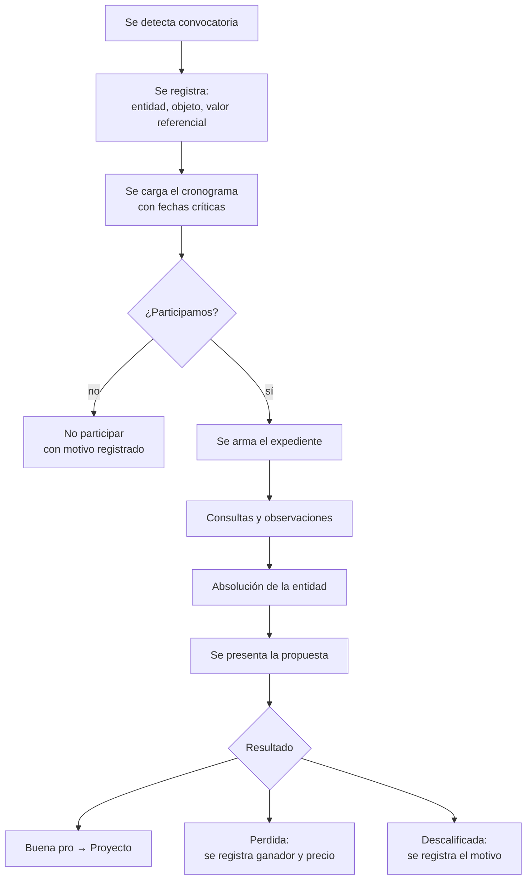

### Por qué este flujo importa más de lo que parece

`[S]` **El valor no está en gestionar la participación sino en acumular el resultado.**

Registrar convocatoria tras convocatoria quién adjudicó y a qué precio construye la única base
para responder a qué precio se puede competir en cada entidad. Esa información hoy no existe en
ningún lado.

`[S]` **Y `motivo_no_participar` vale tanto como el resultado.** Registrar por qué se dejó pasar
una convocatoria —fuera de rubro, plazo imposible, requisito no cumplido— muestra dónde está el
techo comercial de la empresa.

`[P]` **Preguntas para la Fase 0:** ¿quién detecta las convocatorias y cómo? ¿quién decide
participar? ¿qué documentos exige cada tipo de procedimiento?

---

## 4. Proceso de proyecto

`[S]` Un solo flujo con plantilla de fases por tipología. Es la decisión del documento 01,
sección 3.3.

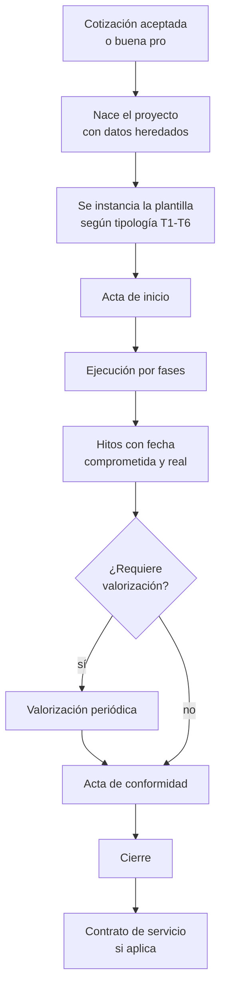

### La herencia que evita recapturar

`[S]` Cuando la cotización se acepta, el proyecto nace con cliente, monto, moneda, líneas y
tipología ya cargados. **Nadie vuelve a escribir esos datos.**

Es donde hoy se pierde información entre quien vende y quien ejecuta — problema que el
documento 00 señala explícitamente.

`[P]` **Lo que falta saber:** cuántas fases tiene realmente cada tipología, qué hitos son
obligatorios, y si todas las tipologías valorizan o solo algunas.

---

## 5. Proceso de abastecimiento

`[S]` Es el más parecido a lo que S10 ya hace, con una corrección importante.

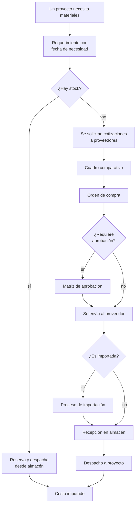

### La corrección respecto de S10

`[V]` En la instalación de S10 analizada, **la cotización de proveedor tiene cero registros**.
Las nueve órdenes se emitieron sin comparar ofertas en el sistema.

`[S]` Aquí el cuadro comparativo es un paso del flujo, no una tabla opcional. `[P]` Pero hay que
validar en la Fase 0 si Techquk realmente cotiza con varios proveedores o si compra directo — y
si compra directo, si eso es política o inercia.

`[S]` **Y el paso de verificar stock antes de comprar** no existe en el flujo de S10. Para un
integrador que maneja inventario de equipos, evitar comprar lo que ya se tiene es dinero
directo.

---

## 6. Proceso de importación

> `[V]` **DECISIÓN D5 RESUELTA.** El documento 03 establece que Techquk realizó **80
> operaciones de importación en 2024**, por **USD 452.3 mil CIF**, vía marítima por la Aduana
> del Callao y con **dos agentes de aduana**. El escenario de compra a mayoristas locales queda
> descartado.
>
> `[S]` Ochenta operaciones al año es una cada cuatro días hábiles. Este proceso no es marginal:
> gobierna el costo de casi todo lo que Techquk vende.

### El flujo confirmado

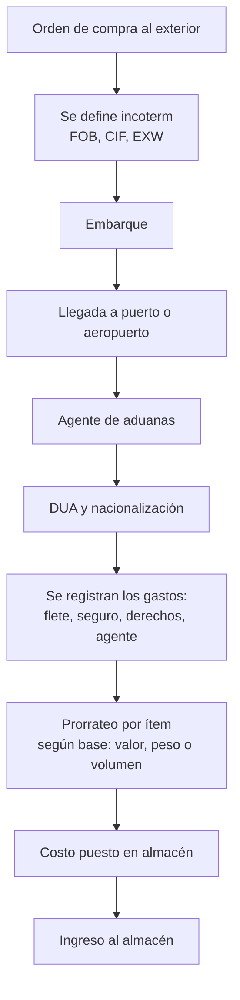

### La alerta que este proceso debe disparar

`[V]` El documento 03 señala que **en contratos de suministro la entrega tardía se origina con
más frecuencia en la llegada del equipo que en la instalación**, y registra una penalidad por
mora de **S/ 250,498.54** — superior al monto íntegro de cinco de los nueve contratos.

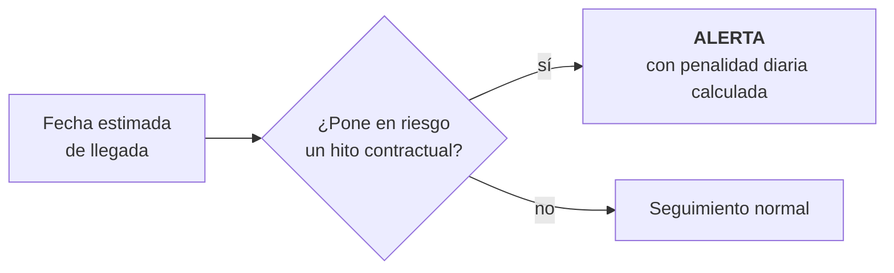

`[S]` **Es la integración de mayor valor entre dos módulos de todo el modelo.** Conectar
`embarques` con `contrato_hitos` convierte un riesgo invisible en un número que alguien mira
antes de que ocurra.

---

## 7. Proceso de almacén

`[S]` Con la particularidad que S10 no tiene: control por número de serie.

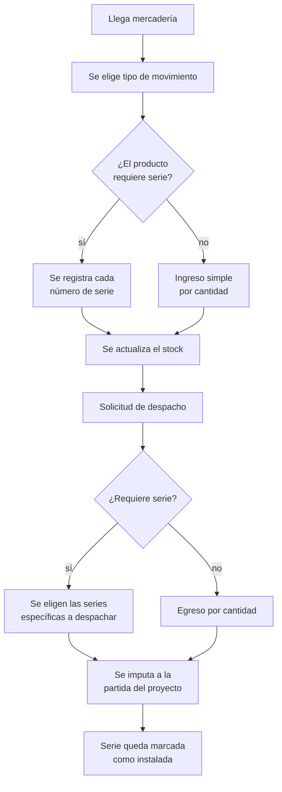

### Por qué el número de serie

`[S]` Cámaras, switches y equipos de red se identifican individualmente. Es lo que permite
responder **qué equipo exacto está instalado en qué punto** y si su garantía sigue vigente.

Cuando entra un ticket por una cámara que falla, la serie conecta el reclamo con la orden de
compra, el proveedor y la fecha de instalación.

`[V]` S10 no tiene esta capacidad: no existe tabla de series en su esquema.

`[S]` **El tipo de movimiento gobierna el comportamiento**, igual que en S10: si afecta stock,
si exige documento, si imputa costo al proyecto. Es el tercer patrón del documento 05.

---

## 8. Proceso de servicios y postventa

`[S]` Es el módulo que S10 no cubre y donde está el ingreso recurrente.

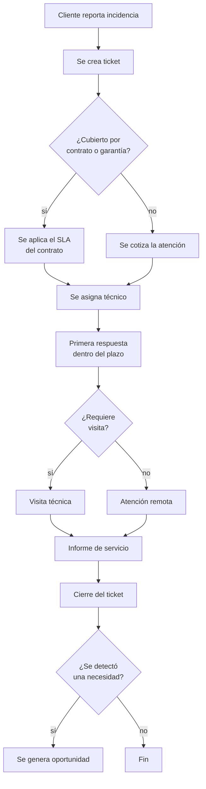

### Los dos plazos del SLA

`[S]` Responder y resolver son compromisos distintos. Responder en dos horas y resolver en
veinticuatro es lo habitual, y el sistema tiene que medir ambos por separado.

### La flecha que cierra el ciclo

`[S]` La transición de ticket a oportunidad es la que convierte el soporte en canal comercial.
Vender a quien ya conoce a Techquk cuesta una fracción de conseguir un cliente nuevo.

`[P]` **La validación pendiente del documento 00:** ¿hay clientes que le pagan a Techquk todos
los meses? Si los hay, este proceso es el que los hace visibles.

---

## 9. Proceso de administración de contratos ★ NUEVO

> `[V]` **Origen:** rol *Administración de Contratos*, cuyo indicador es **"penalidades
> incurridas: meta cero"**. Su justificación es la penalidad de S/ 250,498.54 ya registrada.

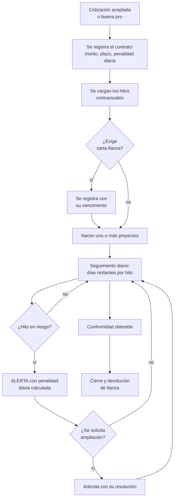

### Por qué el contrato va antes que el proyecto

`[S]` **Cambio respecto de la versión 1.0.** Antes, una cotización aceptada creaba directamente
un proyecto. Ahora crea un contrato, y de ahí nacen los proyectos.

Tres razones:

Un contrato puede cubrir **más de un proyecto**. P6 y P9 del Hospital Regional Docente Las
Mercedes incluyen software, servidor y otros activos en un solo contrato.

El contrato tiene **vida jurídica propia**: plazos que se amplían, fianzas que vencen,
penalidades que se calculan por día.

Y la penalidad **no se calcula sobre el proyecto sino sobre el contrato**.

### El cálculo que hace útil al módulo

`[S]` Con el monto contratado, el plazo y la fecha comprometida, el sistema puede mostrar
**cuánto cuesta cada día de atraso antes de que ocurra**. Eso convierte un registro en una
alerta.

`[P]` **Preguntas para la Fase 0:** ¿cómo se calcula la penalidad en cada tipo de contrato?
¿quién autoriza solicitar una ampliación? ¿dónde están hoy las cartas fianza?

---

## 10. Proceso de suscripciones y renovación ★ NUEVO

> `[V]` **Origen:** rol *Ciberseguridad y Monitoreo*, que administra servicios en nube con
> vigencias de hasta **372 días**. El documento 03 aclara que esto no se gobierna con un jefe de
> proyecto ni con una mesa de ayuda.

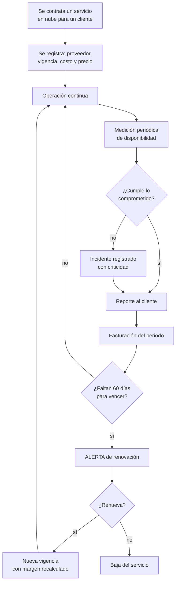

### Lo que distingue este proceso del de tickets

`[S]` **El costo también corre.** Techquk le paga al proveedor de nube mientras le cobra al
cliente. El margen se mide por periodo, no por proyecto.

`[S]` **La renovación es el evento crítico.** Una suscripción que vence sin renovarse deja al
cliente sin servicio y a Techquk sin ingreso — sin que nadie haya hecho nada mal.

`[P]` **Validación pendiente número tres del documento 00:** ¿hay clientes que le pagan a
Techquk todos los meses? Este proceso es el que los hace visibles.

`[P]` **Y la decisión D7:** ¿la disponibilidad se mide automáticamente desde las plataformas o
se registra a mano?

---

## 11. Proceso de reclamo de garantía al fabricante ★ NUEVO

> `[V]` **Origen:** Help Desk *"gestiona garantías con el fabricante y tramita devoluciones"*.

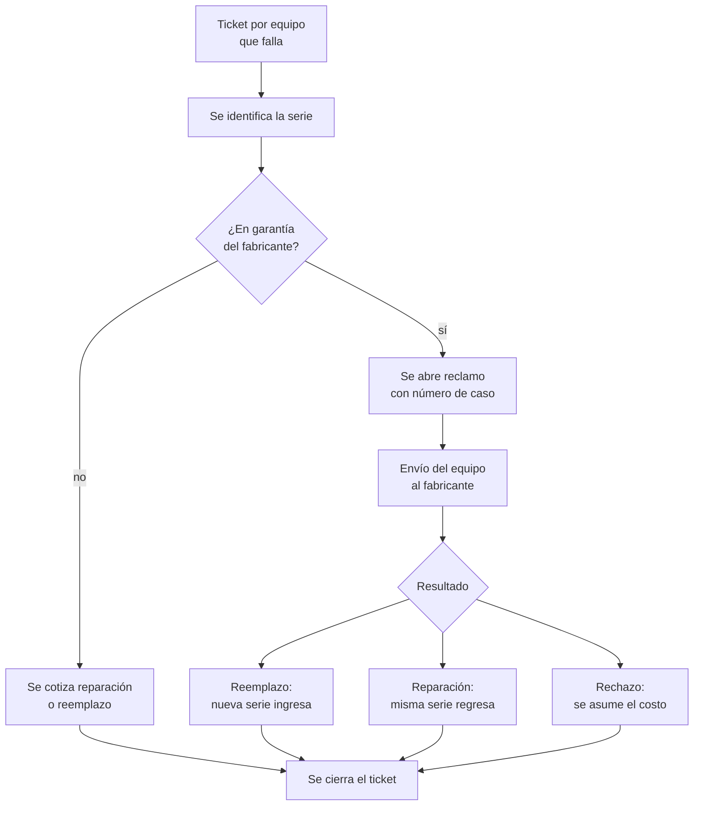

`[S]` **Aquí la tabla de series muestra su valor completo.** El reclamo se hace por número de
serie y el fabricante lo exige. Sin ese dato, el proceso se hace por correo y sin trazabilidad.

`[S]` **Y el caso de reemplazo tiene una consecuencia de inventario:** entra una serie nueva y
la anterior se da de baja. Si el sistema no lo refleja, el equipo instalado en obra queda
apuntando a una serie que ya no existe.

---

## 12. Proceso de facturación y cobranza

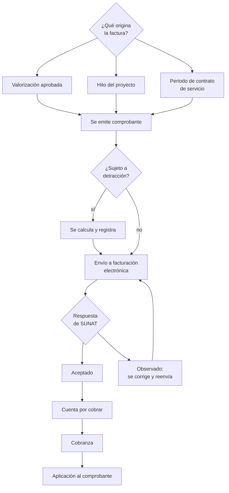

### El contador de intentos

`[V]` En S10, la tabla de errores de facturación electrónica tiene **1,763 registros contra
1,340 documentos emitidos** — más errores que documentos.

`[S]` Sin un contador de reintentos por comprobante, ese problema es invisible hasta que alguien
revisa a mano. El bucle de "observado → corregir → reenviar" del diagrama tiene que dejar
rastro.

`[P]` **Depende de la decisión D4:** si el ERP genera y firma el XML o alimenta al emisor actual
de Techquk, que funciona desde 2019.

`[V]` **Lo que no es decisión** es la conexión con SUNAT: para emitir un comprobante en Perú hay
que enviarlo, directamente o vía OSE. Existe en cualquier escenario.

`[P]` **Y el destino contable depende del escenario del eje A.** En el escenario 1 —recomendado—
el ERP exporta asientos a software especializado. En el escenario 2 los genera internamente. Ver
documento 01, sección 8-bis.

---

## 13. Proceso de aprobación

`[S]` Es transversal: lo usan cotizaciones, órdenes de compra, valorizaciones y notas de
crédito.

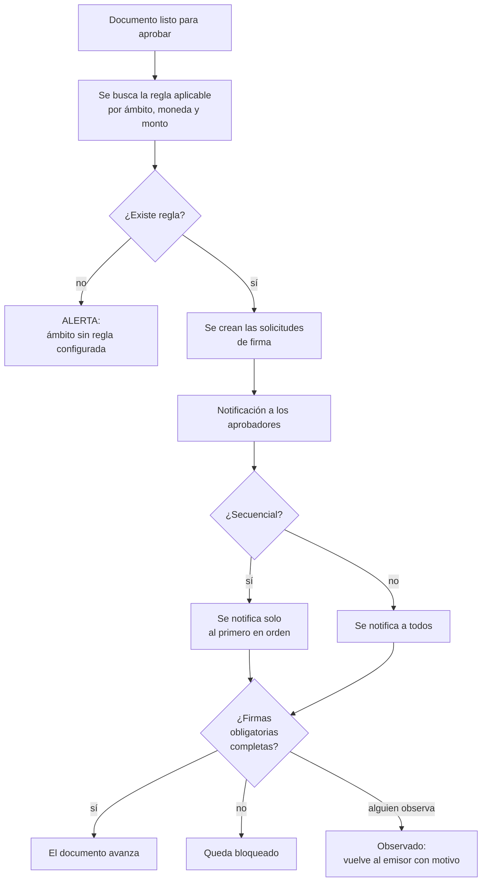

### Los dos agregados respecto de S10

`[V]` **La alerta de ámbito sin regla.** En la instalación analizada, dos proyectos compraron
sin ninguna política configurada y nada lo señaló.

`[V]` **El bloqueo real.** El campo que decide si una firma es indispensable existe en S10 y
está apagado: de las nueve órdenes emitidas, ninguna pasó por un control capaz de detenerla.

`[S]` Aquí el camino "queda bloqueado" tiene que ser efectivo, no decorativo.

---

## 14. Cómo converge el costo del proyecto

`[S]` Este no es un proceso de usuario sino la mecánica que responde la pregunta que originó
todo el proyecto.

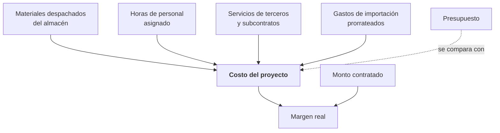

### Las tres desviaciones que Gerencia necesita

| Comparación | Qué responde |
|---|---|
| Presupuestado contra real | Dónde se gastó de más |
| Contratado contra facturado | Cuánto falta cobrar del contrato |
| Facturado contra cobrado | Cuánto está en la calle |

`[S]` **La clave del diseño:** todos los módulos escriben en una sola tabla de costos. Ninguno
calcula el margen por su cuenta.

`[V]` **La advertencia de S10.** Allá la partida de control debería recibir costos de
materiales, mano de obra, equipos y subcontratos. Trece de las dieciséis tablas que apuntan a
ella están vacías: solo llegan los pedidos y los subcontratos.

`[S]` Una estructura de costos solo vale si todos los orígenes la alimentan. Si el sistema
permite que un módulo no escriba ahí, tarde o temprano no escribirá.

---

## 15. Tres puntos donde este diseño corrige al sistema actual

`[V]` La reconstrucción de los procesos de S10 —documento **09-A**, sección 10— reveló tres
puntos donde la trazabilidad se corta. Los procesos propuestos aquí los cierran.

| Punto | En S10 | En el diseño propuesto | Dónde |
|---|---|---|---|
| Recepción ↔ Factura de compra | Tabla puente con **0 registros** | Enlace obligatorio al conciliar | §5 |
| Factura ↔ Asiento contable | Tabla puente con **0 registros** | Fuera de alcance: la contabilidad se integra | §12 |
| Aprobaciones ↔ resto del sistema | **Ninguna relación declarada** | Relación declarada, con integridad garantizada | §13 |

`[S]` **El tercero es el más llamativo.** En una base con 1,572 relaciones, el subsistema de
aprobaciones no tiene ni una: funciona por convención en el código, no por integridad
garantizada por el motor. Nada impide que quede una firma apuntando a una orden que ya no
existe.

> **El detalle de cada uno, con su consulta de respaldo, está en el documento 09-A.** Aquí solo
> se registra qué proceso lo corrige, para no duplicar el análisis en dos documentos.

---

## 16. Cómo usar este documento en la Fase 0

`[S]` **Como guion de entrevista.** Llevar el flujograma del área a la sesión y preguntar: *"¿es
así como lo hacen? ¿qué paso falta? ¿cuál nunca ocurre?"*.

Es mucho más productivo que preguntar en abstracto cómo trabajan. La gente corrige mejor de lo
que describe.

**Como detector de diferencias.** Donde el flujo propuesto y el real difieran mucho, hay una
decisión que tomar: o el proceso cambia o el sistema se adapta. Esa conversación es más
importante que el diagrama.

**Como base de las validaciones.** Cada rombo de decisión de estos diagramas es una validación
que el sistema tendrá que implementar. Contarlos da una idea del esfuerzo real.

**Lo que no hay que hacer:** tratarlos como definitivos. Un flujograma que sobrevive intacto a
la Fase 0 probablemente signifique que nadie lo miró con atención.

---

## 17. Las preguntas que cada proceso deja abiertas

| Proceso | Pregunta principal |
|---|---|
| Comercial privado | ¿Cuántas etapas tiene el embudo y quién aprueba descuentos? |
| Contratación pública | ¿Quién detecta las convocatorias y quién decide participar? |
| Proyecto | ¿Cuántas fases tiene cada tipología y cuáles valorizan? |
| Abastecimiento | ¿Se cotiza con varios proveedores o se compra directo? |
| **Contratos** ★ | ¿Cómo se calcula la penalidad en cada tipo de contrato? |
| **Suscripciones** ★ | ¿Hay clientes con pago recurrente hoy? |
| **Garantías** ★ | ¿Cómo se tramita hoy un reclamo al fabricante? |
| Importación | ~~¿importa o compra a mayoristas?~~ **RESUELTA: importa** |
| Almacén | ¿Qué productos se controlan por serie? |
| Servicios | ¿Hay clientes con pago recurrente hoy? |
| Facturación | ¿El ERP emite o alimenta al emisor actual? |
| Aprobación | ¿Qué montos y qué firmas, por área y por proyecto? |

`[S]` La de importación quedó resuelta por el documento 03. La de mayor impacto pendiente es
ahora la de contratos, porque define cómo se calcula el riesgo económico más grande registrado.

---

*Fin del documento 09-B v2.1. La versión 2.0 está archivada en `v1_historico/`. El documento
09-A describe los procesos que S10 ejecuta hoy, reconstruidos desde su base de datos.*