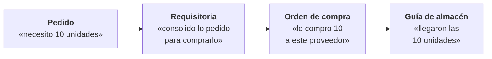

# ERP S10 — primeros resultados

> **Qué es este documento.** Los hallazgos del análisis de una base de datos de S10, con la
> consulta que respalda cada afirmación.
>
> **De quién es la base.** `[V]` **Es de Techquk.** La primera lectura fue que pertenecía a una
> empresa constructora, porque el dominio de S10 es de construcción —partidas, presupuestos,
> análisis de precios unitarios— y porque hay registros fechados en 1999, trece años antes de
> que Techquk existiera.
>
> **Ambas cosas tienen otra explicación.** Los catálogos de construcción y las fechas antiguas
> vienen precargados con el producto: son catálogos de fábrica de S10, no datos de la empresa.
> Y la lista de proveedores lo confirma sin ambigüedad — Ingram Micro, Deltron, Intcomex, TD
> Synnex, ferreterías de Chiclayo y el propio fabricante del ERP facturándole soporte.
>
> **Qué cambia con eso.** Los hallazgos de las secciones 6 y 7 no son observaciones sobre un
> tercero: son advertencias sobre la operación actual de Techquk. Ver la sección 11.3.
>

---

## Convención de evidencia

Cada afirmación lleva una marca que indica cuánto respaldo tiene:

| Marca | Significado | Qué la respalda |
|---|---|---|
| `[V]` | **Verificado** | Hay una consulta en este documento que devuelve ese resultado |
| `[S]` | **Supuesto** | Interpretación razonable, pero no comprobada |
| `[P]` | **Pendiente** | Falta preguntárselo a alguien; los datos no lo responden |

**Por qué importa la distinción.** Durante el análisis, diez interpretaciones resultaron
falsas — todas ellas `[S]` que se habían tomado por `[V]`. Ver la sección 12.

La regla práctica: **si alguien cuestiona una afirmación `[V]`, hay una consulta para
mostrarle. Si cuestiona una `[S]`, la conversación es legítima.**

---

## Índice

1. [Cómo se hizo el análisis](#1-cómo-se-hizo-el-análisis)
2. [Primer vistazo: el tamaño del sistema](#2-primer-vistazo-el-tamaño-del-sistema)
3. [Hallazgo 1: esta base tiene seis semanas de transacciones](#3-hallazgo-1-esta-base-tiene-seis-semanas-de-transacciones)
4. [Hallazgo 2: una sola tabla para todas las personas](#4-hallazgo-2-una-sola-tabla-para-todas-las-personas)
5. [Hallazgo 3: el almacén cambió de modo entre julio y agosto](#5-hallazgo-3-el-almacén-cambió-de-modo-entre-julio-y-agosto)
6. [Hallazgo 4: el control de aprobación existe, pero casi no controla](#6-hallazgo-4-el-control-de-aprobación-existe-pero-casi-no-controla)
7. [Hallazgo 5: controles declarados que nadie alimenta](#7-hallazgo-5-controles-declarados-que-nadie-alimenta)
8. [Los patrones que sí copiaríamos](#8-los-patrones-que-sí-copiaríamos)
9. [Lo que no copiaríamos](#9-lo-que-no-copiaríamos)
10. [Tres lecciones de método](#10-tres-lecciones-de-método)
11. [Qué sigue](#11-qué-sigue)
12. [Registro de correcciones](#12-registro-de-correcciones)

---

## 1. Cómo se hizo el análisis

`[V]` Todo salió de consultar la base de datos directamente. **No se abrió la aplicación de S10
ni una sola vez.**

`[S]` Eso tiene una ventaja: la aplicación muestra lo que sus diseñadores quisieron mostrar; la
base muestra lo que realmente hay.

El procedimiento fue:

1. **Restaurar el respaldo** en un SQL Server local. El archivo traía dos respaldos encadenados
   —uno completo del 7 de agosto y uno incremental del 17— y se aplicaron ambos en orden.
2. **Consultar el catálogo del sistema.** SQL Server guarda, en tablas especiales, información
   sobre sí mismo: qué tablas existen, qué columnas tienen, cómo se relacionan. Ese catálogo
   fue la fuente principal.
3. **Mirar muestras de datos** solo cuando la estructura no bastaba para entender algo.

Ejemplo de lo que significa "consultar el catálogo": esta consulta lista todas las tablas con
su cantidad de filas y el espacio que ocupan.

```sql
SELECT  s.name AS esquema, t.name AS tabla, p.rows AS filas,
        SUM(a.total_pages) * 8 / 1024 AS mb
FROM sys.tables t
JOIN sys.schemas s          ON s.schema_id = t.schema_id
JOIN sys.indexes i          ON i.object_id = t.object_id AND i.index_id IN (0,1)
JOIN sys.partitions p       ON p.object_id = t.object_id AND p.index_id = i.index_id
JOIN sys.allocation_units a ON a.container_id = p.partition_id
GROUP BY s.name, t.name, p.rows
ORDER BY p.rows DESC;
```

Todo lo que empieza con `sys.` son las tablas internas de SQL Server.

### Verificación del respaldo

`[V]` Que los dos respaldos se aplicaron y en qué orden queda registrado:

```sql
SELECT  rh.restore_date      AS cuando_se_restauro,
        bs.type              AS tipo,
        bs.backup_start_date AS fecha_del_respaldo,
        bs.server_name       AS servidor_origen
FROM msdb.dbo.restorehistory rh
JOIN msdb.dbo.backupset bs ON bs.backup_set_id = rh.backup_set_id
WHERE rh.destination_database_name = 'S10'
ORDER BY rh.restore_date;
```

| Tipo | Fecha del respaldo | Servidor origen |
|---|---|---|
| `D` (completo) | 7 ago 2026, 18:21 | `WIN-HCAN6SJG143` |
| `I` (incremental) | 17 ago 2026, 15:15 | `WIN-HCAN6SJG143` |

**La foto analizada corresponde al 17 de agosto de 2026 a las 15:15.**

### Sobre datos personales

La base contiene razones sociales, RUC, nombres de personas naturales y montos reales. En este
documento se registran **estructuras, relaciones y conteos** — nunca registros individuales
identificables.

---

## 2. Primer vistazo: el tamaño del sistema

```sql
SELECT 'Tablas'                AS objeto, COUNT(*) AS cantidad FROM sys.tables
UNION ALL SELECT 'Procedimientos', COUNT(*) FROM sys.procedures
UNION ALL SELECT 'Vistas',         COUNT(*) FROM sys.views
UNION ALL SELECT 'Relaciones',     COUNT(*) FROM sys.foreign_keys;
```

| Qué | Cuánto |
|---|---:|
| Tablas | 1,916 |
| Procedimientos (rutinas de programación guardadas en la base) | 9,159 |
| Vistas (consultas preparadas) | 1,356 |
| Relaciones declaradas entre tablas | 1,254 |

`[S]` Casi dos mil tablas es una cifra alta incluso para un ERP completo. Y no es producto de
un diseño inicial ambicioso sino de acumulación: [V] la base contiene registros fechados en 1999
junto a módulos que arrancaron este año, dos sistemas de identificación sin unificar, y un
subsistema entero de listas de precios que quedó vacío pero nunca se retiró.

> **Nota sobre esta comparación.** Se evitó a propósito decir "un sistema normal tiene entre X
> e Y tablas": no hay una cifra de referencia que se pueda sostener. Lo que sí se puede
> afirmar con evidencia es lo que sigue.

### Cuántas tablas tienen algo adentro

```sql
SELECT SUM(CASE WHEN p.rows > 0 THEN 1 ELSE 0 END) AS con_datos,
       SUM(CASE WHEN p.rows = 0 THEN 1 ELSE 0 END) AS vacias,
       COUNT(*)                                    AS total
FROM sys.tables t
JOIN sys.partitions p ON p.object_id = t.object_id AND p.index_id IN (0,1);
```

> **Por qué el `JOIN`.** `sys.tables` tiene una fila por tabla, con su nombre y su
> identificador interno, pero **no guarda cuántas filas tiene**. Ese dato vive en
> `sys.partitions`, que a su vez no guarda el nombre. El `JOIN` las une por `object_id`.
>
> El filtro `index_id IN (0,1)` es indispensable: una tabla aparece una vez por cada índice, y
> los valores 0 y 1 corresponden a los datos reales. Sin ese filtro, una tabla con cuatro
> índices se contaría cinco veces.

`[V]` **519 tablas tienen al menos una fila. Las otras 1,397 están vacías — el 73%.**

Esa cifra fue la primera trampa del análisis. Ver la sección 3.

### El peso engaña

`[V]` El archivo de la base ocupa 1.87 GB en disco. Al desglosarlo aparece otra cosa.

Primero, cuánto espacio usan realmente las tablas:

```sql
SELECT SUM(a.total_pages) * 8 / 1024 AS mb_ocupados_por_tablas
FROM sys.tables t
JOIN sys.indexes i          ON i.object_id = t.object_id AND i.index_id IN (0,1)
JOIN sys.partitions p       ON p.object_id = t.object_id AND p.index_id = i.index_id
JOIN sys.allocation_units a ON a.container_id = p.partition_id;
```

> **Por qué cruza cuatro tablas del catálogo.** El dato del espacio está tres niveles más abajo
> que el nombre de la tabla:
>
> | Nivel | Tabla del catálogo | Qué representa |
> |---|---|---|
> | 1 | `sys.tables` | la tabla lógica: "existe algo llamado Insumo" |
> | 2 | `sys.indexes` | sus estructuras: los datos en sí, más cada índice |
> | 3 | `sys.partitions` | los trozos físicos de cada estructura |
> | 4 | `sys.allocation_units` | el espacio en disco de cada trozo |
>
> SQL Server guarda todo en páginas de 8 kilobytes. Por eso se multiplica por 8 y se divide
> entre 1024: convierte páginas en megabytes.

`[V]` Las tablas ocupan **1,050 MB**. Los otros ~850 MB del archivo son espacio reservado y
vacío: el motor pide disco por adelantado para no interrumpirse cada vez que necesita grabar.

Ahora, en qué se van esos 1,050 MB:

```sql
SELECT  t.name  AS tabla,
        p.rows  AS filas,
        CAST(SUM(a.total_pages) * 8.0 / 1024 AS decimal(10,2)) AS mb
FROM sys.tables t
JOIN sys.indexes i          ON i.object_id = t.object_id AND i.index_id IN (0,1)
JOIN sys.partitions p       ON p.object_id = t.object_id AND p.index_id = i.index_id
JOIN sys.allocation_units a ON a.container_id = p.partition_id
GROUP BY t.name, p.rows
ORDER BY SUM(a.total_pages) DESC;
```

> **Ordenar por peso y no por cantidad de filas** es lo que hace saltar las tablas
> desproporcionadas: pocas filas, muchos megas.
>
> Y usar `8.0` en lugar de `8` evita que SQL Server trunque los decimales: con división entera,
> toda tabla menor a un megabyte aparecería como cero.

| Concepto | MB | Proporción |
|---|---:|---:|
| Control de versiones del propio sistema (8 tablas `ESQUEMA_BASEDATOS_J*`) | 420.02 | 40% |
| Archivos adjuntos dentro de la base (`Notero`, 508 registros) | 280.27 | 27% |
| **Subtotal que no es información de la empresa** | **700.29** | **67%** |
| Información de negocio | 349.71 | 33% |

`[V]` Dos tercios del espacio no describen la operación de nadie. Son la bitácora que el
fabricante lleva sobre su propio producto —qué tabla creó en qué versión, qué actualización
aplicó— y archivos PDF y escaneos metidos dentro de la base.

**De casi dos gigas de archivos, la operación real de la empresa son ~350 MB.** Menos de la
quinta parte.

### La señal de los archivos escondidos

```sql
SELECT  t.name  AS tabla,
        p.rows  AS filas,
        CAST(SUM(a.total_pages) * 8.0 / 1024 AS decimal(10,2))                AS mb,
        CAST(SUM(a.total_pages) * 8192.0 / NULLIF(p.rows,0) AS decimal(12,0)) AS bytes_por_fila
FROM sys.tables t
JOIN sys.indexes i          ON i.object_id = t.object_id AND i.index_id IN (0,1)
JOIN sys.partitions p       ON p.object_id = t.object_id AND p.index_id = i.index_id
JOIN sys.allocation_units a ON a.container_id = p.partition_id
WHERE t.name IN ('Insumo','Partida','Cubso','Contribuyente','Identificador','Notero')
GROUP BY t.name, p.rows
ORDER BY bytes_por_fila DESC;
```

| Tabla | Filas | MB | Bytes por fila |
|---|---:|---:|---:|
| **`Notero`** | **508** | **280.27** | **~578,520** |
| `Partida` | 9,113 | 15.13 | ~1,741 |
| `Identificador` | 1,638 | 1.10 | ~705 |
| `Insumo` | 10,254 | 6.78 | ~693 |
| `Contribuyente` | 29,181 | 4.88 | ~175 |
| `Cubso` | 57,610 | 6.01 | ~109 |

`[V]` **En esta misma base, las filas normales pesan entre 100 bytes y 2 KB. `Notero` pesa
565 KB por registro** — trescientas veces más que la tabla más pesada de las demás.

`[S]` Esa diferencia de tres órdenes de magnitud solo se explica si guarda archivos completos.
Para que una fila supere el kilobyte hacen falta muchísimas columnas, campos de texto muy
largos, o contenido binario.

**Para el proyecto:** los adjuntos deben guardarse fuera de la base —en disco o en un servicio
de almacenamiento— dejando en la tabla solo la ruta. La base se mantiene liviana y los
respaldos dejan de arrastrar cientos de megas que casi nunca cambian.

---

## 3. Hallazgo 1: esta base tiene seis semanas de transacciones

Este hallazgo cambió la interpretación de todo lo anterior. Se construye en ocho pasos, cada
uno verificable con una consulta.

---

### Paso 1 — La base registra cuándo nació cada dato

```sql
SELECT COUNT(*) AS objetos_con_columna_creacionfecha
FROM sys.columns
WHERE name = 'CreacionFecha';
```

`[V]` **1,137 objetos** tienen una columna llamada `CreacionFecha`. Restringiendo solo a
tablas de usuario —el resto son vistas— son **627**:

```sql
SELECT COUNT(*) AS tablas_con_creacionfecha
FROM sys.columns c
JOIN sys.tables t ON t.object_id = c.object_id
WHERE c.name = 'CreacionFecha';
```

**Por qué importa:** si cada fila sabe cuándo se grabó, la historia del sistema se puede
reconstruir sin preguntarle a nadie.

---

### Paso 2 — Preguntarle a una tabla desde cuándo tiene datos

```sql
SELECT MIN(CreacionFecha) AS primer_registro,
       MAX(CreacionFecha) AS ultimo_registro,
       COUNT(*)           AS filas
FROM dbo.GuiaAlmacen;
```

`[V]` Del 1 de julio de 2026 al 17 de agosto de 2026, 151 filas.

**Qué significa:** la primera guía de almacén de esta base se grabó el 1 de julio. La tabla
existía desde antes, pero nadie la usó hasta esa fecha.

---

### Paso 3 — Repetirlo en las demás tablas de movimiento

```sql
SELECT 'GuiaAlmacen' AS tabla, MIN(CreacionFecha) AS desde, MAX(CreacionFecha) AS hasta, COUNT(*) AS filas FROM dbo.GuiaAlmacen
UNION ALL
SELECT 'RDocumento',      MIN(CreacionFecha), MAX(CreacionFecha), COUNT(*) FROM dbo.RDocumento
UNION ALL
SELECT 'AsientoContable', MIN(CreacionFecha), MAX(CreacionFecha), COUNT(*) FROM dbo.AsientoContable
UNION ALL
SELECT 'Pedido',          MIN(CreacionFecha), MAX(CreacionFecha), COUNT(*) FROM dbo.Pedido
UNION ALL
SELECT 'OrdenDeCompra',   MIN(CreacionFecha), MAX(CreacionFecha), COUNT(*) FROM dbo.OrdenDeCompra;
```

| Tabla | Desde | Hasta |
|---|---|---|
| Guías de almacén | 1 jul 2026, 09:02 | 17 ago 2026, 12:12 |
| Facturas de compra | 3 jul 2026, 15:24 | 17 ago 2026, 12:31 |
| Asientos contables | 30 jul 2026, 23:56 | 17 ago 2026, 12:31 |
| Pedidos | 3 ago 2026 | 16 ago 2026 |
| Órdenes de compra | 3 ago 2026 | 16 ago 2026 |

**El razonamiento:** si el sistema llevara años operando, habría facturas de 2024, asientos de
2025, guías de mayo. `[V]` **No hay ninguna.** Las tablas transaccionales empezaron a recibir
datos en julio de 2026, y siguen recibiéndolos hasta el minuto en que se generó el respaldo.

---

### Paso 4 — Descartar que el respaldo haya recortado la historia

Es la objeción obvia: *¿y si el respaldo solo trajo lo reciente?*

```sql
SELECT 'Insumo'  AS tabla, MIN(CreacionFecha) AS primer_registro FROM dbo.Insumo
UNION ALL
SELECT 'Partida',       MIN(CreacionFecha) FROM dbo.Partida
UNION ALL
SELECT 'Identificador', MIN(CreacionFecha) FROM dbo.Identificador
UNION ALL
SELECT 'Proyecto',      MIN(CreacionFecha) FROM dbo.Proyecto;
```

| Tabla | Primer registro |
|---|---|
| `Insumo` | 7 de diciembre de **1999** |
| `Partida` | 7 de diciembre de **1999** |
| `Identificador` | 23 de abril de **2003** |
| `Proyecto` | 24 de abril de **2003** |

**El razonamiento:** un respaldo completo copia el archivo de datos entero; no existe la opción
de recortar por fecha. `[V]` Y aquí está la prueba directa: **hay registros de 1999.** Si el
respaldo hubiera recortado, tampoco estarían.

Lo revelador es la **asimetría**: los catálogos tienen más de veinte años y las transacciones
seis semanas. Un recorte habría afectado a ambos por igual. Por lo tanto el corte de julio es
real.

---

### Paso 5 — Cuándo se creó la base

```sql
SELECT name, create_date
FROM sys.databases
WHERE name = 'S10';
```

`[V]` **Marzo de 2025.**

`[S]` La base es de 2025 pero contiene registros de 1999. Eso solo ocurre si los datos se
**migraron** desde otra instalación conservando su fecha original — práctica estándar en
migraciones cuidadosas.

**Conclusión:** los catálogos son herencia de la instalación anterior; las transacciones son
nuevas.

---

### Paso 6 — El cronograma de arranque

Aplicando lo mismo a todas las tablas con más de 100 filas, ordenado por fecha y descartando
los catálogos migrados:

```sql
DECLARE @sql nvarchar(max);

SELECT @sql = 'SELECT tabla, primer_registro, filas FROM (' +
    STRING_AGG(CAST(
        'SELECT ''' + t.name + ''' AS tabla, MIN(' + QUOTENAME(c.name) + ') AS primer_registro, ' +
        'COUNT(*) AS filas FROM ' + QUOTENAME(s.name) + '.' + QUOTENAME(t.name)
        AS nvarchar(max)), ' UNION ALL ') +
    ') AS x
     WHERE primer_registro >= ''2026-06-01''
     ORDER BY primer_registro;'
FROM sys.tables t
JOIN sys.schemas s    ON s.schema_id = t.schema_id
JOIN sys.columns c    ON c.object_id = t.object_id
JOIN sys.partitions p ON p.object_id = t.object_id AND p.index_id IN (0,1)
WHERE c.name = 'CreacionFecha' AND p.rows > 100;

EXEC sp_executesql @sql;
```

> **Por qué la subconsulta.** El `WHERE` y el `ORDER BY` no pueden ir sueltos sobre una cadena
> de `UNION ALL`: se aplicarían solo al último bloque. Envolviendo todo en `FROM ( ... ) AS x`
> operan sobre el resultado completo. El filtro por fecha descarta los catálogos heredados,
> que traen fechas de 1999 a 2019.

| Primer registro | Tabla | Filas |
|---|---|---:|
| 4 jun, 10:43 | `CentroCompraProyectoUsuarioPermiso` | 243 |
| 1 jul, 08:54 | `ProyectoAlmacenUsuarioPermiso` | 332 |
| 1 jul, 09:02 | `GuiaAlmacen` | 151 |
| 1 jul, 09:05 | `GuiaAlmacenDetalle` | 1,310 |
| 3 jul, 10:27 | `PresupuestoSubpartidaProyecto` | 856 |
| 3 jul, 10:29 | `Tarea`, `Actividad` | 209 / 653 |
| 3 jul, 15:24 | `RDocumento` | 1,340 |
| 3 jul, 15:25 | `RDocumentoDetalle`, `RDocumentoCronogramaPago` | 1,721 / 1,390 |
| 15 jul, 13:02 | `PartidaDeControl` | 1,079 |
| 17 jul, 17:40 | `Clasificacion` | 348 |
| 30 jul, 23:56 | `AsientoContable` | 6,491 |
| 10 ago, 11:11 | `Identificador_SSCO` | 212 |

**La secuencia que revela:**

| Fecha | Qué entró en operación |
|---|---|
| 4 de junio | Permisos por centro de compra y proyecto |
| 1 de julio | Permisos de almacén y **primera guía**, ocho minutos después |
| 3 de julio | Proyectos y presupuestos por la mañana; **facturas de compra** por la tarde |
| 15 de julio | Partidas de control |
| 17 de julio | Clasificaciones |
| 30 de julio | **Contabilidad** |
| 3 de agosto | **Compras: pedidos y órdenes** (no figura arriba por tener solo 9 filas) |
| 10 de agosto | `Identificador_SSCO` |

**Tres detalles que el orden cronológico deja ver:**

`[V]` **Hubo una fase previa de configuración.** La primera tabla en recibir datos es de
**permisos**, el 4 de junio, casi un mes antes que cualquier operación. Primero se define quién
puede ver qué, y recién después la gente registra movimientos.

`[V]` **Los permisos preceden al uso por minutos.** `ProyectoAlmacenUsuarioPermiso` a las 08:54
y la primera guía a las 09:02. Configuraron el acceso y empezaron a trabajar el mismo día.

`[V]` **El 3 de julio hay dos bloques separados.** A las 10:29 entran proyectos, presupuestos y
actividades; a las 15:24 las facturas. Primero la estructura, después los comprobantes.

`[V]` Y un dato que llama la atención: `AsientoContable` arranca el **30 de julio a las 23:56**,
casi medianoche. `[S]` Eso no parece alguien digitando asientos, sino un proceso de generación
contable corriendo fuera de horario.

**Por qué esto refuerza el hallazgo.** No es solo que las tablas tengan datos recientes: es que
aparecen `[V]` **en una secuencia escalonada** —permisos, almacén, facturación, contabilidad,
compras—. `[S]` Un sistema con años de uso no muestra ese patrón; todas sus tablas tendrían
fechas de inicio antiguas y revueltas.

`[S]` **Sobre el nivel de certeza.** Lo comprobado es *cuándo empezó a haber datos en cada
tabla*. Que eso corresponda a un plan de implementación por etapas sigue siendo interpretación
— muy razonable dada la secuencia, pero no probada.

> **Nota sobre el umbral.** El filtro `p.rows > 100` deja fuera tablas con pocos registros pero
> relevantes: `Pedido` y `OrdenDeCompra` (9 filas cada una) y `Presupuesto` (44). Bajando a
> `p.rows > 0`, la tabla más antigua sigue siendo del 4 de junio: `CentroCompra`, a las 10:24.
> **No hay nada anterior a esa fecha en toda la base.**

---

### Paso 7 — El giro sobre el módulo de compras

```sql
SELECT NroPedido, CodEstadoPedido, CreacionUsuario, CreacionFecha
FROM dbo.Pedido
ORDER BY CreacionFecha;
```

`[V]` Nueve pedidos, todos entre el 3 y el 16 de agosto de 2026.

**Por qué esto cambió una conclusión anterior.** El módulo de compras tenía 581 registros
repartidos en 64 tablas, y la lectura inicial fue *"la empresa tiene el módulo pero no lo
usa"*. Se llegó a proponer que en las entrevistas se preguntara por qué lo habían abandonado.

Pero los nueve pedidos son de **las últimas dos semanas**, la actividad más reciente de toda la
base. Si el módulo estuviera abandonado, los registros serían antiguos y no habría ninguno
reciente.

> **El mismo número —nueve pedidos— significa "abandonado" si son de 2024 y "recién nacido" si
> son de hace dos semanas.** La cifra sola no distingue; la fecha sí.

La pregunta para las entrevistas deja de ser *"¿por qué no usan compras?"* y pasa a ser
**"¿en qué orden están implementando los módulos y qué falta?" (para el proximo desarrollo tener en cuenta los modulos mas urgentes)**.

---

### Paso 8 — La tendencia: ¿avanza o se estancó?

```sql
SELECT DATEPART(week, CreacionFecha) AS semana,
       MIN(CAST(CreacionFecha AS date)) AS desde,
       COUNT(*) AS documentos
FROM dbo.RDocumento
GROUP BY DATEPART(week, CreacionFecha)
ORDER BY semana;
```

| Semana | Desde | Documentos |
|---:|---|---:|
| 27 | 3 jul | 4 |
| 28 | 7 jul | 47 |
| 29 | 15 jul | 102 |
| 30 | 20 jul | 332 |
| 31 | 27 jul | 129 |
| 32 | 3 ago | 392 |
| 33 | 10 ago | 277 |
| 34 | 16 ago | 57 |

`[V]` La curva sube fuerte —4, 47, 102, 332— y luego se sostiene alto. `[S]` Si la
implementación se hubiera estancado, tendería a cero. No lo hace.

`[V]` La semana 34 solo cubre dos días, porque el respaldo se generó el 17. Su ritmo diario
está en línea con el resto.

`[S]` El bajón de la semana 31 y el pico de la 32 coinciden con el cierre de julio: las
facturas de compra se registran concentradamente para la declaración mensual. Es estacionalidad
tributaria.

---

### Qué quedó probado y qué no

| Afirmación | Estado |
|---|---|
| Las transacciones de esta base empiezan el 1 de julio de 2026 | `[V]` pasos 2 y 3 |
| No es un recorte del respaldo | `[V]` paso 4 |
| Los catálogos se migraron de una instalación anterior | `[S]` pasos 4 y 5 |
| Los módulos se habilitaron por etapas | `[S]` paso 6 |
| Compras acaba de arrancar, no está abandonado | `[V]` paso 7 |
| El uso crece y se sostiene | `[V]` paso 8 |
| *La empresa* lleva seis semanas usando S10 | **`[P]` no probado** |

Esa última línea importa. Lo verificado es que **esta base** tiene seis semanas de
transacciones — no que la empresa sea nueva en S10. `[S]` Podría existir una instalación
anterior, todavía en uso para consulta, con el histórico previo. Es el escenario habitual en
migraciones de ERP.

`[P]` **Se resuelve con una pregunta:** ¿esta base reemplazó a otra?

La conclusión práctica no cambia en ninguno de los dos escenarios: los volúmenes bajos siguen
sin significar rechazo del módulo, y el cronograma de puesta en marcha sigue siendo válido.

---

## 4. Hallazgo 2: una sola tabla para todas las personas

El patrón de diseño más valioso, y el mejor sustentado: cuatro evidencias, todas verificadas.

---

### El problema que resuelve

En la mayoría de los sistemas hay una tabla de clientes y otra de proveedores. Suena lógico
hasta que aparece una empresa que es las dos cosas.

Entonces se carga dos veces, con dos códigos distintos. Cuando cambia de dirección se
actualiza una y se olvida la otra. Y cuando alguien pide el estado de cuenta consolidado
—cuánto me debe y cuánto le debo— hay que cruzar dos tablas por RUC esperando que esté escrito
igual en ambas.

Peor aún: cada figura nueva del negocio exige una tabla nueva. Aparece el subcontratista, nueva
tabla. Aparece el practicante, otra más. Y si un subcontratista también es proveedor, vuelta a
empezar.

---

### Evidencia 1 — Las tablas por rol están vacías y nadie las usa

```sql
SELECT 'Proveedor' AS tabla, COUNT(*) AS filas FROM dbo.Proveedor
UNION ALL SELECT 'Contacto',      COUNT(*) FROM dbo.Contacto
UNION ALL SELECT 'Identificador', COUNT(*) FROM dbo.Identificador;
```

| Tabla | Filas |
|---|---:|
| `Proveedor` | 0 |
| `Contacto` | 0 |
| **`Identificador`** | **1,638** |

Estar vacía no basta como argumento: una tabla puede estarlo simplemente porque aún no le tocó,
y esta base tiene seis semanas de operación. **Lo decisivo es si algo la usa.**

```sql
SELECT  OBJECT_NAME(fk.referenced_object_id) AS tabla_referenciada,
        OBJECT_NAME(fk.parent_object_id)     AS quien_la_usa,
        fk.name                              AS nombre_relacion
FROM sys.foreign_keys fk
WHERE fk.referenced_object_id IN (OBJECT_ID('dbo.Proveedor'),
                                  OBJECT_ID('dbo.Contacto'),
                                  OBJECT_ID('dbo.Identificador'))
ORDER BY tabla_referenciada, quien_la_usa;
```

| Tabla | Referencias | Quién la usa |
|---|---:|---|
| `Contacto` | **0** | nadie — no aparece en el resultado |
| `Proveedor` | 2 | `Nota` y `TituloPrecio`, ambas también vacías |
| `Identificador` | **129** | todo el sistema |

`[V]` `Contacto` es una tabla completamente huérfana: sin datos y sin que ningún objeto la
referencie. **Eso descarta la objeción del tiempo** — su desuso no depende de que la
implementación sea reciente.

`[V]` `Proveedor` solo la usan dos tablas que a su vez están vacías. `[S]` Pertenecen a un
subsistema fósil de listas de precios —`Nota`, `TituloPrecio`, `Precio`, `Edicion`, `Mes`—, con
una convención de nombres de otra época (`COD_CLI`, `C_MONEDA`, `C_GRUPO`) que nunca se retiró.

#### La prueba más directa de la migración de enfoque

`[V]` El rol de "contacto" **sí se usa** en el sistema. Pero apunta a otra tabla:

| Tabla | Restricción | Columna |
|---|---|---|
| `FichaDocumento` | `FK_FichaDocumento_Contacto` | `CodContacto` |
| `RegistroIdentificador` | `FK_RegistroIdentificador_Contacto` | `CodContacto` |
| `EmpresaEntidadCrediticia` | `FK_EmpresaEntidadCrediticia_Contacto` | `CodContacto` |

`FichaDocumento` tiene una columna llamada `CodContacto`. Por el nombre, uno esperaría que
apunte a la tabla `Contacto`. **Las tres apuntan a `Identificador`.**

Es la demostración más limpia del cambio de diseño: el concepto sigue vivo y en uso, pero se
resolvió como un rol dentro de la entidad central en lugar de como una tabla propia. La tabla
`Contacto` quedó en el esquema sin que nadie volviera a mirarla.

#### Una aclaración sobre `Tercero`

```sql
SELECT COUNT(*) AS total_registros FROM dbo.Tercero;
```

`[V]` `Tercero` tiene 14 registros y podría parecer una cuarta tabla de personas. No lo es. Sus
cuatro referencias son de su propia familia —`IdentificadorTercero`, `TerceroConceptoPeriodo`,
`TerceroConceptoPeriodoIndependiente`, `TerceroConceptoValor`— y la tabla **apunta a
`Identificador`**, no al revés.

`[S]` Es una figura tributaria peruana —quien recibe pagos sujetos a retención— conectada a las
personas mediante una tabla puente. No compite con el patrón: lo usa.

**Conclusión:** toda la información de personas y organizaciones vive en `Identificador`. Las
tablas por rol que quedaron en el esquema no están esperando datos — el sistema dejó de
usarlas.

---

### Evidencia 2 — Todo el sistema apunta a esa tabla

```sql
SELECT COUNT(*) AS tablas_que_la_referencian
FROM sys.foreign_keys
WHERE referenced_object_id = OBJECT_ID('dbo.Identificador');
```

`[V]` **129 relaciones.** Es la tabla más referenciada de toda la base, por delante de
`Proyecto` (101) e `Insumo` (88).

Y los nombres de las columnas que apuntan revelan qué papel cumple en cada caso:

```sql
SELECT DISTINCT pc.name AS columna_que_apunta
FROM sys.foreign_keys fk
JOIN sys.foreign_key_columns fkc ON fkc.constraint_object_id = fk.object_id
JOIN sys.columns pc ON pc.object_id = fkc.parent_object_id
                   AND pc.column_id = fkc.parent_column_id
WHERE fk.referenced_object_id = OBJECT_ID('dbo.Identificador')
ORDER BY pc.name;
```

**Roles comerciales y organizativos:**

| Columna que apunta | Papel que representa |
|---|---|
| `CodIdentificador` | genérico, el más frecuente |
| `CodEmpresa` / `CodIdentificadorEmpresa` | empresa |
| `CodSucursal` / `CodIdentificadorSucursal` | sucursal |
| `CodProveedor` | proveedor |
| `CodBanco` | banco |
| `CodObrero` | trabajador |
| `CodAlmacenero` | almacenero |
| `CodContacto` | contacto |
| `CodAtencion` | persona de atención |

**Roles de proceso — quién hace qué en un flujo:**

| Columna que apunta | Papel que representa |
|---|---|
| `CodSupervisor` | supervisa una partida |
| `CodRevisor` | revisa una partida |
| `CodResponsable` / `CodIdentificadorResponsable` | responsable de un subcontrato o fondo |
| `CodIdentificadorEvaluador` | evalúa al personal |
| `CodIdentificadorAprueba` | aprueba un incidente laboral |
| `CodIdentificadorReporta` | reporta un incidente laboral |
| `CodIdentificadorOferente` | presenta una oferta |
| `CodIdentificadorDispone` | dispone un descuento |

**Roles en transacciones de dinero y documentos:**

| Columna que apunta | Papel que representa |
|---|---|
| `CodBeneficiario` / `CodIdentificadorBeneficiario` | recibe un pago |
| `CodCobrador` | cobra |
| `CodIdentificadorDestino` | destinatario de un documento |
| `CodIdentificadorReferencia` | entidad de referencia |

`[V]` **Veinticinco nombres de columna distintos, una sola tabla destino.** Esto no es
interpretación: es el esquema declarando de sí mismo que esa tabla cumple todos esos papeles.

`[S]` Lo más aprovechable no es la cantidad sino la variedad. **El patrón no se limita a las
figuras comerciales**: los roles de proceso —quién aprueba, quién revisa, quién reporta, quién
evalúa— se resuelven con el mismo mecanismo. Un ERP necesita ambas cosas, y aquí una sola
entidad las soporta.

`[V]` El caso más contundente es `Usuario`. Que la tabla de usuarios del sistema cuelgue de
`Identificador` significa que no hay atajo — hasta quien opera el software es primero una
persona registrada.

```sql
SELECT  OBJECT_NAME(fk.referenced_object_id) AS tabla_referenciada,
        OBJECT_NAME(fk.parent_object_id)     AS quien_la_usa,
        fk.name                              AS nombre_relacion
FROM sys.foreign_keys fk
WHERE fk.referenced_object_id = OBJECT_ID('dbo.Identificador')
  AND fk.parent_object_id     = OBJECT_ID('dbo.Usuario');
```

> **Un detalle de calidad.** `[V]` Hay pares redundantes: `CodEmpresa` y
> `CodIdentificadorEmpresa` significan lo mismo, igual que `CodSucursal` /
> `CodIdentificadorSucursal` y `CodResponsable` / `CodIdentificadorResponsable`. `[S]` Dos
> convenciones de nombres para el mismo concepto — otra manifestación de las dos generaciones
> de diseño conviviendo.
>
> `[V]` Y una errata heredada: la columna `AgrupamientoDocumento.CodIdentificadorDestino` tiene
> su restricción llamada `FK_AgrupamientoDocumento_Empresa`. `[S]` Alguien copió y pegó sin
> ajustar el nombre.

---

### Evidencia 3 — Los roles se asignan aparte, y una entidad puede tener varios

Tres tablas sostienen el mecanismo:

```
Identificador                    ← la persona u organización, una sola vez
TipoIdentificador                ← el catálogo de roles posibles
IdentificadorTipoIdentificador   ← qué roles tiene cada quién
```

```sql
SELECT * FROM dbo.TipoIdentificador ORDER BY 1;
```

| Código | Rol |
|---|---|
| 00 | Empresa del grupo |
| 01 | Cliente |
| 02 | Proveedor |
| 03 | Obrero |
| 04 | Empleado |
| 05 | Accionista |
| 06 | Banco |
| 07 | AFP |
| 08 | Subcontratista |
| 09 | Derecho habiente |
| 10 | Practicante |
| 11 | Contacto |
| 12 | Dirección |

`[V]` Son roles, no tipos de documento. Exactamente el catálogo que el patrón predice.

Y la pregunta decisiva —¿alguien cumple dos papeles a la vez?— también se responde:

```sql
SELECT CodIdentificador, COUNT(*) AS cuantos_roles
FROM dbo.IdentificadorTipoIdentificador
GROUP BY CodIdentificador
HAVING COUNT(*) > 1
ORDER BY cuantos_roles DESC;
```

> `IdentificadorTipoIdentificador` es la tabla que conecta a las personas con sus roles. Una
> fila por cada rol que cumple cada quien. Es lo que en modelado se llama una relación **muchos
> a muchos**, y siempre exige una tabla intermedia.

`[V]` **Diecisiete entidades tienen dos roles simultáneos.** Son pocas —el 1% de 1,638— pero
suficientes para probar que el mecanismo funciona y se usa. `[S]` Con seis semanas de operación
es esperable que no haya más todavía.

---

### Evidencia 4 — El catálogo creció veintidós años sin crear una tabla

```sql
SELECT CodTipoIdentificador      AS codigo,
       LTRIM(RTRIM(Descripcion)) AS rol,
       CreacionFecha             AS creado
FROM dbo.TipoIdentificador
ORDER BY CreacionFecha;
```

| Código | Rol | Creado |
|---|---|---|
| 04 | Empleado | 14 oct 1999 |
| 05 | Accionista | 14 oct 1999 |
| 06 | Banco | 14 oct 1999 |
| 07 | AFP | 14 oct 1999 |
| 08 | Subcontratista | 14 oct 1999 |
| 01 | Cliente | 6 dic 2001 |
| 02 | Proveedor | 6 dic 2001 |
| 03 | Obrero | 6 dic 2001 |
| 00 | Empresa del grupo | 17 dic 2001 |
| 09 | Derecho habiente | 17 nov 2014 |
| 10 | Practicante | 26 ene 2015 |
| 11 | Contacto | 3 oct 2016 |
| 12 | Dirección | 5 jun 2021 |

`[V]` Ordenado por fecha, el catálogo cuenta la historia del sistema en cuatro capas:

| Época | Roles agregados |
|---|---|
| **1999** | Empleado, Accionista, Banco, AFP, Subcontratista |
| **2001** | Cliente, Proveedor, Obrero, Empresa del grupo |
| **2014–2016** | Derecho habiente, Practicante, Contacto |
| **2021** | Dirección |

**Aquí está el retorno del patrón, medido en años reales de evolución.**

Cuando en 2015 apareció la figura del practicante, nadie tuvo que crear una tabla
`Practicante` con sus pantallas, sus permisos, su mantenimiento y su lugar en los reportes.
**Insertaron una fila.**

`[S]` Sin el patrón, hoy habría trece tablas de personas en lugar de una.

> **Dos detalles que revelan cómo se hizo.** `[V]` Los códigos no siguen el orden cronológico:
> los roles de 1999 llevan los códigos 04 al 08, y los de 2001 los códigos 00 al 03. En 2001
> alguien insertó cliente, proveedor y obrero **antes** en la numeración que los que ya
> existían — `[S]` pudo hacerlo porque el código es solo un identificador, no una secuencia.
>
> `[V]` Y el tipo 12 se llama "Dirección". `[S]` No es un rol de persona en sentido estricto,
> sino un uso creativo del mismo mecanismo para modelar direcciones adicionales. El diseño
> resultó lo bastante general como para absorber algo que sus autores probablemente no
> previeron en 1999.

---

### Evidencia 5 — Y una segunda columna organiza todo el sistema

El mismo método aplicado a los nombres de columna revela algo que ninguna consulta de relaciones
muestra.

```sql
SELECT c.name AS columna, COUNT(DISTINCT t.name) AS tablas
FROM sys.columns c
JOIN sys.tables t ON t.object_id = c.object_id
GROUP BY c.name
ORDER BY tablas DESC;
```

| Nombre de columna | Tablas donde aparece |
|---|---:|
| `CreacionFecha` | 627 |
| `CreacionUsuario` | 617 |
| `ActualizacionFecha` | 603 |
| **`CodProyecto`** | **603** |
| `Descripcion` | 521 |
| `TieneNota` | 347 |
| **`CodIdentificador`** | **342** |
| `CodInsumo` | 279 |

`[V]` **`CodProyecto` aparece en 603 tablas** — casi tantas como las columnas de auditoría, que
por convención van en todas partes.

`[S]` **El proyecto es la unidad que organiza toda la información de S10.** Casi cualquier dato
pertenece a un proyecto: un pedido, una guía, un asiento contable, un tareo. Es la decisión
estructural más importante de su diseño.

**Y explica las llaves primarias monstruosas de la sección 9.1.** Si todo cuelga del proyecto y
cada nivel arrastra los códigos de sus padres, una tabla de cuarto nivel termina necesitando
once columnas para identificar una fila.

`[V]` **`CodIdentificador` en 342 tablas** confirma lo que las relaciones ya mostraban: las
personas y organizaciones están en todas partes.

`[S]` **Para el proyecto de Techquk esto es una pregunta a resolver, no una respuesta a copiar.**
¿Qué organiza la información aquí: el proyecto, el contrato o el cliente? La respuesta cambia el
esquema completo — es la decisión D2 del documento 01.

---

### Por qué aplica a Techquk

`[S]` En un integrador de tecnología ocurre exactamente lo mismo: un contacto puede ser cliente
en un proyecto, proveedor en otro y socio en un tercero. Con tablas separadas se duplica; con
una sola, no.

Este patrón tiene nombre en la literatura de diseño: se lo conoce como **patrón Party**.

**La advertencia que viene con él.** Casi ninguna consulta va directo a la tabla de personas:
siempre hay que pasar por la de roles. Con cien mil registros y una consulta mal escrita, se
nota. Se resuelve con índices adecuados y, si hace falta, vistas por rol.

Pero conviene ver la proporción: **el rendimiento es un problema que se resuelve; la
duplicación de datos es un problema de integridad que no se resuelve, solo se administra.**

---

## 5. Hallazgo 3: el almacén cambió de modo entre julio y agosto

Este hallazgo salió de perseguir una cifra que no cuadraba. Llevó dos hipótesis equivocadas
antes de llegar a la explicación real, y por eso se documenta el recorrido completo.

---

### La anomalía

```sql
SELECT  DATEPART(month, CreacionFecha)                              AS mes,
        COUNT(*)                                                     AS guias,
        DATEDIFF(day, MIN(CreacionFecha), MAX(CreacionFecha)) + 1    AS dias,
        CAST(COUNT(*) * 1.0 /
             (DATEDIFF(day, MIN(CreacionFecha), MAX(CreacionFecha)) + 1.0)
             AS decimal(5,1))                                        AS ritmo_diario
FROM dbo.GuiaAlmacen
GROUP BY DATEPART(month, CreacionFecha)
ORDER BY mes;
```

| Mes | Guías de almacén | Días | Ritmo diario |
|---|---:|---:|---:|
| Julio | 121 | 30 | 4.0 |
| Agosto (hasta el 17) | 30 | 17 | 2.0 |

`[V]` Las recepciones de mercadería **cayeron un 50%**. Y no es efecto del mes incompleto: el
cálculo ya está ajustado por días.

### Pero las facturas de compra subieron

Si el almacén recibe menos, uno esperaría que también se compre menos. Ocurrió lo contrario.

```sql
SELECT  DATEPART(month, CreacionFecha)                             AS mes,
        COUNT(*)                                                    AS facturas,
        DATEDIFF(day, MIN(CreacionFecha), MAX(CreacionFecha)) + 1   AS dias,
        CAST(COUNT(*) * 1.0 /
             (DATEDIFF(day, MIN(CreacionFecha), MAX(CreacionFecha)) + 1.0)
             AS decimal(5,1))                                       AS ritmo_diario
FROM dbo.RDocumento
GROUP BY DATEPART(month, CreacionFecha)
ORDER BY mes;
```

| Documento | Julio | Agosto | Ritmo julio | Ritmo agosto | Variación |
|---|---:|---:|---:|---:|---:|
| Guías de almacén | 121 | 30 | 4.0 / día | 2.0 / día | **−50%** |
| Facturas de compra | 568 | 772 | 19.6 / día | 45.4 / día | **+132%** |

`[V]` **El ritmo diario es la cifra que importa, no el total.** Agosto solo cubre 17 días, así
que comparar 568 contra 772 subestima el aumento. Medido por día, las facturas **más que se
duplicaron** mientras las recepciones **cayeron a la mitad**.

**Por qué esto es contradictorio.** Comprar y recibir son las dos caras de la misma operación:
llega mercadería, llega su factura. Deberían moverse juntas. `[S]` Que una caiga a la mitad
mientras la otra se duplica significa que algo cambió en el proceso, no en el volumen del
negocio.

> **Nota sobre las cifras.** Los totales mensuales no coinciden con la suma de las cifras
> semanales que aparecen más abajo, porque las semanas cruzan el cambio de mes: la semana 31
> empieza el 27 de julio y termina el 2 de agosto. **Para comparar meses hay que agrupar por
> mes, no sumar semanas.**

---

### Primera hipótesis: una carga de inventario inicial

Cuando una empresa estrena un sistema de almacén, lo primero que hace es registrar el stock
que ya tiene. Eso genera muchas guías de golpe, una sola vez, y después el número baja.

Dos observaciones la respaldaban.

**La curva semanal mostraba un pico aislado:**

```sql
SELECT DATEPART(week, CreacionFecha) AS semana,
       MIN(CAST(CreacionFecha AS date)) AS desde,
       COUNT(*) AS guias
FROM dbo.GuiaAlmacen
GROUP BY DATEPART(week, CreacionFecha)
ORDER BY semana;
```

| Semana | Desde | Guías |
|---:|---|---:|
| 27 | 1 jul | 3 |
| 28 | 7 jul | 7 |
| 29 | 15 jul | 9 |
| **30** | **20 jul** | **45** |
| **31** | **27 jul** | **57** |
| 32 | 3 ago | 9 |
| 33 | 11 ago | 13 |
| 34 | 16 ago | 8 |

`[V]` Dos semanas concentran 102 de las 151 guías. Antes y después, unas 10 semanales.

**Y un solo tipo de movimiento dominaba:**

```sql
SELECT  CodMovimiento,
        COUNT(*) AS guias,
        SUM(CASE WHEN NroOrden IS NOT NULL THEN 1 ELSE 0 END) AS con_orden,
        CAST(COUNT(*) * 100.0 / SUM(COUNT(*)) OVER () AS decimal(5,1)) AS porcentaje
FROM dbo.GuiaAlmacen
GROUP BY CodMovimiento
ORDER BY guias DESC;
```

| Tipo | Guías | Con orden de compra | % del total |
|---|---:|---:|---:|
| **`1B`** | **106** | **0** | **70.2%** |
| `12` | 10 | 10 | 6.6% |
| `1D` | 8 | 0 | 5.3% |
| `2R` | 8 | 0 | 5.3% |
| `25` | 6 | 0 | 4.0% |
| `2G` | 4 | 0 | 2.6% |
| `11` | 3 | 0 | 2.0% |
| `24` | 2 | 0 | 1.3% |
| `15` | 2 | 0 | 1.3% |
| `2H` | 1 | 0 | 0.7% |
| `2O` | 1 | 0 | 0.7% |

`[V]` El código `1B` concentra el 70% de todas las guías, ninguna con orden de compra. El
segundo tipo más frecuente tiene diez veces menos.

Encajaba. Pero era falsa.

---

### Por qué era falsa

El error fue interpretar qué significaba `1B` mirando cómo se comportaba, en lugar de leer el
catálogo que lo define.

```sql
SELECT * FROM dbo.GuiaAlmacenMovimiento ORDER BY 1;
```

| Código | Qué significa |
|---|---|
| `11` | Ingreso por **Inventario** |
| `12` | Ingreso por **Orden de Compra** |
| `1B` | Ingreso por **Compra** |

`[V]` Dos golpes a la hipótesis. `1B` no es carga de inventario: es mercadería comprada que
entra al almacén sin orden de compra previa. Y el código de carga de inventario **sí existe**
—es el `11`— y tiene **3 guías**.

Si hubieran hecho una carga inicial, ese código tendría cientos de registros.

---

### Segunda hipótesis: la carga se hizo con el botón equivocado

Objeción razonable: el código registra **qué opción eligió el usuario**, no qué estaba
haciendo. Bien puede ser que el almacenero necesitara cargar el stock y usara "Ingreso por
Compra" —el que conocía— en lugar de "Ingreso por Inventario", que quizás requiere un permiso
especial o no aparece en su menú.

Se verifica mirando el comportamiento, no el nombre:

```sql
SELECT  CAST(CreacionFecha AS date)                             AS dia,
        DATENAME(weekday, CreacionFecha)                        AS dia_semana,
        CreacionUsuario,
        COUNT(*)                                                 AS guias,
        COUNT(DISTINCT CodIdentificador)                         AS proveedores_distintos,
        CONVERT(varchar(5), MIN(CreacionFecha), 108)             AS desde,
        CONVERT(varchar(5), MAX(CreacionFecha), 108)             AS hasta,
        DATEDIFF(minute, MIN(CreacionFecha), MAX(CreacionFecha)) AS minutos
FROM dbo.GuiaAlmacen
WHERE CodMovimiento = '1B'
GROUP BY CAST(CreacionFecha AS date), DATENAME(weekday, CreacionFecha), CreacionUsuario
ORDER BY dia;
```

| Fecha | Día | Guías | Proveedores distintos | Desde | Hasta | Minutos |
|---|---|---:|---:|---|---|---:|
| 7 jul | martes | 1 | 1 | 11:37 | 11:37 | 0 |
| 8 jul | miércoles | 5 | 2 | 10:46 | 19:08 | 502 |
| 15 jul | miércoles | 1 | 1 | 12:15 | 12:15 | 0 |
| 16 jul | jueves | 3 | 3 | 10:03 | 10:53 | 50 |
| 17 jul | viernes | 1 | 1 | 11:52 | 11:52 | 0 |
| **20 jul** | lunes | **17** | **7** | 09:05 | 19:02 | 597 |
| 24 jul | viernes | 10 | 8 | 16:56 | 19:16 | 140 |
| **25 jul** | **sábado** | **18** | **10** | 10:33 | 13:47 | 194 |
| **27 jul** | lunes | **29** | **20** | 09:05 | 18:05 | 540 |
| 30 jul | jueves | 16 | 10 | 08:58 | 11:45 | 167 |
| 3 ago | lunes | 1 | 1 | 18:10 | 18:10 | 0 |
| 4 ago | martes | 1 | 1 | 17:00 | 17:00 | 0 |
| 17 ago | lunes | 3 | 3 | 00:11 | 12:10 | 719 |

`[V]` **Las trece jornadas salieron de una sola cuenta de usuario.** El módulo tiene un único
operador.

**También era falsa. Tres razones, en orden de peso:**

`[V]` **Primera y decisiva: el código de carga de inventario existe y tiene 3 guías.** Si
hubieran hecho una carga, estarían ahí.

`[V]` **Segunda: la distribución en el tiempo.** Las guías se reparten en trece jornadas a lo
largo de seis semanas. Una carga inicial es un evento puntual, no algo que se hace de a una por
semana. Del 7 al 17 de julio hay guías sueltas: 1, 5, 1, 3, 1.

`[S]` **Tercera, complementaria: la variedad de proveedores.** El 27 de julio se registraron 29
guías de **20 proveedores distintos**. En una carga inicial no importa de dónde vino cada cosa,
solo cuánto hay — por eso suele registrarse sin proveedor o con uno genérico. Veinte
proveedores distintos en un día es más propio de compras acumuladas, aunque por sí solo no
sería concluyente.

`[V]` Las ventanas horarias apuntan en el mismo sentido: los días fuertes van de las 9 de la
mañana a las 7 de la noche. `[S]` Eso es una persona trabajando un día completo con
interrupciones, no una sesión de carga masiva concentrada.

---

### La explicación real

`[S]` Son compras reales, y el pico es **una puesta al día**.

`[V]` Mirando los días de la semana: el **25 de julio es sábado**. Y el 24 de julio la jornada
empezó a las 16:56 y terminó a las 19:16, fuera de horario.

`[S]` Eso no es operación normal. Es alguien poniéndose al día con documentos atrasados antes
del cierre de mes.

La secuencia se entiende así: el almacén arrancó el 1 de julio, las primeras semanas se
registró poco mientras la gente aprendía, y en la última semana y media se metió el grueso de
lo pendiente — incluido un sábado.

---

### La segunda capa: cambió el método de registro

```sql
SELECT  CodMovimiento,
        SUM(CASE WHEN DATEPART(month, CreacionFecha) = 7 THEN 1 ELSE 0 END) AS julio,
        SUM(CASE WHEN DATEPART(month, CreacionFecha) = 8 THEN 1 ELSE 0 END) AS agosto,
        COUNT(*)                                                             AS total
FROM dbo.GuiaAlmacen
WHERE CodMovimiento IN ('1B', '12')
GROUP BY CodMovimiento
ORDER BY CodMovimiento;
```

| Código | Movimiento | Julio | Agosto | Total |
|---|---|---:|---:|---:|
| `1B` | Ingreso por Compra — sin orden previa | **101** | 5 | 106 |
| `12` | Ingreso por Orden de Compra | 0 | **10** | 10 |
| | **Subtotal: ingresos por compra** | **101** | **15** | **116** |

`[V]` En julio, el 100% de las compras se registró sin orden previa. En agosto, dos de cada
tres pasan por el circuito formal: 10 con orden contra 5 sin ella.

`[V]` **Por qué en julio no había ninguna.** El módulo de compras no se usó antes del 3 de
agosto: la primera orden, el primer pedido y los primeros grupos de aprobación son todos de ese
día.

`[S]` La secuencia sugiere que estaba disponible pero sin configurar —los grupos de aprobación
se crearon a las 11:37 y el primer pedido salió a las 16:39 del mismo día—, y que ese fue el
momento en que le tocó el turno dentro del plan de implementación.

`[P]` Lo que el dato no dice es si estaba deshabilitado, sin configurar, o disponible pero sin
usar por decisión o costumbre.

`[P]` **Y por qué quedan 5 sin orden en agosto.** El cambio no fue total. Puede deberse a
compras urgentes, a proveedores con los que se opera de forma directa, o a que la costumbre
anterior no desaparece de un día para otro. Es una buena pregunta para las entrevistas:
**¿en qué casos se compra sin orden previa, y es intencional o es inercia?**

> **Ojo con la interpretación.** Estas cifras dicen **cómo se registró** cada ingreso, no
> necesariamente cómo ocurrió. Un ingreso marcado como `1B` pudo tener su orden de compra en
> papel sin que nadie la cargara al sistema. La transición de método está probada; el proceso
> real detrás de cada guía, no.

---

### La tercera capa: el almacén empezó a despachar

```sql
SELECT  DATEPART(month, CreacionFecha) AS mes,
        SUM(CASE WHEN LEFT(CodMovimiento,1) = '1' THEN 1 ELSE 0 END) AS ingresos,
        SUM(CASE WHEN LEFT(CodMovimiento,1) = '2' THEN 1 ELSE 0 END) AS salidas,
        COUNT(*)                                                      AS total,
        CAST(SUM(CASE WHEN LEFT(CodMovimiento,1) = '2' THEN 1 ELSE 0 END) * 100.0
             / COUNT(*) AS decimal(5,0))                              AS pct_salidas
FROM dbo.GuiaAlmacen
GROUP BY DATEPART(month, CreacionFecha)
ORDER BY mes;
```

> `LEFT(CodMovimiento,1)` aprovecha la convención del catálogo: los códigos que empiezan con
> `1` son ingresos y los que empiezan con `2` son egresos.

| Mes | Ingresos | Salidas | Total | % salidas |
|---|---:|---:|---:|---:|
| Julio | 112 | 9 | 121 | 7% |
| Agosto | 17 | 13 | 30 | 43% |

`[V]` En julio el almacén casi solo recibía. En agosto aparecen las salidas: seis ventas, cinco
consumos a partida de control, dos transferencias.

**Julio fue llenar el almacén. Agosto es operarlo.**

`[S]` La caída en recepciones no era un problema: era la señal de que el almacén dejó de
cargarse y empezó a funcionar.

---

### El circuito completo funciona, con una salvedad

#### Cómo se encadena una compra

Comprar algo no es un solo acto: son cuatro documentos enlazados.



La **requisitoria** —`NotaPedidoRequisitoria`— es el eslabón intermedio: agrupa lo solicitado
antes de convertirlo en orden. Es fácil pasarla por alto porque los pedidos y las órdenes son
lo visible, pero es a ella a la que apunta la tabla de enlaces.

Cada documento tiene una **cabecera** —quién, cuándo, a qué proveedor— y varias **líneas**, una
por producto. Si pides dos cosas distintas, el pedido es una cabecera con dos líneas.

#### Lo que muestran los conteos

```sql
SELECT 'Pedidos'            AS documento, COUNT(*) AS cantidad FROM dbo.Pedido
UNION ALL SELECT 'Órdenes de compra',      COUNT(*) FROM dbo.OrdenDeCompra
UNION ALL SELECT 'Líneas de pedido',       COUNT(*) FROM dbo.PedidoDetalle
UNION ALL SELECT 'Líneas de requisitoria', COUNT(*) FROM dbo.NotaPedidoRequisitoriaDetalle
UNION ALL SELECT 'Líneas de orden',        COUNT(*) FROM dbo.OrdenDeCompraDetalle
UNION ALL SELECT 'Enlaces línea a línea',  COUNT(*) FROM dbo.OrdenCompraDetallePedido;
```

| Documento | Cantidad | Qué significa |
|---|---:|---|
| Pedidos | 9 | se hicieron nueve solicitudes |
| Órdenes de compra | 9 | de esas nueve salieron nueve órdenes |
| Líneas de pedido | 13 | entre los nueve pedidos se solicitaron trece productos |
| Líneas de requisitoria | 13 | los mismos trece pasaron a requisitoria |
| Líneas de orden | 13 | se ordenaron esos mismos trece productos |
| Enlaces línea a línea | 13 | hay trece conexiones registradas |

`[V]` **Que pedidos y órdenes den 9 y 9 significa que ningún pedido quedó sin atender.**

`[V]` **Que las líneas den 13 en los cuatro documentos significa que ningún producto se
perdió.** Si alguien hubiera pedido cinco cosas y la orden hubiera salido con tres, habría 13
líneas de pedido y 11 de orden.

#### La tabla que sostiene la trazabilidad

Trece líneas de un lado y trece del otro no prueban, por sí solas, que estén conectadas.
Podrían ser dos listas paralelas sin relación entre ellas.

`[V]` Pero existe una tabla —`OrdenCompraDetallePedido`— cuya función es guardar la conexión:
*esta línea de orden viene de esta línea de requisitoria*. Tiene **13 filas**.

Y hace bastante más que enlazar. Sus columnas revelan que **lleva el saldo de cada ítem a lo
largo de todo el circuito**:

| Columna | Qué registra |
|---|---|
| `NroNPR` + `Orden` | de qué línea de requisitoria viene |
| `NroDetalle` | a qué línea de orden de compra corresponde |
| `Cantidad` | cuánto se pidió |
| `CantidadAtendida` | cuánto se atendió |
| `CantidadAlmacen` | cuánto llegó físicamente |
| `CantidadDevueltoEDOC` | cuánto se devolvió |
| `UsuarioDevuelveCantidad` | quién autorizó la devolución |
| `NroGuia` | con qué guía de almacén llegó |

#### Qué muestra la data real

```sql
SELECT  npr.NroNPR,
        link.CodInsumo         AS insumo,
        link.Cantidad          AS pedida,
        link.CantidadAtendida  AS atendida,
        link.CantidadAlmacen   AS recibida,
        oc.NroOrden,
        link.NroGuia
FROM dbo.OrdenCompraDetallePedido link
JOIN dbo.OrdenDeCompraDetalle ocd   ON ocd.NroDetalle = link.NroDetalle
JOIN dbo.OrdenDeCompra oc           ON oc.NroOrden    = ocd.NroOrden
JOIN dbo.NotaPedidoRequisitoria npr ON npr.NroNPR     = link.NroNPR
ORDER BY link.CodInsumo;
```

| Pedida | Recibida | Estado |
|---:|---:|---|
| 10 | 10 | completo |
| 7 | 7 | completo |
| 7 | 7 | completo |
| 4 | 4 | completo |
| 1 | 1 | completo |
| 1 | 1 | completo |
| 1 | 1 | completo |
| **10** | **0** | **pendiente** |

`[V]` **Todo llegó completo salvo una línea de 10 unidades.** Es coherente con las dos órdenes
que no figuran "En Almacén".

#### La salvedad: dos columnas de control vacías

`[V]` **`CantidadAtendida` está en nulo en las 13 líneas.** La columna existe y nadie la llena.

`[V]` **`NroGuia` también está en nulo en las 13 líneas.** La mercadería sí llegó —`CantidadAlmacen`
lo confirma— **pero la tabla no registra con qué guía llegó.**

Eso acota lo que realmente se puede rastrear:

| Pregunta | ¿Se puede responder? |
|---|---|
| ¿De qué requisitoria salió este ítem? | **Sí** |
| ¿En qué orden de compra se pidió? | **Sí** |
| ¿A qué proveedor? | **Sí** |
| ¿Cuánto llegó al almacén? | **Sí** |
| **¿En qué guía de recepción llegó?** | **No — la columna está vacía** |

`[P]` Averiguar si `NroGuia` se llena en algún otro flujo, si depende de un proceso que no está
activo, o si simplemente nadie lo usa.

#### Y el circuito llega hasta el final

```sql
SELECT CodEstado, COUNT(*) AS ordenes
FROM dbo.OrdenDeCompra
GROUP BY CodEstado;
```

| Estado | Órdenes |
|---|---:|
| 02 — Aprobado | 1 |
| **04 — En Almacén** | **7** |
| 07 — En Subcontrato | 1 |

`[V]` **Siete de las nueve órdenes figuran como "En Almacén": la mercadería llegó.** El circuito
completo —pedido, requisitoria, orden, recepción— funcionó de punta a punta en las dos semanas
que lleva operando el módulo.

> **Un detalle de diseño a decidir conscientemente.** `[V]` El saldo se lleva en dos lugares: en
> `PedidoDetalle` —que tiene `CantidadReservada`, `CantidadOriginal` y `Atendido`— y en la
> tabla puente. `[S]` Es desnormalización deliberada para no recalcular, pero abre la puerta a
> que ambos números se desincronicen.

---

### La advertencia que deja este hallazgo

Dos hipótesis equivocadas antes de dar con la buena, y las dos por el mismo motivo: **el código
de movimiento registra qué opción eligió el usuario, no necesariamente qué estaba haciendo.**

`[S]` En una implementación nueva, donde la gente todavía aprende el sistema, esa distancia
puede ser grande. Alguien puede usar "compra" para cargar inventario, o "ajuste" para corregir
un error de digitación.

**Esto es un límite de todo el método, no solo de este hallazgo.** El cronograma de arranque, el
cambio de modo del almacén, el circuito de compras — todo asume que la gente usó las opciones
correctas.

Cuando la interpretación importe, hay que contrastarla con datos de comportamiento —proveedores
distintos, horarios, días de la semana, cantidad de líneas— y no solo con el nombre del código.
Eso fue lo que resolvió este caso.

---

## 6. Hallazgo 4: el control de aprobación existe, pero casi no controla

Este hallazgo cambió cuatro veces durante el análisis, y cada corrección vino de una consulta
que no se había hecho.

---

### Lo que parecía a primera vista

```sql
SELECT CodUsuario,
       SUM(CASE WHEN VistoBueno = 1 THEN 1 ELSE 0 END) AS firmadas,
       SUM(CASE WHEN VistoBueno = 0 THEN 1 ELSE 0 END) AS sin_firmar
FROM dbo.OrdenDeCompraAprobacion
GROUP BY CodUsuario;
```

| Aprobador | Firmadas | Sin firmar |
|---|---:|---:|
| `0103002` | 7 | 0 |
| `0104005` | 2 | 7 |

`[V]` Uno firma todo, el otro casi nada. Y en siete órdenes aparece una firma registrada y otra
fila en blanco.

**La conclusión inicial:** hay un cuello de botella, alguien no firma y las compras se atascan.

#### Lo que el dato dice y lo que se supuso

| Lo que el dato dice `[V]` | Lo que se supuso `[S]` — y era falso |
|---|---|
| Un aprobador tiene 7 firmas y 0 sin firmar | *Ese trabaja al día* |
| El otro tiene 2 firmas y 7 sin firmar | *Ese está atrasado* |
| Siete órdenes tienen una firma y otra fila en blanco | *Están esperando la segunda firma* |
| Las filas sin firmar no tienen fecha | *Llevan días pendientes* |
| En las siete, firmó siempre el mismo | *El otro se está demorando* |

---

### Primera corrección: nada estaba esperando

```sql
SELECT CodEstado, COUNT(*) AS ordenes
FROM dbo.OrdenDeCompra
GROUP BY CodEstado;
```

`[V]` Siete de nueve órdenes ya tienen la mercadería recibida. **Si las firmas faltantes
bloquearan algo, esas órdenes no habrían llegado al almacén.**

`[V]` **"Llevan días pendientes" tampoco se puede afirmar.** La columna `VistoBuenoFecha` solo
se llena cuando alguien firma; en las filas sin firmar está en nulo. **No hay forma de saber
desde cuándo están así.**

---

### Segunda corrección: el campo que lo decide

```sql
SELECT NroOrden, CodUsuario, VistoBueno, Obligatorio, Orden, Jerarquia
FROM dbo.OrdenDeCompraAprobacion
ORDER BY NroOrden;
```

| Campo | Qué significaría | Valor real |
|---|---|---|
| `Obligatorio` | si esta firma es indispensable | **0 en las 16 filas** |
| `Orden` | en qué turno le toca firmar | **0 en las 16 filas** |
| `Jerarquia` | nivel jerárquico del aprobador | **0 en las 16 filas** |

`[V]` Las dos filas por orden no son dos firmas encadenadas: son dos aprobadores
**candidatos**, y con que uno firme, basta.

`[V]` `0104005` no está atrasado — **su firma nunca fue requerida.** De hecho, en las dos
órdenes donde era el único aprobador asignado, firmó.

> **La lección.** Un campo en cero significa *"esto no ocurrió"*, no *"esto está pendiente de
> ocurrir"*. Cuál de las dos lecturas aplica lo decide otro campo, y sin consultarlo ambas
> parecen igual de plausibles.

---

### Tercera corrección: sí existe una firma obligatoria

La configuración de los grupos muestra algo que las filas de aprobación no.

```sql
SELECT  LTRIM(RTRIM(ga.Descripcion)) AS grupo,
        gau.CodUsuario,
        gau.Obligatorio,
        gau.Orden,
        gau.Jerarquia
FROM dbo.GrupoAprobacionUsuario gau
JOIN dbo.GrupoAprobacion ga ON ga.NroGrupoAprobacion = gau.NroGrupoAprobacion
ORDER BY grupo, gau.CodUsuario;
```

| Grupo | Usuario | Obligatorio |
|---|---|---:|
| APROBADOR | `0103002`, `0104005` | 0 |
| APROBADORES | `0103002`, `0104005` | 0 |
| Aprobadores $ | `0103002`, `0104005` | 0 |
| APROBADORES S/ | `0104005` | 0 |
| **Grupo Compras** | **`0102013`** | **1** |

`[V]` Aparece un tercer usuario, `0102013`, que **no figura en ninguna de las 16 filas de
aprobación**. La única regla con firma obligatoria del sistema **nunca se activó.**

---

### Por qué nunca se activó

```sql
SELECT CodProyecto, NroCC, COUNT(*) AS ordenes
FROM dbo.OrdenDeCompra
GROUP BY CodProyecto, NroCC;
```

| Proyecto | Órdenes | Grupo que aplica | ¿Firma obligatoria? |
|---|---:|---|---|
| `04004` | 5 | APROBADOR | no |
| `05003` | 2 | *(ninguno configurado)* | — |
| `05002` | 1 | *(ninguno configurado)* | — |
| `05005` | 1 | APROBADORES S/ | no |
| **`02001`** | **0** | Grupo Compras | **sí** |

`[V]` **Ninguna de las nueve órdenes es del proyecto `02001`.** La regla existe, es correcta, y
corresponde a un proyecto que todavía no ha comprado nada.

`[V]` Y aparece algo que no se buscaba: **`05002` y `05003` suman tres órdenes y no tienen
ningún grupo de aprobación configurado.** No es que su control esté suelto — es que no existe
regla para esos proyectos.

`[P]` Aun así, esas tres órdenes sí tienen filas de aprobación registradas. Habría que
averiguar de dónde salieron los aprobadores si no hay grupo definido: puede haber una regla por
defecto o una herencia desde el centro de compra.

#### El alcance de cada grupo

```sql
SELECT CodGrupoAprobacion,
       LTRIM(RTRIM(Descripcion)) AS grupo,
       NroCC, CodProyecto, CreacionUsuario, CreacionFecha
FROM dbo.GrupoAprobacion
ORDER BY CreacionFecha;
```

| Grupo | Centro de compra | Proyecto | Creado | Monto máximo |
|---|---|---|---|---:|
| Grupo Compras | *(ninguno)* | `02001` | *(sin registro)* | 10,000,000 |
| APROBADORES | `79EE421C…` | *(ninguno)* | 3 ago, 11:37 | 1,000,000 |
| Aprobadores $ | `79EE421C…` | *(ninguno)* | 3 ago, 11:39 | 1,000,000 |
| APROBADORES S/ | *(ninguno)* | `05005` | 4 ago, 10:41 | 1,000,000 |
| APROBADOR | *(ninguno)* | `04004` | 11 ago, 17:49 | 1,000,000 |

`[V]` **No están duplicados.** Aunque comparten rango de monto, cada uno aplica a un ámbito
distinto: tres a proyectos diferentes y dos al mismo centro de compra separando soles de
dólares, creados con dos minutos de diferencia. **La estructura de cuatro dimensiones sí se
está usando como corresponde.**

`[V]` Las fechas muestran configuración incremental: se fueron agregando conforme hacía falta.

`[S]` **"Grupo Compras" es el caso raro**: sin centro de compra, sin usuario creador, sin fecha
y con `AprobacionJerarquica` en nulo, cuando todos los demás tienen esos campos completos.
Parece un registro sembrado en la instalación inicial. Tiene además el techo más alto —diez
millones contra un millón— lo que lo vuelve más permisivo que cualquier regla configurada
después.

`[V]` **Los nombres no ayudan.** "APROBADOR", "APROBADORES", "APROBADORES S/" y "Aprobadores $"
no indican a qué proyecto o centro pertenecen. Quien abra esta tabla en seis meses tendrá que
cruzarla con la de proyectos para saber cuál es cuál.

---

### Cuarta corrección: las firmas no llegan tarde

La pregunta que quedaba era si el visto bueno se registra antes o después de que la orden
avance. Si llegara después, sería un trámite decorativo.

```sql
SELECT  oc.NroOrden, oc.CodProyecto, oc.CodEstado,
        oc.CreacionFecha        AS orden_creada,
        MIN(a.VistoBuenoFecha)  AS primera_firma,
        DATEDIFF(minute, oc.CreacionFecha, MIN(a.VistoBuenoFecha)) AS minutos
FROM dbo.OrdenDeCompra oc
LEFT JOIN dbo.OrdenDeCompraAprobacion a
       ON a.NroOrden = oc.NroOrden AND a.VistoBueno = 1
GROUP BY oc.NroOrden, oc.CodProyecto, oc.CodEstado, oc.CreacionFecha
ORDER BY oc.CreacionFecha;
```

| Orden creada | Primera firma | Demora |
|---|---|---:|
| 3 ago 16:49 | 16:57 | 8 min |
| 4 ago 10:53 | 10:57 | 4 min |
| 11 ago 17:56 | 18:01 | 5 min |
| 12 ago 13:25 | 13:29 | 4 min |
| 12 ago 17:55 | 17:59 | 4 min |
| 14 ago 16:50 | 17:56 | 66 min |
| 14 ago 18:38 | 18:42 | 4 min |
| 16 ago 22:33 | 22:36 | 3 min |
| 16 ago 23:05 | 23:06 | 2 min |

`[V]` **Todas las órdenes se firmaron el mismo día en que se crearon**, la mayoría en menos de
diez minutos. La más lenta tardó poco más de una hora.

`[S]` Ese patrón sugiere que quien crea la orden y quien la aprueba trabajan juntos, o que la
aprobación es un paso inmediato dentro del mismo flujo de pantalla. No es un trámite que
alguien deje pendiente.

---

### La conclusión, ya corregida

`[V]` El control de aprobación **no está roto ni abandonado**. Está parcialmente configurado:

| Situación | Proyectos | Órdenes |
|---|---|---:|
| Regla con firma obligatoria, sin usarse | `02001` | 0 |
| Regla sin firma obligatoria, en uso | `04004`, `05005` | 6 |
| Sin regla configurada | `05002`, `05003` | 3 |

`[V]` **Lo que sí es cierto:** de las nueve órdenes emitidas, **ninguna pasó por un control
capaz de detenerla.** Seis se aprobaron bajo reglas donde la firma no es obligatoria, y tres
bajo proyectos sin regla definida.

**Lo que no es cierto** —y se afirmó antes— es que el sistema no pueda controlar. Sí puede: la
configuración del proyecto `02001` lo demuestra. Simplemente no se replicó a los proyectos que
están comprando.

`[P]` Las preguntas para las entrevistas quedan más precisas:

- ¿Por qué el proyecto `02001` tiene firma obligatoria y los demás no?
- ¿Los proyectos `05002` y `05003` deberían tener grupo de aprobación?
- ¿Alguien revisa qué proyectos quedaron sin regla al configurarlos?

---

### Y hay un segundo hallazgo estructural sobre este subsistema

```sql
SELECT  OBJECT_NAME(fk.parent_object_id)     AS tabla_origen,
        OBJECT_NAME(fk.referenced_object_id) AS tabla_destino,
        fk.name                              AS restriccion
FROM sys.foreign_keys fk
WHERE fk.parent_object_id     IN (OBJECT_ID('dbo.GrupoAprobacion'),
                                  OBJECT_ID('dbo.OrdenDeCompraAprobacion'))
   OR fk.referenced_object_id IN (OBJECT_ID('dbo.GrupoAprobacion'),
                                  OBJECT_ID('dbo.OrdenDeCompraAprobacion'));
```

`[V]` **Devuelve cero filas.** Ni `GrupoAprobacion` ni `OrdenDeCompraAprobacion` tienen una sola
relación declarada, ni entrante ni saliente.

**Por qué eso es notable.** La base tiene 1,572 relaciones declaradas y el 98% configuradas de
forma conservadora, justamente para que nada desaparezca sin dejar rastro. Que el subsistema de
aprobaciones esté completamente suelto es una anomalía.

**Qué significa en la práctica.** La columna `NroOrden` de la tabla de aprobaciones apunta a una
orden de compra, pero **la base no lo sabe**. Para el motor es un número cualquiera.

Eso permite que exista una aprobación apuntando a una orden que fue eliminada, o una firma de un
usuario dado de baja. Nada lo impide.

`[S]` **Y encaja con todo lo anterior.** Un subsistema que no está atado a la base, cuyo campo
de firma obligatoria está en cero, y donde ninguna de las nueve órdenes pasó por un control
capaz de detenerla, es un módulo que **registra pero no controla**.

`[S]` **Para el proyecto:** las aprobaciones del sistema nuevo deben tener sus relaciones
declaradas. Es barato al inicio y prácticamente imposible de agregar después, cuando ya hay
miles de filas que podrían estar inconsistentes.

---

### El diseño en sí es sólido

`[V]` La estructura de aprobaciones de S10 cruza cuatro dimensiones:

| Dimensión | Columna | Ejemplo |
|---|---|---|
| Proyecto | `CodProyecto` | esta regla aplica solo al proyecto X |
| Centro de compra | `NroCC` | y solo a este centro |
| Moneda | `CodMoneda` | reglas distintas para soles y dólares |
| Rango de monto | `MontoMinimo` / `MontoMaximo` | de cero a un millón, o hasta diez millones |

Más los parámetros de comportamiento: `NumeroAprobadores`, `AprobacionJerarquica`, y
`Obligatorio` / `Orden` / `Jerarquia` a nivel de cada aprobador dentro del grupo.

Con eso se puede expresar una política completa —*"las compras en dólares del proyecto X sobre
50 mil requieren dos firmas en orden, y la del gerente es indispensable"*— **sin escribir una
línea de código**.

**Para el proyecto:** replicar esta estructura. Y agregar dos cosas que S10 no tiene:

**Una pantalla que muestre las reglas vigentes en lenguaje claro.** Aquí hizo falta cruzar tres
tablas para descubrir que la única firma obligatoria correspondía a un proyecto sin compras.

**Una alerta cuando un ámbito opera sin regla configurada.** Los proyectos `05002` y `05003`
compraron sin que existiera política de aprobación para ellos, y nada lo señaló.

---

## 7. Hallazgo 5: controles declarados que nadie alimenta

Tres cosas aparecieron de paso durante el análisis. Ninguna era el objetivo, y las tres
importan a quien opera el sistema.

---

### 7.1 Un padrón tributario congelado desde 2015

```sql
SELECT COUNT(*)                AS registros,
       MIN(CreacionFecha)      AS primera_carga,
       MAX(CreacionFecha)      AS ultima_carga,
       MAX(ActualizacionFecha) AS ultima_modificacion
FROM dbo.Contribuyente;
```

`[V]` 29,181 registros cargados el **5 de febrero de 2015 en tres minutos**, sin ninguna
modificación posterior.

```sql
SELECT TipoContribuyente,
       COUNT(*)   AS registros,
       MIN(Fecha) AS vigencia_desde,
       MAX(Fecha) AS vigencia_hasta
FROM dbo.Contribuyente
GROUP BY TipoContribuyente;
```

| Tipo | Registros | Vigencias desde | Vigencias hasta |
|---:|---:|---|---|
| 1 | 2,584 | abr 2006 | feb 2014 |
| 2 | 4,010 | jun 2002 | **feb 2015** |
| 3 | 22,587 | ago 2001 | **feb 2015** |

`[V]` El padrón conoce el estado del mundo al 1 de febrero de 2015 y nada posterior.

#### Está diseñada para mantenerse

```sql
SELECT name AS columna
FROM sys.columns
WHERE object_id = OBJECT_ID('dbo.Contribuyente')
ORDER BY column_id;
```

`[V]` Tiene las tres capas de auditoría completas —creación, actualización y visado de auditor—
y existen los procedimientos de mantenimiento:

```sql
SELECT o.name AS objeto, o.type_desc AS tipo
FROM sys.sql_modules m
JOIN sys.objects o ON o.object_id = m.object_id
WHERE m.definition LIKE '%Contribuyente%'
ORDER BY o.name;
```

`[V]` Entre los 41 objetos que la referencian están `S10_14_Contribuyente_Adicionar`,
`_Modificar` y `_Eliminar`: **el mantenimiento manual está implementado.** Nadie lo ha usado
desde 2015.

`[S]` Una tabla pensada como carga desechable no necesitaría saber quién modificó cada fila ni
quién la revisó. Que tenga las tres capas sugiere que estaba contemplada para mantenerse desde
la aplicación.

#### Y sí participa en decisiones tributarias

`[V]` En la misma lista aparecen dos funciones de cálculo:

| Objeto | Qué decide |
|---|---|
| `FN_00_AplicaRetencion` | si a un documento le corresponde retención |
| `FN_00_EsContribuyenteVigente` | si un contribuyente está vigente en el padrón |

Y procedimientos que las usan: `S10_12_Liquidacion_GenerarComprobante`,
`S10_09_OB_Pago_GenerarTributo`, `S10_10_AgrupamientoDocumento_ActualizarRetencionCalculado`.

```sql
SELECT m.definition
FROM sys.sql_modules m
JOIN sys.objects o ON o.object_id = m.object_id
WHERE o.name = 'FN_00_AplicaRetencion';
```

`[V]` La lógica de la función, traducida:

1. Parte de **aplicar retención = sí**
2. Se apaga si la empresa no es agente de retención
3. Se apaga si el proveedor ya es agente de retención o percepción
4. **Se apaga si el proveedor está vigente en el padrón tipo 2, o está marcado como Buen
   Contribuyente**

El paso 4 es el que consulta `Contribuyente`.

#### Por qué el padrón vencido no ha causado daño todavía

```sql
SELECT COUNT(*) AS facturas_con_retencion
FROM dbo.RDocumento
WHERE ISNULL(MontoRetencion, 0) <> 0;
```

`[V]` **Cero facturas con retención.** Y la razón está en el paso 3, no en el 4:

```sql
SELECT COUNT(*) AS registros_marcados
FROM dbo.Identificador
WHERE Retencion = 1 OR Percepcion = 1;
```

`[V]` Hay 187 registros con marcas de retención o percepción activas, y los proveedores de
mayor volumen están entre ellos. **Como el proveedor ya es agente de retención, la función se
apaga en el paso 3 y nunca llega a consultar el padrón.**

#### La conclusión

`[V]` El padrón desactualizado es un **riesgo latente, no un problema activo**. Las marcas
manuales en `Identificador` están resolviendo los casos; el padrón es la red de seguridad que
no se ha necesitado.

`[S]` Pero hay dos fuentes de verdad para lo mismo: la marca manual en la ficha del proveedor y
el padrón oficial de 2015. Si un proveedor cambia de condición ante SUNAT y nadie actualiza
ninguna de las dos, el cálculo saldrá mal.

`[P]` Preguntar quién mantiene las marcas de `Retencion` y `Percepcion` en las fichas, y con
qué frecuencia.

---

### 7.2 Un catálogo estatal de 2018

```sql
SELECT COUNT(*)           AS registros,
       MIN(CreacionFecha) AS primera_carga,
       MAX(CreacionFecha) AS ultima_carga
FROM dbo.Cubso;
```

`[V]` 57,610 códigos cargados entre el 12 de noviembre y el 5 de diciembre de 2018, sin
modificaciones posteriores.

Es el **CUBSO**, el Catálogo Único de Bienes, Servicios y Obras de uso obligatorio en toda
contratación pública peruana, basado en el estándar UNSPSC de Naciones Unidas.

`[P]` El organismo regulador publica actualizaciones periódicas. Verificar si la versión
cargada sigue vigente.

> **Nota aparte.** Este catálogo es el único elemento de S10 que Techquk podría aprovechar tal
> cual, porque vende al Estado y necesita clasificar sus bienes y servicios con esos mismos
> códigos.

---

### 7.3 El avance de un pedido no queda registrado en su estado

Esta afirmación se investigó en cuatro pasos y terminó siendo distinta de lo que parecía.

#### Lo que se veía

```sql
SELECT  p.NroPedido,
        LTRIM(RTRIM(pe.Descripcion)) AS estado_pedido,
        p.CreacionFecha
FROM dbo.Pedido p
LEFT JOIN dbo.PedidoEstado pe ON pe.CodEstadoPedido = p.CodEstadoPedido
ORDER BY p.CreacionFecha;
```

`[V]` Los nueve pedidos están en **"Aprobado"**. Ninguno avanzó a "Pendiente de entrega",
"Parcialmente entregado" ni "Entregado", que son los tres estados siguientes del catálogo.

Y sin embargo siete de las nueve órdenes derivadas figuran "En Almacén".

**Lectura inicial:** dos documentos de la misma cadena se contradicen.

#### Lo que faltaba mirar

```sql
SELECT  pd.NroPedido,
        COUNT(*) AS lineas,
        SUM(CASE WHEN pd.Atendido = 1 THEN 1 ELSE 0 END) AS atendidas
FROM dbo.PedidoDetalle pd
GROUP BY pd.NroPedido;
```

`[V]` **Las 13 líneas están marcadas como atendidas.** El sistema sí sabe que los pedidos se
atendieron.

No es contradicción: **la información vive en el detalle y no sube a la cabecera.**

#### El estado de línea tampoco lo refleja

```sql
SELECT * FROM dbo.PedidoDetalleEstado ORDER BY 1;
```

| Código | Estado |
|---|---|
| 01 | Registrado |
| 02 | Observado |
| 03 | No aprobado |
| **04** | **Aprobado** |
| 10 | Anulado |

```sql
SELECT CodEstadoRecurso, Atendido, COUNT(*) AS lineas
FROM dbo.PedidoDetalle
GROUP BY CodEstadoRecurso, Atendido;
```

`[V]` Las 13 líneas tienen `CodEstadoRecurso = 04` ("Aprobado") y `Atendido = 1`.

`[V]` **El catálogo de estados de línea ni siquiera contempla la entrega**: sus cinco valores
cubren solo el ciclo de aprobación.

#### El problema real

| Fuente | Qué dice sobre la entrega |
|---|---|
| `Pedido.CodEstadoPedido` | "Aprobado" — no informa |
| `PedidoDetalle.CodEstadoRecurso` | "Aprobado" — no informa |
| `PedidoDetalle.Atendido` | **1 — sí se atendió** |
| `OrdenDeCompra.CodEstado` | "En Almacén" — sí llegó |

`[V]` El único lugar donde consta que el pedido se atendió es un booleano. **No hay fecha, no
hay usuario, no hay cantidad parcial.**

Un reporte de pedidos pendientes construido sobre el estado mostraría **nueve pendientes**. Uno
construido sobre `Atendido` mostraría **cero**. Ambos correctos según su fuente.

`[V]` **Los tres estados de entrega del catálogo de pedidos existen y nunca se usan.**

`[P]` Averiguar si esos estados se activan por un proceso que no está corriendo, si requieren
una acción manual que nadie ejecuta, o si quedaron obsoletos cuando se agregó `Atendido`.

---

### El patrón que une las tres

`[V]` Seis casos del mismo fenómeno, en módulos distintos:

| Control declarado | Estado real | Sección |
|---|---|---|
| `CreacionFecha` en tres tablas | completamente en nulo | 9.4 |
| `CantidadAtendida` y `NroGuia` en la tabla puente | en nulo en las 13 líneas | 5 |
| `Obligatorio` en las aprobaciones | en cero salvo un grupo sin uso | 6 |
| Padrón tributario con auditoría y mantenimiento completos | sin actualizar desde 2015 | 7.1 |
| Catálogo estatal oficial | sin refrescar desde 2018 | 7.2 |
| Tres estados de entrega en el pedido | nunca usados | 7.3 |

`[S]` No es descuido puntual: **el software ofrece más estructura de la que la operación
alimenta.**

**Para el proyecto:** un campo que puede quedar vacío quedará vacío. Si un dato importa, hay
que hacerlo obligatorio en la base y llenarlo desde la aplicación. Si no importa lo suficiente
para eso, probablemente no debería existir — porque un control a medias da la falsa sensación
de que algo está bajo vigilancia.

> **Nota sobre datos.** Las consultas de esta sección devuelven razones sociales, RUC y nombres
> de personas naturales reales, junto con volúmenes de facturación por proveedor. Ese detalle
> no se reproduce aquí: son datos comerciales y personales de terceros.

---

## 8. Los patrones que sí copiaríamos

`[S]` Los cuatro patrones más valiosos son variaciones del mismo principio: **poner en tablas
lo que la tentación sería programar en código.**

---

### 8.1 Una tabla de personas, roles aparte

Desarrollado con evidencia en la sección 4.

**Sin el patrón:** una tabla de clientes, otra de proveedores, otra de empleados. Una empresa
que es cliente y proveedor aparece dos veces y se desincroniza.

**Con el patrón:** una tabla de personas y organizaciones, y una tabla que asigna roles. Se
carga una vez y se le suman roles según haga falta.

`[V]` El retorno se midió: el catálogo de roles pasó de 9 en 1999 a 13 en 2021 **sin que se
creara una sola tabla nueva**.

---

### 8.2 Reglas de autorización en una tabla, no en el código

**Sin el patrón:** cada vez que gerencia cambia el límite de aprobación, hay que modificar el
programa, probarlo y publicarlo. Semanas de trabajo por un cambio de política.

**Con el patrón:** se edita una fila. La regla vive como dato, no como instrucción.

`[V]` Los campos mínimos, verificados en la sección 6: alcance (proyecto, centro de compra),
moneda, monto mínimo y máximo, número de firmas requeridas, si el orden importa, y **si cada
firma es obligatoria**.

`[V]` Ese último campo es el que en esta instalación quedó apagado en los proyectos que están
comprando.

---

### 8.3 Un catálogo de tipos de transacción con reglas de comportamiento

`[V]` S10 tiene **55 tipos de movimiento de almacén**: ingreso por compra, por orden de compra,
por inventario, por transformación, por préstamo, por fabricación; egreso por venta, por
consumo, por transferencia, por merma, por devolución.

`[V]` Cincuenta y cinco variantes con un solo formulario. Cada tipo trae media docena de campos
de sí/no que le dicen al sistema cómo comportarse: si afecta el stock, si exige documento, si
requiere pedido previo, si genera asiento contable.

**Sin el patrón:** un formulario por cada tipo de movimiento, y cada regla nueva es una
modificación al programa.

**Con el patrón:** un formulario, y las variantes se agregan como filas.

`[V]` Un detalle que muestra hasta dónde llega: "Egreso a partida de control" existe en tres
versiones —con pedido previo, sin pedido, y con descarga directa sin pasar por stock— y la
empresa usa dos de las tres. `[S]` El sistema no impone un nivel de rigor: lo ofrece y deja que
la operación elija.

---

### 8.4 Tablas puente con el saldo de cada tramo

`[V]` Entre cada par de documentos de la cadena de compras existe una tabla que guarda la
conexión **línea a línea**, no solo documento a documento. Y `OrdenCompraDetallePedido` va más
allá: lleva cuánto se pidió, cuánto se atendió, cuánto llegó al almacén y cuánto se devolvió,
todo en la misma fila.

**Qué permite.** Tomar un ítem específico y responder de qué solicitud salió, en qué orden se
compró, a qué proveedor y cuánto llegó — sin reconstruirlo a mano.

`[V]` **Con la salvedad de la sección 5:** dos de esas columnas están vacías. La estructura
vale si alguien la alimenta.

---

## 9. Lo que no copiaríamos

### 9.1 Códigos de negocio como identificador único

`[V]` En S10, la llave que identifica una fila suele ser el código que escribe el usuario. Como
cada nivel arrastra los códigos de sus padres, la llave se va alargando. **El caso extremo es
`TareoActividadObreroHora`, que necesita once columnas:**

```
CodProyecto, CodOT, CodTareo, CodTarea, CodPresupuesto,
CodSubpresupuesto, Item, CodSubpartida, CodSubActividad,
CodObrero, Correlativo
```

```sql
SELECT  t.name AS tabla, COUNT(*) AS columnas_en_la_llave,
        STRING_AGG(c.name, ', ') WITHIN GROUP (ORDER BY ic.key_ordinal) AS llave
FROM sys.indexes i
JOIN sys.tables t         ON t.object_id  = i.object_id
JOIN sys.index_columns ic ON ic.object_id = i.object_id AND ic.index_id = i.index_id
JOIN sys.columns c        ON c.object_id  = ic.object_id AND c.column_id = ic.column_id
WHERE i.is_primary_key = 1
GROUP BY t.name
HAVING COUNT(*) >= 8
ORDER BY columnas_en_la_llave DESC;
```

`[V]` **Hay 15 tablas más con llaves de ocho columnas.** De las 1,578 tablas con llave primaria,
1,015 la tienen de una sola columna y 563 la tienen compuesta.

`[S]` Consultar eso es incómodo, y cambiar la estructura obliga a tocar decenas de tablas a la
vez.

**La alternativa:** que cada fila tenga su propio identificador interno, generado
automáticamente, y que el código de negocio sea un campo más —único, sí, pero no la llave.

---

### 9.2 Tipos de dato obsoletos

`[V]` Las descripciones usan `char` —texto de largo fijo— en **207 columnas repartidas en 131
tablas**. Rellena con espacios en blanco hasta completar el tamaño, así que todo lo que se
consulta viene con espacios sobrantes y las comparaciones fallan sin avisar.

> **Corrección de una cifra anterior.** Una versión previa de este documento decía que `char`
> estaba en 521 tablas. Ese número era en realidad la cantidad de columnas llamadas
> `Descripcion`. La cifra correcta es 131 tablas — el problema es real pero bastante menos
> extendido de lo que se había afirmado.

```sql
-- Hay que limpiar cada vez:
SELECT LTRIM(RTRIM(Descripcion)) FROM dbo.Insumo;
```

`[V]` Las observaciones usan `text`, un tipo abandonado desde 2005 que ni siquiera admite
operaciones normales.

---

### 9.3 Números aproximados para importes

```sql
SELECT ty.name AS tipo, COUNT(*) AS columnas, COUNT(DISTINCT t.name) AS tablas
FROM sys.columns c
JOIN sys.tables t ON t.object_id = c.object_id
JOIN sys.types ty ON ty.user_type_id = c.user_type_id
WHERE ty.name IN ('float','real','decimal','numeric','money')
GROUP BY ty.name
ORDER BY columnas DESC;
```

`[V]` Hay **489 columnas de tipo `float`**, frente a 6,913 `numeric` y 442 `decimal`.

**Por qué importa.** `float` es un tipo **aproximado**: no guarda el número exacto sino el más
cercano que puede representar en binario. Para una medición física da igual; para dinero
produce diferencias de centavos que después nadie sabe explicar.

`[S]` El caso típico es un total que no coincide con la suma de sus líneas por un céntimo. No
rompe nada de inmediato, pero convierte cada cuadre contable en una discusión.

**La regla:** `decimal` o `numeric` para todo lo que sea dinero o cantidad facturable. `float`
solo para mediciones donde la precisión exacta no importa.

---

### 9.4 Archivos binarios dentro de la base

`[V]` La tabla de notas pesa **280 MB con 508 registros** — unos 565 KB por fila, cuando el
resto de las tablas van de 100 bytes a 2 KB.

`[S]` Los adjuntos deben vivir fuera de la base, dejando en la tabla solo la ruta. Mantiene la
base liviana y los respaldos dejan de arrastrar cientos de megas que casi nunca cambian.

---

### 9.5 Controles que pueden quedar vacíos

`[V]` Tres tablas tienen la fecha de creación **completamente en nulo**: 926 filas del plan
contable, 809 de formatos de boleta, 397 de un reporte de precios. La columna existe pero nunca
se llenó.

`[S]` Un campo de auditoría opcional es peor que no tenerlo, porque da una falsa sensación de
control. Y hay un sesgo perverso: los registros creados por caminos irregulares —cargas
masivas, correcciones manuales, scripts de emergencia— son los que más interesaría rastrear, y
son precisamente los que se saltan la aplicación.

**La solución** es declararlo obligatorio y con valor automático:

```sql
CreacionFecha datetime NOT NULL DEFAULT GETDATE()
```

Ver la sección 7 para los otros cinco casos del mismo fenómeno.

---

### 9.6 La escala

`[V]` 1,916 tablas, de las cuales **1,397 están vacías**. Cada tabla es código que mantener,
pantallas que probar y documentación que actualizar.

`[S]` Un ERP no se mide por cuántas funciones tiene sino por cuántas se usan.

---

## 10. Tres lecciones de método

`[S]` Estas resultaron ser lo más transferible del ejercicio, más que cualquier patrón técnico.

---

### 10.1 Cuando un número sorprenda, pártelo por fecha

`[V]` Tres veces durante el análisis un número agregado apuntó en la dirección **exactamente
contraria** a la verdad, y en las tres el mismo remedio la corrigió:

| Lo que decía la cifra | Lo que decía la serie de tiempo |
|---|---|
| Compras con pocos registros → *módulo abandonado* | Arrancó el 3 de agosto y crece (§3) |
| Recepciones cayeron 50% → *deterioro* | Fin de una puesta al día + inicio de los despachos (§5) |
| Nueve pedidos → *pruebas viejas del proveedor* | Actividad de los últimos catorce días (§3) |

**Un promedio aplasta la historia. Una serie de tiempo la cuenta.**

`[S]` La regla práctica: el `GROUP BY` por fecha no es la última consulta que corres, es la
primera cuando algo no cuadra.

---

### 10.2 Los nombres son sugerencias, no evidencia

`[V]` De las hipótesis basadas únicamente en cómo se llamaba algo, la mayoría resultó falsa:

| Nombre | Lo que sugería | Lo que era |
|---|---|---|
| `EstadoProyecto` | historial de estados del proyecto | qué carpetas tenía abiertas cada usuario en pantalla |
| `ClasificacionTipo` | catálogo de clasificaciones | cuadro de costos calculado |
| `UnidadMedida` | duplicado de `Unidad` | catálogo internacional, otro propósito |
| `RDocumentoDetalleCopia` | respaldo olvidado | tabla espejo activa y sincronizada |
| Movimiento `1B` | carga de inventario inicial | ingreso por compra |

`[S]` En una base con veinte años encima, el nombre de un objeto describe lo que alguien quiso
que fuera, no necesariamente lo que es hoy. **Los metadatos —catálogos, nombres de columna,
definiciones— son la única forma de saberlo.**

---

### 10.3 Un campo en cero no significa "pendiente"

`[V]` Al ver que un aprobador tenía siete firmas y otro ninguna, la lectura natural fue *"hay
un cuello de botella"*. Los hechos eran correctos; la inferencia era falsa.

`[V]` El campo que decidía era `Obligatorio`, y estaba en cero. **La firma faltante nunca fue
requerida.**

`[S]` Un valor vacío significa *"esto no ocurrió"*. Que además signifique *"esto está pendiente
de ocurrir"* lo decide otro campo, y sin consultarlo ambas lecturas parecen igual de plausibles.

---

## 11. Qué sigue

### 11.1 Lo que este análisis entrega

`[S]` Un mapa de cómo está construido un ERP maduro, cuatro patrones de diseño concretos para
el sistema de Techquk, una lista de errores documentados que conviene no repetir, y —lo más
importante— **preguntas específicas y respaldadas para llevar a las entrevistas**.

Preguntar *"¿cómo funcionan las compras aquí?"* abre una conversación difusa. Preguntar
*"¿por qué el proyecto 02001 tiene firma obligatoria y los que están comprando no?"* abre otra
muy distinta.

**Las preguntas concretas que quedaron formuladas:**

| Pregunta | Sección |
|---|---|
| ¿Esta base reemplazó a otra instalación anterior? | 3 |
| ¿En qué casos se compra sin orden previa: es intencional o inercia? | 5 |
| ¿Se sabe que los proyectos que compran no tienen firma obligatoria? | 6 |
| ¿Los proyectos 05002 y 05003 deberían tener grupo de aprobación? | 6 |
| ¿Quién mantiene las marcas de retención en las fichas de proveedor? | 7.1 |
| ¿El catálogo CUBSO de 2018 sigue vigente? | 7.2 |
| ¿Por qué los estados de entrega del pedido nunca se usan? | 7.3 |

---

### 11.2 Lo que no puede entregar

`[S]` Nada de esto explica **por qué** la gente trabaja como trabaja, qué le incomoda del
proceso actual, ni qué necesita del sistema nuevo. Los datos muestran el resultado de las
decisiones, no las razones detrás.

Y hay un límite adicional: **los códigos de movimiento y de estado registran qué opción eligió
el usuario, no necesariamente qué estaba haciendo.** Todo lo reconstruido aquí asume que las
opciones se usaron correctamente.

---

### 11.3 Cuatro cosas que Techquk querría saber de su propio sistema

`[S]` No eran el objetivo del análisis, y ninguna se ve desde la aplicación. `[V]` Y como la
base es de Techquk, no son observaciones sobre un tercero: son advertencias sobre la operación
actual.

`[V]` **Los proyectos que están comprando no tienen firma obligatoria.** De las nueve órdenes
emitidas, ninguna pasó por un control capaz de detenerla. La única regla con firma
indispensable aplica a un proyecto sin compras. (§6)

`[V]` **Dos proyectos compraron sin ninguna regla de aprobación configurada**, y nada lo
señaló. (§6)

`[V]` **El padrón tributario no se actualiza desde 2015.** Hoy no causa daño porque las marcas
manuales en las fichas de proveedor resuelven los casos, pero es la red de seguridad de una
función que calcula retenciones. (§7.1)

`[V]` **Y el subsistema de aprobaciones está desacoplado de la base.** Sus dos tablas no tienen
ni una relación declarada, así que nada impide que queden firmas huérfanas apuntando a órdenes
que ya no existen. (§6)

---

#### Por qué esto importa más de lo que parece

`[V]` El documento 03 del programa registra una **penalidad por mora de S/ 250,498.54** — monto
superior al valor íntegro de cinco de los nueve contratos del portafolio. Y señala que en
contratos de suministro **la entrega tardía se origina con más frecuencia en la llegada del
equipo que en la instalación**.

`[S]` Los hallazgos de este análisis se conectan con ese dato. Un circuito de compras que
funciona pero sin control capaz de detener una orden, sobre operaciones de importación que
tardan semanas, es exactamente la combinación que produce ese tipo de penalidad.

`[S]` **La recomendación inmediata**, con independencia del sistema nuevo: revisar la
configuración de grupos de aprobación en S10. Los proyectos que están comprando no tienen firma
obligatoria, y dos compraron sin ninguna regla configurada. Eso se corrige editando filas, no
programando.

---

### 11.4 Una oportunidad poco común

`[V]` Esta base tiene seis semanas de transacciones. `[S]` Pedir otro respaldo en dos o tres
meses y comparar permitiría ver **cómo evoluciona una implementación real**: qué módulos entran
después, en qué orden, dónde se atasca, qué se abandona.

Ese tipo de referencia no se consigue leyendo documentación de producto. Solo se consigue
mirando un sistema real mientras crece.

---

## 12. Registro de correcciones

`[S]` Se conservan porque enseñan más que los aciertos. Diez interpretaciones que resultaron
falsas, y qué evidencia las corrigió en cada caso.

| Interpretación inicial | Realidad | Qué la corrigió |
|---|---|---|
| Logística abandonada por la empresa | Módulo implementado el 3 de agosto | Fechas de creación |
| `EstadoProyecto` es historial de estados | Es estado de interfaz por usuario | Nombres de columna |
| `ClasificacionTipo` es un catálogo | Es un agregado de costos | Nombres de columna |
| `UnidadMedida` duplica a `Unidad` | Son catálogos con propósitos distintos | Muestra de datos |
| `UsoRecurso` podría ser dato sin integridad | Es una tabla derivada | Estructura de columnas |
| `RDocumentoDetalleCopia` es respaldo olvidado | Es tabla espejo activa | Fechas de escritura |
| El pico de guías de julio fue carga de inventario | Era registro de compras acumuladas | Catálogo de movimientos |
| ...o una carga hecha con el botón equivocado | El código de inventario existe y tiene 3 guías | Catálogo + comportamiento |
| Un aprobador causa un cuello de botella | Nada bloquea: basta una firma | Campo `Obligatorio` |
| Las aprobaciones no pueden bloquear nada | Sí pueden: hay una regla que sí obliga | Configuración de grupos |
| `ESQUEMA_BASEDATOS_J_MOD` es el catálogo de módulos | Es una bitácora de objetos del esquema | Nombres de columna |
| La base es de una empresa constructora | **Es de Techquk**; los catálogos son de fábrica de S10 | Lista de proveedores |
| `char` está en 521 tablas | Está en 131; el 521 eran columnas `Descripcion` | Diccionario completo de columnas |
| La llave más larga tiene ocho columnas | Tiene **once** | Consulta de llaves primarias |

**El patrón detrás de los catorce errores es el mismo:** interpretar el comportamiento de un
dato sin conocer su significado. `[V]` En once de los catorce casos, la corrección vino de
**leer un catálogo, una definición de columna o el inventario completo** — no de mirar más
datos.

`[S]` **Los tres últimos merecen un comentario aparte**, porque son de un tipo distinto:

**`ESQUEMA_BASEDATOS_J_MOD`** se defendió con un argumento que sonaba sólido — 2,541 registros
no cuadran con diecisiete módulos, así que debe ser algo más granular. La explicación real es
que contaba objetos del esquema, no módulos. **Fue construir una inferencia sobre un volumen de
datos sin verificar qué contaban esas filas.**

**La identidad de la base** se dedujo del dominio —catálogos de construcción— y de las fechas de
1999. Ambas cosas tenían otra explicación: son catálogos de fábrica del producto. **Fue tomar
por dato de la empresa lo que venía con el software.**

**Las cifras de `char` y de la llave primaria** salieron de extracciones parciales. **Fue confiar
en una muestra cuando el inventario completo estaba a una consulta de distancia.**

`[S]` De ahí la utilidad de la convención `[V]` / `[S]` / `[P]`. No es formalismo: es la
diferencia entre un análisis y una opinión bien redactada.