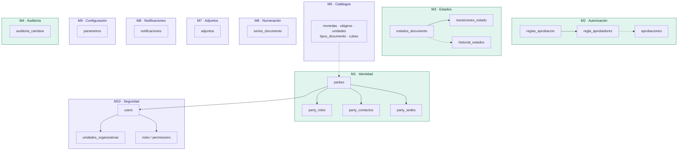

# Documento 06 — Arquitectura del núcleo de datos

> ## ⚠ Versión 3.0 — ampliado con la especificación v4 (octubre 2026)
> Fuente de verdad: `Techquk-Sistema-CRM-ERP-v4.pdf` (21 set 2026), `Techquk-Flujograma-de-gastos-1.pdf` y `techquk-prototipo_4_.html`. Índice de cambios: `00-Reconciliacion-con-v4.md`.
> Las convenciones y los mecanismos M1 a M10 siguen vigentes. La **sección 17** agrega M11 (Imputación), M12 (IA) y M13 (Alertas) y amplía M2, M3 y M10.


**Programa:** Ordenamiento Organizacional y Sistemas de Gestión — Techquk S.A.C.
**Versión:** 2.0 · Agosto 2026
**Alcance:** los diez mecanismos transversales. No incluye los módulos de negocio.
**Complementa:** documento 05 v2.1 (plan de construcción técnica)

---

## Registro de cambios

| Versión | Fecha | Cambios |
|---|---|---|
| 1.0 | Ago 2026 | Los diez mecanismos del núcleo, ~38 tablas |
| **2.0** | **Ago 2026** | **Estimación con el equipo real · decisiones D6 a D10 · tres ajustes que exigen los módulos nuevos** |

### Qué cambió

| Cambio | Motivo |
|---|---|
| **El esfuerzo se expresa por equipo, no por persona** | `[V]` Son tres desarrolladores con experiencia previa en el mismo stack |
| **El núcleo casi no se reparte** | `[S]` Diez mecanismos entrelazados; partirlos entre tres produce tres criterios |
| **Decisiones D6 a D10** | Aparecieron al revisar el organigrama y al decidir el reemplazo de S10 |
| **Tres campos nuevos** | Los exigen ERP-10 Contratos, ERP-11 Suscripciones y ERP-12 Desarrollo |

---

## 1. Qué es el núcleo y qué no es

El núcleo **no es un módulo**. Es la infraestructura que los diecinueve módulos consumen.

Piénselo como los cimientos y las instalaciones de un edificio: no son ningún departamento en
particular, pero ninguno funciona sin ellos, y son lo único que no se puede cambiar una vez que
la gente se mudó.

**Lo que sí incluye:** identidad, autorización, estados, auditoría, catálogos compartidos,
numeración, adjuntos, notificaciones, configuración y seguridad.

**Lo que no incluye:** oportunidades, cotizaciones, proyectos, órdenes de compra, tickets. Todo
eso depende de lo que salga de la Fase 0 y se diseña después.

### Por qué se construye primero

`[V]` En el ERP analizado, la tabla de personas es referenciada por 129 relaciones — la más
referenciada de una base de 1,916 tablas. Si esa tabla se construye dentro del CRM, queda con
forma de CRM, y cuando llegue Compras habrá que retrofitearla con meses de datos encima.

### Nivel de evidencia

| Mecanismo | Origen |
|---|---|
| M1 Identidad, M2 Autorización, M3 Estados, M4 Auditoría | `[V]` Verificados en un ERP real en producción |
| M5 a M10 | `[S]` Propuestos por diseño, con justificación en cada caso |

---

## 2. Convenciones obligatorias

Se fijan antes de la primera migración. Cambiarlas después de doscientas tablas no se hace.

| Regla | Decisión |
|---|---|
| **Idioma de tablas de dominio** | Español, plural, `snake_case` — `parties`, `reglas_aprobacion` |
| **Idioma de tablas de framework** | Se conserva el original — `users`, `jobs`, `migrations` |
| **Llave primaria** | `id` autoincremental siempre. **Nunca** el código de negocio |
| **Códigos de negocio** | Columna aparte con restricción `unique` |
| **Llaves foráneas** | `<tabla_singular>_id` — `party_id`, `proyecto_id` |
| **Booleanos** | Prefijo `es_` o `requiere_` — `es_final`, `requiere_motivo` |
| **Fechas** | `_at` para marcas de tiempo, `fecha_` para fechas de negocio |
| **Texto** | `varchar` o `text`. **Nunca** `char` |
| **Dinero** | `decimal(14,2)`. **Nunca** `float` |
| **Auditoría** | Cuatro columnas obligatorias en toda tabla de negocio, `NOT NULL` |

> **Antipatrón A6 del documento 05.** En el ERP analizado conviven `CodEmpresa` y
> `CodIdentificadorEmpresa` para el mismo concepto, y dos sistemas de identificación —códigos
> de usuario y GUID— sin criterio. Una convención, escrita, aplicada desde la primera tabla.

---

## 3. Vista general

> ⚠ El núcleo tiene ahora **13 mecanismos** (M1 a M13). Ver §17.




Verde: mecanismos verificados en un sistema real. Morado: propuestos por diseño.

---

## 4. M1 — Identidad

> **Propósito.** Que toda persona u organización exista **una sola vez** en el sistema, sin
> importar cuántos papeles cumpla.

### 4.1 `parties`

El corazón del sistema. Guarda quién es alguien, no qué hace.

| Columna | Tipo | Para qué sirve |
|---|---|---|
| `id` | `bigint` | Llave interna. Es lo que referencian las demás tablas |
| `tipo_documento_id` | `FK` | RUC, DNI, carné de extranjería, pasaporte |
| `numero_documento` | `varchar(20)` | El número. Junto con el tipo forma la clave natural |
| `razon_social` | `varchar(255)` | Nombre legal completo |
| `nombre_comercial` | `varchar(255)` | Nombre con el que se le conoce. Nullable |
| `es_persona_natural` | `boolean` | Distingue persona de organización |
| `ubigeo_id` | `FK` nullable | Departamento, provincia, distrito |
| `direccion_fiscal` | `varchar(255)` | La que figura en SUNAT |
| `telefono`, `email` | `varchar` | Contacto principal. Nullable |
| `estado_sunat` | `varchar(20)` | Activo, baja provisional, baja definitiva |
| `condicion_sunat` | `varchar(20)` | Habido, no habido, no hallado |
| `es_agente_retencion` | `boolean` | Determina si se le retiene |
| `es_agente_percepcion` | `boolean` | Determina si se le percibe |
| `es_buen_contribuyente` | `boolean` | Exime de retención |
| `notas` | `text` nullable | Observaciones libres |

**Restricción única:** `(tipo_documento_id, numero_documento)`. Es lo que impide cargar dos
veces al mismo cliente.

> `[V]` **Las tres banderas tributarias vienen de evidencia.** En el ERP analizado, la función
> que decide si aplicar retención lee exactamente esas tres marcas antes de consultar cualquier
> padrón. Son las que resuelven el 100% de los casos observados.

`[P]` Falta decidir si además se consulta un padrón externo. En el sistema analizado el padrón
existía pero llevaba **once años sin actualizarse**, y funcionaba solo porque las marcas
manuales cubrían los casos. Si Techquk quiere depender de un padrón, alguien tiene que
mantenerlo.

### 4.2 `party_roles`

Qué papel cumple cada quien. Una fila por rol.

| Columna | Tipo | Para qué sirve |
|---|---|---|
| `id` | `bigint` | Llave interna |
| `party_id` | `FK` | A quién corresponde |
| `rol` | `varchar(30)` | `cliente`, `proveedor`, `aliado`, `entidad_contratante`, `colaborador`, `agente_aduanas` |
| `desde` | `date` nullable | Desde cuándo cumple ese rol |
| `hasta` | `date` nullable | Hasta cuándo. Nulo = vigente |

**Restricción única:** `(party_id, rol)`.

> `[V]` **El retorno del patrón, medido en el sistema analizado:** su catálogo de roles pasó de
> 9 en 1999 a 13 en 2021 **sin que se creara una sola tabla nueva**. Cuando en 2015 apareció la
> figura del practicante, insertaron una fila.

Las columnas `desde` y `hasta` son un agregado: el sistema analizado no registra desde cuándo
alguien es proveedor, y ese dato importa para auditoría y para reportes históricos.

### 4.3 `party_contactos`

Las personas dentro de una organización. Quién decide y quién solo opina.

| Columna | Tipo | Para qué sirve |
|---|---|---|
| `party_id` | `FK` | La organización |
| `contacto_party_id` | `FK` nullable | Si la persona también está registrada como party |
| `nombres`, `apellidos` | `varchar` | Nombre de la persona |
| `cargo` | `varchar(120)` | Jefe de Seguridad Ciudadana, Logística, etc. |
| `area` | `varchar(120)` | A qué área pertenece |
| `es_decisor` | `boolean` | Si tiene poder de decisión |
| `es_principal` | `boolean` | El contacto por defecto |
| `telefono`, `email` | `varchar` | Datos de contacto |

> `[V]` **Por qué `contacto_party_id` en lugar de una tabla `contactos` separada.** En el ERP
> analizado existe una tabla `Contacto` con cero filas y **cero referencias** — nadie la usa. Y
> sin embargo el rol de contacto sí se usa: tres tablas tienen columnas llamadas `CodContacto`
> y **las tres apuntan a la tabla central de personas**. El concepto sobrevivió; la tabla no.

### 4.4 `party_sedes`

Direcciones múltiples. Una municipalidad tiene sede central, comisarías y almacén.

| Columna | Tipo | Para qué sirve |
|---|---|---|
| `party_id` | `FK` | A quién pertenece |
| `nombre` | `varchar(120)` | "Sede central", "Almacén Chiclayo" |
| `direccion` | `varchar(255)` | La dirección |
| `ubigeo_id` | `FK` | Ubicación geográfica |
| `es_fiscal` | `boolean` | Si es el domicilio fiscal |
| `es_entrega` | `boolean` | Si ahí se entrega mercadería |
| `latitud`, `longitud` | `decimal` nullable | Para proyectos con georreferencia |

Las coordenadas son específicas de Techquk: en videovigilancia y seguridad ciudadana, la
ubicación de cada punto instalado es información operativa.

### 4.5 `party_cuentas_bancarias`

| Columna | Tipo | Para qué sirve |
|---|---|---|
| `party_id` | `FK` | Titular |
| `banco_party_id` | `FK` | El banco, que también es un party con rol proveedor |
| `numero_cuenta` | `varchar(30)` | Número de cuenta |
| `cci` | `varchar(20)` | Código interbancario |
| `moneda_id` | `FK` | Soles o dólares |
| `es_detraccion` | `boolean` | Si es la cuenta de detracciones del Banco de la Nación |
| `es_principal` | `boolean` | Cuenta por defecto para pagos |

> `[V]` Que el banco sea un party y no una tabla aparte viene del sistema analizado: su tabla de
> cuentas corrientes tiene una columna `CodBanco` que apunta a la tabla central de personas.

---

## 5. M2 — Autorización

> **Propósito.** Que las reglas de aprobación vivan como datos editables, no como código.

### 5.1 `reglas_aprobacion`

Una fila por política. Cambiar un límite es editar un campo.

| Columna | Tipo | Para qué sirve |
|---|---|---|
| `documento` | `varchar(40)` | A qué aplica: `cotizacion`, `orden_compra`, `requerimiento`, `pago` |
| `proyecto_id` | `FK` nullable | Ámbito. Nulo = aplica a todos |
| `unidad_organizativa_id` | `FK` nullable | Ámbito por área |
| `moneda_id` | `FK` | Reglas distintas por moneda |
| `monto_desde` | `decimal(14,2)` | Piso del tramo |
| `monto_hasta` | `decimal(14,2)` nullable | Techo. Nulo = sin límite superior |
| `firmas_requeridas` | `tinyint` | Cuántas se necesitan |
| `es_secuencial` | `boolean` | Si el orden de firmas importa |
| `es_activa` | `boolean` | Permite desactivar sin borrar |

> `[V]` **Las cuatro dimensiones vienen del sistema analizado:** proyecto, centro de compra,
> moneda y rango de monto, más `NumeroAprobadores` y `AprobacionJerarquica`. Con eso expresa
> políticas completas sin escribir código.

### 5.2 `regla_aprobadores`

Quiénes firman bajo cada regla.

| Columna | Tipo | Para qué sirve |
|---|---|---|
| `regla_aprobacion_id` | `FK` | A qué regla pertenece |
| `user_id` | `FK` | Quién firma |
| `es_obligatorio` | `boolean` | **Si su firma es indispensable** |
| `orden` | `tinyint` | En qué turno le toca, si la regla es secuencial |
| `puede_delegar` | `boolean` | Si puede pasar la firma a otro |

> `[V]` **`es_obligatorio` es el campo más importante de todo el mecanismo, y el que más fácil
> se apaga.** En el sistema analizado estaba en cero en las 16 filas registradas. Resultado: de
> las nueve órdenes de compra emitidas, **ninguna pasó por un control capaz de detenerla.**

### 5.3 `aprobaciones`

El registro de cada firma. Tabla polimórfica: sirve para cualquier documento.

| Columna | Tipo | Para qué sirve |
|---|---|---|
| `aprobable_type` | `varchar` | Qué tipo de documento — modelo de Laravel |
| `aprobable_id` | `bigint` | Cuál documento |
| `regla_aprobacion_id` | `FK` | Bajo qué regla se pidió |
| `user_id` | `FK` | A quién le toca |
| `es_obligatorio` | `boolean` | Copiado de la regla al momento de crear |
| `orden` | `tinyint` | Turno |
| `estado` | `varchar(20)` | `pendiente`, `aprobado`, `observado`, `rechazado` |
| `firmado_at` | `timestamp` nullable | Cuándo firmó |
| `motivo` | `text` nullable | Obligatorio si observa o rechaza |

**Por qué se copia `es_obligatorio` en vez de leerlo de la regla:** si mañana cambian la
política, las aprobaciones ya emitidas deben conservar la regla que estaba vigente cuando se
emitieron. Es el mismo criterio con que se congela un precio en una factura.

### 5.4 Las dos pantallas obligatorias

`[S]` No son tablas, pero sin ellas el mecanismo se vuelve invisible:

**Reglas vigentes en lenguaje claro.** Una vista que traduzca las filas a frases: *"Las órdenes
de compra en dólares del proyecto Municipalidad sobre USD 5,000 requieren la firma de Gerencia
General, que es indispensable."*

> `[V]` En el sistema analizado hizo falta cruzar tres tablas para descubrir que la única firma
> obligatoria correspondía a un proyecto que aún no había comprado nada.

**Alerta de ámbito sin regla.** Un aviso cuando un proyecto o un área emite documentos sin
tener política configurada.

> `[V]` Dos proyectos del sistema analizado compraron sin ninguna regla definida, y nada lo
> señaló.

---

## 6. M3 — Estados

> **Propósito.** Que el ciclo de vida de cada documento sea configurable y auditable, no una
> lista de etiquetas libres.

### 6.1 `estados_documento`

| Columna | Tipo | Para qué sirve |
|---|---|---|
| `documento` | `varchar(40)` | `oportunidad`, `cotizacion`, `proyecto`, `orden_compra`, `ticket` |
| `codigo` | `varchar(6)` | Identificador estable. **No se reutiliza ni se reordena** |
| `descripcion` | `varchar(80)` | "Por aprobar", "En almacén" |
| `orden` | `smallint` | **Posición en el flujo, separada del código** |
| `color` | `varchar(20)` nullable | Para los badges de Filament |
| `es_inicial` | `boolean` | Estado con el que nace el documento |
| `es_final` | `boolean` | Cierra el ciclo |
| `es_cancelacion` | `boolean` | Anulado, rechazado, descartado |

**Restricción única:** `(documento, codigo)`.

> `[V]` **Por qué `orden` va separado de `codigo`.** En el ERP analizado, el catálogo de estados
> de orden de compra tiene "Por Aprobar" con el código `06`, **después** de "Anulado" que es el
> `05`. El estado se agregó años después y le asignaron el siguiente número libre. El orden
> lógico del proceso no coincide con la numeración, y ya no se puede arreglar sin romper datos.

### 6.2 `transiciones_estado`

Qué saltos están permitidos. Es lo que convierte un catálogo en una máquina de estados.

| Columna | Tipo | Para qué sirve |
|---|---|---|
| `desde_estado_id` | `FK` | Estado origen |
| `hacia_estado_id` | `FK` | Estado destino |
| `requiere_motivo` | `boolean` | Si exige justificación tipificada |
| `permiso` | `varchar(60)` nullable | Qué permiso hace falta para ejecutarla |
| `requiere_aprobacion` | `boolean` | Si dispara el mecanismo M2 |

Aquí vive la regla del documento 01: *ninguna oportunidad se cierra como perdida sin motivo
tipificado*. Se implementa marcando `requiere_motivo` en esa transición.

### 6.3 `motivos_transicion`

La lista cerrada de motivos. Sin esto, `requiere_motivo` produce texto libre inservible.

| Columna | Tipo | Para qué sirve |
|---|---|---|
| `documento` | `varchar(40)` | A qué documento aplica |
| `codigo` | `varchar(10)` | Identificador |
| `descripcion` | `varchar(120)` | "Precio", "Plazo de entrega", "Especificación técnica" |
| `es_activo` | `boolean` | Permite retirar sin borrar histórico |

> `[S]` Ese campo, obligatorio y de lista cerrada, es lo que convierte el CRM en herramienta de
> aprendizaje comercial y no en archivador. Sin él no se puede responder *"¿por qué perdemos?"*

### 6.4 `historial_estados`

Cada transición ejecutada. Tabla polimórfica.

| Columna | Tipo | Para qué sirve |
|---|---|---|
| `documentable_type`, `documentable_id` | polimórfico | Qué documento cambió |
| `desde_estado_id` | `FK` nullable | Nulo si es la creación |
| `hacia_estado_id` | `FK` | A dónde pasó |
| `motivo_id` | `FK` nullable | Si la transición lo exigía |
| `observacion` | `text` nullable | Detalle libre adicional |
| `user_id` | `FK` | Quién la ejecutó |
| `created_at` | `timestamp` | Cuándo |

> `[V]` **Por qué esta tabla es indispensable.** En el sistema analizado, el único lugar donde
> consta que un pedido se atendió es un campo booleano suelto: sin fecha, sin usuario, sin
> cantidad parcial. Un reporte de pendientes armado sobre el estado muestra nueve; armado sobre
> el booleano muestra cero. Ambos correctos según su fuente.

---

## 7. M4 — Auditoría

> **Propósito.** Que toda transacción registre quién, cuándo y qué cambió. Requisito
> indispensable para contratación pública.

### 7.1 Columnas obligatorias en toda tabla de negocio

No es una tabla: es una regla aplicada en cada migración.

```php
$table->foreignId('created_by')->constrained('users');
$table->timestamp('created_at')->useCurrent();
$table->foreignId('updated_by')->nullable()->constrained('users');
$table->timestamp('updated_at')->nullable();
```

`created_by` y `created_at` son **`NOT NULL`**. No admiten excepción.

> `[V]` **Antipatrón A4 del documento 05.** En el sistema analizado, tres tablas tienen la fecha
> de creación **completamente en nulo**: 926 filas del plan contable, 809 de formatos de boleta,
> 397 de un reporte de precios. La columna existe y nunca se llenó.
>
> Y hay un sesgo perverso: los registros creados por caminos irregulares —cargas masivas,
> correcciones manuales, scripts de emergencia— son los que más interesaría rastrear, y son
> precisamente los que se saltan la aplicación y dejan el campo vacío.

### 7.2 `auditoria_cambios`

Bitácora de cambios campo por campo, solo para tablas sensibles.

| Columna | Tipo | Para qué sirve |
|---|---|---|
| `auditable_type`, `auditable_id` | polimórfico | Qué registro cambió |
| `evento` | `varchar(20)` | `creado`, `actualizado`, `eliminado` |
| `valores_anteriores` | `jsonb` | Estado previo |
| `valores_nuevos` | `jsonb` | Estado posterior |
| `user_id` | `FK` | Quién |
| `ip`, `user_agent` | `varchar` | Desde dónde |
| `created_at` | `timestamp` | Cuándo |

`jsonb` es tipo nativo de PostgreSQL: permite consultar dentro del JSON sin desarmarlo.

**Qué tablas se auditan:** parties, reglas de aprobación, cotizaciones, órdenes de compra,
proyectos y parámetros. **No todas** — auditar todo produce una bitácora que nadie consulta y
que triplica el tamaño de la base.

### 7.3 La capa de visado

`[V]` El sistema analizado tiene una tercera capa que vale la pena considerar:
`AuditorUsuario`, `AuditorFecha` y `AuditorOK` en unas 250 tablas. No es rastro técnico: es un
**visto bueno de revisión** incrustado en la fila.

`[P]` Decisión para Techquk: ¿hay procesos donde una persona captura y otra valida? En
valorizaciones, actas de conformidad y liquidaciones probablemente sí. Si aplica, se agrega
como tres columnas más en esas tablas específicas.

---

## 8. M5 — Catálogos maestros compartidos

> **Propósito.** Que exista un solo lugar para cada lista que usan varios módulos.
> `[S]` En el sistema analizado se encontraron **dos tablas de unidades de medida** y **dos
> padrones de entidades tributarias** conviviendo. Es lo que hay que evitar.

### 8.1 `monedas`

| Columna | Para qué sirve |
|---|---|
| `codigo` | `PEN`, `USD`, `EUR` — estándar ISO 4217 |
| `nombre` | "Sol", "Dólar americano" |
| `simbolo` | `S/`, `$` |
| `decimales` | Cuántos decimales usa |
| `es_local` | La moneda funcional de la empresa |

### 8.2 `tipos_cambio`

| Columna | Para qué sirve |
|---|---|
| `moneda_id` | Qué moneda |
| `fecha` | De qué día |
| `compra`, `venta` | Los dos valores publicados por SUNAT |
| `origen` | `sunat`, `manual` |

**Restricción única:** `(moneda_id, fecha)`.

`[S]` Guardar compra y venta por separado no es capricho: SUNAT exige usar el tipo de cambio
venta para compras y compra para ventas. Un solo campo obliga a decidir mal.

### 8.3 `unidades_medida`

| Columna | Para qué sirve |
|---|---|
| `codigo` | `NIU`, `ZZ`, `MTR` — catálogo 03 de SUNAT |
| `nombre` | "Unidad", "Servicio", "Metro" |
| `abreviatura` | Para mostrar en documentos |
| `permite_decimales` | Si acepta cantidades fraccionadas |

Los códigos siguen el catálogo de SUNAT porque van en el comprobante electrónico. Inventar
códigos propios obliga a mapear después.

### 8.4 `ubigeos`

| Columna | Para qué sirve |
|---|---|
| `codigo` | Seis dígitos del INEI |
| `departamento`, `provincia`, `distrito` | Los tres niveles |
| `parent_id` | Jerarquía autoreferenciada |

### 8.5 `tipos_documento_identidad`

| Columna | Para qué sirve |
|---|---|
| `codigo` | `1` DNI, `6` RUC, `4` CE, `7` Pasaporte — catálogo 06 de SUNAT |
| `nombre` | Nombre legible |
| `longitud` | Cuántos dígitos debe tener |
| `valida_modulo11` | Si aplica el dígito verificador del RUC |

### 8.6 `tipos_comprobante`

| Columna | Para qué sirve |
|---|---|
| `codigo` | `01` Factura, `03` Boleta, `07` NC, `08` ND, `09` Guía — catálogo 01 de SUNAT |
| `nombre` | Nombre legible |
| `es_electronico` | Si va por facturación electrónica |
| `afecta_cuenta_corriente` | Si genera cuenta por cobrar |

### 8.7 `cubso`

El **Catálogo Único de Bienes, Servicios y Obras** del Estado peruano.

| Columna | Para qué sirve |
|---|---|
| `codigo` | Ocho dígitos, estándar UNSPSC |
| `descripcion` | Nombre oficial del bien o servicio |
| `segmento`, `familia`, `clase` | Los niveles superiores de la jerarquía |
| `version_catalogo` | Qué versión del catálogo se cargó |
| `es_vigente` | Permite retirar códigos sin borrarlos |

> `[V]` **Es el único elemento del ERP analizado que aplica a Techquk tal cual.** Son 57,610
> códigos, de uso obligatorio en toda contratación pública peruana. Las entidades lo usan para
> su Plan Anual de Contrataciones y los proveedores para inscribirse en el RNP.

> `[V]` **Y trae una advertencia.** En el sistema analizado se cargó en diciembre de 2018 y
> nunca se refrescó. Por eso la columna `version_catalogo`: sin ella no se sabe qué versión
> está cargada ni cuándo toca actualizar.

### 8.8 `lineas_solucion`

Las nueve líneas del portafolio de Techquk, y las seis tipologías de proyecto del documento 02.

| Columna | Para qué sirve |
|---|---|
| `codigo` | `T1` a `T6` |
| `nombre` | "Integración de seguridad electrónica" |
| `tipologia` | A qué tipología operativa corresponde |
| `vertical` | Gobierno, Educación, Salud |

`[S]` Esta tabla es la que permite que el catálogo comercial, las oportunidades y los proyectos
compartan la misma clasificación. Sin ella, cada módulo inventa la suya.

---

## 9. M6 — Numeración de documentos

> **Propósito.** Que cada documento tenga un correlativo único, sin huecos ni duplicados.
> `[S]` En contratación pública, un correlativo con salto es una pregunta incómoda.

### 9.1 `series_documento`

| Columna | Para qué sirve |
|---|---|
| `documento` | `cotizacion`, `orden_compra`, `factura`, `ticket` |
| `serie` | Prefijo: `COT`, `OC`, `F001` |
| `anio` | Si la numeración se reinicia cada año |
| `proyecto_id` | nullable — si la serie es por proyecto |
| `ultimo_numero` | El último asignado |
| `longitud` | Cuántos dígitos rellenar con ceros |
| `es_activa` | Permite cerrar una serie |

**Restricción única:** `(documento, serie, anio)`.

### 9.2 Cómo se asigna sin duplicados

`[S]` El correlativo se toma **dentro de la transacción que guarda el documento**, con bloqueo
de fila:

```php
DB::transaction(function () use ($documento) {
    $serie = SerieDocumento::where('documento', 'cotizacion')
        ->where('anio', now()->year)
        ->lockForUpdate()          // ← impide que dos usuarios tomen el mismo número
        ->first();

    $serie->increment('ultimo_numero');
    $documento->numero = $serie->serie . '-' .
        str_pad($serie->ultimo_numero, $serie->longitud, '0', STR_PAD_LEFT);
    $documento->save();
});
```

Sin `lockForUpdate`, dos personas guardando al mismo tiempo obtienen el mismo número. Es un
error que aparece recién cuando hay concurrencia real, o sea cuando el sistema ya está en
producción.

---

## 10. M7 — Adjuntos y documentos

> **Propósito.** Que todo documento pueda llevar archivos, guardados **fuera** de la base.

### 10.1 `adjuntos`

| Columna | Para qué sirve |
|---|---|
| `adjuntable_type`, `adjuntable_id` | polimórfico — a qué documento pertenece |
| `tipo_adjunto_id` | `FK` — qué clase de documento es |
| `nombre_original` | Como lo subió el usuario |
| `ruta` | Dónde está en el almacenamiento. **No el contenido** |
| `disco` | `local`, `s3`, según configuración |
| `mime` | Tipo de archivo |
| `tamano_bytes` | Peso |
| `hash` | SHA-256, para detectar duplicados |
| `es_vigente` | Para versionado de documentos |
| `created_by`, `created_at` | Auditoría |

> `[V]` **Antipatrón A3, y es el más caro de los seis.** En el ERP analizado, la tabla de notas
> pesa **280 MB con 508 registros** — unos 565 KB por fila, cuando el resto de las tablas van de
> 100 bytes a 2 KB. Guarda los archivos completos adentro.
>
> Consecuencia medida: dos tercios del espacio de esa base no son información de negocio.

### 10.2 `tipos_adjunto`

| Columna | Para qué sirve |
|---|---|
| `documento` | A qué tipo de documento aplica |
| `codigo` | `BASES`, `PROPUESTA`, `ACTA`, `DUA`, `FOTO_OBRA` |
| `nombre` | Nombre legible |
| `es_obligatorio` | Si el documento no se cierra sin él |
| `extensiones_permitidas` | `pdf,jpg,png` |
| `tamano_maximo_mb` | Límite |

`[S]` `es_obligatorio` es lo que permite que una licitación no se marque como presentada sin
tener cargadas las bases y la propuesta.

---

## 11. M8 — Notificaciones

> **Propósito.** Que los avisos del sistema sean configurables y queden registrados.
> `[S]` Sin un mecanismo central, cada módulo arma sus correos y terminas con siete formatos
> distintos, ninguno editable sin tocar código.

### 11.1 `plantillas_notificacion`

| Columna | Para qué sirve |
|---|---|
| `evento` | `aprobacion_pendiente`, `sla_por_vencer`, `cotizacion_por_expirar` |
| `canal` | `email`, `sistema`, `whatsapp` |
| `asunto` | Con variables: `Orden {{numero}} pendiente de su aprobación` |
| `cuerpo` | Plantilla del mensaje |
| `es_activa` | Permite silenciar sin borrar |

### 11.2 `notificaciones`

Laravel ya trae esta tabla con `php artisan notifications:table`. Se usa la nativa y se le
agregan dos columnas:

| Columna agregada | Para qué sirve |
|---|---|
| `evento` | Qué la disparó |
| `notificable_type`, `notificable_id` | A qué documento se refiere |

### 11.3 Los tres eventos mínimos

`[S]` Con estos tres, el mecanismo justifica su costo desde la fase 2:

| Evento | Cuándo dispara |
|---|---|
| Aprobación pendiente | Un documento entra a estado que requiere firma |
| Cotización por expirar | Faltan N días para la fecha de validez |
| SLA por vencer | Un ticket se acerca a su plazo comprometido |

---

## 12. M9 — Configuración

> **Propósito.** Que los parámetros del negocio se cambien sin tocar código ni desplegar.

### 12.1 `parametros`

| Columna | Para qué sirve |
|---|---|
| `grupo` | `tributario`, `comercial`, `proyectos` |
| `clave` | `igv_porcentaje`, `validez_cotizacion_dias`, `margen_minimo_alerta` |
| `valor` | El valor, guardado como texto |
| `tipo` | `entero`, `decimal`, `booleano`, `texto`, `json` |
| `descripcion` | Para qué sirve, en lenguaje claro |
| `es_editable` | Si el usuario puede cambiarlo desde la interfaz |

**Restricción única:** `(grupo, clave)`.

### 12.2 `empresas`

`[P]` **Depende de la decisión D1 del documento 05.**

Si el sistema es de empresa única, esta tabla tiene una fila y sirve como cabecera de
documentos —razón social, RUC, logo, dirección fiscal—.

Si es multiempresa, se convierte en el eje de aislamiento y **toda tabla de negocio necesita
`empresa_id`**. Eso cambia el esquema completo, no un módulo.

> `[S]` La decisión importa más de lo que parece para Techquk: es un integrador de tecnología, y
> es plausible que quiera vender este ERP a clientes del mismo rubro. Si esa posibilidad existe,
> el aislamiento se diseña ahora.

---

## 13. M10 — Seguridad y estructura organizativa

> ⚠ **Ampliado** con puestos, restricciones por campo y cruces de funciones: ver §17.6.


> **Propósito.** Que los permisos reflejen el organigrama del documento 03, y que cada usuario
> sea antes que nada una persona registrada.

### 13.1 `users`

Se extiende la tabla nativa de Laravel:

| Columna agregada | Para qué sirve |
|---|---|
| `party_id` | `FK` — **la persona detrás de la cuenta** |
| `unidad_organizativa_id` | `FK` — dónde está en el organigrama |
| `jefe_user_id` | `FK` nullable — a quién reporta |
| `es_activo` | Baja lógica sin borrar histórico |

> `[V]` **Que `users` apunte a la tabla de personas es el caso más contundente del patrón
> Party.** En el sistema analizado, la tabla de usuarios cuelga de la tabla central: hasta quien
> opera el software es primero una persona registrada. No hay atajo ni siquiera para la tabla
> de acceso.

### 13.2 `unidades_organizativas`

El organigrama del documento 03, en tabla.

| Columna | Para qué sirve |
|---|---|
| `codigo` | Identificador estable |
| `nombre` | "Gerencia de Suministro y Comercio Exterior" |
| `tipo` | `gerencia`, `jefatura`, `rol`, `staff` |
| `parent_id` | Jerarquía autoreferenciada |
| `responsable_user_id` | `FK` nullable — quién la dirige |
| `es_activa` | Permite reorganizar sin perder histórico |

`[S]` Tenerlo en tabla y no cableado permite que la reorganización sea configuración. El
documento 03 ya prevé vacantes y titulares interinos — eso se modela con `responsable_user_id`
nullable.

### 13.3 Roles y permisos

Se usa `spatie/laravel-permission`, que aporta cinco tablas ya probadas: `roles`,
`permissions`, `role_has_permissions`, `model_has_roles`, `model_has_permissions`.

**No se reinventa.** Es un paquete maduro, integrado con Filament, y el esfuerzo se concentra en
definir los permisos correctos, no en construir el mecanismo.

### 13.4 `permisos_por_ambito`

`[S]` Lo que spatie **no** resuelve: permisos acotados a un proyecto o a un almacén.

| Columna | Para qué sirve |
|---|---|
| `user_id` | Quién |
| `ambito_type`, `ambito_id` | polimórfico — proyecto, almacén, unidad |
| `permiso` | Qué puede hacer ahí |
| `desde`, `hasta` | Vigencia temporal |

> `[V]` El sistema analizado resuelve esto con tablas como `ProyectoAlmacenUsuarioPermiso` y
> `CentroCompraProyectoUsuarioPermiso`. Son las **primeras tablas que recibieron datos** en toda
> su implementación: el 4 de junio, casi un mes antes de cualquier operación.
>
> `[S]` La lectura es clara: primero se define quién puede ver qué, después la gente registra
> movimientos.

---

## 14. Resumen: el núcleo completo

> ⚠ Resumen de agosto. La v4 suma **14 tablas**: 11 en M11 a M13 y 3 en M10 (`puestos`, `restricciones_campo`, `cruces_funciones`).


| Mecanismo | Tablas | Evidencia |
|---|---:|---|
| M1 Identidad | 5 | `[V]` |
| M2 Autorización | 3 | `[V]` |
| M3 Estados | 4 | `[V]` |
| M4 Auditoría | 1 + columnas | `[V]` |
| M5 Catálogos | 8 | `[S]` |
| M6 Numeración | 1 | `[S]` |
| M7 Adjuntos | 2 | `[S]` |
| M8 Notificaciones | 2 | `[S]` |
| M9 Configuración | 2 | `[S]` |
| M10 Seguridad | 3 + 5 de spatie | `[V]` parcial |
| **Total** | **~38 tablas** | |

**Esfuerzo estimado:** 5 a 6 semanas a dedicación completa, incluyendo pruebas automatizadas y
datos de ejemplo.

`[S]` Es más de las tres o cuatro semanas que estimé en el documento 05. La diferencia son los
seis mecanismos que se agregaron después de revisar qué faltaba. Prefiero corregir la
estimación ahora que descubrirlo en la semana cuatro.

---

## 15. Criterios de salida del núcleo

El núcleo no está terminado hasta cumplir las siete condiciones:

| # | Condición |
|---|---|
| 1 | `php artisan migrate:fresh --seed` levanta el esquema completo desde cero |
| 2 | Los catálogos de SUNAT y el CUBSO están cargados y son consultables |
| 3 | Existe un módulo de demostración —una entidad simple— que usa los diez mecanismos |
| 4 | Pruebas automatizadas sobre: unicidad de party, resolución de regla de aprobación, transición de estado no permitida, correlativo bajo concurrencia |
| 5 | Las dos pantallas del M2: reglas vigentes en lenguaje claro y alerta de ámbito sin regla |
| 6 | Consulta de verificación que devuelve **cero** tablas sin llave primaria y **cero** columnas de auditoría en nulo |
| 7 | Documentación de los modelos publicada en el sitio de documentación |

`[S]` La condición 3 es la que más se subestima. Construir los mecanismos sin usarlos deja
errores latentes que aparecen recién en la fase 2, cuando ya hay presión de entrega.

---

## 16. Lo que este documento deja abierto

`[P]` **Cinco decisiones del documento 05** siguen pendientes y condicionan el esquema:
multiempresa, unidad organizadora, CUBSO, facturación electrónica y dedicación.

`[P]` **El visado de revisión** (sección 7.3): falta definir en qué procesos aplica.

`[P]` **Los estados concretos** de cada documento salen de la Fase 0. Aquí está el mecanismo,
no el contenido: cuántos estados tiene una oportunidad de Techquk y qué transiciones permite es
material del levantamiento.

`[S]` **Los diecinueve módulos de negocio** se diseñan después. Este documento entrega el suelo
sobre el que se paran, no las paredes.

---

*Fin del documento 06. La evidencia de cada patrón marcado `[V]` está en
`S10_firstSteps.md`. El plan de fases está en el documento 05.*


---

## 17. Lo que la v4 agrega al núcleo (v3.0)

`[V]` Fuente: especificación v4, partes 1, 6 y 7. Los **diseños de tabla** son `[S]` (propuesta derivada de los documentos, estados y efectos que define la v4); conviene revisarlos al construir el primer módulo que los use.

### 17.1 M11 — Imputación

> **Propósito.** Que cada peso de costo diga a dónde va. Es la idea más importante del sistema.

**Regla.** Toda línea de costo (de una orden, un despacho, una hora de tareo, una rendición, un gasto de importación, una valorización de subcontrato, un servicio con vigencia) tiene **exactamente un destino**: una partida de control de un proyecto, o el gasto directo con su centro de costo. No existe una tercera opción ni una línea sin destino.

| Tabla | Para qué sirve |
|---|---|
| `centros_costo` | Destino del gasto directo sin proyecto. Iniciales: Administración, Comercial, Operaciones, Suministro, RRHH (POR CONFIRMAR con Contabilidad) |
| `tipos_motivo` y `motivos` | Listas cerradas configurables (pérdida de oportunidad, gasto no presupuestado, exceso de partida, anulación). `es_cambio_cliente` marca el gasto como posible adicional |
| `imputaciones` | Una fila por línea de origen, con sus tres montos: comprometido, ejecutado y pagado |
| `posibles_adicionales` | Gasto cuyo motivo es un cambio pedido por el cliente: podría cobrarse con una adenda |

**Tres clases de gasto**

| Clase | Ejemplo | Dónde cae |
|---|---|---|
| General del proyecto | SCTR del personal, movilidad a la obra, comisión de la carta fianza | PC-04 del árbol, presupuestada |
| General de la empresa | Alquiler de la oficina, póliza del local, honorarios del contador | Gasto directo sin proyecto, con su centro de costo |
| No presupuestado | Un taxi imprevisto, dos cámaras que pidió el cliente | **PC-99** del proyecto, con motivo y aprobación |

**Los cuatro números de cada partida**

| Número | Qué significa | Cuándo cambia |
|---|---|---|
| Presupuestado | Lo que se decidió gastar | Al aprobar el árbol; después solo con una nueva versión aprobada |
| Comprometido | Lo que ya se decidió gastar | Al aprobar una orden, una reserva de stock o al cerrar una semana de tareo |
| Ejecutado | Lo que ya se consumió | Al despachar, dar conformidad, cerrar el tareo o aprobar una rendición |
| Pagado | Lo que ya salió de la caja | Al aplicar el pago. Es medida de caja, no de costo |

`disponible = presupuestado − comprometido` · `margen estimado = venta sin IGV − máx(presupuestado, comprometido)` por partida · **el comprometido nunca puede ser menor que el ejecutado.**

**Restricciones de integridad** (la base valida integridad; las reglas de negocio van en PHP):

```php
Schema::create('imputaciones', function (Blueprint $table) {
    $table->id();
    $table->string('origen_type', 120);
    $table->unsignedBigInteger('origen_id');
    $table->foreignId('partida_control_id')->nullable()->constrained('partidas_control');
    $table->foreignId('centro_costo_id')->nullable()->constrained('centros_costo');
    $table->decimal('monto_comprometido', 14, 2)->default(0);
    $table->decimal('monto_ejecutado', 14, 2)->default(0);
    $table->decimal('monto_pagado', 14, 2)->default(0);
    // ... ver techquk_modelo.dbml
    $table->unique(['origen_type', 'origen_id']);
    $table->auditoria();
});

DB::statement('ALTER TABLE imputaciones ADD CONSTRAINT imputaciones_destino_chk
    CHECK (partida_control_id IS NOT NULL OR centro_costo_id IS NOT NULL)');
DB::statement('ALTER TABLE imputaciones ADD CONSTRAINT imputaciones_montos_chk
    CHECK (monto_comprometido >= monto_ejecutado)');
```

**El selector de imputación** se construye **una sola vez** y aparece en todos los documentos que llevan costo. El saldo se calcula en el momento: quien pide ve si se pasa *antes* de pedir. Si excede, se puede continuar, pero la línea se marca y exige motivo y aprobación.

### 17.2 M2 ampliado — Matriz de aprobaciones

`[V]` Las reglas viven **como datos** y se cambian desde una pantalla de configuración. Los umbrales **U1, U2 y U3** los fija Gerencia (`POR VALIDAR`).

| Documento | Condición | Aprueba |
|---|---|---|
| Requerimiento | Hasta U1 | Jefatura de Proyectos |
| Requerimiento u orden | Sobre U1 | Gerencia de Operaciones o de Suministro |
| Orden | Sobre U2 | Gerencia General |
| Cualquier línea que exceda su partida | Siempre | Jefatura de Proyectos, con motivo; sobre U1 también Gerencia de Operaciones |
| Árbol de partidas o nueva versión | Siempre | Jefatura de Proyectos |
| Adenda | Siempre | Gerencia de Operaciones; con impacto económico, Gerencia General |
| Pago | Hasta U3 / sobre U3 | Gerencia de Administración / Gerencia General |
| Factura retenida liberada | Siempre | Gerencia de Administración |
| Ajuste de inventario o de tareo | Siempre | Jefatura del área |
| Gasto no presupuestado (PC-99) | Siempre, cualquier monto | Jefatura de Proyectos; sobre U1 también Gerencia de Operaciones |
| Habilitación de campo autorizada sin requisito | Siempre | Gerencia de Operaciones, con motivo |
| Cierre de planilla | Siempre | RRHH con visto bueno del contador |

`[V]` Se mantienen las dos exigencias de agosto: la pantalla de **reglas vigentes en lenguaje claro** y la **alerta cuando un ámbito opera sin regla**.

### 17.3 M3 ampliado — Documentos con estados y efectos

`[V]` Casi todo en el ERP es un documento que recorre estados y **produce efectos**. Cada tipo declara sus estados y transiciones **como datos**; la pantalla no los programa.

Cada transición define: desde qué estado, con qué acción, hacia cuál, **quién** puede hacerla y **qué efectos** produce. Cada ficha define además las **validaciones** que bloquean una acción.

Tres reglas valen para todos los documentos:

1. Un documento aprobado **no se edita**: se anula con motivo o se corrige con otro documento.
2. **Nada se borra:** lo anulado, rechazado o vencido se conserva con su motivo.
3. **Anular exige motivo y revierte los efectos de la última transición.**

**Prefijos de numeración** (generados por M6): `CT` contrato · `PRE` presupuesto (con versión) · `REQ` requerimiento · `OC` orden de compra · `OS` orden de servicio · `ING` recepción · `DES` despacho · `HOR` parte de horas · `GAR` garantía · `AD` adenda · `ADL` adelanto · `VAL` valorización · `LIQ` liquidación · `CSR` consorcio · `SC` subcontrato · `SUG` sugerencia de IA · `AS` asiento · `PLA` planilla · `REN` rendición · `COL` y `CTL` colaborador y contrato laboral · `EXP` exportación contable. Los comprobantes de venta y las guías usan la serie y correlativo del facturador/SUNAT; las facturas de proveedor, los del proveedor.

### 17.4 M12 — IA

> **Propósito.** Automatizar lo tedioso (leer y relacionar) sin perder control ni confianza.

| Tabla | Para qué sirve |
|---|---|
| `ia_procesos` | Catálogo de procesos donde la IA sugiere; cada uno se activa o desactiva por configuración y registra si envía datos a un servicio externo y quién lo autorizó |
| `ia_sugerencias` | Una fila por sugerencia: archivo o foto de origen (siempre adjunto), propuesta con su seguridad por campo, explicación en una línea y qué hizo la persona |
| `ia_aprendizajes` | Lo que una persona corrige una vez no se vuelve a preguntar |

**Las cinco reglas del mecanismo**

1. La IA **nunca guarda nada sola**.
2. **Siempre existe el camino manual**: nadie queda bloqueado si falla.
3. Cada proceso se **activa o desactiva por configuración**.
4. Los **datos sensibles** (exámenes médicos, sueldos) nunca se envían a un servicio externo, y Gerencia autoriza qué sí puede enviarse (`adjuntos.es_sensible`).
5. Todo lo que **mueve dinero** conserva la aprobación humana.

**No se usa IA para calcular ni aplicar reglas:** el costo unitario, la penalidad, el stock, el cruce de tres vías y los asientos tienen una sola respuesta correcta y se programan de forma fija.

| Proceso | Qué lee o relaciona | Quién confirma |
|---|---|---|
| Árbol de partidas desde archivos | Presupuestos del cliente, Excel, cronogramas de MS Project | Robert |
| Comprobantes sin XML | PDF o foto de una factura | Contabilidad |
| Notas de Tesorería | Foto de la hoja de registro en papel | Lisset |
| Enlaces sugeridos | Un pago con su factura, un comprobante con su hito, un cobro con su cuenta por cobrar | Quien registra |
| Posible adicional | Gastos no presupuestados cuyo motivo es un cambio pedido por el cliente | Administración de Contratos |
| Rendición de viáticos | Foto de boletas | Jefatura del técnico |
| Datos de un contrato `FASE POSTERIOR` | Hitos, plazos y penalidades del PDF | Administración de Contratos |
| Partida sugerida `FASE POSTERIOR` | La partida probable de una línea de requerimiento | Solicitante |

`[S]` La integración con el modelo de lenguaje va **detrás de una interfaz** y las pruebas usan una versión falsa: nunca llaman al servicio real.

### 17.5 M13 — Alertas y vencimientos

> **Propósito.** Un solo mecanismo y un solo lugar de configuración para todas las alertas. Cada persona ajusta anticipación y canal dentro de lo que su rol permite; **las obligatorias se pueden adelantar pero no apagar**.

| Tabla | Para qué sirve |
|---|---|
| `alerta_tipos` | El catálogo: nombre, si es obligatoria, anticipación y destinatarios por defecto |
| `alerta_preferencias` | Lo que ajusta cada persona |
| `alertas_emitidas` | Lo enviado. La columna `clave` (tipo + entidad + umbral + fecha) es **única**, de modo que un reintento o una doble ejecución del job no envía la misma alerta dos veces |

| Alerta | Se dispara | A quién |
|---|---|---|
| Hito de contrato | 7 y 2 días antes; el mismo día; vencido | Jefatura de Proyectos, Adm. Contratos |
| Carta fianza por vencer | 60, 30 y 15 días antes | Tesorería, Adm. Contratos, Legal |
| Servicio con vigencia por vencer (SCTR, pólizas, alquileres) | 30 días antes | Responsable del servicio y del proyecto |
| Partida excedida o al 90 % | Al aprobar la línea que la excede | Responsable de la partida, Jefatura de Proyectos |
| Embarque en riesgo | Cuando la llegada estimada supera un hito | Compras, Jefatura de Proyectos, Adm. Contratos |
| Orden vencida sin recibir | Al día siguiente de la entrega pactada | Compras, solicitante |
| Stock bajo mínimo | Al bajar del mínimo | Almacén, Compras |
| Tareo sin cerrar | Lunes siguiente a la semana | Jefatura de Proyectos |
| Certificación de personal por vencer | 90 días antes | RRHH, persona |
| Sobreasignación | Al asignar más de 100 % en una semana | Coordinación de Recursos |
| SLA de ticket por vencer | Al 75 % del tiempo | Help Desk, jefatura |
| Cuenta por cobrar vencida | 30, 60 y 90 días | Tesorería, Gerencia de Administración |
| Comprobante observado por SUNAT | Al recibir la respuesta | Administración |
| Exportación contable fallida | Al fallar | Contabilidad |
| Gasto no presupuestado registrado | Al enviarse | Jefatura de Proyectos |
| Posible adicional detectado | Al aprobarse el gasto | Administración de Contratos |
| Caja proyectada bajo el mínimo | Al recalcular el flujo | Tesorería, Gerencia de Administración |
| Hoja de notas por revisar | Al subir la foto | Tesorería |
| Habilitación de campo por vencer | 15 días antes; bloqueo el día del vencimiento | RRHH, jefatura, la persona |
| Contrato laboral por vencer | 30 días antes | RRHH, jefatura |
| Brecha de personal | Al recalcular la demanda a 90 días | Gerencia de RRHH |
| Cruce de funciones | Al asignar roles que se cruzan | Gerencia General |

### 17.6 M10 ampliado — Roles, puestos y restricciones por campo

`[V]` **El puesto es el cargo del organigrama; el rol es un paquete de permisos.** Una persona puede tener varios roles. No hace falta reordenar la empresa para empezar, pero sí proteger los controles.

| Tabla nueva | Para qué sirve |
|---|---|
| `puestos` | El cargo del organigrama |
| `restricciones_campo` | Qué campos no ve un rol (costos, márgenes, remuneración, detalle médico, precios de compra) |
| `cruces_funciones` | Combinaciones de roles que se cruzan y su **control compensatorio** |

**Restricciones de campo, no de módulo.** Auxiliares de contabilidad y asistentes de administración pueden abrir un proyecto o una orden pero **no ven costos ni márgenes**: esas columnas no aparecen. Los **sueldos** solo los ven RRHH, Gerencia y contabilidad; el **detalle de exámenes médicos**, solo RRHH (datos sensibles según la ley de protección de datos personales). `[V]` Se construye en el núcleo **desde el inicio**: agregarlo después obliga a revisar cada formulario.

**Matriz de permisos** (L lectura · E escritura · A aprueba · P propio ámbito · — sin acceso). `POR VALIDAR` con los roles reales.

| Área | Ger. General | Comercial | Operaciones | Suministro | Administración | RRHH |
|---|---|---|---|---|---|---|
| Contratos y garantías | L | L | E | L | L · Tesorería E en garantías | — |
| Proyectos, presupuesto y partidas | L | L · Preventa E en presupuesto | E | L | L | L |
| Compras | A | — | pide | E | L | — |
| Importaciones | L | — | L | E | L | — |
| Almacén | L | — | L · recibe en obra | E | — | — |
| Personal, asignación y tareo | L | — | E/P | — | L | E |
| Facturación y cobranzas | L | — | L | — | E | — |
| Pagos, caja y contabilidad | L | — | — | L | E | — |
| Servicios y suscripciones | L | L | E | — | L | — |
| Planilla y contratos laborales | L | — | — | — | L | E |
| Habilitación de campo (solo resultado) | L | — | L | — | — | E |
| Configuración | A | — | — | — | E | — |

**Roles del prototipo:** Gerencia General, Control de partidas (Robert), Jefatura de Proyectos, Tesorería + Preventa (Lisset), Compras e Importaciones, Almacén, Contabilidad, Ejecutivo comercial, RRHH y Técnico de campo.

### 17.7 Otras ampliaciones

| Mecanismo | Cambio |
|---|---|
| M5 Catálogos | `tipos_compra` (doce, configurables) e `indices_precios` (carga mensual manual para la fórmula polinómica). `cubso` queda definido pero **sin cargar** (no aparece en la v4) |
| M7 Adjuntos | `adjuntos.es_sensible`: marca lo que la IA no procesa y nunca sale a un servicio externo |
| M9 Parámetros | U1, U2, U3, caja mínima, umbral del cuadro comparativo, topes y plazos configurables |
| Tipos de cambio | Se registra el tipo de cambio de cada documento en moneda extranjera; carga diaria manual o automática (`POR VALIDAR`) |
