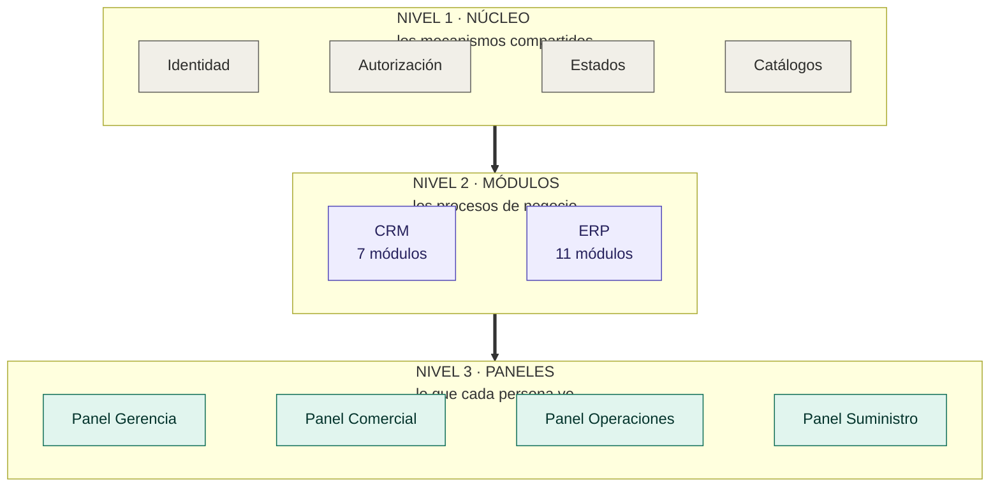
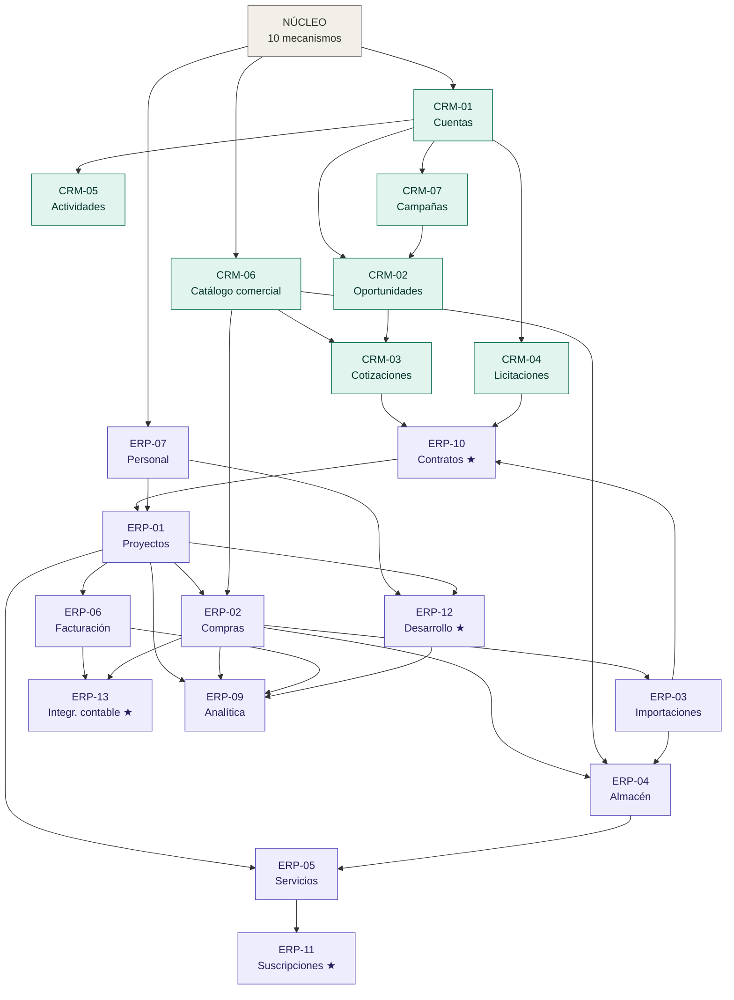
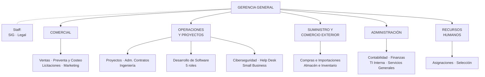

# Documento 10 — Sistema de módulos, procesos y paneles

> ## ⚠ Versión 3.0 — matizado con la especificación v4 (octubre 2026)
> Fuente de verdad: `Techquk-Sistema-CRM-ERP-v4.pdf` (21 set 2026), `Techquk-Flujograma-de-gastos-1.pdf` y `techquk-prototipo_4_.html`. Índice de cambios: `00-Reconciliacion-con-v4.md`.
> Este documento ordenaba por dependencias entre módulos. Sigue siendo útil como inventario, pero **el detalle de cada módulo está ahora en la v4**. Cuadro de estado:
>
> | Módulo | Estado frente a la v4 | Cambio principal |
> |---|---|---|
> | CRM-01 a CRM-07 | Sin cotejar (v4 parte 2) | Pantallas nuevas según el inventario v4: contactos con rotación, cuenta en dos estados, traspaso de oportunidad ganada a contrato |
> | ERP-01 Proyectos | ⚠ Cambia | Presupuesto con APU, árbol de partidas, PC-99. `proyecto_presupuesto` y `proyecto_costos` quedan obsoletas |
> | ERP-02 Compras | ⚠ Cambia | Doce tipos de compra, imputación por línea, cuadro comparativo obligatorio sobre un umbral, subcontratos |
> | ERP-03 Importaciones | ⏳ Entrega 4 | Sin cambio de tablas. `POR VALIDAR`; puede adelantarse |
> | ERP-04 Almacén | ⚠ Cambia | Almacén de obra con la misma pantalla, recepción directa a obra, despacho con imputación y guía |
> | ERP-05 Servicios y postventa | Sin cotejar en detalle | Entrega 5 |
> | ERP-06 Facturación y cobranzas | ⚠ Cambia | Comprobantes **subidos por XML**; el ERP no emite. Hito sugerido y confirmado por la persona |
> | ERP-07 Personal y asignación | ⚠ Ampliado | Ver ERP-17 y ERP-18 |
> | ERP-08 Seguridad y administración | ⚠ Cambia | Roles distintos de puestos; restricciones por campo; cruces de funciones |
> | ERP-09 Analítica | Sin cambio de fondo | Tableros por rol (ver prototipo) |
> | ERP-10 Contratos y garantías | ⚠ Cambia | Garantías con costo y renovaciones; penalidad **calculada**; plazo vigente con adendas; liquidación; consorcios |
> | ERP-11 Suscripciones | ⏳ Entrega 5 | Marcado «módulo especulativo»: falta confirmar si hay contratos reales |
> | ERP-12 Desarrollo de software | ⚠ Reducido | Solo las horas, dentro del parte semanal (D6 por confirmar) |
> | ERP-13 Integración contable | ⚠ Cambia | Asientos por plantilla; estados generado / exportado / fallido; exportación a Excel |
> | **ERP-14 Presupuesto y partidas** | 🆕 | Presupuesto con APU, árbol de partidas, fórmula polinómica, índices |
> | **ERP-15 Obra pública** | 🆕 | Adelantos, valorización por línea, liquidación, consorcios, subcontratos |
> | **ERP-16 Tesorería y gastos** | 🆕 | Tablero de pagos, notas por foto, flujo de caja, servicios con vigencia, rendiciones |
> | **ERP-17 Tareo y habilitación de campo** | 🆕 | Parte semanal, categorías de costo hora, requisitos y habilitaciones, asistencias |
> | **ERP-18 RRHH y planilla** | 🆕 | Demanda a 90 días, selección, salida, planilla con boletas y PLAME |
> | **M11 · M12 · M13** | 🆕 | Imputación, IA y alertas (ver doc 06 §17) |
>
> Los «ERP-14 Contabilidad» y «ERP-15 Planillas» del documento 01 (escenario 2 de agosto) fueron descartados: sus números se reutilizan.
>
> **Navegación del prototipo** (la referencia de pantallas): *Inicio* (mis bandejas, alertas, recorridos guiados) · *Comercial* (cuentas, oportunidades, cotizaciones, licitaciones, agenda, catálogo, campañas y leads, Gerencia Comercial) · *Operaciones* (contratos, proyectos, partidas de control, presupuestos, valorizaciones, postventa, suscripciones) · *Suministro* (requerimientos, órdenes, tipos de compra, importaciones, subcontratos, recepciones, despachos, stock y series) · *Finanzas* (tablero de pagos, cuentas por pagar, comprobantes, cobranzas, garantías y adelantos, servicios con vigencia, capturar notas, flujo de caja, asientos, liquidaciones) · *Personas* (colaboradores, asignación, tareo, demanda 90 días, planilla) · *Config* (roles y grilla, umbrales, automatizaciones IA).

**Programa:** Ordenamiento Organizacional y Sistemas de Gestión — Techquk S.A.C.
**Versión:** 2.1 · Agosto 2026
**Integra:** documento 01 v2.1 · 03 (organigrama) · 07 v2.2 · 09-B v2.1

---

## Registro de cambios

| Versión | Fecha | Cambios |
|---|---|---|
| 1.0 | Ago 2026 | 15 módulos, 6 paneles deducidos, grafo de dependencias |
| 2.0 | Ago 2026 | Paneles reemplazados por los 33 roles declarados · 3 módulos nuevos · D5 resuelta |
| **2.1** | **Ago 2026** | **Se elimina la sección 7, que duplicaba fichas ya presentes en la 5 · referencias cruzadas al día** |

### Qué cambió en la versión 2.0

`[V]` La versión 1.0 propuso seis paneles construidos por deducción. **El documento 03 ya
declara, para cada uno de sus 33 roles, qué debe ver en el sistema.** Esa sección era una
especificación de accesos que estaba sin usar.

| Error de la v1.0 | Realidad |
|---|---|
| Consideré cinco áreas | Son **seis gerencias** y 33 roles con acceso declarado |
| Omití Recursos Humanos | Gerencia completa, con dos roles |
| Omití Desarrollo de Software | Jefatura con **cinco roles** dentro de Operaciones |
| Omití cuatro funciones más | Administración de Contratos · Ciberseguridad · Help Desk · Small Business |

**Y tres de esas funciones exigían módulos que el modelo no tenía:** ERP-10 Contratos, ERP-11
Suscripciones y ERP-12 Desarrollo.

**Además se agregó lo que faltaba por completo en la v1.0:** la **sección 10 de integraciones**,
con su dueño, su panel y su fase. Y el módulo **ERP-13 de integración contable**, que se vuelve
obligatorio al decidir el reemplazo de S10.

---

## 1. Qué resuelve este documento

Los documentos anteriores dejaron tres piezas sueltas:

| Documento | Qué define | Qué le falta |
|---|---|---|
| 01 | Los diecinueve módulos | Cómo dependen entre sí |
| 07 | Las 142 entidades | A qué pantalla corresponde cada una |
| 09-B | Los flujos de proceso | Quién los ve y desde dónde |

**Este documento las une.** Para cada módulo: qué entidades lo componen, qué proceso ejecuta,
qué pantallas necesita y qué ve cada rol.

`[S]` Y agrega lo que faltaba: **el grafo de dependencias**, que es lo que determina en qué
orden se puede construir sin rehacer trabajo.

Marcas: `[V]` verificado en el análisis de S10 · `[S]` propuesta de diseño · `[P]` pendiente de
la Fase 0

---

## 2. Un hallazgo que cierra la decisión más importante

`[V]` El documento 03, sección 1.3, afirma:

> Techquk realizó **80 operaciones de importación en 2024**, por USD 452.3 mil CIF, vía marítima
> por la Aduana del Callao y con **dos agentes de aduana**.

**Eso responde la decisión D5**, que era la de mayor impacto sobre el modelo de datos.

| Antes | Ahora |
|---|---|
| `[P]` ¿Techquk importa o compra a mayoristas? | `[V]` **Importa directamente, y con volumen** |
| El módulo ERP-03 podía reducirse a un campo | **Se mantiene completo, y sube de prioridad** |

`[S]` Ochenta operaciones al año es una cada cuatro días hábiles. Con dos agentes de aduana y
vía marítima, el ciclo de nacionalización y el prorrateo de costos no son un detalle: son parte
del costo de casi todo lo que se vende.

`[V]` Y el documento 03 agrega el argumento económico: existe una **penalidad por mora de
S/ 250,498.54**, monto superior al valor íntegro de cinco de los nueve contratos del
portafolio. En contratos de suministro, la entrega tardía se origina con más frecuencia en la
llegada del equipo que en la instalación.

`[S]` **Conclusión para el plan:** el módulo de importaciones deja de ser fase 6 y debería
moverse junto con compras. Es donde está el riesgo económico documentado.

---

---

## 3. Los tres niveles del sistema

`[S]` **La distinción importa para construir.** El núcleo se hace una vez. Los módulos se hacen
por fases. Los paneles se ajustan permanentemente, porque son lo que la gente pide cambiar.

Por eso los paneles no deben tener lógica propia: son vistas sobre los módulos.

---

## 4. El grafo de dependencias

`[S]` Qué módulo necesita cuál para funcionar. Es lo que determina el orden de construcción.

### Lo que el grafo revela

`[S]` **Tres módulos no dependen de ningún otro** más allá del núcleo: Cuentas, Catálogo
comercial y Personal. Son los que se pueden construir en paralelo desde el primer día.

`[S]` **Catálogo comercial es más crítico de lo que parece.** Lo necesitan Cotizaciones,
Compras y Almacén. Está listado como prioridad media en el documento 01, y el grafo dice que
debería subir.

`[S]` **Contratos es ahora la puerta del ERP.** Todo lo que se gana comercialmente pasa por ahí
antes de convertirse en proyecto. Y depende de Importaciones en un sentido no obvio: la fecha
estimada de llegada de un embarque es lo que dice si un hito contractual está en riesgo.

`[S]` **Proyectos sigue siendo el cuello del sistema.** Siete módulos dependen de él.

`[S]` **Analítica va último por definición.** No crea información: la lee.

### El orden de construcción que se deriva

| Bloque | Módulos | Se pueden hacer |
|---|---|---|
| 0 | Núcleo | Primero, sin excepción |
| 1 | CRM-01, CRM-06, ERP-07 | En paralelo |
| 2 | **ERP-10 Contratos**, ERP-01 Proyectos | Después del bloque 1 |
| 3 | CRM-02, CRM-03, CRM-04, CRM-05 | Después del 2 |
| 4 | ERP-02, ERP-03 | Después del 3 |
| 5 | ERP-04, ERP-06 | Después del 4 |
| 6 | ERP-05, ERP-11, **ERP-13** | Después del 5 |
| 7 | ERP-12, ERP-09, CRM-07 | Al final |

`[S]` **Dos correcciones respecto de la v1.0.** Catálogo comercial y Personal suben al bloque 1,
porque todo los necesita. Y **Contratos entra en el bloque 2, antes que el CRM**: el riesgo
económico documentado —la penalidad de S/ 250,498.54— rinde desde el primer mes, mientras que
ordenar el embudo comercial rinde después.

---

## 5. Ficha de cada módulo

`[S]` Estructura de cada ficha: qué hace, qué entidades usa del documento 07, qué proceso del
09-B ejecuta, qué pantallas necesita y qué muestra su panel.

---

### CRM-01 · Cuentas y contactos

**Propósito.** Que exista una sola ficha por organización, con todo su historial.

| Aspecto | Contenido |
|---|---|
| **Entidades** | `parties`, `party_roles`, `party_contactos`, `party_sedes`, `cuentas`, `cuenta_verticales` |
| **Proceso** | Alta y mantenimiento de la cartera |
| **Depende de** | Núcleo (M1 Identidad) |

**Pantallas:**

| Pantalla | Qué hace |
|---|---|
| Listado de cuentas | Filtros por ejecutivo, vertical, clasificación, sector |
| Ficha de cuenta | Datos, con pestañas de contactos, sedes, oportunidades, proyectos, tickets |
| Alta rápida desde RUC | `[S]` Consulta el padrón y precarga razón social y dirección |

`[S]` **La pestaña de historial completo es lo que justifica el módulo.** Ver en una sola
pantalla cuánto se le vendió, qué proyectos tiene abiertos y cuántos tickets reportó es lo que
hoy exige abrir tres archivos distintos.

**Panel:** cuentas sin actividad en 90 días · cartera por ejecutivo · nuevas cuentas del mes.

---

### CRM-02 · Oportunidades

**Propósito.** Que el embudo comercial sea visible y medible.

| Aspecto | Contenido |
|---|---|
| **Entidades** | `oportunidades`, `oportunidad_lineas`, `oportunidad_competidores` |
| **Proceso** | 09-B sección 2, proceso comercial privado |
| **Depende de** | CRM-01 |

**Pantallas:**

| Pantalla | Qué hace |
|---|---|
| Tablero kanban por etapa | Arrastrar entre columnas ejecuta la transición de estado |
| Ficha de oportunidad | Con competidores, líneas estimadas y actividades |
| Cierre con motivo | `[S]` Modal obligatorio al marcar como perdida |

`[S]` **El kanban no es cosmético.** Ver el embudo como columnas hace evidente dónde se
acumulan las oportunidades, que es información que una lista no transmite.

**Panel:** embudo ponderado —monto por probabilidad— · oportunidades sin actividad en 15 días ·
cierres previstos del mes · tasa de conversión por etapa.

`[P]` Las etapas concretas salen de la Fase 0.

---

### CRM-03 · Cotizaciones

**Propósito.** Emitir propuestas versionadas con margen controlado.

| Aspecto | Contenido |
|---|---|
| **Entidades** | `cotizaciones`, `cotizacion_versiones`, `cotizacion_lineas`, `condiciones_comerciales` |
| **Proceso** | 09-B sección 2, pasos de cotización y aprobación |
| **Depende de** | CRM-02, CRM-06 |
| **Usa del núcleo** | Autorización (M2), numeración (M6), adjuntos (M7) |

**Pantallas:**

| Pantalla | Qué hace |
|---|---|
| Editor de cotización | Líneas con costo, precio y margen calculado en vivo |
| Comparador de versiones | `[S]` Muestra qué cambió entre revisiones |
| Generador de PDF | Con la plantilla comercial de Techquk |
| Bandeja de aprobación de descuentos | Para quien autoriza |

`[S]` **El margen visible mientras se cotiza es el control más barato del sistema.** Si el
vendedor ve que bajó del objetivo antes de enviar, la conversación ocurre antes y no después.

**Panel:** cotizaciones por vencer · margen promedio del mes · tasa de aceptación · descuentos
pendientes de aprobación.

---

### CRM-04 · Licitaciones y contrataciones del Estado

**Propósito.** No perder plazos y acumular inteligencia de precios.

| Aspecto | Contenido |
|---|---|
| **Entidades** | `convocatorias`, `convocatoria_cronograma`, `participaciones`, `participacion_documentos`, `participacion_resultado`, `tipos_procedimiento` |
| **Proceso** | 09-B sección 3 |
| **Depende de** | CRM-01 |
| **Usa del núcleo** | Adjuntos con tipos obligatorios (M7), notificaciones (M8), CUBSO (M5) |

**Pantallas:**

| Pantalla | Qué hace |
|---|---|
| Calendario de cronogramas | `[S]` Vista de calendario con las fechas críticas de todas las convocatorias activas |
| Ficha de convocatoria | Con cronograma, documentos y resultado |
| Checklist de expediente | Marca qué documentos faltan antes de presentar |
| **Histórico de precios por entidad** | `[S]` Qué se adjudicó, a quién y a qué precio |

`[S]` **La última pantalla es el activo del módulo.** Acumulada, responde a qué precio se puede
competir en cada entidad — información que hoy no existe en ningún lado.

**Panel:** próximos vencimientos de cronograma · convocatorias en evaluación · tasa de
adjudicación · diferencia promedio contra el ganador.

---

### CRM-05 · Actividades

**Propósito.** Que quede registro de cada contacto con el cliente.

| Aspecto | Contenido |
|---|---|
| **Entidades** | `actividades`, `actividad_participantes`, `tipos_actividad` |
| **Depende de** | CRM-01 |

`[S]` **Es una entidad polimórfica**, así que no tiene pantalla propia: aparece como pestaña
dentro de cuentas, oportunidades, proyectos y tickets.

**Pantallas:** agenda del día · registro rápido desde cualquier ficha · próximas acciones
pendientes.

**Panel:** actividades de hoy · próximas acciones vencidas.

---

### CRM-06 · Catálogo comercial

**Propósito.** Una sola lista de qué vende Techquk.

| Aspecto | Contenido |
|---|---|
| **Entidades** | `productos`, `marcas`, `familias_producto`, `producto_precios`, `producto_cubso`, `producto_proveedores` |
| **Depende de** | Núcleo (M5 Catálogos) |

**Pantallas:**

| Pantalla | Qué hace |
|---|---|
| Catálogo navegable | Por familia, marca y línea de solución |
| Ficha de producto | Con precios vigentes, equivalencia CUBSO y proveedores |
| Carga masiva de precios | `[S]` Desde plantilla de Excel, que es como llegan las listas de los fabricantes |
| Mantenimiento de equivalencias CUBSO | Para que las cotizaciones nazcan clasificadas |

`[S]` **La carga masiva no es un lujo.** Los distribuidores actualizan precios por lista, y sin
esa pantalla alguien los carga a mano cada mes.

**Panel:** productos sin precio vigente · productos sin equivalencia CUBSO · variaciones de
costo del mes.

---

### CRM-07 · Campañas y prospección

| Aspecto | Contenido |
|---|---|
| **Entidades** | `campanias`, `leads`, `origenes_lead` |
| **Depende de** | CRM-01 |

**Pantallas:** bandeja de leads sin calificar · conversión de lead a cuenta y oportunidad ·
resultados por campaña.

**Panel:** leads sin atender · conversión por origen.

`[P]` Prioridad media. Depende de si la tienda en línea puede enviar leads automáticamente.

---

### ERP-01 · Proyectos

**Propósito.** El centro del ERP. Todo lo posterior cuelga de aquí.

| Aspecto | Contenido |
|---|---|
| **Entidades** | `proyectos`, `plantillas_fase`, `proyecto_fases`, `proyecto_hitos`, `proyecto_entregables`, `actas`, `valorizaciones`, `proyecto_presupuesto`, `proyecto_costos`, `proyecto_ubicaciones` |
| **Proceso** | 09-B sección 4 |
| **Depende de** | CRM-03 o CRM-04, ERP-07 |

**Pantallas:**

| Pantalla | Qué hace |
|---|---|
| Listado de proyectos | Con semáforo de plazo y de margen |
| **Ficha de proyecto** | La pantalla más importante del sistema |
| Editor de plantillas de fase | Por tipología, configurable sin programar |
| Cronograma de hitos | Comprometido contra real |
| **Presupuesto contra real** | Por partida de costo |
| Valorizaciones | Para las tipologías que lo requieren |
| Mapa de ubicaciones | `[S]` Para videovigilancia y seguridad ciudadana |

`[S]` **La ficha de proyecto debe responder cuatro preguntas sin salir de ella:** en qué fase
está, cuánto se lleva gastado contra lo presupuestado, qué falta entregar, y quién está
asignado.

**Panel:** proyectos con margen bajo el objetivo · hitos vencidos · proyectos sin actividad ·
avance por tipología.

> `[V]` **Advertencia desde S10.** Allá, de las 101 tablas que apuntan a proyecto, **solo once
> tienen datos**. Actas, cronogramas y órdenes de trabajo están vacías. Un módulo de proyectos
> se llena solo si las pantallas son rápidas de usar — si registrar un hito toma cinco clics,
> nadie lo registra.

---

### ERP-02 · Compras y abastecimiento

| Aspecto | Contenido |
|---|---|
| **Entidades** | `requerimientos`, `cotizaciones_proveedor`, `cuadros_comparativos`, `ordenes_compra`, `evaluaciones_proveedor` |
| **Proceso** | 09-B sección 5 |
| **Depende de** | ERP-01, CRM-06 |
| **Usa del núcleo** | Autorización (M2) — es el módulo que más la usa |

**Pantallas:**

| Pantalla | Qué hace |
|---|---|
| Requerimiento desde proyecto | Con verificación de stock disponible |
| **Cuadro comparativo** | Ofertas lado a lado, con la decisión y su motivo |
| Orden de compra | Con seguimiento de recepción |
| Bandeja de aprobación | Lo pendiente de firma de cada persona |
| Evaluación de proveedor | Por cumplimiento de plazo, calidad y precio |

`[V]` **El cuadro comparativo es la corrección directa a lo observado en S10:** allá la tabla de
cotizaciones de proveedor tiene **cero registros**. Las nueve órdenes se emitieron sin comparar
ofertas en el sistema.

`[P]` Validar en la Fase 0 si Techquk cotiza con varios proveedores o compra directo.

**Panel:** requerimientos sin atender · órdenes pendientes de aprobación · órdenes vencidas sin
recibir · gasto del mes por proyecto.

---

### ERP-03 · Importaciones y costeo

| Aspecto | Contenido |
|---|---|
| **Entidades** | `ordenes_importacion`, `embarques`, `declaraciones_aduana`, `gastos_importacion`, `prorrateo_importacion` |
| **Proceso** | 09-B sección 6 |
| **Depende de** | ERP-02 |

**Pantallas:**

| Pantalla | Qué hace |
|---|---|
| Seguimiento de embarques | Dónde está cada envío |
| Registro de gastos | Por concepto, con su comprobante |
| **Simulador de costo puesto en almacén** | `[S]` Antes de comprar, estimar el costo final |
| Prorrateo | Cómo se repartió cada gasto entre los ítems |

`[S]` **El simulador es lo que permite cotizar bien.** Sin él, el precio de venta se calcula
sobre el valor FOB y el margen real aparece meses después.

**Panel:** embarques en tránsito · gastos sin prorratear · desviación entre costo estimado y
real.

> `[V]` **D5 resuelta.** Techquk realizó **80 operaciones de importación en 2024** —una cada
> cuatro días hábiles— por USD 452.3 mil CIF. El módulo se mantiene completo y sube de
> prioridad.

`[S]` **Y necesita una pantalla más que la v1.0 no tenía:** la **alerta de embarque en riesgo**,
que cruza la fecha estimada de llegada con los hitos contractuales. `[V]` El documento 03 señala
que en contratos de suministro la entrega tardía se origina con más frecuencia en la llegada del
equipo que en la instalación.

---

### ERP-04 · Almacén e inventario

| Aspecto | Contenido |
|---|---|
| **Entidades** | `almacenes`, `ubicaciones_almacen`, `tipos_movimiento`, `movimientos`, `movimiento_lineas`, `stock`, `series`, `serie_movimientos` |
| **Proceso** | 09-B sección 7 |
| **Depende de** | ERP-02, CRM-06, ERP-03 |

**Pantallas:**

| Pantalla | Qué hace |
|---|---|
| Recepción contra orden | Precarga lo esperado, se confirma lo recibido |
| Despacho a proyecto | Con selección de series si corresponde |
| **Consulta de stock** | Por producto, almacén y ubicación |
| **Rastreo de serie** | Dónde está y dónde estuvo cada equipo |
| Toma de inventario | Conteo físico contra sistema |
| Configuración de tipos de movimiento | Las banderas de comportamiento |

`[S]` **El rastreo de serie es la pantalla diferencial.** Ante un ticket por una cámara que
falla, permite saber en segundos cuándo se compró, a qué proveedor, cuándo se instaló y si
sigue en garantía.

`[V]` S10 no tiene esta capacidad: no existe tabla de series en su esquema.

**Panel:** stock por debajo del mínimo · material asignado sin despachar · series en garantía por
vencer · movimientos del día.

---

### ERP-05 · Servicios y postventa

| Aspecto | Contenido |
|---|---|
| **Entidades** | `contratos_servicio`, `sla_definiciones`, `tickets`, `ticket_seguimientos`, `visitas_tecnicas`, `informes_servicio`, `garantias` |
| **Proceso** | 09-B sección 8 |
| **Depende de** | ERP-01, ERP-04 |

**Pantallas:**

| Pantalla | Qué hace |
|---|---|
| **Bandeja de tickets** | Ordenada por vencimiento de SLA, no por fecha |
| Ficha de ticket | Con equipo afectado, historial y seguimientos |
| Programación de visitas | Agenda de técnicos |
| Informe de servicio | Genera el entregable para el cliente |
| Contratos vigentes | Con alertas de renovación |
| **Portal del cliente** | `[P]` Opcional: que el cliente reporte y consulte |

`[S]` **Ordenar la bandeja por vencimiento de SLA y no por fecha de creación** es una decisión
pequeña con efecto grande: hace que lo urgente esté siempre arriba.

**Panel:** tickets por vencer SLA · cumplimiento del mes · contratos por renovar en 60 días ·
tickets que derivaron en oportunidad.

---

### ERP-06 · Facturación y cobranzas

| Aspecto | Contenido |
|---|---|
| **Entidades** | `comprobantes`, `comprobante_lineas`, `comprobantes_electronicos`, `cuentas_cobrar`, `cobranzas`, `detracciones`, `retenciones` |
| **Proceso** | 09-B sección 9 |
| **Depende de** | ERP-01 |

**Pantallas:**

| Pantalla | Qué hace |
|---|---|
| Emisión desde valorización o hito | Precarga lo facturable |
| **Estado de cuenta por cliente** | Lo pendiente con su antigüedad |
| **Antigüedad de deuda** | Por tramos: 30, 60, 90, más de 90 días |
| Registro de cobranza | Con aplicación a comprobantes |
| Bandeja de comprobantes observados | Con el motivo de SUNAT y reenvío |

`[V]` **La bandeja de observados no es opcional.** En S10, la tabla de errores de facturación
electrónica tiene **1,763 registros contra 1,340 documentos** — más errores que documentos.

**Panel:** por facturar · antigüedad de deuda · cobranza del mes · comprobantes rechazados.

`[P]` Depende de la decisión D4.

---

### ERP-07 · Personal y asignación

> ⚠ **Ampliado.** RRHH ahora es un módulo completo con planilla: ver ERP-17 (parte semanal, habilitación de campo, asistencias) y ERP-18 (demanda, selección, salida, planilla) en el DBML v2.

| Aspecto | Contenido |
|---|---|
| **Entidades** | `colaboradores`, `competencias`, `certificaciones`, `colaborador_competencias`, `colaborador_certificaciones`, `asignaciones`, `disponibilidad` |
| **Depende de** | Núcleo (M1, M10) |

**Pantallas:**

| Pantalla | Qué hace |
|---|---|
| Ficha de colaborador | Con competencias y certificaciones |
| **Matriz de competencias** | Quién sabe hacer qué, de un vistazo |
| **Tablero de asignación** | Quién está en qué proyecto y con qué dedicación |
| Control de certificaciones | Con vencimientos |

`[S]` **El tablero de asignación resuelve el problema que el documento 01 menciona
explícitamente:** que la misma persona quede comprometida en dos frentes el mismo día. Verlo en
una grilla de personas por semanas lo hace evidente.

`[S]` **Y el control de certificaciones es información comercial**, no administrativa: varias
convocatorias exigen personal certificado vigente.

**Panel:** certificaciones que vencen en 90 días · personas sin asignación · sobreasignación
detectada.

---

### ERP-10 · Contratos y garantías contractuales ★

> ⚠ **Ampliado.** La penalidad diaria se **calcula** (`coeficiente × monto ÷ (F × plazo)`) y no se digita; la garantía registra su **costo** y sus renovaciones; el plazo vigente suma las adendas aprobadas con resolución; se agregan adelantos, liquidación y consorcios (ERP-15).

**Propósito.** Que ningún contrato genere penalidad por causa administrativa.

| Aspecto | Contenido |
|---|---|
| **Entidades** | `contratos`, `contrato_hitos`, `contrato_adendas`, `cartas_fianza`, `penalidades`, `conformidades` |
| **Proceso** | 09-B sección 8-A |
| **Depende de** | CRM-03 o CRM-04, ERP-03 |
| **Usa del núcleo** | Notificaciones (M8), adjuntos (M7), numeración (M6) |

**Pantallas:**

| Pantalla | Qué hace |
|---|---|
| Listado de contratos | Con **días restantes** y semáforo de riesgo |
| **Ficha de contrato** | Hitos, adendas, fianzas, conformidades y penalidad diaria |
| **Simulador de penalidad** | `[S]` Cuánto costaría atrasarse N días |
| Registro de adenda | Con su resolución y nuevo plazo |
| Control de cartas fianza | Con alerta de vencimiento |

`[S]` **El simulador es lo que convierte el módulo de un registro en una herramienta de
decisión.** Cuando Operaciones evalúa si vale la pena acelerar, necesita el número.

**Panel:** días para vencimiento por contrato · **penalidad acumulada en riesgo** · fianzas por
vencer en 60 días · conformidades pendientes.

---

### ERP-11 · Suscripciones y servicios gestionados ★

**Propósito.** Que ninguna suscripción venza sin renovarse y que el nivel comprometido se
cumpla.

| Aspecto | Contenido |
|---|---|
| **Entidades** | `suscripciones`, `suscripcion_renovaciones`, `disponibilidad_servicio`, `incidentes_seguridad` |
| **Proceso** | 09-B sección 8-B |
| **Depende de** | ERP-05 |

**Pantallas:**

| Pantalla | Qué hace |
|---|---|
| Cartera de suscripciones | Con vigencia y margen por periodo |
| **Tablero de disponibilidad** | Comprometido contra efectivo |
| Registro de incidentes | Con criticidad y contención |
| Renovación | Con recálculo de costo y precio |

`[S]` **El margen aquí se mide por periodo, no por proyecto**, porque el costo también corre:
Techquk le paga al proveedor de nube mientras le cobra al cliente.

**Panel:** disponibilidad efectiva vs. comprometida · suscripciones por renovar en 60 días ·
margen recurrente del mes · incidentes abiertos.

`[P]` **Decisión D7:** si la disponibilidad se mide automáticamente desde las plataformas de
monitoreo o se registra a mano.

---

### ERP-12 · Desarrollo de software ★

**Propósito.** Que las horas de desarrollo lleguen al margen del proyecto.

| Aspecto | Contenido |
|---|---|
| **Entidades** | `partes_horas`, `especificaciones`, `especificacion_cambios`, `casos_prueba`, `defectos`, `versiones`, `integraciones_cliente` |
| **Depende de** | ERP-01, ERP-07 |

**Pantallas:**

| Pantalla | Qué hace |
|---|---|
| **Registro de horas** | Rápido, por semana, desde una sola pantalla |
| Especificaciones con criterios de aceptación | Y su gestión de cambios |
| Casos de prueba y defectos | Por versión |
| Certificación de versión | Antes de entregar al cliente |

`[V]` **La imputación de horas aparece en cinco roles distintos** del organigrama. Sin ella, el
margen de un proyecto híbrido está mal calculado — y los contratos híbridos son el **55.3% del
portafolio**.

`[S]` **La pantalla de registro de horas tiene que ser la más rápida del sistema.** Si toma más
de un minuto por semana, nadie la usa, y sin horas no hay margen. Es la aplicación directa de la
regla 10.1.

**Panel:** mis horas de la semana · horas del equipo por proyecto · defectos por severidad ·
versiones por certificar.

`[P]` **Decisión D6:** si el resto del módulo vive en el ERP o en herramienta especializada.
`[S]` Recomendación: solo las horas en el ERP.

---

### ERP-13 · Integración contable ★

**Propósito.** Que el ERP entregue al sistema contable lo que necesita, sin recaptura.

> `[V]` **Este módulo nace de la decisión de reemplazar S10.** Mientras convivieran, la
> contabilidad se quedaba allá. Al apagarlo, el ERP tiene que alimentar a su reemplazo.

| Aspecto | Contenido |
|---|---|
| **Entidades** | `cuentas_pagar`, `pagos`, `asientos_generados`, `configuracion_contable`, `bitacora_integraciones` |
| **Depende de** | ERP-06, ERP-02 |

**Pantallas:**

| Pantalla | Qué hace |
|---|---|
| Cuentas por pagar | Lo que se debe a proveedores, con vencimiento |
| Registro de pagos | Con aplicación a comprobantes |
| **Configuración contable** | Qué cuenta corresponde a cada tipo de operación |
| **Bandeja de exportación** | Qué se envió, qué falló y por qué |

`[S]` **`cuentas_pagar` y `pagos` faltaban en el modelo con independencia de esta decisión.** El
sistema tenía lo que te deben pero no lo que debes.

`[P]` **Decisión D9:** dónde vive la contabilidad. El alcance de este módulo depende de si el
destino acepta cargas estructuradas o exige captura manual.

**Panel:** por pagar esta semana · exportaciones fallidas · operaciones sin cuenta configurada.

---

### ERP-09 · Analítica

| Aspecto | Contenido |
|---|---|
| **Entidades** | `indicadores`, `indicador_valores`, `tableros` |
| **Depende de** | Todos |

`[S]` **No crea información: la lee.** Casi todo se resuelve con vistas sobre las tablas
existentes.

**Pantallas:** tablero configurable por rol · exportación a Excel · serie histórica de cada
indicador.

---

## 6. Las seis gerencias reales y sus 33 roles

`[V]` Estructura completa del documento 03:

> `[V]` **Una inconsistencia menor del documento 03.** La sección 1.1 se titula *"Por qué cinco
> gerencias"* pero su tabla lista **seis**. Conviene corregir el título.

`[S]` **Y una observación estructural.** Desarrollo de Software está dentro de Operaciones y
Proyectos, con un argumento sólido: los contratos son híbridos —P6 y P9 del Hospital Regional
Docente Las Mercedes incluyen software, servidor y otros activos en un solo contrato— y separar
las gerencias dejaría ese contrato con dos gerentes y ningún responsable único.

Eso tiene una consecuencia para el sistema: **un proyecto de Techquk puede tener frente de
hardware y frente de software simultáneos**, con imputación de horas de desarrollo y consumo de
materiales en la misma ficha. El documento 07 modela lo segundo pero no lo primero.

---

---

> **Nota sobre los módulos nuevos.** ERP-10 Contratos, ERP-11 Suscripciones, ERP-12 Desarrollo y
> ERP-13 Integración contable tienen su ficha completa —entidades, pantallas y panel— dentro de
> la sección 5, igual que los demás. La versión 2.0 los describía además en una sección aparte,
> que se eliminó por redundante.

---

## 7. Paneles por rol

`[V]` Los accesos vienen textualmente del documento 03. La columna de panel es propuesta `[S]`.

### 7.1 Dirección

| Rol | Acceso declarado | Panel propuesto |
|---|---|---|
| **Gerencia General** | Lectura total · aprobación sobre umbral · tablero gerencial | Margen por proyecto · embudo ponderado · antigüedad de deuda · **penalidades en riesgo** · aprobaciones propias |
| **SIG** *(staff)* | Lectura transversal · administración documental | Procesos documentados vigentes · no conformidades abiertas |
| **Legal** *(staff)* | Lectura de contratos y expedientes | Contratos por firmar · **cartas fianza por vencer** · adendas en trámite |

`[S]` El widget de penalidades en riesgo es el único que no existía en mi propuesta anterior, y
probablemente sea el más importante del panel de Gerencia dado el antecedente de
S/ 250,498.54.

### 7.2 Comercial

| Rol | Acceso declarado | Panel propuesto |
|---|---|---|
| **Gerencia Comercial** | CRM completo · aprobación de cotizaciones · lectura de proyectos | Embudo por ejecutivo · cotizaciones por vencer · descuentos pendientes · tasa de conversión |
| **Jefatura de Ventas** | CRM sobre **cartera propia** · creación de cotizaciones | Mis oportunidades · mis cotizaciones · próximas acciones |
| **Preventa y Costeo** | Catálogo · cotizador · **histórico de proyectos similares** | Cotizaciones en elaboración · margen promedio · productos sin precio vigente |
| **Licitaciones** | Módulo de licitaciones · alertas de plazo · **histórico de precios** | Cronogramas próximos · convocatorias en evaluación · tasa de adjudicación |
| **Marketing** | Registro de campañas y su atribución a oportunidades | Leads sin atender · conversión por origen |

`[S]` **"CRM sobre cartera propia" es una restricción de ámbito**, no un permiso global. Es
exactamente el mecanismo `permisos_por_ambito` del núcleo (documento 06, sección 13.4).

`[S]` **"Histórico de proyectos similares" para Preventa** es una pantalla que no había
considerado: al cotizar, ver qué se cotizó y qué costó realmente en proyectos parecidos. Es la
forma más directa de que el margen estimado se acerque al real.

### 7.3 Operaciones y Proyectos

| Rol | Acceso declarado | Panel propuesto |
|---|---|---|
| **Gerencia de Operaciones** | Proyectos, avance, consumo, **imputación de horas** · lectura de compras | Proyectos con margen bajo objetivo · hitos vencidos · **arbitraje entre frentes** · asignación de recursos |
| **Jefatura de Proyectos** | Proyectos asignados · cronograma · requerimientos de compra | Mis proyectos · hitos de la semana · requerimientos sin atender |
| **Administración de Contratos** | Contratos con vigencia, **penalidad diaria y alertas automáticas** | **Días para vencimiento por contrato** · penalidad acumulada en riesgo · fianzas por vencer · conformidades pendientes |
| **Jefatura de Ingeniería** | Registro de avance · consumo de materiales · carga de evidencias | Trabajos de la semana · material pendiente de recoger · evidencias por cargar |
| **Jefatura de Desarrollo** | Proyectos de desarrollo · imputación de horas · lectura de costos | Proyectos activos · horas del equipo · defectos abiertos |
| **Analista Funcional** | Especificaciones · criterios de aceptación · gestión de cambios | Especificaciones pendientes · cambios solicitados |
| **Desarrolladores** | Tareas · imputación de horas · repositorio | Mis tareas · mis horas de la semana |
| **DBA e Ingeniería de Datos** | Administración de base de datos · **auditoría de accesos** | Salud del sistema · accesos inusuales · respaldos |
| **Integraciones** | Registro de integraciones por cliente · bitácora de ejecución | Integraciones activas · fallos recientes |
| **Aseguramiento de Calidad** | Casos de prueba · defectos · certificación de versiones | Casos pendientes · defectos por severidad · versiones por certificar |
| **Ciberseguridad y Monitoreo** | Contratos de servicio con vigencia y nivel comprometido · **tablero de disponibilidad** | Disponibilidad efectiva vs. comprometida · **suscripciones por renovar** · incidentes de seguridad |
| **Help Desk y Garantías** | Tickets con nivel de servicio · garantías · **consulta de inventario y series** | Tickets por vencer SLA · garantías en trámite con fabricante · resolución en primer contacto |
| **Small Business** | **Flujo comercial simplificado** | Encargos del mes · pendientes de conformidad |

`[S]` **El panel de Administración de Contratos es el que más valor agrega y no existía.** Un
contador de días hasta el vencimiento, con la penalidad diaria calculada, convierte un riesgo
invisible en un número que alguien mira todos los días.

`[S]` **"Flujo comercial simplificado" para Small Business** implica algo importante: **el
sistema necesita dos caminos comerciales.** Uno completo con oportunidad, cotización, proyecto
y cronograma; otro corto para contratos menores donde todo eso sería más caro que el encargo.

`[P]` Definir dónde está el umbral entre ambos. El documento 03 sugiere 8 UIT para el Estado.

### 7.4 Suministro y Comercio Exterior

| Rol | Acceso declarado | Panel propuesto |
|---|---|---|
| **Gerencia de Suministro** | Compras, importaciones e inventario completos · lectura de proyectos y cotizaciones | Órdenes pendientes de recepción · embarques en tránsito · stock bajo mínimo · desviación de costo importado |
| **Compras e Importaciones** | Órdenes de compra · **expediente de importación con declaración aduanera** · costeo completo | Embarques por etapa · gastos sin prorratear · órdenes vencidas sin recibir |
| **Almacén e Inventario** | Movimientos de almacén · **series · guías de remisión** · inventarios | Movimientos del día · despachos pendientes · series por instalar · diferencias de inventario |

`[V]` **Aparecen las guías de remisión**, que el documento 07 no modela. Es un documento
electrónico ante SUNAT distinto de la guía interna de almacén.

**Entidad faltante:** `guias_remision`, con su serie, correlativo, transportista, punto de
partida y llegada.

### 7.5 Administración

| Rol | Acceso declarado | Panel propuesto |
|---|---|---|
| **Gerencia de Administración** | Módulo administrativo completo · lectura total · **administración de usuarios** | Por facturar · antigüedad de deuda · flujo de caja proyectado |
| **Contabilidad** | Módulo contable · comprobantes · **costeo de importación** | Comprobantes por registrar · observados por SUNAT · detracciones pendientes |
| **Auxiliares de Contabilidad** | Registro contable operativo · **sin acceso a márgenes por proyecto** | Documentos por registrar del día |
| **Finanzas y Tesorería** | Estado de cuenta · registro de cobros y pagos · **garantías vigentes** | Cobranza del mes · pagos programados · antigüedad de deuda |
| **Asistente de Administración** | Módulo administrativo operativo · **sin acceso a costos ni márgenes** | Tareas administrativas pendientes |
| **Coordinador de TI Interna** | Administración de usuarios y accesos internos | Usuarios activos · accesos por revisar |
| **Servicios Generales** | **Registro de traslados asociados a proyecto** | Traslados del día |

`[V]` **Dos roles tienen restricción explícita de no ver márgenes.** Eso no es un permiso de
módulo sino **de campo**: pueden abrir la ficha de proyecto pero no ver las columnas de costo.

`[S]` Filament lo resuelve con visibilidad condicional por permiso en cada campo. Conviene
tenerlo previsto desde el diseño, porque agregarlo después implica revisar cada formulario.

`[V]` **Y Servicios Generales necesita registrar traslados asociados a proyecto** — el conductor
imputa su viaje al proyecto que lo consume. Es una fuente de costo que el documento 07 no
contempla.

### 7.6 Recursos Humanos

| Rol | Acceso declarado | Panel propuesto |
|---|---|---|
| **Gerencia de RRHH** | Personas, contratos, asignaciones y competencias | Personal activo · certificaciones por vencer · contratos por renovar |
| **Coordinación de Recursos y Asignaciones** | **Tabla de asignaciones con vigencia · alertas de capacidad** | **Sobreasignación detectada** · personas sin asignar · demanda próxima por proyecto |
| **Selección y Banco de CV** | *(no declarado)* | Vacantes abiertas · candidatos en proceso |

`[S]` **"Alertas de capacidad" es la pantalla clave de RRHH** y valida el diseño del documento
07: la asignación con porcentaje de dedicación existe justamente para detectar que la misma
persona quedó comprometida en dos frentes.

`[P]` El rol de Selección no declara acceso. `[S]` Probablemente porque el banco de CV puede
vivir fuera del ERP.

---

## 8. Matriz resumen de acceso por módulo

`[S]` Consolidado de los 33 roles. **L** lectura · **E** escritura · **A** aprueba · **—** sin
acceso · **P** propio ámbito

| Módulo | Ger. Gral | Comercial | Operaciones | Suministro | Admin | RRHH |
|---|:--:|:--:|:--:|:--:|:--:|:--:|
| Cuentas y contactos | L | **E** | L | L | L | — |
| Oportunidades | L | **E/P** | L | — | — | — |
| Cotizaciones | **A** | **E** | L | L | L | — |
| Licitaciones | L | **E** | L | L | — | — |
| **Contratos** ★ | L | L | **E** | L | L | — |
| Proyectos | L | L | **E** | L | L | L |
| Compras | **A** | — | L | **E** | L | — |
| **Importaciones** | L | — | L | **E** | L | — |
| Almacén | L | — | L | **E** | — | — |
| **Servicios y suscripciones** ★ | L | L | **E** | — | L | — |
| Facturación | L | — | L | — | **E** | — |
| **Personal y horas** ★ | L | — | **E/P** | — | L | **E** |
| Analítica | L | L/P | L/P | L/P | L/P | L/P |
| Configuración | **A** | — | — | — | **E** | — |

★ Módulos agregados por esta corrección.

---

---

## 9. Las integraciones externas

`[S]` **Esta sección faltaba por completo en la versión 1.0.** Las integraciones aparecían en el
diagrama de componentes del documento 01, pero sin decir quién es su dueño, quién mira cuando
fallan, ni en qué fase se construyen.

### 9.1 Por qué una integración necesita dueño y panel

`[V]` La evidencia es directa. En S10, la tabla de errores de facturación electrónica tiene
**1,763 registros contra 1,340 documentos emitidos** — más errores que documentos.

`[S]` Eso no significa que la integración esté rota: significa que **nadie estaba mirando**. Una
integración sin panel se degrada en silencio, y el problema aparece cuando alguien busca un
comprobante que nunca llegó a SUNAT.

> **La regla:** toda integración tiene un rol responsable, un panel donde se ve su salud, y una
> bitácora de ejecución consultable.

### 9.2 Tres ejes distintos, que suelen confundirse

`[S]` **Es tentador plantear "sistema con integraciones" contra "sistema sin integraciones".
Esa dicotomía no existe**, y presentarla así lleva a una decisión mal informada.

Lo que hay son tres ejes, y solo el primero admite la opción de desarrollar en lugar de
integrar.

| Eje | Qué se decide realmente | A cuáles aplica |
|---|---|---|
| **A — Construir o integrar** | Si la función vive dentro o fuera del ERP | Contabilidad · Planillas |
| **B — Automático o manual** | Si la conexión la hace el sistema o una persona | Padrón RUC · Convocatorias · Monitoreo |
| **C — No negociable** | Existe siempre; solo varía el proveedor | Facturación electrónica |

#### Por qué el eje B no admite "desarrollarlo"

`[S]` **Los datos no son de Techquk.** El padrón de contribuyentes es de SUNAT, las
convocatorias son del Estado, y la disponibilidad de un servicio en nube la mide la plataforma
del proveedor.

No existe una versión del sistema donde Techquk produzca esos datos. La única alternativa a la
conexión automática es que **alguien los escriba a mano** — que muchas veces es perfectamente
aceptable, pero es otra cosa.

#### Por qué el eje C no admite nada

`[V]` Para emitir un comprobante en Perú hay que enviarlo a SUNAT, directamente o a través de un
OSE. **La conexión existe en cualquier escenario.**

`[V]` Lo que sí es decisión es quién genera y firma el XML. Techquk ya está autorizada como
facturador electrónico desde 2018 y emite desde sus propios sistemas desde 2019, así que la
infraestructura existe.

`[S]` **El riesgo práctico de confundir los ejes** es elegir "sin integraciones" pensando en
simplificar, y descubrir en la fase 6 que la facturación electrónica no era opcional.

### 9.3 Las siete integraciones

| # | Integración | Eje | Sentido | Módulo dueño | Rol que la vigila | Fase |
|---|---|:--:|---|---|---|---|
| **I1** | Facturación electrónica (OSE/PSE) | **C** | Salida | ERP-06 | Contabilidad | F6 |
| **I2** | Validación de RUC / padrón | **B** | Entrada | Núcleo · CRM-01 | TI Interna | F1 |
| **I3** | Convocatorias del Estado | **B** | Entrada | CRM-04 | Licitaciones | F4 |
| **I4** | Sistema contable | **A** | Salida | ERP-13 | Contabilidad | F6 |
| **I5** | Sistema de planillas | **A** | Entrada | ERP-07 | RRHH | F2 |
| **I6** | Plataformas de monitoreo | **B** | Entrada | ERP-11 | Ciberseguridad | F7 |
| **I7** | **Migración desde S10** | — | Entrada | *(temporal)* | DBA | F2–F7 |

### 9.4 El modo mínimo aceptable de cada una

`[S]` Ninguna integración es todo o nada. Estas son las versiones más baratas que igual
funcionan:

| # | Modo mínimo aceptable | Qué cuesta | Qué se pierde |
|---|---|---|---|
| **I1** | Ninguno — es obligatoria | — | — |
| **I2** | Captura manual de RUC y razón social | Minutos por proveedor nuevo | Datos que envejecen sin aviso |
| **I3** | Registro manual de convocatorias | Media hora por convocatoria | Riesgo de no enterarse a tiempo |
| **I4** | Exportación a Excel para el contador | Una plantilla | Recaptura del otro lado |
| **I5** | Campo de costo hora actualizado a mano | Minutos por periodo | Desfase si cambian sueldos |
| **I6** | Registro manual mensual de disponibilidad | Media hora al mes | Medición menos confiable |

`[S]` **Cuatro de las seis empiezan bien en modo manual.** El documento 01 ya lo acepta para las
convocatorias, y el mismo criterio aplica al resto: automatizar cuando el volumen lo justifique,
no antes.

`[S]` **La excepción es I5.** El costo hora alimenta el margen de todos los proyectos con frente
de software. Un campo desactualizado ahí distorsiona el indicador más importante del sistema.

### 9.5 Los dos escenarios reales

`[S]` La única decisión de fondo está en el eje A, y son dos caminos genuinamente distintos.

#### Escenario 1 — Contabilidad y planilla externas *(recomendado)*

El ERP registra la operación, calcula el margen y **exporta** lo que el sistema contable
necesita. Las planillas viven en software especializado y devuelven el costo hora.

| Aspecto | Valor |
|---|---|
| Módulos adicionales | ERP-13 Integración contable — **5 entidades** |
| Impacto en el horizonte | Ninguno; ya está contemplado |
| Riesgo tributario y laboral | **Del proveedor del software especializado** |
| Costo recurrente | Licencia del contable y del de planillas |
| Dependencia | Media — hay varios proveedores en el mercado |

`[V]` **Es lo que el documento 01 recomienda desde la versión 1.0**, y la evidencia lo respalda:
en S10, contabilidad y planillas suman **1,730 procedimientos**, casi el 20% de todo el sistema.

#### Escenario 2 — Contabilidad y planilla propias

El ERP es autónomo. Nada sale ni entra para estas dos funciones.

| Aspecto | Valor |
|---|---|
| Módulos adicionales | ERP-14 Contabilidad (~18 entidades) · ERP-15 Planillas (~24 entidades) |
| Impacto en el horizonte | **+22 a +30 semanas** de construcción |
| Riesgo tributario y laboral | **De Techquk** |
| Costo recurrente | Solo infraestructura |
| Dependencia | Nula |

`[S]` **El costo real no es la construcción sino el mantenimiento.** Las tasas de AFP cambian,
los topes se actualizan, la PLAME cambia de formato, aparecen nuevos regímenes. Cada cambio
normativo es trabajo de desarrollo que compite con las mejoras al negocio.

`[S]` **Y hay un argumento de oportunidad.** Techquk vende integración tecnológica, no software
contable. Construir contabilidad es dedicar meses a un problema ya resuelto por terceros, en
lugar de dedicarlos a licitaciones, contratos y servicios recurrentes, que es donde ningún
producto del mercado la atiende bien.

#### Comparación directa

| Criterio | Escenario 1 | Escenario 2 |
|---|---|---|
| Horizonte total (dedicación completa) | 11–14 meses | **17–21 meses** |
| Entidades del sistema | ~142 | **~182** |
| Riesgo tributario ante error de cálculo | Del proveedor | **De Techquk** |
| Mantenimiento normativo | Incluido en licencia | Trabajo de desarrollo permanente |
| Autonomía | Media | Total |
| Costo recurrente | Licencias | Solo infraestructura |

`[S]` **Recomendación: escenario 1.** El escenario 2 solo se justifica si el software contable
del mercado resultara incompatible con la operación de Techquk, cosa que no hay razón para
suponer.

`[P]` **Decisiones D9 y D10.** La elección del escenario define ambas. Y en el escenario 1,
queda por definir cuál software concreto, porque de eso depende el formato de exportación.

### 9.6 Qué significa cada sentido

**Salida** — el ERP produce algo que otro sistema consume. Si falla, el otro sistema queda
incompleto y alguien reprocesa.

**Entrada** — el ERP consume algo de afuera. Si falla, el ERP opera con datos viejos, que es más
peligroso porque no se nota.

`[V]` **El caso de I2 lo ilustra.** En S10, el padrón tributario se cargó en febrero de 2015 y
**nunca se actualizó**. No causó daño porque las marcas manuales en la ficha de cada proveedor
resolvían los casos — pero es la red de seguridad de una función que calcula retenciones.

### 9.7 Las que dependen de decisiones abiertas

`[P]` **I4 e I5 dependen del escenario del eje A** (sección 9.5). En el escenario 1 existen
como integraciones; en el escenario 2 desaparecen y se reemplazan por dos módulos completos.

`[P]` **I1 depende de D4**, pero solo en su forma: quién genera el XML. La conexión con SUNAT
existe en ambos casos.

`[P]` **I6 depende de D7.** El rol de Ciberseguridad declara un tablero de disponibilidad. Ese
dato o se registra a mano —modo mínimo aceptable— o viene de las plataformas.

### 9.8 La integración temporal

`[S]` **I7 no es permanente.** La migración desde S10 corre en paralelo con las fases 2 a 7 y
desaparece cuando el último módulo de S10 se apaga.

Su estrategia está en el documento 01, sección 8: extraer a una zona intermedia, limpiar ahí, y
recién cargar. Se corre diez veces antes de salir bien.

`[S]` **Y necesita su propio panel mientras dure:** qué se migró, qué falló, qué quedó
pendiente de revisión manual. Es el único panel del sistema que se elimina al terminar.

### 9.9 El panel de salud de integraciones

`[S]` Un panel único, visible para TI Interna y para el DBA, con cuatro widgets:

| Widget | Qué muestra |
|---|---|
| Última ejecución por integración | Cuándo corrió cada una y con qué resultado |
| Fallos de las últimas 24 horas | Con su motivo |
| Documentos pendientes de envío | Lo que quedó en cola |
| Datos externos desactualizados | Padrón, tipo de cambio, CUBSO |

`[S]` **El último widget es el que evita el caso de S10.** Un padrón sin actualizar desde hace
once años debería haber sido visible desde el primer mes.

### 9.10 La entidad que sostiene todo esto

`[S]` `bitacora_integraciones` — una tabla del módulo ERP-13, polimórfica, que registra cada
ejecución: qué integración, cuándo, con qué resultado, qué documento afectó y cuántos reintentos
lleva.

`[V]` **El contador de reintentos viene de evidencia.** Sin él, los 1,763 errores de S10 son
1,763 líneas sueltas en lugar de "estos veinte documentos fallaron muchas veces".

---

## 10. Tres reglas de diseño de pantallas

`[S]` Derivadas de lo observado en S10.

### 10.1 Si registrar algo toma más de tres clics, no se registra

`[V]` La evidencia: en S10, de las 101 tablas relacionadas con proyecto, solo once tienen datos.
Actas, cronogramas y órdenes de trabajo están vacías.

`[S]` No es que no las necesiten. Es que llenarlas cuesta más de lo que rinden.

**La regla:** toda acción frecuente debe estar a un clic desde la pantalla donde uno ya está.
Registrar una actividad desde la ficha de la cuenta, no desde un menú aparte.

### 10.2 Lo que se puede dejar vacío, quedará vacío

`[V]` Seis casos documentados en S10 de controles declarados y nunca alimentados.

**La regla:** si un dato importa, el formulario lo exige. Si no importa lo suficiente para
exigirlo, probablemente no debería estar en la pantalla.

### 10.3 La configuración necesita una pantalla que la explique

`[V]` En S10 hizo falta cruzar tres tablas para descubrir que la única firma obligatoria
correspondía a un proyecto que no compraba.

**La regla:** toda pantalla de configuración necesita una vista que traduzca las reglas a
lenguaje claro, y una alerta cuando un ámbito quede sin configurar.

---

## 11. Resumen: el sistema completo

| Módulo | Entidades | Pantallas | Widgets | Bloque |
|---|---:|---:|---:|---:|
| CRM-01 Cuentas | 6 | 3 | 3 | 1 |
| CRM-06 Catálogo | 6 | 4 | 3 | 1 |
| ERP-07 Personal | 7 | 4 | 3 | 1 |
| **ERP-10 Contratos ★** | **6** | **5** | **4** | **2** |
| ERP-01 Proyectos | 12 | 7 | 4 | 2 |
| CRM-02 Oportunidades | 3 | 3 | 4 | 3 |
| CRM-03 Cotizaciones | 4 | 4 | 4 | 3 |
| CRM-04 Licitaciones | 6 | 4 | 4 | 3 |
| CRM-05 Actividades | 3 | 3 | 2 | 3 |
| ERP-02 Compras | 8 | 5 | 4 | 4 |
| ERP-03 Importaciones | 7 | 5 | 4 | 4 |
| ERP-04 Almacén | 9 | 6 | 4 | 5 |
| ERP-06 Facturación | 7 | 5 | 4 | 5 |
| ERP-05 Servicios | 9 | 6 | 4 | 6 |
| **ERP-11 Suscripciones ★** | **4** | **4** | **4** | **6** |
| **ERP-13 Integración contable ★** | **5** | **4** | **3** | **6** |
| **ERP-12 Desarrollo ★** | **7** | **4** | **4** | **7** |
| CRM-07 Campañas | 3 | 3 | 2 | 7 |
| ERP-09 Analítica | 3 | 3 | — | 7 |
| — Panel de integraciones ★ | — | 1 | 4 | — |
| **Total** | **~105** | **~78** | **~61** | |

`[S]` Más las 38 tablas del núcleo dan las **~142 entidades**. Y **78 pantallas y 61 widgets** es
una estimación de esfuerzo mucho más concreta que "diecinueve módulos".

`[S]` **Ojo con la diferencia respecto de la v1.0.** Pasó de 78 pantallas a 78 y de 61 widgets a
61 — un aumento de más del 30% que salió de revisar un solo documento. Eso refuerza dos cosas:
que el alcance sigue creciendo, y que el horizonte revisado del documento 05 no es pesimismo.

---

## 12. Lo que este documento deja abierto

`[P]` **Las pantallas concretas dependen de la Fase 0.** Cuántos campos tiene un formulario de
cotización y qué validaciones aplica sale de las entrevistas.

`[P]` **Los paneles se validan con cada gerencia.** La pregunta que los define: *"si abres el
sistema un lunes a las ocho, ¿qué necesitas ver primero?"*. Esa pregunta no está en el
formulario de levantamiento actual.

`[P]` **La estructura de menú se prueba usándola.** Es lo más barato de cambiar y lo que más
opiniones genera.

`[P]` **La elección del escenario del eje A es la decisión más grande que queda abierta.** No es
una preferencia técnica: cambia el horizonte en **6 a 7 meses**, el tamaño del sistema en 42
entidades, y traslada el riesgo tributario y laboral de un proveedor a Techquk.

`[S]` Y conviene decidirla antes de F2, porque en el escenario 2 el módulo de planillas necesita
al colaborador modelado de otra forma.

`[S]` **Y una advertencia sobre el alcance visual.** 78 pantallas y 61 widgets es mucho más
trabajo del que sugiere "un módulo de cotizaciones". La interfaz suele ser la mitad del esfuerzo
de un ERP, y en las estimaciones casi nunca aparece.

---

## 13. Una observación sobre el organigrama

`[S]` La sección *"En el sistema"* de cada rol es lo más útil del documento 03 para este
proyecto, y probablemente no se escribió pensando en eso.

Define, rol por rol, qué debe ver cada persona. Es una especificación de permisos redactada
antes de que existiera el sistema — y llegó antes que mi propuesta de paneles, que era
deducción.

`[S]` **La recomendación:** que esa sección se mantenga viva. Cuando se cree un rol nuevo o se
modifique uno existente, actualizar ahí primero y después en el sistema. Es el único lugar donde
los permisos están explicados en lenguaje de negocio y no en nombres técnicos.

---

*Fin del documento 10 v2.0. Consolida el antiguo 10-A. La v1.0 está archivada en
`v1_historico/`. Entidades en el 07 v2.2, procesos en el 09-B v2.1, fases en el 05 v2.1.*