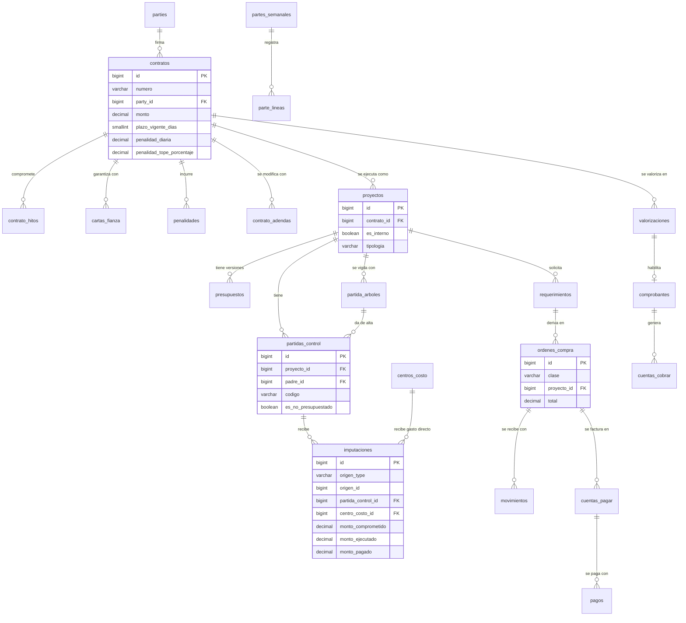
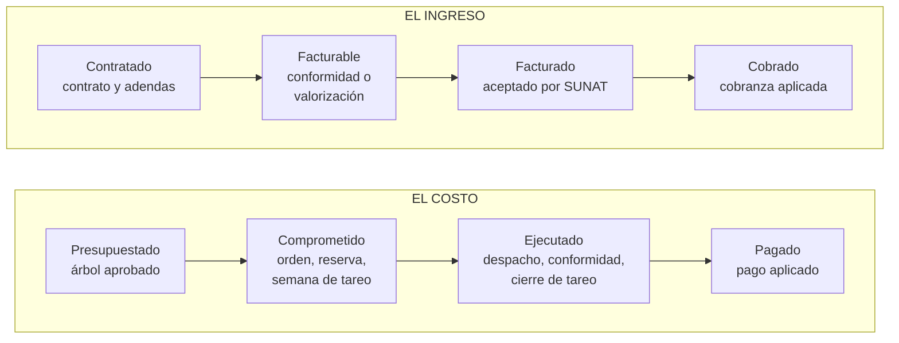

# El recorrido central del sistema

**Techquk S.A.C.** · Del contrato al margen real del proyecto · **Versión 2.0 (alineada con la especificación v4, 21 set 2026)**

> **Qué cambió respecto de la versión de agosto.** Antes, todo el costo iba a una sola tabla (`proyecto_costos`) con la partida como texto libre. Ahora **el proyecto es el eje** y **todo costo termina en una partida de control o en el gasto directo con su centro de costo** (el *selector de imputación*). Eso es lo que permite comparar presupuestado contra real sin armar una hoja de cálculo.

---

## Qué muestra este documento

`[V]` El camino de un negocio desde que se gana hasta que se sabe cuánto se ganó. Es el recorrido que responde la pregunta que originó todo el programa: **¿cuánto se gana realmente en cada proyecto?**

No hace falta saber de bases de datos para seguirlo: cada caja es una ficha y cada línea dice cuál nace de cuál.

---

## El diagrama

---

## Los dos caminos que recorre cualquier proyecto

`[V]` **El margen real** de un proyecto es lo cobrable menos lo ejecutado. **La caja** es lo cobrado menos lo pagado. Son preguntas distintas y el sistema responde las dos. Pagado es una medida de caja, no de costo.

---

## El recorrido, paso a paso

### 1 · Todo empieza con alguien
`parties` guarda personas y organizaciones en una sola lista; el papel de cada una (cliente, proveedor, trabajador, banco) se registra aparte. `[S]` Una empresa puede ser cliente en un proyecto y proveedor en otro.

### 2 · Se gana y nace un contrato
Cuando el CRM marca una oportunidad como ganada, **genera el contrato** con cliente, monto y condiciones de la cotización aceptada. Administración de Contratos completa lo que falta: número del contrato, fecha de firma, plazo, hitos, forma de pago y fórmula de penalidad. Al activarlo se programan las alertas de hitos.

De él cuelgan tres cosas: `contrato_hitos` (qué se entrega y cuándo), `cartas_fianza` (la garantía **con su costo y sus renovaciones**) y `penalidades`.

`[V]` **La penalidad diaria no se escribe, se calcula:** `coeficiente × monto ÷ (F × plazo)`. Con el caso de ejemplo (S/ 24,715.10 a 30 días, F = 0.40) da **S/ 205.96 por día**, con tope de S/ 2,471.51 (10 %). `POR VALIDAR` los factores contra el reglamento vigente de la Ley 32069.

### 3 · El contrato se ejecuta como proyecto
`proyectos` es la ficha de ejecución. **Un contrato puede tener varios proyectos** (un frente de hardware y otro de software), pero **un proyecto siempre tiene contrato**, salvo los internos (`es_interno`).

### 4 · Presupuesto y árbol de partidas
El presupuesto (con análisis de precios unitarios) se armó antes de ofertar. Al ganar **no se copia**: el mismo presupuesto pasa al proyecto, queda congelado como versión aprobada y de él sale el **árbol de partidas de control**.

| Concepto del caso Plaza de Armas | Monto (S/) |
|---|---:|
| Costo directo | 17,750.00 |
| Gastos generales 10 % | 1,775.00 |
| **Costo presupuestado (suma del árbol)** | **19,525.00** |
| Utilidad 8 % | 1,420.00 |
| IGV 18 % | 3,770.10 |
| **Total del contrato** | **24,715.10** |

`[V]` **Regla fija:** la suma de las hojas del árbol debe ser igual al costo presupuestado, o no se aprueba. Al aprobarlo, el sistema crea la partida **PC-99 (no presupuestados)**, que empieza en cero y nadie puede borrar, y el proyecto pasa a «en ejecución».

### 5 · El proyecto necesita cosas
`requerimientos`: cada línea declara **tipo de compra** (uno de doce, configurables) y **a qué partida va**. El sistema revisa stock en el momento: lo que hay en almacén se atiende con un despacho, no con una compra.

### 6 · Órdenes de compra o de servicio
Al aprobar una orden, su monto queda **comprometido** en la partida. Si la línea excede el saldo de su partida, el aprobador debe registrar el motivo: nadie autoriza un sobrecosto sin saberlo. `es_importacion` activa embarque, gastos y prorrateo.

### 7 · Llega la mercadería o se da conformidad
La recepción confirmada **sube el stock** (almacén central) o **ejecuta el costo en la partida** (almacén de obra). El despacho a obra baja el stock y **ejecuta el costo al valor del almacén**. Anular revierte los efectos de la última transición.

### 8 · Llega la factura del proveedor
Se sube su **XML**, se valida ante SUNAT y se hace el **cruce de tres vías** (orden, recepción o conformidad, factura). Si no coincide queda retenida; si coincide aparece como tarjeta en el tablero de pagos. Al aplicar el pago, el costo queda **pagado**.

### 9 · Las horas de la gente
`partes_semanales` y `parte_lineas`: horas por día y por imputación, con el costo hora de la categoría vigente. Al **cerrar la semana** el costo queda comprometido y ejecutado en cada partida; la semana ya no se edita. No se tarea en obra a quien no tiene SCTR vigente para el proyecto ni habilitación de campo.

### 10 · Y todo converge en `imputaciones`
Cada línea de costo, venga de donde venga, tiene **exactamente un destino**:

| Origen | Qué representa |
|---|---|
| Líneas de órdenes de compra y de servicio | Lo comprometido con terceros |
| Despachos de almacén | Materiales a obra |
| Partes de horas | El tiempo de las personas |
| Rendiciones de viáticos | Gastos de campo |
| Gastos de importación prorrateados | Flete, seguro y derechos por ítem |
| Valorizaciones de subcontratos | Avance de terceros |
| Servicios con vigencia | SCTR, pólizas, alquileres |

`[V]` **La advertencia de S10 sigue vigente:** allá trece de dieciséis fuentes de costo estaban vacías. Una estructura de costos solo vale si todos los orígenes la alimentan. Por eso `imputaciones` no admite líneas sin destino.

### 11 · Conformidad, factura y cobro
La conformidad (o la valorización aprobada) **habilita facturar**. Se emite en el facturador de siempre y se **sube el XML**; el sistema propone a qué hito corresponde y la persona confirma. Al aplicar la cobranza baja la cuenta por cobrar. Retención y detracción se registran aparte.

### 12 · Cierre
Se revisa presupuesto contra real, se verifica que no quede nada abierto (órdenes, tareo, valorizaciones), se calcula el margen real y se devuelven las garantías. En contratos de obra, la **liquidación** debe consentirse primero.

---

## Las preguntas que este recorrido responde

| Comparación | Qué responde |
|---|---|
| Presupuestado contra comprometido y ejecutado | Dónde se gastó de más, antes de que ocurra |
| Contratado contra facturado | Cuánto falta cobrar del contrato |
| Facturado contra cobrado | Cuánto está en la calle |
| Días restantes por hito y penalidad diaria | Cuánto costaría atrasarse |
| Cobrado contra pagado | La caja, semana a semana |

---

## Lo que este diagrama no muestra

Quedan fuera: el lado comercial anterior al contrato (cuentas, oportunidades, cotizaciones, licitaciones), la postventa (tickets, garantías de equipos, suscripciones), la planilla y los asientos contables, y los mecanismos transversales (permisos, aprobaciones, estados, auditoría, alertas, IA). Están en los documentos 06 §17 y 09-B.

*`[V]` verificado en la especificación v4 · `[S]` decisión de diseño · `POR VALIDAR` pendiente con el personal.*
